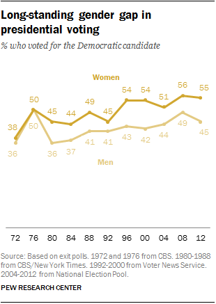
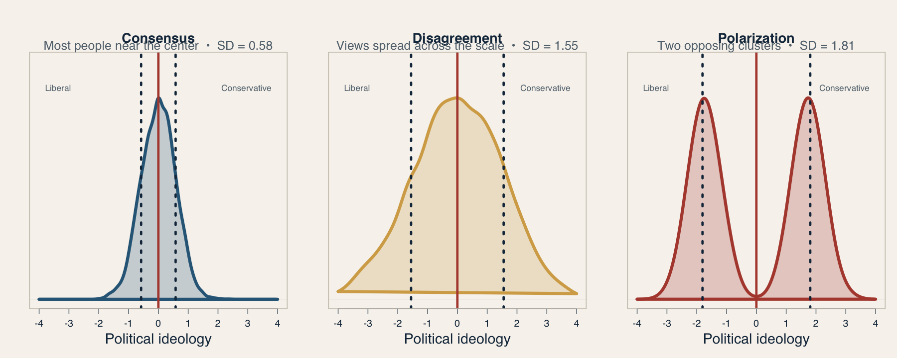
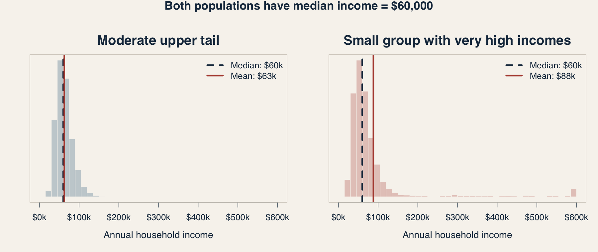
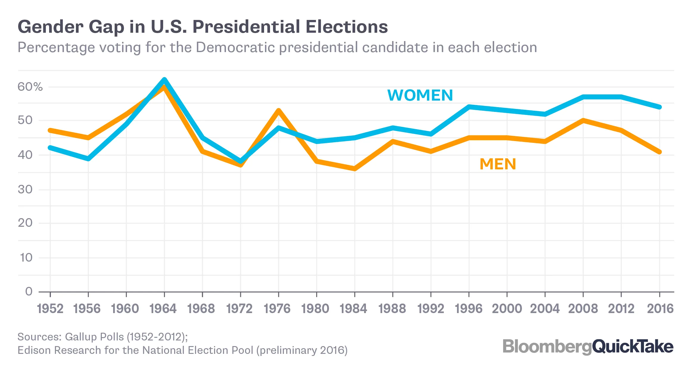
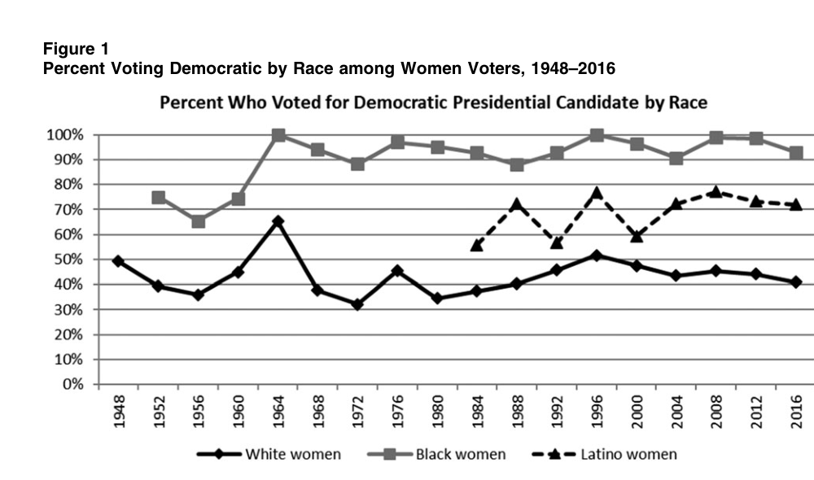
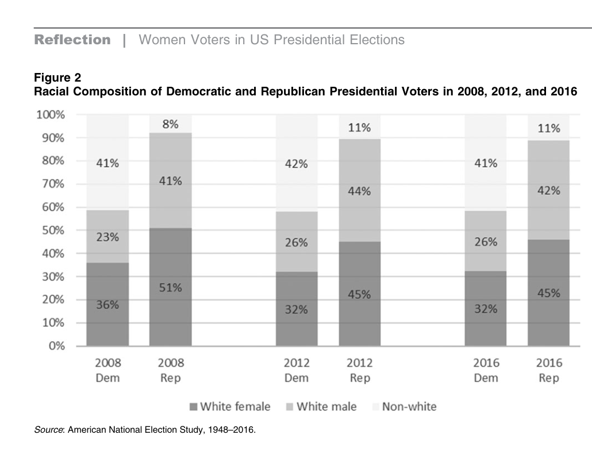
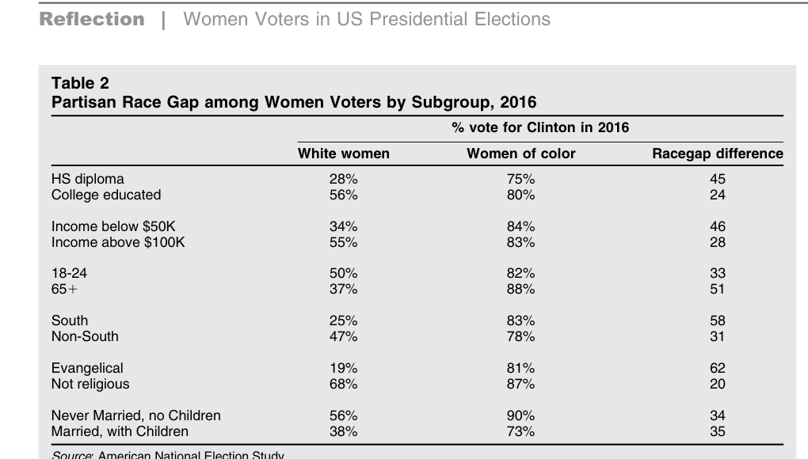
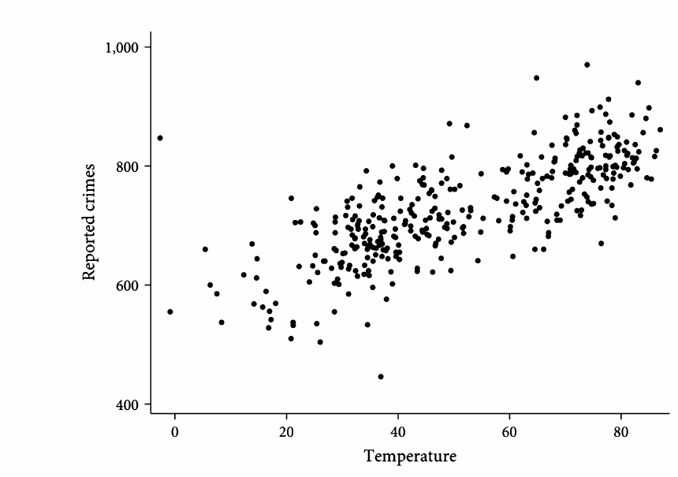
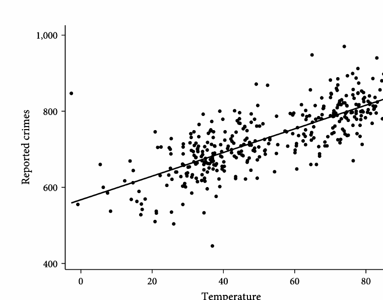

## Week 7 recap: concepts, measures, and claims {.section-title}

> Description is an argument about what the evidence represents.

::: notes
Use this opening to recover the part of Week 7 that students completed before moving into the unfinished material.

The central Week 7 sequence was concept, operationalization, and descriptive claim. We began with an abstract concept such as ideological media bias. We then asked what observable evidence could represent that concept. Finally, we asked what kind of descriptive conclusion the resulting measure could support.

Kim, Lelkes, and McCrain operationalized ideological visibility using campaign-finance scores attached to the people appearing on cable-news programs. That measure captures which ideological positions become visible through guest selection. It does not directly measure tone, issue framing, factual accuracy, audience effects, or the ideology of every statement in a program.

The broader lesson was that validity depends on the match between the concept, the measure, and the claim. A technically sophisticated measure can still support an overbroad claim if the analyst forgets which feature of the concept it captures.
:::

## Three forms of descriptive claim

:::::: triad
::: triad-item
**Indicator**

How much of a feature does a case or population display?
:::

::: triad-item
**Typology**

How do cases fall into substantively meaningful categories?
:::

::: triad-item
**Association**

How do two or more measured features vary together?
:::
::::::

::: {.fragment .key-line}
The form of the claim determines what the descriptive evidence must preserve.
:::

::: notes
Source: the Week 7 discussion of Gerring's forms of descriptive argument.

An indicator locates a case or population on a dimension. Examples include a program's ideological-visibility score or the proportion of stories containing a conflict frame.

A typology sorts cases using one or more dimensions. Examples include fact-check verdict categories or a matrix crossing partisan bias with misinformation.

An association describes patterned covariation. Examples include ideological scores changing across channels and time or network ties clustering into communities.

These forms can build on one another. Researchers may construct indicators, use them to define a typology, and then study associations between those classifications and other variables. The key is to state which claim the current analysis supports.
:::

## From claim form to descriptive tools

::::: two-column
::: column
### Gerring supplies the argument

Indicator, typology, or association

What kind of conclusion should the evidence support?
:::

::: column
### Huntington-Klein supplies the tools

Counts, distributions, transformations, centers, and spreads

Which feature of the data must the summary preserve?
:::
:::::

::: {.fragment .key-line}
Choose the claim before choosing the statistic or graph.
:::

::: notes
This is the Week 7 slide we did not reach. It connects Gerring's account of descriptive arguments to Huntington-Klein's practical tools.

The claim determines what must remain visible in the data. A prevalence claim may require a count or proportion. A typology requires category definitions and cell counts. A trend requires an ordered time axis. An association requires the joint distribution of at least two variables. A mean alone cannot support every kind of descriptive argument.

This ordering also prevents software from choosing the question. We do not begin with a convenient command and then invent an interpretation. We begin by naming the quantity or pattern we want to describe, then select a summary that preserves it.
:::

## Describing a categorical indicator

::: notes
Semetko and Valkenburg (2000) use a deductive approach. Coders answer 20 yes-or-no questions. The authors use factor analysis to assess whether the items cluster into the five expected frames, then average the retained items within each scale. This is a useful correction to treating each story as if it has one dominant frame. Frames can coexist, and each scale ranges from 0 to 1.

Their sample includes 2,601 newspaper stories and 1,522 television stories surrounding the 1997 Amsterdam meetings. Responsibility appears most often, followed by conflict, economic consequences, human interest, and morality. Outlet type and topic structure the distribution.

Ask: Is each frame an indicator, a typology, or both? The frame scale is an indicator. Treating stories as belonging to one exclusive frame would create a typology and would require different coding rules.

Source: Semetko and Valkenburg (2000), pp. 93–109, especially the abstract, pp. 94–96, 100–102, and Table 3.
:::

## Describing a quantitative indicator

For weekly visibility scores, inspect:

:::::: triad
::: triad-item
**Shape**

Symmetric, skewed, multimodal, bounded?
:::

::: triad-item
**Center**

Mean, median, mode, or a substantive reference point?
:::

::: triad-item
**Spread**

Range, IQR, standard deviation, or quantiles?
:::
::::::

::: {.fragment .key-line}
Never choose a summary before looking at the distribution.
:::

::: notes
Huntington-Klein emphasizes histograms and density plots for quantitative variables. A mean can conceal polarization or multiple modes. A median resists extreme weeks but may hide meaningful tails. Standard deviation has a clear interpretation only in relation to the variable and shape.
:::

## The mean

Seven ideology scores, ordered from liberal to conservative:

::: score-row
**−3  −1  −1  0  1  1  3**
:::

$$
\bar{x}=\frac{1}{n}\sum_{i=1}^{n}x_i
=\frac{-3-1-1+0+1+1+3}{7}=0
$$

::: key-line
The mean is the balance point of all observed scores.
:::

::: notes
Read the equation from left to right. The bar over x denotes the sample mean. The summation symbol means “add every observed score.” Divide that sum by n, the number of observations.

The mean uses every value. It acts like the balance point of the distribution and moves when extreme observations move. In this example the negative and positive ideology scores cancel, producing a mean of zero.

Ask whether mean zero implies that most people are centrists. It does not. The distribution could concentrate at zero, spread evenly across the scale, or split into liberal and conservative groups.
:::

## The median and mode

For ordered values $x_{(1)}\leq x_{(2)}\leq\cdots\leq x_{(n)}$:

::::: {.two-column .contrast}
::: column
### Median

$$
\tilde{x}=\begin{cases}
x_{((n+1)/2)}, & n\text{ odd}\\
\dfrac{x_{(n/2)}+x_{(n/2+1)}}{2}, & n\text{ even}
\end{cases}
$$

Here: $\tilde{x}=x_{(4)}=0$
:::

::: column
### Mode

$$
\operatorname{mode}(x)=
\underset{v}{\arg\max}\;\#\{i:x_i=v\}
$$

Here: modes = **−1 and +1**
:::
:::::

::: notes
Parentheses in the subscripts indicate positions after sorting, not raw observation numbers.

To find the median, order the observations and locate the middle one. With an even number of observations, average the two middle values. The median depends on rank, so an extreme score can become even more extreme without changing the median.

The mode equation says: among all possible values v, choose the value or values with the largest count. The arg max notation means “the value that makes this quantity largest.” This example has two modes, −1 and +1, so it is bimodal. With continuous variables, the exact mode may depend on how values are rounded or how a histogram is binned.

Discussion prompt: All three summaries point to zero or symmetry here, but does this small group contain a widely shared centrist position? No. The modes suggest two common positions away from the center.
:::

## Variance and standard deviation

Mean ideology = 0, so each deviation equals the original score:

| Score              |  −3 |  −1 |  −1 |   0 |   1 |   1 |   3 |
|--------------------|----:|----:|----:|----:|----:|----:|----:|
| Distance from mean |  −3 |  −1 |  −1 |   0 |   1 |   1 |   3 |
| Squared distance   |   9 |   1 |   1 |   0 |   1 |   1 |   9 |

::::: {.two-column .contrast}
::: column
### Variance

$$
\sigma^2=\frac{1}{N}\sum_{i=1}^{N}(x_i-\mu)^2
=\frac{22}{7}=3.14
$$

Average squared distance from the mean.
:::

::: column
### Standard deviation

$$
\sigma=\sqrt{\sigma^2}=\sqrt{3.14}=1.77
$$

Typical distance from the mean, expressed in the original units.
:::
:::::

::: notes
Variance starts by calculating each observation's deviation from the mean. Positive and negative deviations would cancel, so we square them. Average those squared deviations to obtain the population variance. Variance is useful mathematically, but its squared units are difficult to interpret.

Standard deviation takes the square root of variance. It returns to the original ideology scale. A standard deviation of 1.77 means that scores typically sit about 1.77 ideology points from the mean, though “typical distance” is an intuition rather than the exact average absolute distance.

This slide treats the seven scores as the full population and divides by N = 7. If they are a sample used to estimate population variance, divide by N − 1 = 6. The sample variance would be 3.67 and the sample standard deviation would be 1.91.

Squaring gives unusual observations extra influence. The two scores at −3 and +3 contribute 18 of the 22 total squared-distance units.
:::

## Population and sample formulas {.compact-formulas}

::::: {.two-column .contrast}
::: column
### Full population

$$
\mu=\frac{1}{N}\sum_{i=1}^{N}x_i
$$

$$
\sigma^2=\frac{1}{N}\sum_{i=1}^{N}(x_i-\mu)^2
\qquad \sigma=\sqrt{\sigma^2}
$$
:::

::: column
### Sample estimating a population

$$
\bar{x}=\frac{1}{n}\sum_{i=1}^{n}x_i
$$

$$
s^2=\frac{1}{n-1}\sum_{i=1}^{n}(x_i-\bar{x})^2
\qquad s=\sqrt{s^2}
$$
:::
:::::

::: notes
Use Greek letters for population quantities and Latin letters for sample statistics. N denotes the population size and n denotes the sample size.

When the observed cases constitute the entire population of interest, divide the squared deviations by N. When using a sample to estimate population variance, divide by n − 1. Estimating the sample mean uses one degree of freedom, and dividing by n − 1 makes sample variance unbiased under standard random-sampling assumptions.

For the seven ideology scores, the population variance is 22/7 = 3.14 and population SD is 1.77. Treated as a sample, the variance is 22/6 = 3.67 and the sample SD is 1.91.
:::

## What does “within one or two SDs” mean?

{fig-alt="Normal distribution showing that about 68 percent of observations lie within one standard deviation of the mean, 95 percent within two, and 99.7 percent within three"}

$$
P(\mu-\sigma\leq X\leq\mu+\sigma)\approx .68
\qquad
P(\mu-2\sigma\leq X\leq\mu+2\sigma)\approx .95
$$

::: key-line
The **68–95–99.7 rule** applies when the population is approximately normal.
:::

::: notes
For an approximately normal, bell-shaped distribution, about 68% of the population lies between one standard deviation below and one standard deviation above the mean. About 95% lies within two standard deviations, and about 99.7% lies within three.

The percentages are cumulative. The 95% within two SDs includes the 68% already within one SD. Therefore, about 27% lies between one and two standard deviations from the mean—roughly 13.5% on each side. About 5% lies beyond two standard deviations—roughly 2.5% in each tail.

Use an ideology example with mean 0 and SD 1. If ideology were approximately normal, about 68% of people would score between −1 and +1, about 95% between −2 and +2, and about 99.7% between −3 and +3.

Emphasize the qualification. These percentages do not follow from the definition of standard deviation and do not hold for every distribution. A skewed, heavy-tailed, or polarized distribution may place very different percentages inside the same boundaries. In the seven-score worked example, 5 of 7 observations—or 71.4%—lie within one population SD; the sample is not a normal population.
:::

## The same mean can describe different politics

{fig-alt="Three simulated political ideology distributions with mean zero but different shapes and standard deviations; solid vertical lines show the mean and dotted lines show one standard deviation below and above the mean"}

::: notes
These simulated populations all have mean ideology zero. The left panel supports a story of consensus around the center. The middle panel supports a story of widespread disagreement. The right panel supports a story of polarization into opposing camps. Reporting only the mean would make all three populations sound centrist.

The solid vertical line marks the shared mean of zero. The dotted vertical lines mark one standard deviation below and above the mean. The SD is printed above each panel. The wider disagreement and polarized distributions have much larger SDs than the consensus distribution.

Ask students which features separate the stories. Relevant answers include variance, density near the midpoint, number of modes, distance between modes, and the relative size of each cluster. Then ask which single statistic, if any, captures polarization.

The same problem applies to outlet scores. An average near zero could mean consistently moderate guests, a mixture of liberal and conservative guests, or movement between extremes over time.

Illustrative simulated data. All three series were centered to mean zero.
:::

## The same median can describe different inequality

{fig-alt="Two simulated household-income distributions with the same median of sixty thousand dollars but different upper tails and means"}

::: notes
Both simulated populations have a median household income of \$60,000. In the first, the mean is about \$63,000 because the upper tail is modest. In the second, a small group with very high incomes raises the mean to about \$88,000 while leaving the median unchanged.

The median supports the claim that the typical household occupies the same position in both populations. The mean supports the claim that total income per household is higher in the second. The full distribution supports a third claim: the second population has much greater upper-tail inequality. None of these descriptions is false, but each answers a different question.

Ask which summary a policymaker might choose when discussing living standards, the tax base, or inequality. Then ask how an advocate could produce a technically accurate but substantively misleading comparison by selecting only one statistic.

Illustrative simulated data. Each distribution was rescaled to a median of \$60,000.
:::

## Match the tool to the descriptive target

| Target | Preserve | Useful displays or summaries |
|--------|----------|------------------------------|
| Categorical indicator | category frequencies | counts, proportions, bar chart |
| Quantitative indicator | distributional shape | histogram, quantiles, center and spread |
| Typology | membership across categories | cell counts, percentages, cross-tabulation |
| Association | joint variation | crosstab, scatterplot, covariance, correlation |

::: {.fragment .key-line}
Week 6 develops the final row: what associations show and how we summarize them.
:::

::: notes
This slide consolidates the Week 7 descriptive-tools material so that Week 6 does not need to repeat the full sequence on means, medians, modes, variance, and standard deviation.

For a categorical indicator, ask how many observations occupy each category and what proportion of the relevant population they represent. For a quantitative indicator, inspect the distribution before choosing a center or spread. A mean can conceal skew, multiple modes, or polarization.

For a typology, show how cases populate the cells. Sparse or empty cells may reveal that a theoretically possible type rarely appears in practice.

For an association, preserve paired or joint information. Separate summaries of X and Y cannot show whether high values of X occur with high or low values of Y. This last point leads directly into today's emphasis on comparisons, crosstabs, covariance, and the correlation coefficient.
:::

## Questions for today {.section-title}

1.  What can an **association** show us?
2.  How do comparison and variation determine the association we see?
3.  How do covariance and the correlation coefficient summarize a linear pattern?
4.  What quantity did we actually mean to estimate?

::: notes
Open by separating usefulness from causality. Associations can reorganize an empirical question even when they do not identify a causal effect. The readings move from an empirical demonstration to formal tools and then to a framework for matching evidence to a target.

Use “association” as the broad term throughout the class. Reserve “correlation coefficient” or r for the standardized numerical measure of linear association. TCD sometimes uses “correlation” more broadly to mean that two features of the world tend to occur together; flag that terminological choice when introducing the chapter.
:::

## Junn and Masuoka: the same electorate, reorganized {.section-title}

> A familiar association can conceal a more consequential one.

The paper changes the comparison before it changes the method.

::: notes
Source: Junn and Masuoka (2020), pp. 1135–1141. The piece is a Reflection, not a causal identification study. Its main intervention is descriptive and analytical: reorient the comparison from women versus men to variation among women by race.
:::

## The familiar gender gap

::: notes
Use this figure to establish the comparison that usually organizes discussion of gender and voting: women versus men. Ask students to identify the groups being compared, the outcome being summarized, and the implicit baseline.

Do not yet challenge the result. The point is that this can be a real and correctly measured descriptive difference while still directing attention away from larger variation within the category of women. The next slide changes the comparison from women versus men to racial groups among women.
:::

## A different comparison changes the pattern

{fig-alt="Line chart showing Democratic presidential vote by race among women from 1948 to 2016"}

::: source
Source: Junn and Masuoka (2020), Figure 1, ANES 1948–2016.
:::

::: notes
White women supported the Democratic presidential candidate in only two elections in the series, 1964 and 1996. Black women show consistently high Democratic support after 1964. Latina support is also mostly high, with greater sampling instability in early years. Asian American women are omitted from the figure because ANES samples are too small.
:::

## What changed?

:::::: comparison
::: side
**Standard frame**

Compare **women with men**.

The result is a gender gap.

Men become the baseline.
:::

::: versus
versus
:::

::: side
**Junn and Masuoka's frame**

Compare **women with women** by race.

The result is a much larger race gap.

Variation within the category becomes visible.
:::
::::::

::: notes
Source: Junn and Masuoka (2020), pp. 1136–1138. Their claim is not that the white gender gap disappears. They report a 5-to-6-point gap between white women and white men in recent elections. They argue that it is dwarfed by racial variation among women.

The broader implication is that a genuine association can support a misleading substantive story when researchers choose an unhelpful comparison or aggregate heterogeneous groups. Comparing women with men produces the real gender gap, but it encourages the overgeneralization that “women are Democrats.” Comparing women by race reveals that white women have usually supported Republican presidential candidates while women of color have strongly supported Democrats.

Emphasize five consequences. First, the category “women” conceals politically important heterogeneity. Second, the reference category determines which difference receives attention. Third, the aggregate gender gap partly reflects the changing racial composition of the female electorate rather than a general movement of women toward the Democratic Party. Fourth, intersectionality changes the empirical analysis itself, not only the language used to interpret results. Fifth, a descriptive study can make a major contribution without identifying a causal mechanism: it can reorganize a familiar pattern and change what scholars now need to explain.

The methodological question to leave with students is: before explaining a gap, which gap, between which groups, and in which population? That question anticipates the estimand framework later in the deck.
:::

## One dataset supports several associations

:::::: triad
::: triad-item
**Vote rate**

Within each racial group of women, what share votes Democratic?
:::

::: triad-item
**Party composition**

Within each party coalition, what share comes from each race and gender group?
:::

::: triad-item
**Subgroup comparison**

Within education, income, region, or religion groups, how large is the racial difference?
:::
::::::

::: {.fragment .key-line}
Each association uses a different denominator and answers a different question.
:::

::: notes
Use this slide to preview estimands. None of these quantities is simply “the race gap.” Each requires a population, variables, conditioning choices, and a denominator.

Before explaining the three boxes, ask: **“What is the denominator for each association?”** Give students a moment to work through all three.

- For **vote rate**, the denominator is all women in the specified racial group; the numerator is those who voted Democratic.
- For **party composition**, the denominator is everyone in the specified party coalition; the numerator is coalition members in a particular race-and-gender group.
- For the **subgroup comparison**, there are two denominators: all white women in the specified subgroup and all women of color in that subgroup. The association compares the Democratic-vote proportion calculated within each denominator.

After hearing their answers, emphasize that changing the denominator changes the conditional quantity and therefore the substantive question.

The first crosstab asks how vote choice varies across racial groups among women. The second reverses the conditioning direction and asks who makes up each party coalition. The subgroup table repeats the white-women versus women-of-color comparison separately within categories such as education, income, age, region, religion, and family status. These remain descriptive comparisons. They do not hold every other characteristic constant and do not identify a causal effect of race.
:::

## Party composition reverses the denominator

{fig-alt="Stacked bars showing the racial and gender composition of Democratic and Republican presidential voters in 2008, 2012, and 2016"}

::: source
Source: Junn and Masuoka (2020), Figure 2, ANES.
:::

::: notes
The earlier figure asks P(Democratic vote \| race among women). This one asks P(race and gender group \| party vote). Reversing a conditional probability changes the question. White women make up 45 percent of Republican voters in 2016 and 32 percent of Democratic voters. The figure makes coalition composition visible.
:::

## Conditional probabilities are directional

::::: two-column
::: column
### Vote within a group

$$P(\text{Democratic vote}\mid\text{white woman})$$

“How did white women vote?”
:::

::: column
### Group within a coalition

$$P(\text{white woman}\mid\text{Republican vote})$$

“Who made up the Republican coalition?”
:::
:::::

::: {.fragment .key-line}
The two quantities use the same joint data, but they are not interchangeable.
:::

::: notes
Connect to TCD's reminder that a slope also changes when X and Y switch axes. Direction matters for conditional summaries even when the underlying joint distribution stays the same.
:::

## Associations across subgroups

{fig-alt="Table comparing Clinton vote share among white women and women of color across demographic subgroups in 2016"}

::: notes
Source: Junn and Masuoka (2020), Table 2, p. 1140. Invite students to pick one row and state the association precisely. Examples: among evangelicals, Clinton support was 19 percent among white women and 81 percent among women of color, a 62-point difference. Among nonreligious women, the difference was 20 points. These are raw subgroup comparisons, not interaction coefficients with uncertainty estimates.
:::

## Different conditioning choices reveal different gaps

| Comparison in 2016 | White women | Women of color | Difference |
|--------------------|------------:|---------------:|-----------:|
| Evangelical        |         19% |            81% |  62 points |
| South              |         25% |            83% |  58 points |
| College educated   |         56% |            80% |  24 points |
| Not religious      |         68% |            87% |  20 points |

::: {.fragment .key-line}
The race association persists, but its magnitude varies across the groups we condition on.
:::

::: notes
Source: Junn and Masuoka (2020), Table 2. This is a useful place to discuss effect modification versus descriptive subgroup variation. The table does not prove that religion or region causes the race gap to change.
:::

## An estimand preview

Which quantity best expresses the central descriptive target?

:::::: claim-stack
::: claim
The gender difference in Democratic vote share among all voters
:::

::: claim
The racial difference in Democratic vote share among women voters
:::

::: claim
The racial difference among women within a specified subgroup, such as region or religion
:::
::::::

::: {.fragment .key-line}
All three are legitimate. They are different targets.
:::

::: notes
Ask students which target best matches the paper's title and theoretical intervention. Hold the term “estimand” lightly here. Lundberg et al. will give it precision later.
:::

## Association and correlation

::::: two-column
::: column
### Association

The broad idea that the distribution of one variable differs across values of another.

It includes crosstabs, differences in proportions, subgroup patterns, and nonlinear relationships.
:::

::: column
### Correlation coefficient

A specific standardized measure of **linear association**.

Pearson's $r$ is unitless and ranges from −1 to 1.
:::
:::::

::: {.fragment .key-line}
Association is the general relationship. Covariance, $r$, and a regression slope are numerical summaries of linear association.
:::

::: notes
Use Junn and Masuoka as the immediate example. Their percentage differences and crosstabs establish associations between race and vote choice. It would be incorrect to call each percentage-point gap a correlation coefficient.

TCD initially uses “correlation” in a broad conceptual sense for the extent to which two features tend to occur together. In this class, use “association” for that broad concept and say “correlation coefficient” or “Pearson's r” when referring to the standardized statistic. This is a clarification of vocabulary, not a substantive disagreement with TCD.
:::

## TCD chapter 2: what association means {.section-title}

> A correlation describes the extent to which two features of the world tend to occur together.

It requires a comparison across values of both variables.

::: notes
Source: Bueno de Mesquita and Fowler, Thinking Clearly with Data, chapter 2, pp. 13–19.

This quotation shows TCD's broad use of “correlation.” Translate it for the class as a definition of association. Later in the chapter, TCD introduces the correlation coefficient as one particular statistic for measuring linear association.
:::

## Binary variables: Is oil associated with an autocracy?

|                          | Democracy | Autocracy | Total |
|--------------------------|----------:|----------:|------:|
| Not a major oil producer |       118 |        29 |   147 |
| Major oil producer       |         9 |        11 |    20 |

::: notes
Source: TCD chapter 2, Table 2.1, pp. 14–15. Begin with the counts only. Ask students whether the raw table is enough to see the association and which conditional percentages would make the comparison easiest.

The relevant comparison holds oil-production status as the grouping variable and calculates the proportion of autocracies within each row. The next slide performs that calculation. This staged repetition lets students choose the denominator before seeing the answer.
:::

## Binary variables: Is oil associated with an autocracy?

|                          | Democracy | Autocracy | Total |
|--------------------------|----------:|----------:|------:|
| Not a major oil producer |       118 |        29 |   147 |
| Major oil producer       |         9 |        11 |    20 |

::::: two-column
::: column
$$P(\text{autocracy}\mid\text{oil})=11/20=55\%$$
:::

::: column
$$P(\text{autocracy}\mid\text{no oil})=29/147\approx20\%$$
:::
:::::

::: {.fragment .key-line}
Major oil producers are more often autocracies in these data.
:::

::: notes
Source: TCD chapter 2, Table 2.1, pp. 14–15. This describes a positive association. It may help description or prediction. It does not by itself show that oil causes autocracy.
:::

## Continuous variables: crime and temperature

{fig-alt="Scatterplot of reported crime and temperature in Chicago across days in 2018"}

::: notes
Source: TCD chapter 2, Figure 2.1, p. 15. Each observation is a day. The variables are average temperature at Midway Airport and reported crimes in Chicago. Ask students what features they see before adding a line.
:::

## A line summarizes the association

:::::: {.two-column .wide-left}
::: column
{fig-alt="Scatterplot of reported crime and temperature in Chicago with an upward-sloping OLS regression line"}
:::

:::: column
The fitted OLS line has a positive slope:

::: formula
$\widehat{\text{crimes}}=\widehat\alpha+3.1(\text{temperature})$
:::

On average, one additional degree Fahrenheit corresponds to **3.1 additional reported crimes**.
::::
::::::

::: {.fragment .key-line}
The slope describes the joint pattern in substantive units.
:::

::: notes
Source: TCD chapter 2, Figure 2.2, p. 16. The book later makes the OLS definition precise as the line minimizing the sum of squared errors.

Compare this figure directly with Figure 2.1 on the preceding slide. The points have not changed. Figure 2.2 adds a single line that summarizes their linear tendency. The book reports the slope, 3.1, but does not report a numerical intercept, so the equation leaves the fitted intercept as $\widehat\alpha$.
:::

## Practice: read the equation, state the claim

Each equation below predicts one variable from another. For each one: read it aloud, then state in one plain-language sentence what it claims about the world — not just "positive" or "negative," but what substantively happens as X increases.

:::::: triad
::: triad-item
**Positive**

$$\widehat{\text{Turnout}_i} = 38 + 0.6\,\text{Age}_i$$
:::

::: triad-item
**Negative**

$$\widehat{\text{TrustInGovt}_i} = 64 - 3.1\,\text{PerceivedCorruption}_i$$
:::

::: triad-item
**Zero**

$$\widehat{\text{VoteChoice}_i} = .52 + 0\,\text{ShoeSize}_i$$
:::
::::::

::: {.fragment .key-line}
A slope of zero does not mean "no relationship exists." It means this particular straight line predicts no change in Y as X increases.
:::

::: notes
Give students a moment to translate each equation silently before discussing as a group.

Equation 1 (positive): predicted turnout rises by 0.6 percentage points for each additional year of age, starting from a baseline of 38% among the youngest respondents in the sample. This is the same age/turnout slope introduced earlier in TCD chapter 2.

Equation 2 (negative): predicted trust in government (0–100 scale) falls by 3.1 points for each one-point increase in perceived corruption (0–10 scale), starting from a baseline of 64 among respondents who perceive no corruption at all.

Equation 3 (zero): the predicted probability of voting for the Democratic candidate stays at .52 regardless of shoe size. The coefficient on shoe size is exactly zero, so the fitted line is flat. The variable is deliberately absurd so students see clearly that a zero slope is an answer the model gives, not a modeling failure — shoe size simply does not linearly predict vote choice once nothing else is in the equation.

Push students to name what none of the three equations can tell them on its own: nothing about causation, nothing about whether a line is the right shape for the full range of X (compare the next slide), and nothing about statistical significance, which is not introduced until chapter 6.
:::

## The comparison behind an association

Each point pairs two measurements from the same day:

-   a temperature
-   a crime count

The scatterplot compares crime counts across different temperatures.

::: {.fragment .key-line}
Before choosing a statistic, ask whether the evidence contains a comparison.
:::

::: notes
Segue: Figure 2.2 makes an association visible and summarizes it with a line. Every point contributes a paired observation, so we can examine whether crime counts differ as temperature changes.

But analysts often present a percentage or a striking fact and then talk as if they have shown a relationship. A fact about one group or one outcome category may be informative, but it does not necessarily show that two variables vary together. The next exercise asks students to identify whether each statement contains the comparison needed for an association.
:::

## Fact or association?

Treat each statement as hypothetical. Which ones contain the comparison needed to establish an association?

1.  Seventy-three percent of viral political posts contain emotional language.
2.  Political posts containing emotional language are shared more often than posts without it.
3.  Most people who shared a false news story encountered it on a smartphone.
4.  Counties with fewer local newspapers tend to have lower municipal-election turnout.
5.  Sixty-eight percent of surveyed teenagers use TikTok every day.
6.  Debate viewers score higher on a political-knowledge quiz than nonviewers.

::: notes
These are original teaching examples. The numerical values are hypothetical. The exercise applies the logic in TCD chapter 2, pp. 17–19.

Answers: 2, 4, and 6 describe associations. Each compares one variable across values of another variable.

Statement 1 gives a fact about viral posts. We would need to compare emotional language in viral and nonviral posts, or compare virality for posts with and without emotional language.

Statement 3 gives a fact about people who shared false news. We would need to compare false-news sharing among smartphone and desktop users, for example.

Statement 5 reports the prevalence of one behavior. We would need a second varying feature, such as age, news exposure, or political knowledge.

Facts can still matter. The distinction is that a percentage for one selected group does not by itself show that two variables vary together. Reveal the answers through discussion rather than immediately.
:::

## Association requires two variables to vary

“Seventy-three percent of viral political posts contain emotional language” varies only **emotional language**. Every post in the statement is already viral.

“Posts containing emotional language are shared more often than posts without it” varies both:

-   **emotional language:** present or absent
-   **sharing:** more or less frequent

::: {.fragment .key-line}
An association asks whether variation in one variable corresponds to variation in another.
:::

::: notes
Use this slide to resolve the exercise. The first statement may contain many observations, but the wording fixes virality by selecting only viral posts. It therefore cannot tell us whether emotional language and virality vary together.

The second statement contains variation in both variables. Some posts contain emotional language and others do not. Sharing also varies, and the statement compares sharing across the two kinds of posts.

Segue to scandal and reelection: the claim that most scandal-plagued politicians win reelection gives us variation in reelection outcomes within the scandal group, but scandal status does not vary. The crosstab restores the second source of variation by adding politicians who did not face scandal.
:::

## Scandal and reelection

> “Most politicians facing a scandal win reelection.”

|            | Not reelected | Reelected | Reelection rate |
|------------|--------------:|----------:|----------------:|
| No scandal |           101 |     1,192 |             92% |
| Scandal    |             8 |        62 |             89% |

::: {.fragment .key-line}
Most scandal-plagued incumbents win, yet scandal and reelection are negatively associated.
:::

::: notes
Source: TCD chapter 2, Table 2.2, pp. 18–19. The high reelection rate among scandal cases sounds positive until compared with the even higher baseline for incumbents without scandals.
:::

## Three uses of association

:::::: triad
::: triad-item
**Description**

How do features of the observed world vary together?
:::

::: triad-item
**Forecasting**

What should we predict for a new case, place, or time?
:::

::: triad-item
**Causal inference**

What would change under an intervention?
:::
::::::

::: notes
Source: TCD chapter 2, pp. 19–24. Description requires an informative comparison. Forecasting requires transportability and some stability of the relationship. Causal inference requires additional assumptions because association alone does not identify an effect.
:::

## Junn and Masuoka use associations powerfully

::::: two-column
::: column
### Description

They replace a broad gender comparison with racial comparisons among women.

They also reverse the denominator to describe party coalitions.
:::

::: column
### Repeated crosstabs

They repeat the racial comparison within categories such as education, income, region, and religion.

The crosstabs reveal heterogeneity without identifying a causal mechanism.
:::
:::::

::: notes
Return explicitly to the user's requested theme: powerful associations. The paper changes scholarly attention and generates new questions through description alone.
:::

## From deviations to variance

For any observation $i$:

::: formula
deviation from the mean = $X_i - \mu_X$
:::

Variance averages the **squared deviations**:

$$\sigma_X^2=\frac{1}{N}\sum_{i=1}^{N}(X_i-\mu_X)^2$$

Standard deviation returns to the original units:

$$\sigma_X=\sqrt{\sigma_X^2}$$

::: notes
Source: TCD chapter 2, pp. 24–27. The book uses the January 2018 Chicago data: mean temperature 26.3°F, variance about 220.3, standard deviation about 14.8; mean crimes 655.6, variance 5,183, standard deviation 72.0.
:::

## Covariance, graphically

<iframe class="covariance-interactive" src="assets/covariance-interactive.html" title="Interactive covariance graphic">

</iframe>

::: notes
Source: TCD chapter 2, pp. 27–28. This interactive graph is a conceptual reconstruction of the covariance logic, not data from the book.

Start with point 5 selected. Its X and Y deviations are both positive, so the shaded rectangle represents a positive product. The rectangle's width is the X deviation, its height is the Y deviation, and its area corresponds to the magnitude of the product.

Drag the selected point across the horizontal mean line. Its deviations now have opposite signs, the rectangle changes color, and its contribution becomes negative. Then cross the vertical mean line as well: both deviations become negative and the product becomes positive again.

Select and move other points to show that covariance averages all of these signed products. The six point labels identify observations; they do not represent values.
:::

## Covariance averages the products

$$\operatorname{cov}(X,Y)=\frac{1}{N}\sum_{i=1}^{N}(X_i-\mu_X)(Y_i-\mu_Y)$$

::::: two-column
::: column
### Positive covariance

Above-average X usually accompanies above-average Y, and below accompanies below.
:::

::: column
### Negative covariance

Above-average X usually accompanies below-average Y, and vice versa.
:::
:::::

::: {.fragment .key-line}
Covariance turns the visual quadrant pattern into one signed number.
:::

::: notes
Source: TCD chapter 2, p. 28. Zero covariance means no linear association, not necessarily no relationship.
:::

## A four-point covariance example

| Observation |   X |   Y | $X_i-\bar X$ | $Y_i-\bar Y$ | Product |
|-------------|----:|----:|-------------:|-------------:|--------:|
| A           |   1 |   2 |         −1.5 |         −0.5 |     .75 |
| B           |   2 |   1 |         −0.5 |         −1.5 |     .75 |
| C           |   3 |   4 |           .5 |          1.5 |     .75 |
| D           |   4 |   3 |          1.5 |           .5 |     .75 |

$$\bar X=\bar Y=2.5 \qquad \operatorname{cov}(X,Y)=3/4=.75$$

::: notes
This original worked example uses the population denominator N to match TCD's presentation. Every product is positive because X and Y are on the same side of their means for every observation.
:::

## Why covariance needs standardization

Covariance changes when we change units.

::::: two-column
::: column
### Temperature in Fahrenheit

The deviations are measured in degrees Fahrenheit.

Covariance has units of **degrees × crimes**.
:::

::: column
### Temperature in Celsius

The underlying pattern is identical.

The numerical covariance changes because the temperature scale changes.
:::
:::::

::: {.fragment .key-line}
We need a unit-free version to compare linear strength across variables.
:::

::: notes
Source: TCD chapter 2, p. 28. The sign of covariance is interpretable, but its magnitude depends on scale and dispersion.
:::

## Standard deviation for each variable

::::: two-column
::: column
### Variable X

$$\sigma_X^2=\frac{1}{N}\sum_{i=1}^{N}(X_i-\mu_X)^2$$

$$\sigma_X=(\sigma_X^2)^{1/2}$$
:::

::: column
### Variable Y

$$\sigma_Y^2=\frac{1}{N}\sum_{i=1}^{N}(Y_i-\mu_Y)^2$$

$$\sigma_Y=(\sigma_Y^2)^{1/2}$$
:::
:::::

::: {.fragment .key-line}
Standard deviation is the square root of the average squared deviation.
:::

::: notes
Each variable has its own mean, variance, and standard deviation. The population formulas use $N$. A sample estimate commonly uses $N-1$ instead.
:::

## Deriving the correlation coefficient

Start with covariance:

$$\operatorname{cov}(X,Y)$$

Remove both scales from the covariance:

::: formula
$$r=\operatorname{corr}(X,Y)=\frac{\operatorname{cov}(X,Y)}{\underbrace{\sigma_X\times\sigma_Y}_{\text{the two standard deviations multiplied}}}$$
:::

The same calculation written with standardized scores is:

$$r=\frac{1}{N}\sum_{i=1}^{N}z_{Xi}z_{Yi}$$

::: notes
Source: TCD chapter 2, pp. 28–29. Yes, the denominator multiplies the standard deviation of X by the standard deviation of Y. It does not add them. The units therefore cancel: covariance has units of X times Y, while $\sigma_X\sigma_Y$ also has units of X times Y.

A z-score expresses a deviation in standard-deviation units. Standardization makes r unitless and bounds it between −1 and 1.
:::

## Correlation for the four points

For X and Y in the worked example:

$$\sigma_X^2=\sigma_Y^2=1.25 \qquad \sigma_X=\sigma_Y\approx1.118$$

$$r=\frac{.75}{1.118\times1.118}=\frac{.75}{1.25}=.60$$

::::: two-column
::: column
**Covariance .75** retains the original scales.
:::

::: column
**Correlation .60** expresses unit-free linear strength.
:::
:::::

::: notes
This original calculation follows the population formulas in TCD. Use it to show that the correlation coefficient does not appear from nowhere. It is scaled covariance.
:::

## Reading $r$

::: formula
$-1 \le r \le 1$
:::

|  Value | Linear pattern                              |
|-------:|---------------------------------------------|
|  $r=1$ | every point lies on an upward-sloping line  |
|  $r=0$ | no linear association                       |
| $r=-1$ | every point lies on a downward-sloping line |

::: {.fragment .key-line}
$r=0$ can coexist with a strong nonlinear relationship.
:::

::: notes
Source: TCD chapter 2, pp. 28–31. The correlation coefficient measures linear dependence. Always inspect the scatterplot.
:::

## Correlation and slope answer different questions

::::: two-column
::: column
### Correlation coefficient

How strong and in which direction is the **linear pattern**?

-   unitless
-   symmetric in X and Y
-   bounded between −1 and 1
:::

::: column
### Regression slope

How much does Y change, on average, for a **one-unit increase in X**?

-   retains substantive units
-   changes when X and Y switch roles
-   may be large or small on any scale
:::
:::::

::: notes
Source: TCD chapter 2, pp. 29–30. The formula for the slope of Y on X is cov(X,Y)/variance(X). For crime on temperature the slope is 3.1 crimes per degree. Reversing the axes gives .18 degrees per additional crime.
:::

## Zero correlation can hide nonlinear relationships

<iframe class="nonlinear-plots" src="assets/nonlinear-zero-correlation.html" title="Nonlinear relationships with correlations near zero">

</iframe>

::: {.fragment .key-line}
In every graph, Y depends strongly on X, but the upward and downward linear tendencies cancel.
:::

::: notes
Source: TCD chapter 2, Figures 2.5–2.7, pp. 30–32. These are original teaching graphs illustrating the book's warning that a correlation coefficient summarizes only linear association.

Read each plot from left to right. The U-shaped and inverted-U relationships are perfectly predictable functions of X, yet their correlations equal zero because X is symmetric around zero. The circle also has a strong geometric structure but no single upward or downward linear tendency.

Ask students what a fitted straight line would look like in each graph. It would be nearly horizontal. The book suggests inspecting the plot, fitting piecewise lines, or transforming X to $X^2$ when theory supports that shape.
:::

## TCD chapter 4: correlation requires variation {.section-title}

> If we observe only cases where the outcome occurred, we cannot estimate how a predictor varies with that outcome. This is called selection on the dependent variable.

::: notes
Source: TCD chapter 4, pp. 53–73. The core error is selecting on the dependent variable.

The section title preserves the chapter's language. In the vocabulary used in this lecture, the broader claim is that establishing an association requires variation in both variables. Chapter 4 is not limited to calculating Pearson's r.
:::

## The missing cells problem

|                   | Outcome absent | Outcome present |
|-------------------|---------------:|----------------:|
| Predictor absent  |              ? |               ? |
| Predictor present |              ? |  observed cases |

Studying only successes, disasters, dropouts, or attacks fills one column and leaves the comparison unanswered.

::: {.fragment .key-line}
You need all four cells for a correlation.
:::

::: notes
Use the 2×2 table as a recurring diagnostic through all examples in chapter 4.
:::

## A mysterious illness

In a town of 10,000 people, 500 residents developed the same illness.

All 500 sick residents had consumed the same beverage the day before hospitalization.

::: key-line
What should health officials investigate next?
:::

::: fragment
> The beverage was tap water.
:::

::: fragment
|                      | Sick | Not sick |  Total |
|----------------------|-----:|---------:|-------:|
| Drank the beverage   |  500 |    9,500 | 10,000 |
| Did not drink it     |    0 |        0 |      0 |
| Total                |  500 |    9,500 | 10,000 |
:::

::: {.fragment .key-line}
The apparent clue disappears: sick and healthy residents were equally exposed.
:::

::: notes
Source: TCD chapter 4, Tables 4.3 and 4.4, p. 59. The fictional example mirrors the logic of the 10,000-hour argument.

**Set up the mystery before revealing the table.** Say: “Imagine a town of 10,000 people. During one month, 500 residents develop the same symptoms and require hospitalization. Health officials interview all 500 sick residents, looking for something they have in common. They discover that every one of them consumed the same beverage, from the same source, on the day before hospitalization.”

Pause here. Ask: “How alarming does that sound? If you wanted to predict who becomes sick next, would you look for other people who drank the beverage?” The evidence initially feels compelling because 500 out of 500 cases share the exposure. We have a memorable fact about sick people, but we have not yet established an association.

**Reveal:** The beverage was tap water. Then add the 9,500 residents who did not become sick. Every one of them also drank it. The exposure rate is therefore 100% among the sick and 100% among the healthy. The apparent clue came from examining only the cases.

Write the two comparisons verbally if useful:

- Among sick residents, 100% drank the water.
- Among healthy residents, 100% drank the water.

**Punchline:** A characteristic can be universal among people with an outcome and still tell us nothing about who experiences that outcome. What matters is whether the characteristic varies across people and whether the outcome changes with it. Here, drinking status never varies, so the data cannot identify an association between drinking the beverage and illness.

Technical clarification: the difference in exposure prevalence between sick and healthy residents is zero percentage points. Pearson's correlation coefficient is undefined because the beverage variable has zero variance. Avoid saying that $r=0$.

Return to the 10,000-hour claim: learning that many exceptional performers practiced intensely is like learning that every sick resident drank water. We also need to know how often intense practice occurs among people who do not become exceptional performers.

The example mirrors TCD's critique of the 10,000-hour rule: learning that many exceptional performers practiced intensely is like learning that every sick resident drank water. We also need to know how often intense practice occurs among people who do not become exceptional performers.

Transition: the next example repeats this structure. Investigators begin with people who display a troubling outcome and search for a shared trait, while leaving the comparison group unexamined.
:::

## “Corrupting the youth”

Across decades, investigators linked troubling behavior to:

-   comic books
-   rock music
-   violent films and video games
-   social isolation or mental illness

They often studied only young people who committed violence.

::: {.fragment .key-line}
Prevalence among attackers cannot establish an association without prevalence among non-attackers.
:::

::: notes
Source: TCD chapter 4, pp. 59–62.

**Set up the recurring story.** Say: “Every generation seems to identify a new influence that is corrupting young people. The suspected influence changes, but the evidence often takes the same form.” In 1954, congressional testimony connected comic-book reading to theft, violence, and teenage pregnancy. In 1985, the Parents Music Resource Center argued that explicit rock lyrics encouraged suicide and violence. Later public discussions focused on violent films, video games, and social media.

The examples are emotionally powerful because they begin with a disturbing outcome and then identify something the young person had read, watched, heard, or experienced. A tragic case plus a familiar exposure can feel like a pattern.

**Ask students to identify the two variables.** The outcome variable is troubling or violent behavior. The proposed explanatory variable might be comic-book reading, exposure to violent media, social isolation, or mental illness. Then ask: “Which of those variables varies in the evidence we have heard so far?” Usually only the proposed exposure varies across the selected cases. Everyone under discussion has already been selected because the troubling outcome occurred.

The same issue appears in official investigations. A federal study of 37 school-violence incidents from 1974 through 2000 reported that many attackers had experienced bullying or major losses, had displayed concerning behavior, or had shown interest in violence through media. A later commission discussed social isolation among several school shooters. These observations may describe the attackers accurately. Description of the selected cases, however, does not establish that these traits distinguish attackers from other young people.

**Supply the missing comparison.** We need to know whether young people who become violent encounter violent media more often than young people who do not become violent. The same comparison is required for social isolation or mental illness. If a proposed risk factor is also common among nonviolent young people, its prevalence among attackers may tell us little about the association.

Write the needed contrast verbally:

- prevalence of the proposed exposure among violent young people
- prevalence of the same exposure among nonviolent young people

This is what TCD calls **selecting on the dependent variable**: choosing cases because they have the outcome and then looking backward for shared characteristics. Since the outcome has no variation in the selected sample, the sample cannot establish whether the characteristic and the outcome vary together.

**Punchline:** We are not yet debating whether rock music, video games, isolation, or mental illness causes violence. The evidence has not cleared the earlier hurdle of showing an association. A comparison is necessary before causal interpretation begins.

Be careful not to imply that these possible warning signs are useless for every purpose. Case histories may help investigators describe events or generate hypotheses. The narrower point is that case histories alone cannot tell us whether an exposure is associated with a higher probability of violence.

Transition: Pape's study of suicide attacks lets us express the same problem as a reversal of conditional probabilities.
:::

## Suicide attacks: Pape's pattern

Pape collected **188 suicide attacks** worldwide from 1980 through 2001.

| What his data show | Count | Percentage |
|--------------------|------:|-----------:|
| All terrorist attacks in the period | 4,155 | |
| Suicide attacks | 188 | 4.5% of all attacks |
| Occupation-motivated suicide attacks | 178 | 94.7% of suicide attacks |
| Other suicide attacks | 10 | 5.3% of suicide attacks |

::: {.fragment .key-line}
The striking 94.7% estimates $P(\text{occupation}\mid\text{suicide attack})$.
:::

::: notes
Sources: TCD chapter 4, pp. 63–65; Robert Pape, “The Strategic Logic of Suicide Terrorism,” *American Political Science Review* 97(3), 2003; Scott Ashworth, Joshua Clinton, Adam Meirowitz, and Kristopher Ramsay, “Design, Inference, and the Strategic Logic of Suicide Terrorism,” *American Political Science Review* 102(2), 2008.

**Set up Pape's claim.** In 2009, Pape testified during debate over a proposed increase of 40,000 U.S. troops in Afghanistan. He argued that suicide terrorism was primarily a response to foreign military occupation. His broader research collected what he described as the universe of suicide terrorist attacks worldwide from 1980 through 2001.

Pape identified 188 suicide attacks during a period containing 4,155 terrorist attacks in total. Following Pape's coding, Ashworth and colleagues report that 178 of the 188 suicide attacks were motivated by opposition to territorial occupation. That is 94.7%. Only 10 were not coded as occupation-motivated.

The pattern is genuinely striking. Afghanistan, Palestinian attacks against Israel, Hezbollah attacks against American, French, and Israeli targets in Lebanon, and the Tamil Tigers in Sri Lanka all seemed consistent with the occupation argument. Pape also observed that the secular Tamil Tigers carried out 75 of the 188 attacks, which challenged a simple religious-extremism explanation.

Pause before revealing the key line. Ask: “What probability does 178 divided by 188 estimate?” It estimates the probability that an observed suicide attack was occupation-motivated. It does not estimate the probability of a suicide attack when occupation occurs.

The methodological criticism does not require us to decide whether every case was correctly coded as an occupation. Grant Pape the 178 cases for the sake of argument. The denominator problem remains.
:::

## Suicide attacks: the missing denominator

Pape's cases fill only the **suicide attack** column:

| Conflict or attack context | Suicide attack | No suicide attack |
|----------------------------|---------------:|------------------:|
| Occupation                 |            178 |                 ? |
| No occupation              |             10 |                 ? |
| Total                      |            188 |             3,967 |

The proposed association requires:

::: {.formula .small}
$P(\text{suicide attack}\mid\text{occupation})$ versus $P(\text{suicide attack}\mid\text{no occupation})$
:::

::: {.fragment .key-line}
A broader country comparison found a difference of less than one percentage point.
:::

::: notes
The 3,967 figure is $4,155-188$. Pape's suicide-attack data do not divide those nonsuicide attacks into occupation and nonoccupation contexts, so the two question marks are the missing denominators.

**Walk through the reversal.** Pape's 178/188 calculation asks: “Given that a suicide attack occurred, how often was occupation present?” The association needed for prediction asks: “Given that occupation was present, how often did a suicide attack occur?” Those conditional probabilities reverse the conditioning event and can differ dramatically.

Use the tap-water analogy. Every sick resident drank water, but nearly every healthy resident did too. Likewise, even if nearly every suicide attack occurred in a context classified as occupation, there may have been many occupations or occupation-related conflicts without suicide attacks.

TCD gives several examples: British rule in Ireland and the Basque conflict produced long campaigns of resistance without suicide terrorism. The United States stationed troops in places including Germany, Japan, and South Korea without experiencing suicide attacks there. These cases belong in the missing upper-right cell.

TCD reports that a broader comparison of occupied and nonoccupied countries found a difference of less than one percentage point in the likelihood of experiencing suicide violence. Treat that figure as the chapter's summary of the comparison, not as a final adjudication of the substantive debate. Results depend on the unit of analysis, time period, and how occupation is coded.

**Punchline:** A nearly universal characteristic among observed cases can coexist with a very weak association in the broader population. Studying every case of the outcome does not solve selection on the outcome. A census of the dependent variable still lacks the comparison cases.

Transition: the next examples explain why professional routines and organizational postmortems repeatedly create this same selection problem.
:::

## Challenger: hindsight and the comparison set

After the explosion, investigators correctly identified O-ring failure in cold weather.

To evaluate the **decision process**, another comparison matters:

::::: two-column
::: column
How often did scientifically valid engineering concerns precede failed launches?
:::

::: column
How often did scientifically valid engineering concerns also precede successful launches?
:::
:::::

::: notes
Source: TCD chapter 4, pp. 67–69. The authors do not dispute the physics. They distinguish causal diagnosis of the mechanical failure from evaluating whether managers could identify a decisive warning before launch.
:::

## A practical diagnostic for every association

::: flow-list
**1. Name both variables.** What varies?

**2. State the comparison.** Which values are contrasted?

**3. Inspect the missing cells.** Were cases selected because Y occurred?

**4. Identify the use.** Description, forecasting, or causal inference?

**5. State the target population.** For whom or what should the pattern hold?
:::

::: notes
This checklist synthesizes TCD chapters 2 and 4 and prepares the transition to Lundberg et al.
:::

## Lundberg, Johnson, and Stewart: what is your estimand? {.section-title}

> An estimand is the quantity we want the analysis to learn about.

It can be a mean, percentage, difference, correlation, slope, prediction, or causal effect.

::: notes
Source: Lundberg, Johnson, and Stewart (2021), abstract and pp. 532–535. Their framework applies beyond causal inference. Any statistical analysis becomes clearer when the target quantity is defined before choosing a model or estimator.

Open with the plain-language distinction: the **estimand is what we want to know**; an **estimator is the rule we use to learn it from a sample**; an **estimate is the number the rule produces in this dataset**. For example, the Democratic vote share among white women in the 2016 electorate is an estimand. The weighted sample proportion is an estimator, and the reported percentage is the estimate.

Emphasize that an estimand is a quantity, not a topic. “Race and voting” is a topic. “The percentage-point difference in Democratic presidential voting between white women and Black women in the 2016 U.S. electorate” is a target quantity.

Ask students to diagnose three phrases: “the effect of media,” “the correlation in our sample,” and “the coefficient on exposure.” What information is still missing? Expected answers include the units, outcome, comparison, population, timing, and—if causal—the intervention or counterfactual contrast.

Lundberg and colleagues use the question “What is your estimand?” to force these choices into the open. Their audit of 32 quantitative articles in the 2018 volume of *ASR* found that they were completely certain about both the unit-specific quantity and target population in zero articles. The point is not that the studies lacked goals; it is that readers could not recover those goals unambiguously from the reported models.
:::

## The target should exist outside the model

“The coefficient on temperature in Model 4” defines a result inside one statistical procedure.

A stronger statement names the quantity of substantive interest:

::: {.formula .small}
The difference in mean daily reported crime between 40°F and 80°F days in Chicago in 2018
:::

::: {.fragment .key-line}
Once the target is clear, several estimation strategies may be available.
:::

::: notes
Source: Lundberg et al. (2021), pp. 532–534. Their objection is not to regression itself. It is to letting a regression coefficient substitute for the substantive research target.

Explain why “the coefficient on temperature in Model 4” is not a target stated outside the model. Its meaning changes if temperature is measured in Fahrenheit rather than Celsius, crime is modeled as a count, rate, or log count, the relationship is linear or curved, or the model includes different covariates and interactions. Changing any of these choices can change the quantity represented by the coefficient.

By contrast, the difference in mean daily reported crime between 40°F and 80°F days in Chicago in 2018 remains the same substantive target whether analysts estimate it using raw group averages, a regression model, or a flexible prediction method. Those procedures can be compared by asking how well they serve the same target.

Ask: **If two models produce different coefficients, do they necessarily disagree about the same quantity?** No. They may use different conditioning sets or scales and therefore target different quantities. This is why a table of “robustness checks” can be misleading when each specification silently changes the estimand.

Teaching shorthand: the model is a tool; the estimand is the job the tool is supposed to accomplish.
:::

## Three distinct choices

:::::::: estimand-chain
::: step
**Theoretical estimand**

The quantity the theory asks us to know
:::

::: join
→
:::

::: step
**Empirical estimand**

An observable quantity linked to the target by assumptions
:::

::: join
→
:::

::: step
**Estimation strategy**

The procedure used to learn from the available data
:::
::::::::

::: notes
Source: Lundberg et al. (2021), Figure 1, p. 534. The first link requires substantive argument. The second requires identification assumptions. Estimation can then be evaluated partly from the data.

Walk through the chain slowly and keep the three questions distinct:

1. **Theoretical estimand:** What quantity would answer the substantive or theoretical question if we could observe everything we wanted? This choice is defended by theory and substantive argument.
2. **Empirical estimand:** What quantity involving observable distributions would equal, approximate, or illuminate that theoretical target under stated assumptions? This link is an identification argument.
3. **Estimation strategy:** How will we learn the empirical estimand from finite, noisy data? This is where sampling variability, model fit, regularization, and computation enter.

Use a simple descriptive example. The theoretical target might be the racial difference in Democratic vote share among all women voters in an election. The empirical target might be the corresponding difference in population survey-response probabilities after defining race, gender, eligibility, and vote choice. The estimation strategy might be weighted group proportions from the ANES.

Then contrast a causal question. If the theoretical target asks what would happen under an intervention, the empirical association equals that target only under additional assumptions about confounding, treatment definition, interference, and missing potential outcomes.

The arrows are where arguments live. A technically excellent estimator cannot repair an empirical estimand that is unrelated to the theoretical target, and credible identification cannot rescue a target that does not answer the motivating question.
:::

## Four decisions define a target quantity

| Decision | Question | Example |
|----------|----------|---------|
| Units and population | About whom or what? | women voters in the 2020 electorate |
| Variables | Which measured features? | race and Democratic vote choice |
| Summary or comparison | What operation? | difference in vote shares across groups |
| Aggregation | How are units combined? | population-weighted percentage |

::: {.fragment .key-line}
The dataset does not choose these features of the estimand for us.
:::

::: notes
Adapted from Lundberg et al. (2021), pp. 535–540. The paper emphasizes a unit-specific quantity and a target population. For the associations in this course, make two additional choices explicit: the variables being related and the summary or comparison used to relate them.

The target population is not automatically the observed sample. The same dataset can support estimates for different populations only with appropriate weighting and assumptions.

Connect the table to Lundberg et al.'s two formal ingredients. The **unit-specific quantity** is what could be defined for each unit—for example, whether voter $i$ voted Democratic. The **target population** states which actual units are averaged—for example, all women who voted in the 2016 U.S. presidential election. The summary then specifies whether we want a mean, proportion, difference, ratio, correlation, or another aggregation.

Ask students to make every noun precise:

- Does “women voters” mean eligible voters, self-reported voters, validated voters, or survey respondents who report a major-party vote?
- Does “race” use the ANES categories, self-identification, mutually exclusive categories, or a white-versus-women-of-color grouping?
- Is the target one election, several elections separately, or an average across years?
- Is each voter weighted equally, or are elections or subgroups weighted equally?

Return to the denominator prompt from the Junn and Masuoka section. The denominator is part of the estimand, not a technical afterthought. “Democratic vote share among Black women” and “Black women's share of Democratic voters” reverse the conditioning event and target different quantities.

Common misconception: the target population is not “the ANES sample.” That phrase identifies observed data. The target population is the population about which the claim is intended; sampling and weighting are parts of the argument connecting the sample to that target.
:::

## Estimands for different questions

| Question | Example estimand |
|----------|------------------|
| How common is Y? | $P(Y=1)$ |
| How does Y differ across groups? | $P(Y=1\mid X=1)-P(Y=1\mid X=0)$ |
| How strongly do X and Y vary linearly? | $\operatorname{corr}(X,Y)$ |
| How much does predicted Y change with X? | population regression slope $\beta_1$ |
| What would an intervention change? | $E[Y(1)-Y(0)]$ |

::: {.fragment .key-line}
Causal effects are one family of estimands, not the definition of an estimand.
:::

::: notes
The examples move from single-variable description to association and then to causation. Emphasize that each row names a different population quantity. None is simply “the result.”

The correlation coefficient is itself an estimand when the target is the population correlation between specified variables in a specified population. The sample correlation is an estimator of that target. Likewise, a sample percentage estimates a population percentage, and a fitted sample slope estimates a population slope under stated assumptions.

Mention the causal estimand briefly to preserve the broader scope of Lundberg et al. A causal target introduces potential outcomes and requires stronger identification assumptions, but it does not displace descriptive or associational targets.

Read the conditioning explicitly. $P(Y=1\mid X=1)$ means the proportion with $Y=1$ **among units for whom $X=1$**. The condition after the vertical bar identifies the denominator. The difference in the second row therefore compares two within-group proportions.

Clarify the descriptive/causal boundary. $P(Y=1\mid X=1)-P(Y=1\mid X=0)$ is an associational estimand: it compares observed groups. $E[Y(1)-Y(0)]$ is causal: it compares two potential outcomes for the same units and then averages. The expressions can be numerically related under strong identification assumptions, but they do not mean the same thing.

Use the table as a rapid classification exercise. Read a research claim and ask students which row it belongs to. Then ask what would have to be added to define the population and measurement. Good answers should never stop at a formula; every symbol needs a substantive interpretation.

For correlation, stress that $\operatorname{corr}(X,Y)$ is incomplete until X, Y, and the target population are specified. The population correlation is the estimand; the sample $r$ is its estimate. A different population or time window can have a different correlation without either estimate being erroneous.
:::

## Applying the framework to Junn and Masuoka

:::::: claim-stack
::: claim
**Theoretical target:** racial variation in Democratic presidential voting among women in the U.S. electorate
:::

::: claim
**Empirical target:** differences in weighted ANES vote shares across racial groups, elections, party coalitions, and subgroups
:::

::: claim
**Estimation:** cross-tabulations, trend plots, and subgroup comparisons
:::
::::::

::: notes
This is an interpretive application of Lundberg et al.'s framework to Junn and Masuoka. The article itself does not use the theoretical/empirical estimand vocabulary. Invite students to improve the target-population statement.

Treat the displayed theoretical target as a deliberately broad first draft. Ask students what must be fixed before it becomes a single estimand. They should notice that “racial variation,” “women,” “U.S. electorate,” and the election period remain underspecified.

One sharper version would be: **the percentage-point difference in Democratic presidential vote choice between white women and Black women among women who voted in the 2016 U.S. presidential election.** Another legitimate estimand would compare white women with all women of color, but it pools substantively different groups. The choice is theoretical, not dictated by the data.

For the empirical estimand, identify the observable ingredients: recorded ANES race and gender categories, reported presidential vote choice, election year, survey inclusion, and survey weights. Measurement and sampling assumptions connect these observables to the theoretical population.

For estimation, emphasize how modest the machinery can be. A cross-tabulation or weighted difference in proportions may be exactly the right estimator for a descriptive estimand. More complicated modeling is not automatically more theoretically informative.

Ask the class to repair one part of the chain: refine the theoretical target, state one identification assumption, or propose an alternative estimator of the same empirical target.
:::

## One paper contains multiple estimands

| Exhibit  | Target quantity                                             |
|----------|-------------------------------------------------------------|
| Figure 1 | Democratic vote share by race among women, across elections |
| Figure 2 | racial and gender composition within each party coalition   |
| Table 2  | vote-share differences by race within specified subgroups   |

::: {.fragment .key-line}
“What is your estimand?” may require several answers, one for each analysis.
:::

::: notes
Source: Junn and Masuoka (2020), Figures 1–2 and Table 2; framework from Lundberg et al. (2021).

Walk through the denominators again:

- **Figure 1:** within each racial group of women in each election, what proportion voted Democratic? Each race-by-election group supplies a denominator.
- **Figure 2:** within Democratic voters and within Republican voters, what proportion belongs to each race-and-gender group? Party coalition is now the denominator.
- **Table 2:** within each demographic subgroup, compare the Democratic-vote proportion among white women with the corresponding proportion among women of color. Each reported gap uses two denominators.

These are not three estimates of one hidden quantity. They are three families of estimands that reorganize the same joint data. Figure 1 asks about voting behavior within groups; Figure 2 asks about coalition composition; Table 2 asks how a racial contrast varies across subgroup-defined populations.

Ask: **Which exhibit would answer “Who supports the Democratic Party?” and which would answer “Who makes up the Democratic Party?”** The first is closest to Figure 1; the second is Figure 2. The wording difference signals the reversed conditional probability.

Use this slide to normalize multiplicity. A paper may need several estimands because its argument contains several questions. The problem is not having multiple targets; the problem is sliding among them without saying so.
:::

## Identification links target to observable evidence

The target refers to a population quantity. The data contain a finite, measured sample.

Connecting them requires assumptions about:

-   sampling and missingness
-   measurement
-   transport from the observed sample to the target population
-   whether the chosen summary captures the pattern of interest

::: notes
Source: Lundberg et al. (2021), pp. 540–545. Descriptive and associational targets still require assumptions about observation, selection, measurement, and generalization. If the target is causal, add assumptions about treatment assignment, confounding, and interference.

Separate **identification** from **estimation**. Identification asks whether the observable-data quantity is informative about the target, even with unlimited data. Estimation asks how accurately finite data recover that observable quantity. A huge sample reduces sampling error but cannot correct a mismatch between the observed and target populations or repair a badly measured variable.

For the ANES application, make the assumptions concrete:

- **Sampling and missingness:** respondents and reported voters must represent the target electorate after weighting; nonresponse and vote misreporting must be addressed.
- **Measurement:** survey categories must adequately represent the racial and gender groupings invoked by the claim; vote choice must be measured comparably across years.
- **Transport:** relationships observed in sampled respondents must generalize to the stated electorate and election period.
- **Summary choice:** a percentage-point difference must capture the theoretically relevant pattern rather than conceal important subgroup heterogeneity.

Ask students which of these assumptions can be diagnosed from observed data and which require external knowledge. Weight distributions and missingness patterns can be inspected, but the claim that measured categories represent the theoretical constructs is not settled by model fit.

If discussing causal estimands, add that exchangeability/no unmeasured confounding, treatment consistency, positivity, and interference become relevant. Keep these separate from the descriptive assumptions so students do not conclude that descriptive claims are assumption-free.
:::

## Association becomes more useful when the target is explicit

::::: two-column
::: column
### Without a target

“Race is significant.”

“The correlation coefficient is .60.”

“Model 4 fits better.”
:::

::: column
### With a target

Which units?

Which variables and measurements?

Which summary or comparison?

Which population?
:::
:::::

::: {.fragment .key-line}
The statistic gains meaning from the question it was chosen to answer.
:::

::: notes
Synthesis of all three readings. This is the central takeaway for the course.

Use the left column as a diagnosis exercise. “Race is significant” does not state the outcome, comparison, scale, population, or magnitude. “The correlation coefficient is .60” omits the variables, population, units, uncertainty, and substantive meaning. “Model 4 fits better” evaluates a procedure without naming the question it is supposed to answer.

Then have students rewrite one statement using the right-column questions. A complete version might be: “Among women who voted in the 2016 U.S. presidential election, the Democratic vote share was 58 percentage points higher among women of color than among white women.” Students should be able to identify both denominators and the percentage-point comparison.

Stress that explicit targets improve disagreement. Readers can dispute the population, measurement, aggregation, or identifying assumptions separately. Without a target, every disagreement collapses into a vague debate about whether the model is “right.”

Final teaching line: **A statistic does not announce its own meaning. The estimand supplies that meaning.**
:::

## Closing synthesis

:::::: triad
::: triad-item
**Junn and Masuoka**

Changing the comparison reveals a consequential association hidden by aggregation.
:::

::: triad-item
**Thinking Clearly with Data**

Association needs variation; covariance and $r$ summarize linear association through paired deviations.
:::

::: triad-item
**Lundberg and colleagues**

Every statistic should serve a target quantity stated outside the model.
:::
::::::

::: notes
End by asking: what association did today's readings persuade you to see differently, and what exactly was its estimand?

Give students one minute to write an estimand in a complete sentence. Require four elements: the unit or unit-specific quantity, the target population, the variables or conditions being compared, and the aggregation or contrast. Then ask a partner to identify the denominator directly from the sentence. If the denominator is ambiguous, the estimand needs revision.

Close by connecting the readings. Junn and Masuoka show that changing the comparison can reorganize a substantive field. TCD shows that a comparison needs variation and that summaries such as covariance and $r$ have precise limits. Lundberg and colleagues show that the comparison should serve a target quantity chosen before the estimator. Together, the readings turn “What does the model say?” into the more disciplined question: **What quantity did we want to learn, for whom, and why does this evidence inform it?**
:::
