## Questions for today {.section-title}

1.  How should we **conceptualize media bias**?
2.  How could we **operationalize** each conception?
3.  What can a **descriptive argument** accomplish?

::: notes
Timing: 2 minutes. Frame the class as a sequence from concept to measure to descriptive claim. Kim, Lelkes, and McCrain supply the running case. Gerring gives a vocabulary for kinds of descriptive arguments. Huntington-Klein gives practical tools for describing variables.
:::

## Reliability and validity

**Reliability:** repeated measurements give similar results.\
**Validity:** the measurements capture the intended target.

::::::::::: dartboard-grid
:::: dartboard-case
::: dartboard
<i style="--x:47%;--y:48%"></i><i style="--x:51%;--y:46%"></i><i style="--x:52%;--y:52%"></i><i style="--x:48%;--y:53%"></i><i style="--x:50%;--y:50%"></i>
:::

### Reliable and valid

Consistent and on target
::::

:::: dartboard-case
::: dartboard
<i style="--x:72%;--y:27%"></i><i style="--x:76%;--y:29%"></i><i style="--x:73%;--y:33%"></i><i style="--x:78%;--y:32%"></i><i style="--x:75%;--y:30%"></i>
:::

### Reliable, not valid

Consistent but systematically off target
::::

:::: dartboard-case
::: dartboard
<i style="--x:28%;--y:35%"></i><i style="--x:67%;--y:31%"></i><i style="--x:37%;--y:69%"></i><i style="--x:69%;--y:65%"></i><i style="--x:49%;--y:48%"></i>
:::

### Valid on average, not reliable

Centered overall but inconsistent
::::

:::: dartboard-case
::: dartboard
<i style="--x:62%;--y:18%"></i><i style="--x:83%;--y:37%"></i><i style="--x:57%;--y:42%"></i><i style="--x:77%;--y:61%"></i><i style="--x:69%;--y:29%"></i>
:::

### Neither

Inconsistent and off target
::::
:::::::::::

::: notes
Use this as retrieval practice from Week 5. Reliability concerns the spread of repeated measurements: do the shots land near one another? Validity concerns the target: do the measurements represent what we intended to measure?

Start with the reliable-and-valid case, then move to the central warning: a tight cluster can be consistently wrong. Repetition can reduce random noise, but it cannot remove a stable bias. In the lower-left case, the shots are centered only across many attempts; a single measurement is not dependable.

Bridge to today's case: a media-bias measure can consistently reproduce the same channel scores and still fail to capture the conception of bias that we care about.
:::

## Validity is built from different kinds of evidence

| Evidence | Question it asks |
|--------------------|---------------------------------------------------|
| **Face** | Does the measure look sensible on its surface? |
| **Content** | Does it cover the important parts of the concept? |
| **Structural** | Do the indicators relate as the theory predicts? |
| **Convergent** | Does it agree with other measures of the same or closely related constructs? |
| **Discriminant** | Does it remain distinct from measures of different constructs? |
| **Criterion** | Does it agree with a credible external benchmark? |
| **Predictive** | Does it forecast a relevant later outcome? |

::: key-line
Validity is a cumulative argument. No single result proves that a measure captures its intended target.
:::

::: notes
Use this slide as a vocabulary recap before students evaluate Kim, Lelkes, and McCrain. The labels identify different ways to test a validity argument; they are not competing definitions of validity.

Face validity is a quick plausibility check. Content evidence asks whether a measure represents the domain rather than one convenient slice. Structural evidence asks whether components behave as the conceptual model says they should. Convergent and discriminant evidence place the measure in a network of related and unrelated constructs. Criterion evidence uses an external benchmark. Predictive evidence asks whether scores forecast an outcome that theory says they should forecast.

Ask students to anticipate which forms the Kim study can provide. The program rankings provide face evidence; comparisons with human coding provide criterion evidence; comparison with a text-based slant measure provides convergent evidence. Content validity will remain a central concern because the measure captures who appears, not everything that might count as media bias.
:::

## Descriptive and explanatory research

|   | Descriptive research | Explanatory research |
|------------------------|------------------------|------------------------|
| central question | What exists, how much, where, for whom, or how does it vary? | Why does it occur, or what produces the observed pattern? |
| primary goal | Characterize a phenomenon accurately within a stated scope | Account for the phenomenon using causes, mechanisms, or another explanatory model |
| typical claims | levels, distributions, differences, types, trends, networks, associations | causal effects, mechanisms, processes, counterfactual claims |
| main standard | Does the measure and summary represent the phenomenon? | Does the evidence distinguish the explanation from plausible alternatives? |

::: notes
Descriptive research constructs an empirically defensible account of a phenomenon. It can describe a sample, make an inference about a larger population, compare groups, or document change over time. It does not become explanatory merely because it uses regression or another sophisticated method.

Explanatory research asks what accounts for a phenomenon. In much quantitative social science, explanation means identifying a causal effect or mechanism. Other traditions may explain by interpretation, functional account, or theoretical reconstruction. For this class, the key distinction concerns the inferential claim: describing dependence differs from claiming that one factor produces another.

The same dataset can support either kind of argument. The design, assumptions, and wording determine which claim the researcher can defend.

Connection to Week 1: description identifies the explanandum, the phenomenon that calls for explanation. A weak description gives explanatory theory an unstable target.
:::

## Goals of descriptive research

::: question-list
**Establish the phenomenon**\
Determine whether the pattern exists and how large it is.

**Represent its distribution**\
Show center, spread, shape, clusters, and unusual cases.

**Document heterogeneity**\
Identify how the pattern differs across people, settings, outlets, or time.

**Build useful categories**\
Develop indicators and typologies that organize observations.

**Constrain explanation**\
Rule out theories that cannot reproduce the observed pattern.

**Create a baseline**\
Supply facts that later causal or comparative research must explain.
:::

::: notes
Description has intellectual goals beyond reporting a mean. Good descriptive work makes a phenomenon visible, establishes its prevalence and boundaries, reveals variation that a single number would conceal, and provides the target that an explanation must account for.

Use one running example throughout: **a study of how students use the university library during an academic year.** The researcher combines entrance counts, room reservations, and a short exit survey about the purpose of each visit. This example is hypothetical.

**Establish the phenomenon.** Begin with the amount of library use. How many students enter each day? How often does the typical student visit? How long do visits last? A descriptive claim might read: “Library traffic increases during the final three weeks of each semester.” This establishes the size and timing of the pattern without explaining why it occurs.

**Represent its distribution.** A mean number of visits can hide very different patterns. Plot visits per student. Most students might visit once or twice while a small group visits every day. Alternatively, use might cluster around a common weekly routine. Report the median, spread, skew, and modes so the audience can see whether the average describes most students or reflects a highly active minority.

**Document heterogeneity.** Break use down by weekday, hour, class year, commuter status, and point in the semester. First-year students might use the library differently from seniors. Group-study rooms might fill in the evening while individual desks fill in the afternoon. Description identifies where, when, and for whom the pattern differs. It does not show what caused those differences.

**Build useful categories.** Classify visits by purpose: individual study, group work, borrowing materials, printing, or attending an event. The categories turn a raw entrance count into a more informative account of library use. They require clear definitions because one visit may serve several purposes. The researcher must decide whether categories can overlap or whether every visit must enter one exclusive type.

**Constrain explanation.** Suppose traffic rises sharply only near exams but remains flat after ordinary assignment deadlines. A general theory that students visit whenever coursework becomes demanding cannot reproduce that pattern without modification. A satisfactory explanation must account for the timing around exams and the absence of comparable changes at other deadlines.

**Create a baseline.** The descriptive record supplies facts for a later evaluation of extended library hours. Researchers need the prior level, weekly cycle, semester trend, and distribution of visits before asking whether longer hours caused use to increase. Without that baseline, heavy use after the policy change might simply reflect the usual exam-period surge.

Return to the central distinction after each example: description tells us what pattern needs explaining. An explanatory study would ask why use increases, whether extended hours cause additional visits, or which mechanisms connect exams to changes in study location.

A descriptive result can challenge theory. If a theory predicts stable use throughout the semester, a concentrated exam-period surge counts against it before the researcher identifies the cause.
:::

## Description and explanation in one study

::::: {.two-column .contrast}
::: column
### Descriptive claims

Library visits increase near exams.

Evening use is more concentrated in group-study rooms than afternoon use.
:::

::: column
### Explanatory claims

Exam pressure causes students to move their studying into the library.

Extending library hours causes more students to visit.
:::
:::::

::: {.fragment .key-line}
The descriptive patterns motivate these explanations, but they do not establish them.
:::

::: notes
All four statements belong to the same hypothetical library-use study. The claims in the left column describe timing and differences across settings. The claims in the right column say that one factor produces a change in library use.

Ask what additional evidence each explanatory claim would require. Exam-period use could increase because assignments are also due, residence halls become noisy, or the library adds temporary services. To estimate the effect of extended hours, researchers would need a credible comparison showing what use would have been without the change. Options might include a phased rollout across branches, a discontinuity in closing times, or comparison with a similar library whose hours did not change.

The wording matters. “Visits are more frequent during extended hours” states a descriptive association. “Extended hours increase visits” makes a causal claim.
:::

## How would you conceptualize ideological media bias?

::: notes
Timing: 5 minutes. First ask students to write alone, then compare definitions in pairs. Press on whether bias means deviation from truth, imbalance between sides, ideological direction, unfair treatment, or departure from a benchmark. Do not settle the question yet.
:::

## Five possible concepts of media bias

:::::::: concept-grid
::: concept
**Visibility**

Who appears, and for how long?
:::

::: concept
**Agenda**

Which issues receive attention?
:::

::: concept
**Tonality**

Who receives favorable or hostile treatment?
:::

::: concept
**Framing**

Which interpretation organizes the story?
:::

::: concept
**Accuracy**

How closely do claims match the best available evidence?
:::
::::::::

::: notes
These dimensions can move independently. An outlet can give Republicans more airtime while criticizing them, cover climate change frequently while using an economic-cost frame, or balance two sides even when one makes less accurate claims. Ask whether students' definitions combine several dimensions.

Source: Kim, Lelkes, and McCrain (2022), p. 1, drawing on Eberl, Boomgaarden, and Wagner (2017), for visibility, agenda, and tonality.
:::

## How is this broadcast biased?

> A program spends twelve minutes interviewing a Republican senator about a Democratic administration's immigration policy. The host asks aggressive questions and repeatedly shows footage of overcrowded facilities.

::: notes
Use this as an open conceptualization prompt. Ask students to identify every plausible location of bias before supplying categories: guest selection, issue selection, duration, questioning, imagery, sourcing, tone, or the benchmark against which imbalance is judged. Do not resolve the example yet; the next slide shows how one broadcast can support several readings.
:::

## One broadcast, several readings

> A program spends twelve minutes interviewing a Republican senator about a Democratic administration's immigration policy. The host asks aggressive questions and repeatedly shows footage of overcrowded facilities.

:::::: triad
::: triad-item
**Visibility**

Republican presence increases.
:::

::: triad-item
**Tonality**

Treatment of the guest may be negative.
:::

::: triad-item
**Agenda and frame**

Immigration and governmental failure become salient.
:::
::::::

::: notes
Ask: Is this liberal or conservative bias? The answer depends on the construct. The example reveals why “media bias” cannot be treated as one self-evident variable.
:::

## From concept to observable evidence {.section-title}

For one conception of bias, specify:

1.  **Unit:** What receives a score?
2.  **Content:** What material enters the analysis?
3.  **Indicator:** What observable feature stands for bias?
4.  **Benchmark:** What counts as neutral?
5.  **Aggregation:** How do observations become an outlet score?

::: notes
Timing: 6 minutes in groups. Assign different groups visibility, tonality, agenda, framing, or accuracy. Ask each group to propose a workable design and one likely failure.
:::

## Operationalization exercise

| Concept    | Possible indicator | Unit |
|------------|--------------------|------|
| Visibility |                    |      |
| Agenda     |                    |      |
| Tonality   |                    |      |
| Framing    |                    |      |
| Accuracy   |                    |      |

::: notes
Emphasize that no row is the operationalization. Each is a family of choices. Other options: audience perceptions, source balance, headline sentiment, image selection, story placement, or lexical similarity to party speech. Ask what each indicator misses.
:::

## Possible operationalizations

| Concept    | Possible indicator                           | Unit             |
|-------------------|----------------------------------|-------------------|
| Visibility | seconds of airtime by actor ideology         | guest × segment  |
| Agenda     | issue share of all coverage                  | story or minute  |
| Tonality   | favorable minus unfavorable statements       | actor × sentence |
| Framing    | presence of problem definitions and remedies | story            |
| Accuracy   | claims supported by verified evidence        | factual claim    |

::: notes
Emphasize that no row is the operationalization. Each is a family of choices. Other options: audience perceptions, source balance, headline sentiment, image selection, story placement, or lexical similarity to party speech. Ask what each indicator misses.
:::

## Same concept, different measures

**Ideological slant** could be measured through:

:::::: claim-stack
::: claim
**Words:** similarity between an outlet's language and Democratic or Republican speech
:::

::: claim
**People:** ideology of the guests who receive airtime
:::

::: claim
**Perceptions:** where audiences place the outlet on a left–right scale
:::
::::::

::: notes
Examples: a host invites conservative guests to challenge them; a centrist vocabulary accompanies a strongly selective agenda; audiences infer ideology from reputation rather than current content. Measures need not agree perfectly because words, visibility, and perceptions capture different parts of slant.
:::

## Kim, Lelkes, and McCrain's measure {.section-title}

::: measurement-chain
**On-screen identity** → **campaign-finance ideology** → **seconds on screen** → **channel-week score**
:::

**Construct:** visibility bias

**Interpretation:** an outlet looks more conservative when it gives more screen time to people with more conservative donation-based scores.

::: notes
Source: Kim, Lelkes, and McCrain (2022), pp. 1–2. The Stanford Cable TV News Analyzer identifies people and screen time. DIME supplies CF scores. The authors aggregate weighted scores by channel-day and then week, with program and time-block versions. Anchors are excluded.
:::

## The Analyzer turns sampled faces into screen-time estimates

::::: analyzer-slide
::: column
1.  **Archive** CNN, Fox News, and MSNBC video from the Internet Archive.
2.  **Detect** faces in sampled frames.
3.  **Identify** public figures from face descriptors and automated labels.
4.  **Aggregate** detections into estimated screen time, then audit matched clips.
:::

::: column
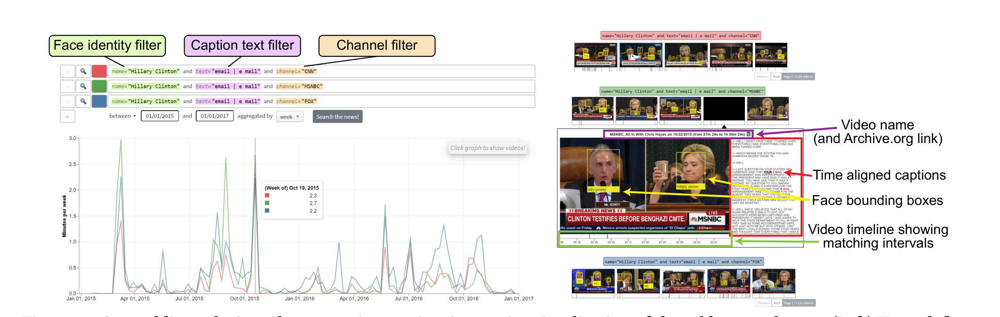{fig-alt="The Stanford Cable TV News Analyzer interface combines face, caption-text, and channel filters, plots matching screen time, and lets users inspect matched video clips." width="100%"}

[Hong et al. (2021), Figure 13.]{.source}
:::
:::::

::: key-line
The Analyzer measures **who is visible**, not who is speaking or what position the person expresses.
:::

::: notes
Explain the technical pipeline before discussing the campaign-finance linkage. The source video comes from the Internet Archive's TV News Archive. The Analyzer detects faces in sampled frames with MTCNN, computes a FaceNet descriptor for each detected face, and uses Amazon Rekognition's celebrity-recognition labels plus within-video nearest-neighbor matching to attach identities to additional faces. Screen-time estimates accumulate the time represented by sampled-frame detections. The public interface allows queries that combine face identity, caption text, channel, program, and time filters. Clicking the graph reveals matched clips, captions, bounding boxes, and timelines so researchers can audit what the query selected.

Then separate the Analyzer from Kim et al.'s contribution. The Analyzer supplies identities and estimated time on screen. Kim and colleagues exclude anchors, match non-anchor identities to DIME campaign-finance scores, weight those scores by screen time, and aggregate them into channel-period measures.

Ask what the screenshot makes visible about measurement error. A detected face may be a live guest, B-roll, or a still photograph. A visible person need not be the speaker. Identity coverage is limited to recognizable public figures, and automated detection or identification can fail. These are not incidental software details: they define what the visibility indicator can represent.

Sources: Hong et al. (2021), Figure 13; Stanford Cable TV News Analyzer methodology and getting-started documentation; Kim, Lelkes, and McCrain (2022), pp. 1–2.
:::

## Campaign-finance ideology scores

::::: {.two-column .contrast}
::: column
### How DIME constructs them

- Donors receive similar scores when they support similar candidates.
- Candidates receive similar scores when they attract similar donors.
- The model places donors and recipients on one left–right dimension.
:::

::: column
### How Kim uses them

- Negative values indicate positions toward the Democratic or liberal side.
- Positive values indicate positions toward the Republican or conservative side.
- Each on-screen person receives one score, treated as fixed across the study period.
:::
:::::

::: {.fragment .key-line}
A CF score measures donation behavior, not what a person says during a broadcast.
:::

::: notes
CF stands for campaign finance. Bonica's Database on Ideology, Money in Politics, and Elections, or DIME, jointly scales donors and political recipients. The intuition resembles ideal-point estimation from legislative voting: patterns of shared support reveal relative ideological proximity. Among officeholders, CF scores correlate highly with DW-NOMINATE scores.

Three interpretive cautions matter for Kim's measure. First, the score reflects revealed financial support rather than a direct survey of beliefs or an analysis of on-air speech. Second, people without donation records receive no score. Third, Kim and colleagues use a fixed person score based on DIME data updated through 2018. Therefore, all change in their media measure comes from changes in who appears and how long they appear, not from changes in an individual's estimated ideology.

Discussion prompt: Consider a former Republican donor who appears on CNN to criticize a Republican president. What does the CF score capture correctly, and what does it miss?

Sources: Bonica (2014); Kim, Lelkes, and McCrain (2022), pp. 1–2 and footnote §.
:::

## Senate extremes support face validity

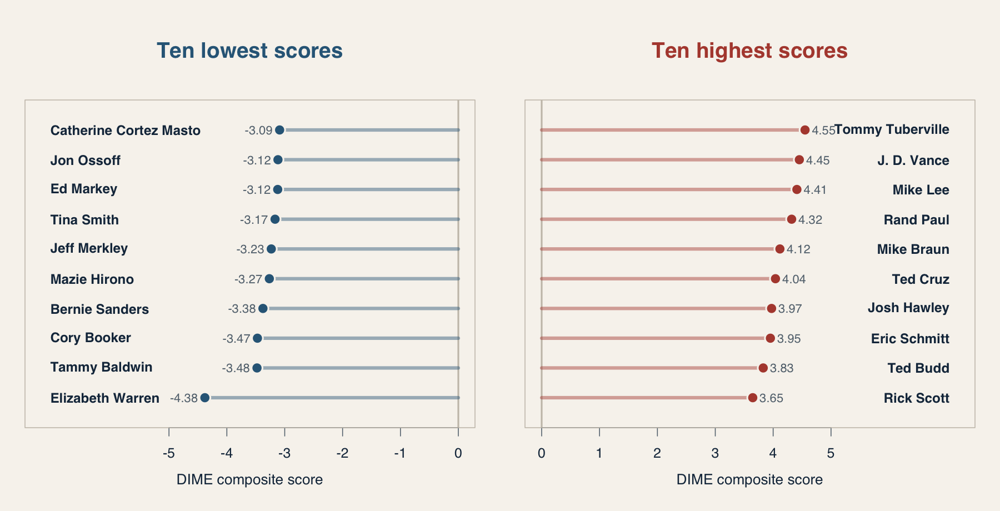{fig-alt="Ranked DIME composite scores for the ten lowest-scoring and ten highest-scoring records among 2024 incumbent-coded federal Senate candidates"}

::: notes
The figure applies the following filter to the 1979–2024 DIME recipient file: election equals fd2024, seat equals federal:senate, and ICO status equals I. After removing missing scores, the filter returns 105 records. The slide shows the ten lowest and ten highest composite scores.

The ordering has strong face validity. The low-score group contains recognizable liberal senators, including Elizabeth Warren, Tammy Baldwin, Cory Booker, Bernie Sanders, and Mazie Hirono. The high-score group contains recognizable conservative senators, including Tommy Tuberville, J. D. Vance, Mike Lee, Rand Paul, and Ted Cruz. Every record in the low-score group carries DIME party code 100; every record in the high-score group carries party code 200. DIME codes Sanders with the Democratic group in this file.

Ask students what this evidence establishes. It shows that the score's extremes align with familiar ideological judgments and partisan groupings. That supports face validity. It does not establish that every person's score is accurate, that the distances between scores have a simple substantive interpretation, or that donation-based ideology captures what a guest says on television.

The DIME filter uses its incumbent-status field. It should be described as “2024 incumbent-coded Senate records,” rather than as a verified roster of senators serving on a particular date.

Source: DIME recipient data, 1979–2024. Variables used: election, seat, ico.status, name, party, and composite.score.
:::

## Doctors and Dime Scores

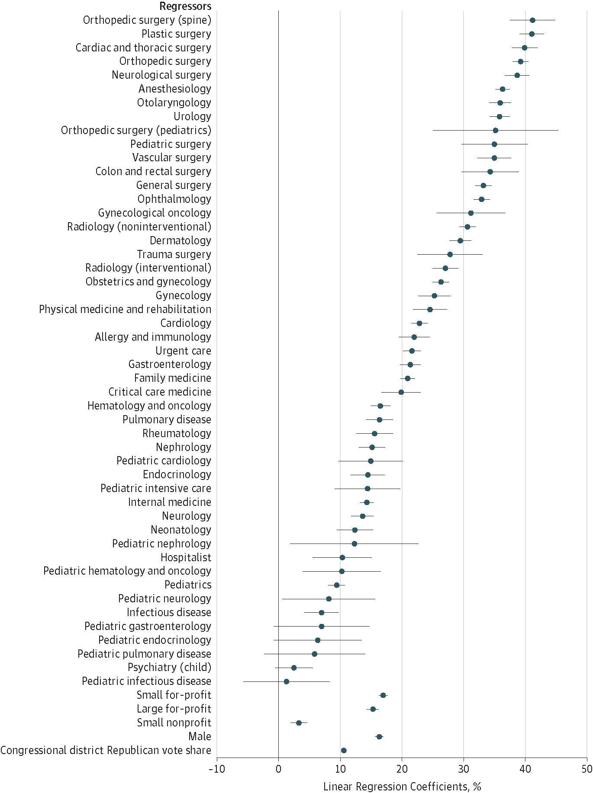

::: notes
Use the example to reinforce that DIME scores are inferred from campaign-finance behavior rather than direct observations of speech or policy beliefs. Ask what donation patterns among physicians might capture and what professional, strategic, or institutional factors could also affect the resulting scores. The point is to make the construct-validity question concrete before returning to Kim's aggregation procedure.
:::

## What enters the Kim et al measure?

::::: two-column
::: column
### Included

- CNN, Fox News, MSNBC
- 2010 to March 2021
- non-anchors with at least 10 hours on screen
- people matched to campaign-finance records
- screen time as the weight
:::

::: column
### Lost or fixed

- anchors and their commentary
- people who never donated
- words, tone, and treatment
- ideology change within a person
- unmatched or rarely shown people
:::
:::::

::: notes
The underlying video archive covers more than 280,000 hours. Of 1,225 non-anchors, 704 people, or 57%, received a matched score. Each person has one fixed CF score. Ask whether the observed population is “all cable news content,” “all guests,” or “screen time from donor-matched frequent non-anchors.”

Source: Kim, Lelkes, and McCrain (2022), p. 2.
:::

## A worked example

| Person  | CF score | Screen time | Weighted contribution |
|---------|---------:|------------:|----------------------:|
| Guest A |     −1.0 |     120 sec |                  −120 |
| Guest B |     +0.5 |     240 sec |                  +120 |
| Guest C |     +1.5 |      60 sec |                   +90 |

::: notes
The first two guests cancel under seconds × CF even though Guest B appears twice as long. Adding Guest C shifts the sum right. Ask how the interpretation changes if the analyst divides by 420 seconds, by three guests, or does not normalize. The main article does not fully explain normalization; this likely appears in the supplement or code. critique pa
:::

## Face validity at the program level

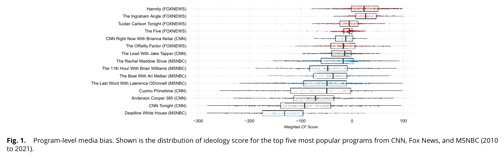{fig-alt="Box plots of weighted campaign-finance scores for cable news programs"}

::: notes
Ask students to inspect before interpreting. Expected: Fox programs generally lie to the right of CNN and MSNBC. Surprises: several Fox medians sit near or below zero; CNN prime-time programs appear more left-leaning than Rachel Maddow by this measure; distributions overlap widely. Treat surprises as potential findings and possible validity warnings.

ask about rachel maddow, what could explain the findings/ Source: Kim, Lelkes, and McCrain (2022), Figure 1, p. 2.
:::

## Validation evidence

:::::: triad
::: triad-item
**Face validity**

Fox averages right of CNN and MSNBC.
:::

::: triad-item
**Criterion evidence**

Correlation with human-coded slant: **r = .72**
:::

::: triad-item
**Convergent evidence**

Correlation with a text measure: **r = .59**
:::
::::::

::: {.fragment .key-line}
What would count as discriminant evidence?
:::

::: notes
Human coders classified 19,582 anonymized speaker blocks as liberal, neutral, or conservative. Intercoder weighted kappa ranged from .55 to .664 across channels. The article does not state the aggregation level for r = .72 in the main text. A correlation can rise with aggregation. The .59 correlation with text scaling indicates related but non-interchangeable measures.

For discriminant validity, ask for a measure this should not closely track, such as visual production style, entertainment content, or channel audience size after appropriate controls.

Source: Kim, Lelkes, and McCrain (2022), p. 2 and footnotes.
:::

## 

{fig-alt="Box plots of weighted campaign-finance scores for cable news programs"}

::: notes
Ask what evidence could distinguish these accounts: include host transcripts, compare all guests with matched guests, inspect segment-level contributions, or compare booking-based scores with independent human coding. how could you interrogate it?

**Substantive account** Her guest bookings differ from her commentary.

**Measurement account**\
Excluding the host removes the program's main ideological voice.

**Data account**\
Donor matching selects an unusual subset of guests.

**Aggregation account**\
Long appearances by a few people drive the score.
:::

## Descriptive arguments {.section-title}

Three forms we will use:

::: argument-map
**Indicator**\
one meaningful dimension

**Typology**\
crisp, mutually exclusive, exhaustive categories

**Association**\
probabilistic patterns across variables, units, or time
:::

::: notes
Source: Gerring (2012), Chapter 6, especially Table 6.1, pp. 141–154. These classify generalizing descriptive claims. They are not a ladder from weak to strong, and one study can contain several.
:::

## Three forms of descriptive claim

| Form | Question | Claim you can make |
|------------------------|------------------------|------------------------|
| indicator | How much of one attribute does a population or case have? | “Outlet A's visibility score averages −1.2.” |
| typology | What distinct kinds of cases result from explicit classification rules? | “Political activists fall into four types based on repertoire and commitment.” |
| association | How do indicators or units vary together? | “Channel distance increases over time,” or “slant and audience partisanship covary.” |

::: notes
Source: Gerring (2012), Chapter 6, especially Table 6.1. Start by asking students to complete the third column in their own words before revealing it.

The forms identify the logical structure of the claim, not the method used to produce it. A regression coefficient can report a descriptive association. Interview evidence can support an indicator claim. A cluster analysis can suggest a typology, but the researcher still must define and defend the types.

A single study may make several forms of claim. Kim and colleagues construct an indicator of visibility bias and describe trends and correlations. The forms should be evaluated separately because each licenses a different conclusion.
:::

## Indicators: one feature of a population

::: claim-form
**Claim form:** Among population $P$, the level or distribution of attribute $X$ is \_\_\_\_\_\_\_\_\_\_.
:::

**Media-bias example:** “During the study period, Fox's mean guest-visibility score is higher than CNN's.”

**This permits:** a statement about level, prevalence, rank, or distribution on one conceptually meaningful dimension.

::: notes
Source: Gerring (2012), pp. 142–143. Every empirical claim uses indicators. The conceptual freight matters: infant deaths per 1,000 births sit close to observation; “human welfare” inferred from infant mortality makes a larger validity claim.

Other indicator examples include the weekly share of stories about immigration, the proportion of comments containing incivility, median household income in a county, and the classification of Angola as having high infant mortality. An indicator can be numerical or qualitative, direct or proxy-based, and single-item or indexed.

Ask students to identify the population, attribute, summary, and scope in the media-bias sentence. Then ask what changes if “guest visibility” is replaced with the broader term “media bias.” The latter asks the indicator to carry more conceptual freight.

- **Population:** Prime-time cable news programs included in the study

- **Attribute:** The partisan affiliation of guests receiving airtime—or, more precisely, Republican guest visibility

- **Summary:** 58% of total guest airtime went to Republican guests

- **Scope:** The 2024 general-election period, during prime time, on the sampled cable-news programs
:::

## Semetko and Valkenburg

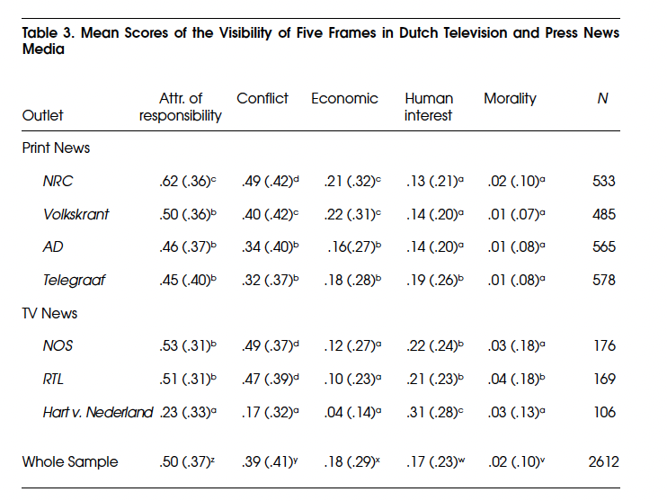

::: notes
Use Semetko and Valkenburg as a bridge from indicators to classification. Their generic framing approach begins with theoretically specified frames and observable content items. Ask students to identify the unit being coded, the rule connecting items to frames, and the evidence needed to show that the categories are applied consistently. This prepares the simple- and matrix-typology examples that follow.
:::

## A simple typology: fact-check verdicts

::: claim-form
**Claim form:** Cases belong to distinct categories using one uniform classification rule.
:::

| Category | Classification rule |
|------------------------------------|------------------------------------|
| **Supported** | Available evidence supports the central factual claim |
| **Contradicted** | Available evidence contradicts the central factual claim |
| **Unresolved** | Available evidence is insufficient or genuinely contested |

**Claim permitted:** “Each assessed claim receives one verdict based on its evidentiary status.”

::: notes
A simple typology divides cases using one principle. Here, the unit is an assessable factual claim and the uniform principle is its relationship to the available evidence. The categories are nominal: unresolved is not halfway between supported and contradicted.

Ask what operational rules are needed. What counts as the “central” claim? Which evidence sources are admissible? At what date is the assessment made? How should partly accurate compound claims be handled?

Then test the typology. Mutual exclusivity means one claim should not receive two verdicts under the same coding procedure. Exhaustiveness means every claim in the stated population needs somewhere to go. The unresolved category helps with exhaustiveness, although satire, predictions, and value judgments may need to be excluded from the population because they are not fact-checkable claims.
:::

## From a simple typology to a matrix

**A matrix typology crosses two or more classification dimensions.**

|                          | **Dimension B: absent** | **Dimension B: present** |
|------------------------|------------------------|------------------------|
| **Dimension A: absent**  | Type 1                  | Type 2                   |
| **Dimension A: present** | Type 3                  | Type 4                   |

::: question-list
**Each dimension needs a rule**\
How do we determine whether the attribute is present?

**Each cell becomes a type**\
What distinguishes this combination from the other combinations?

**Every case needs a destination**\
Are the resulting cells mutually exclusive and exhaustive?
:::

::: notes
A matrix typology applies more than one classification rule to the same cases and defines types from the combinations. With two binary dimensions, there are four logically possible combinations.

This is not yet a substantive typology because Dimensions A and B have no content. Use the abstraction to make the logic visible before revealing the media example. Each row answers one question about the case; each column answers another. The cell records both answers simultaneously.

The matrix does not demonstrate that the two dimensions are empirically independent, equally important, or causally related. It simply ensures that the analyst does not collapse them into one concept.
:::

## Matrix typology: bias × misinformation

|   | **No misinformation** | **Misinformation present** |
|------------------------|------------------------|------------------------|
| **No systematic partisan bias** | fact-based, nonpartisan reporting | nonpartisan misinformation |
| **Systematic partisan bias** | accurate partisan slant | partisan misinformation |

::: claim-form
**Claim:** “Coverage can be classified by whether it systematically advantages a political side and whether it contains false or misleading factual claims.”
:::

::: notes
This matrix crosses two dimensions that are often casually collapsed: partisan bias and misinformation. The unit could be a story, a set of stories, or an outlet-period, but it must be specified. “Systematic” bias usually requires a collection of coverage rather than a single story.

Partisan bias means a systematic advantage produced through selection, prominence, sourcing, tone, or framing. Misinformation means false or misleading factual content, regardless of whether the communicator intended to deceive. If intent to deceive is required, the concept is disinformation.

Walk through the important counterexamples. An editorial may openly favor a candidate while making only factually accurate claims: accurate partisan slant. A rushed breaking-news report may repeat a false claim that favors no side consistently: nonpartisan misinformation. A fabricated allegation designed to damage one candidate falls in partisan misinformation. Factually correct reporting is not automatically unbiased, and unbiased reporting is not automatically correct.

The cells illustrate a possible typology rather than assert an established empirical classification. Students should challenge the thresholds: How much slant counts as systematic? How much uncertainty makes a claim misleading? Can omission be misinformation, bias, both, or neither?
:::

## A third dimension doubles four types to eight

**Dimension C:** Is the source or sponsor disclosed?

::::: typology-slices
::: typology-slice
**Source disclosed**

|   | **No misinformation** | **Misinformation** |
|------------------------|------------------------|------------------------|
| **No partisan bias** | transparent factual report | attributable error |
| **Partisan bias** | disclosed advocacy | attributable partisan misinformation |
:::

::: typology-slice
**Source concealed**

|   | **No misinformation** | **Misinformation** |
|------------------------|------------------------|------------------------|
| **No partisan bias** | anonymous factual report | anonymous misinformation |
| **Partisan bias** | covert advocacy | covert partisan misinformation |
:::
:::::

::: {.key-line}
Three binary dimensions produce $2 \times 2 \times 2 = 8$ logically possible types.
:::

::: notes
Build directly from the prior two-dimensional matrix. Keep partisan bias on the rows and misinformation on the columns. Then add a third binary question: Is the source or sponsor disclosed? Instead of drawing a perspective cube, show the cube as two slices. The left matrix contains cases with disclosed sources; the right contains cases with concealed sources.

Walk through contrasts that hold the first two dimensions constant. Disclosed partisan advocacy and covert advocacy can contain the same accurate claims and favor the same side; they differ only in source transparency. Attributable partisan misinformation and covert partisan misinformation can be equally false and partisan, but the latter conceals who is behind it.

The example also demonstrates the cost of adding dimensions. A two-dimensional binary typology has four cells. A three-dimensional binary typology has eight. Four dimensions would have sixteen. More dimensions can capture important distinctions, but they quickly produce many thin or empty empirical categories. Each dimension therefore needs a theoretical reason and a defensible classification rule.

This is an illustrative typology, not a claim that these eight labels form an established taxonomy of media content. Ask students whether disclosure should refer to the named author, the institutional publisher, the funder, or all three.
:::

## Associations: patterned covariation

| Subtype | Explicit claim form | Media example |
|------------------------|------------------------|------------------------|
| trend | $X$ changes with time | “The Fox–MSNBC distance increases after 2018.” |
| network | ties among units form pattern $N$ | “Political links cluster into two weakly connected communities.” |
| correlation | $X$ and $Y$ vary together | “More partisan audiences accompany more partisan guest visibility.” |

**This permits:** a claim about patterned dependence, including its direction, size, timing, or structure.

**This does not permit:** a claim that $X$ causes $Y$, that $Y$ causes $X$, or that a third factor does not produce both.

::: notes
Source: Gerring (2012), pp. 151–153. Associations are probabilistic and multidimensional. Unlike typologies, they do not require cases to enter crisp, exhaustive categories.

The trend claim describes change with time. It becomes causal if the researcher says that a presidency, ownership change, or audience shift produced the change. The network claim describes who connects to whom and the structure those ties form. It becomes causal if the researcher claims that exposure through the ties caused diffusion. The correlation claim describes covariation and remains agnostic about the data-generating process.

Ask students to rewrite each example as a causal claim. Then ask what additional design or evidence the causal version requires.
:::

## Step 1: describe the network association

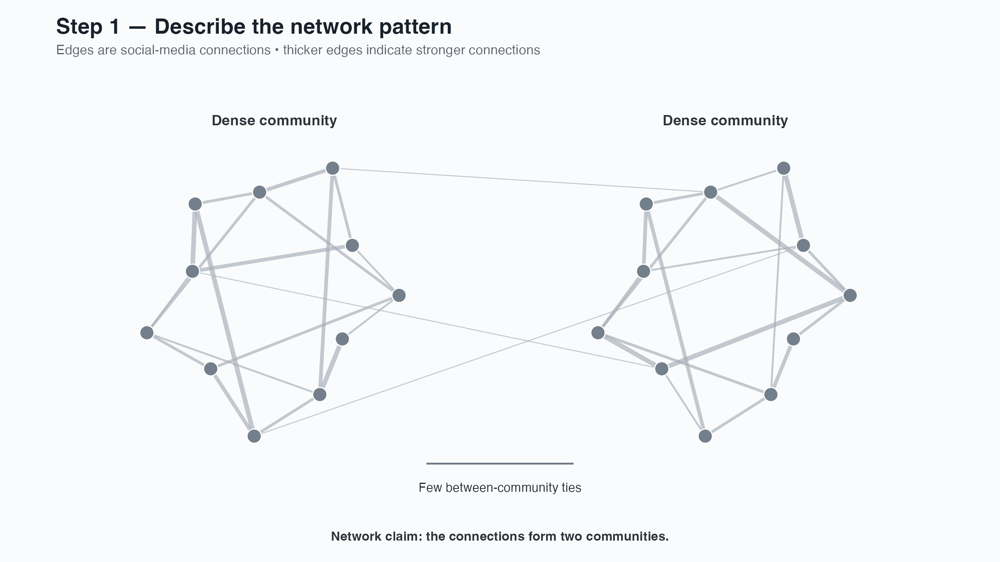{fig-alt="Simulated social-media network with two user communities; edges represent connections and thicker edges represent stronger connections"}

::: notes
Begin without ideological labels. The units are social-media users. An edge indicates that two users are connected on the platform. A thicker edge indicates a stronger connection—for example, more frequent interaction during the observation period. The graph displays two communities.

This is the network association in Gerring's sense: ties among units form a patterned structure. A precise descriptive claim is, “Social-media connections form two communities.” Researchers could quantify the pattern using community detection, modularity, density within and between communities, or the strength of within- and between-community connections.

At this stage, call them Community 1 and Community 2. The network alone does not tell us that one is liberal and the other conservative. It also does not show that media exposure caused the division, that users never encounter material from the other community, or that the shared sources contain biased content.

Ask students: What is observed directly? What is inferred from the layout? What descriptive statistic would allow the claim to be compared across topics or periods? The network is simulated for teaching.
:::

## Step 2: interpret the communities

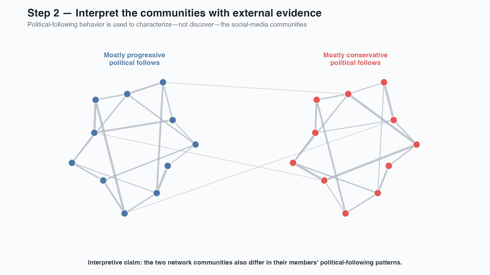{fig-alt="The same simulated news-sharing network, now colored using external evidence showing mostly progressive political follows in one community and mostly conservative political follows in the other"}

::: notes
Now add information not contained in the original connection network: which political actors each user follows. That external evidence suggests that the two previously discovered communities also differ ideologically.

The network claim remains, “Social-media connections form two communities.” The additional interpretive claim is, “Members of the two communities have different political-following patterns.” Keeping these separate prevents us from treating a visually distinct cluster as automatically ideological.

Barberá's method provides a more sophisticated version of the second step. It treats ideology as a continuous latent position and estimates it from follows to political actors under a homophily assumption; it does not merely assign the blue and red cluster labels depicted here.

A subsequent study could ask whether members of the communities share systematically different sources, whether the sources differ in content, or whether segregation changes over time. Those are new descriptive or explanatory claims requiring additional evidence.

Ask what could invalidate the interpretation: strategic or hate-following, bots, recommendation systems, inactive follows, multidimensional ideology, or political actors followed for nonideological reasons. Source for the inferential logic: Barberá (2015), “Birds of the Same Feather Tweet Together,” *Political Analysis* 23(1): 76–91. The network is simulated.
:::

## Kim's results as descriptive associations both across time and between channels

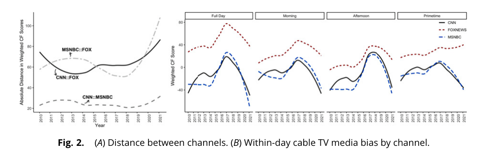{fig-alt="Cable channel ideological distance and channel trends by time slot"}

::: notes
Return to Kim here because the paper's principal results are examples of descriptive association. First inspect separation: Fox pulls away from CNN and MSNBC. Then inspect co-movement: all three shift right around 2016–2017 and left after 2018. The reported cross-channel correlations are about .68 to .72.

The descriptive claims concern patterned covariation across channels and time. The figure supports statements such as “channel distance changes over time” and “channel scores move together.” It does not, by itself, explain the changes.

The authors say channels “mirror the public mood,” but public opinion is not measured in this analysis. An alternative is that all channels respond to changes in which political actors are available or newsworthy.

Source: Kim, Lelkes, and McCrain (2022), Figure 2, p. 3.
:::

## An association sets the stage for an explanation.

{fig-alt="Box plots of weighted campaign-finance scores for cable news programs"}

::: notes
Ask students to state the association first, without explanation: “The three channel scores move together over time.” Then introduce the two accounts to show why the association does not identify its cause.

Possible designs that could separate the accounts include comparing booked guests with the contemporaneous pool of officeholders and newsmakers; modeling a cross-channel common factor and outlet-specific deviations; studying the same event or plausible guest pool across outlets; using invitation or booking records; exploiting ownership or personnel changes; or comparing visibility with tone toward the same people. The non-politician robustness check helps but depends on the definition of politician.

What are some possible explanaitions, how would you test this?
:::

## From claim form to descriptive tools

::::: {.two-column .contrast}
::: column
### Gerring supplies the argument

Indicator, typology, or association

What kind of conclusion should the evidence support?
:::

::: column
### Huntington-Klein supplies the tools

Counts, distributions, transformations, centers, and spreads

Which feature of the indicator must the summary preserve?
:::
:::::

::: {.fragment .key-line}
Choose the claim before choosing the statistic or graph.
:::

::: notes
This slide marks the transition from Gerring's framework to Huntington-Klein's practical tools. The claim determines what must remain visible in the data.

For an indicator claim about prevalence, a proportion and uncertainty interval may matter. For a typology, cell counts and cross-case comparisons matter. For a trend, the time axis and short-term variability matter. For a correlation, the joint distribution matters. A mean alone rarely supports every form of descriptive argument.
:::

## Describing a categorical indicator

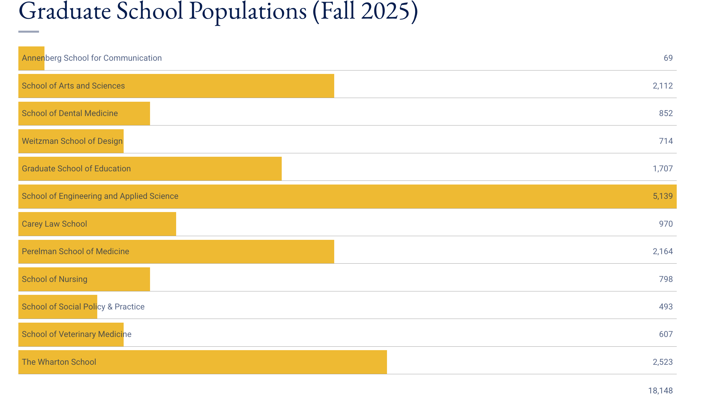

::: notes
Semetko and Valkenburg (2000) use a deductive approach. Coders answer 20 yes-or-no questions. The authors use factor analysis to assess whether the items cluster into the five expected frames, then average the retained items within each scale. This is a useful correction to treating each story as if it has one dominant frame. Frames can coexist, and each scale ranges from 0 to 1.

Their sample includes 2,601 newspaper stories and 1,522 television stories surrounding the 1997 Amsterdam meetings. Responsibility appears most often, followed by conflict, economic consequences, human interest, and morality. Outlet type and topic structure the distribution.

Ask: Is each frame an indicator, a typology, or both? The frame scale is an indicator. Treating stories as belonging to one exclusive frame would create a typology and would require different coding rules.

Source: Semetko and Valkenburg (2000), pp. 93–109, especially the abstract, pp. 94–96, 100–102, and Table 3.
:::

## Describing a quantitative indicator

For weekly visibility scores, inspect:

:::::: triad
::: triad-item
**Shape**

Symmetric, skewed, multimodal, bounded?
:::

::: triad-item
**Center**

Mean, median, mode, or a substantive reference point?
:::

::: triad-item
**Spread**

Range, IQR, standard deviation, or quantiles?
:::
::::::

::: {.fragment .key-line}
Never choose a summary before looking at the distribution.
:::

::: notes
Huntington-Klein emphasizes histograms and density plots for quantitative variables. A mean can conceal polarization or multiple modes. A median resists extreme weeks but may hide meaningful tails. Standard deviation has a clear interpretation only in relation to the variable and shape.
:::

## The mean

Seven ideology scores, ordered from liberal to conservative:

::: score-row
**−3  −1  −1  0  1  1  3**
:::

$$
\bar{x}=\frac{1}{n}\sum_{i=1}^{n}x_i
=\frac{-3-1-1+0+1+1+3}{7}=0
$$

::: key-line
The mean is the balance point of all observed scores.
:::

::: notes
Read the equation from left to right. The bar over x denotes the sample mean. The summation symbol means “add every observed score.” Divide that sum by n, the number of observations.

The mean uses every value. It acts like the balance point of the distribution and moves when extreme observations move. In this example the negative and positive ideology scores cancel, producing a mean of zero.

Ask whether mean zero implies that most people are centrists. It does not. The distribution could concentrate at zero, spread evenly across the scale, or split into liberal and conservative groups.
:::

## The median and mode

For ordered values $x_{(1)}\leq x_{(2)}\leq\cdots\leq x_{(n)}$:

::::: {.two-column .contrast}
::: column
### Median

$$
\tilde{x}=\begin{cases}
x_{((n+1)/2)}, & n\text{ odd}\\
\dfrac{x_{(n/2)}+x_{(n/2+1)}}{2}, & n\text{ even}
\end{cases}
$$

Here: $\tilde{x}=x_{(4)}=0$
:::

::: column
### Mode

$$
\operatorname{mode}(x)=
\underset{v}{\arg\max}\;\#\{i:x_i=v\}
$$

Here: modes = **−1 and +1**
:::
:::::

::: notes
Parentheses in the subscripts indicate positions after sorting, not raw observation numbers.

To find the median, order the observations and locate the middle one. With an even number of observations, average the two middle values. The median depends on rank, so an extreme score can become even more extreme without changing the median.

The mode equation says: among all possible values v, choose the value or values with the largest count. The arg max notation means “the value that makes this quantity largest.” This example has two modes, −1 and +1, so it is bimodal. With continuous variables, the exact mode may depend on how values are rounded or how a histogram is binned.

Discussion prompt: All three summaries point to zero or symmetry here, but does this small group contain a widely shared centrist position? No. The modes suggest two common positions away from the center.
:::

## Variance and standard deviation

Mean ideology = 0, so each deviation equals the original score:

| Score              |  −3 |  −1 |  −1 |   0 |   1 |   1 |   3 |
|--------------------|----:|----:|----:|----:|----:|----:|----:|
| Distance from mean |  −3 |  −1 |  −1 |   0 |   1 |   1 |   3 |
| Squared distance   |   9 |   1 |   1 |   0 |   1 |   1 |   9 |

::::: {.two-column .contrast}
::: column
### Variance

$$
\sigma^2=\frac{1}{N}\sum_{i=1}^{N}(x_i-\mu)^2
=\frac{22}{7}=3.14
$$

Average squared distance from the mean.
:::

::: column
### Standard deviation

$$
\sigma=\sqrt{\sigma^2}=\sqrt{3.14}=1.77
$$

Typical distance from the mean, expressed in the original units.
:::
:::::

::: notes
Variance starts by calculating each observation's deviation from the mean. Positive and negative deviations would cancel, so we square them. Average those squared deviations to obtain the population variance. Variance is useful mathematically, but its squared units are difficult to interpret.

Standard deviation takes the square root of variance. It returns to the original ideology scale. A standard deviation of 1.77 means that scores typically sit about 1.77 ideology points from the mean, though “typical distance” is an intuition rather than the exact average absolute distance.

This slide treats the seven scores as the full population and divides by N = 7. If they are a sample used to estimate population variance, divide by N − 1 = 6. The sample variance would be 3.67 and the sample standard deviation would be 1.91.

Squaring gives unusual observations extra influence. The two scores at −3 and +3 contribute 18 of the 22 total squared-distance units.
:::

## Population and sample formulas

::::: {.two-column .contrast}
::: column
### Full population

$$
\mu=\frac{1}{N}\sum_{i=1}^{N}x_i
$$

$$
\sigma^2=\frac{1}{N}\sum_{i=1}^{N}(x_i-\mu)^2
\qquad \sigma=\sqrt{\sigma^2}
$$
:::

::: column
### Sample estimating a population

$$
\bar{x}=\frac{1}{n}\sum_{i=1}^{n}x_i
$$

$$
s^2=\frac{1}{n-1}\sum_{i=1}^{n}(x_i-\bar{x})^2
\qquad s=\sqrt{s^2}
$$
:::
:::::

::: {.fragment .key-line}
$n-1$ corrects the tendency of a sample to underestimate population spread.
:::

::: notes
Use Greek letters for population quantities and Latin letters for sample statistics. N denotes the population size and n denotes the sample size.

When the observed cases constitute the entire population of interest, divide the squared deviations by N. When using a sample to estimate population variance, divide by n − 1. Estimating the sample mean uses one degree of freedom, and dividing by n − 1 makes sample variance unbiased under standard random-sampling assumptions.

For the seven ideology scores, the population variance is 22/7 = 3.14 and population SD is 1.77. Treated as a sample, the variance is 22/6 = 3.67 and the sample SD is 1.91.
:::

## What does “within one or two SDs” mean?

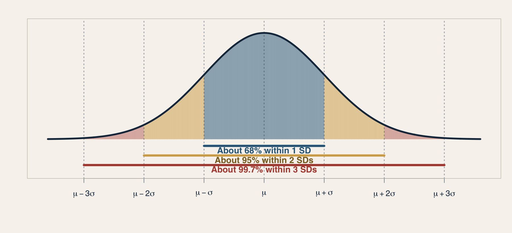{fig-alt="Normal distribution showing that about 68 percent of observations lie within one standard deviation of the mean, 95 percent within two, and 99.7 percent within three"}

$$
P(\mu-\sigma\leq X\leq\mu+\sigma)\approx .68
\qquad
P(\mu-2\sigma\leq X\leq\mu+2\sigma)\approx .95
$$

::: key-line
The **68–95–99.7 rule** applies when the population is approximately normal.
:::

::: notes
For an approximately normal, bell-shaped distribution, about 68% of the population lies between one standard deviation below and one standard deviation above the mean. About 95% lies within two standard deviations, and about 99.7% lies within three.

The percentages are cumulative. The 95% within two SDs includes the 68% already within one SD. Therefore, about 27% lies between one and two standard deviations from the mean—roughly 13.5% on each side. About 5% lies beyond two standard deviations—roughly 2.5% in each tail.

Use an ideology example with mean 0 and SD 1. If ideology were approximately normal, about 68% of people would score between −1 and +1, about 95% between −2 and +2, and about 99.7% between −3 and +3.

Emphasize the qualification. These percentages do not follow from the definition of standard deviation and do not hold for every distribution. A skewed, heavy-tailed, or polarized distribution may place very different percentages inside the same boundaries. In the seven-score worked example, 5 of 7 observations—or 71.4%—lie within one population SD; the sample is not a normal population.
:::

## The same mean can describe different politics

{fig-alt="Three simulated political ideology distributions with mean zero but different shapes and standard deviations; solid vertical lines show the mean and dotted lines show one standard deviation below and above the mean"}

::: notes
These simulated populations all have mean ideology zero. The left panel supports a story of consensus around the center. The middle panel supports a story of widespread disagreement. The right panel supports a story of polarization into opposing camps. Reporting only the mean would make all three populations sound centrist.

The solid vertical line marks the shared mean of zero. The dotted vertical lines mark one standard deviation below and above the mean. The SD is printed above each panel. The wider disagreement and polarized distributions have much larger SDs than the consensus distribution.

Ask students which features separate the stories. Relevant answers include variance, density near the midpoint, number of modes, distance between modes, and the relative size of each cluster. Then ask which single statistic, if any, captures polarization.

The same problem applies to outlet scores. An average near zero could mean consistently moderate guests, a mixture of liberal and conservative guests, or movement between extremes over time.

Illustrative simulated data. All three series were centered to mean zero.
:::

## The same median can describe different inequality

{fig-alt="Two simulated household-income distributions with the same median of sixty thousand dollars but different upper tails and means"}

::: notes
Both simulated populations have a median household income of \$60,000. In the first, the mean is about \$63,000 because the upper tail is modest. In the second, a small group with very high incomes raises the mean to about \$88,000 while leaving the median unchanged.

The median supports the claim that the typical household occupies the same position in both populations. The mean supports the claim that total income per household is higher in the second. The full distribution supports a third claim: the second population has much greater upper-tail inequality. None of these descriptions is false, but each answers a different question.

Ask which summary a policymaker might choose when discussing living standards, the tax base, or inequality. Then ask how an advocate could produce a technically accurate but substantively misleading comparison by selecting only one statistic.

Illustrative simulated data. Each distribution was rescaled to a median of \$60,000.
:::

## Admissions advantages grow sharply at the very top

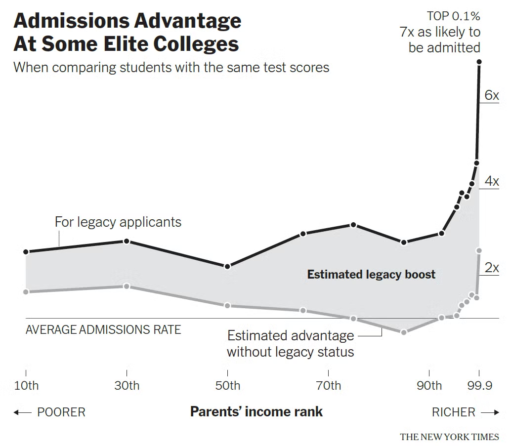{fig-alt="Estimated admissions advantage at some elite colleges by parental income rank, comparing students with the same test scores"}

::: notes
Ask students to describe the pattern before interpreting it. The estimated admissions advantage is fairly stable across much of the parental-income distribution, then increases steeply among applicants from the richest families. The figure separates the estimated legacy boost from the remaining advantage associated with family income.

Use the slide to reinforce descriptive scope. The graph documents an association between parental income rank and estimated admissions advantage among otherwise comparable applicants. It does not, by itself, identify every institutional mechanism producing the pattern.
:::

## Upward mobility varies dramatically by place

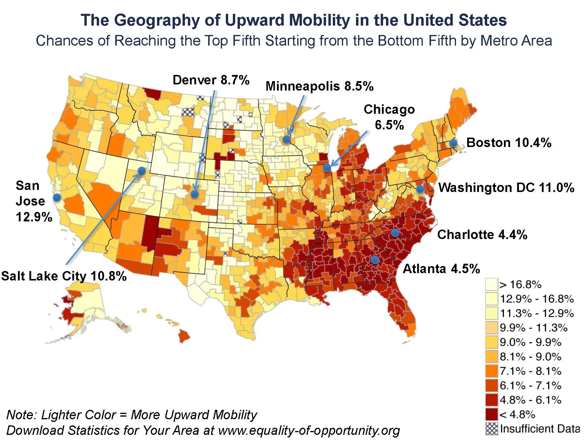{fig-alt="Map of the United States showing the chances that a child from the bottom income fifth reaches the top fifth, by metropolitan area"}

::: notes
The map describes geographic variation in upward mobility: the probability that a child born into the bottom income fifth reaches the top fifth as an adult. Lighter areas indicate higher mobility. The labeled metropolitan areas illustrate the range, from relatively high mobility in San Jose to substantially lower mobility in Atlanta and Charlotte.

Ask what the map establishes and what it does not. It establishes spatial variation under the stated measure. It does not show that living in a particular place causes the outcome without additional research design and evidence.
:::

## Explore mobility by race and class

The interactive follows children from similar-income families and compares adult outcomes across race and gender.

::: {.key-line}
[Open the interactive in a new tab](https://www.nytimes.com/interactive/2018/03/19/upshot/race-class-white-and-black-men.html){target="_blank" rel="noopener noreferrer"}
:::

::: notes
Open the linked interactive in a separate browser tab. Ask students to identify the population, outcome, comparison groups, and descriptive claim before discussing possible explanations. Emphasize that documenting a disparity is distinct from identifying the mechanisms that produced it.
:::

## What can the Kim et al paper claim?

Classify each claim, then remove any causal overreach:

1.  Prime-time channels diverged after 2017.
2.  Audience polarization pushed prime-time channels apart.
3.  Fox occupied the rightmost position in most weeks.
4.  Cable news formed two ideological clusters.
5.  The Trump presidency made MSNBC move left.

::: notes
Suggested discussion: (1) trend association; (2) causal, not established by the descriptive figure; (3) indicator comparison or trend; (4) association or typology depending on whether clusters are probabilistic or imposed categories; (5) causal. Repairs: “MSNBC's measured visibility score moved left during the Trump presidency,” or “the timing is consistent with, but does not establish, a Trump effect.”
:::

## Build a descriptive argument {.section-title}

Use **your research topic** to draft all three forms.

::: question-list
**Gerring: choose the form of claim**\
Indicator, typology, or association?

**Kim and Semetko–Valkenburg: operationalize it**\
What observations, coding rules, categories, or scores would represent the concept?

**Huntington-Klein: describe the resulting data**\
What comparison, distribution, or visualization would reveal the pattern?

**Then bound the claim**\
For which units, settings, and period should it hold—and what does it not establish?
:::

::: key-line
**Scope conditions specify where, when, and for whom a claim is expected to apply—and where it may not.**
:::

::: notes
Students should complete the next three templates using the same research topic. The exercise is not asking them to use all three forms in their paper. It asks them to see how changing the form changes the design and the conclusion.

Gerring supplies the logical form of the claim. Kim illustrates operationalization and validation. Semetko and Valkenburg illustrate how explicit coding categories organize content. Huntington-Klein supplies tools for displaying distributions, comparisons, and relationships.

Unpack scope conditions in plain language. They identify the boundaries of the claim: the units or population, setting, time period, and relevant measurement or inclusion rules. For Kim, examples include CNN, Fox, and MSNBC; 2010 to March 2021; frequent non-anchor guests; and people matched to campaign-finance records. The claim should not silently expand from those observations to all television news, all media bias, or every historical period.

Scope conditions are not merely weaknesses. Every defensible empirical claim has boundaries. Stating them allows readers to distinguish the population actually described from cases to which the result might—or might not—generalize.
:::

## 1. Make an indicator claim

::: description-template
**Claim:**\
I will make an **indicator claim** about \_\_\_\_\_\_\_\_\_\_ among \_\_\_\_\_\_\_\_\_\_.

**I will do this by:**\
Observing \_\_\_\_\_\_\_\_\_\_, operationalizing the concept as \_\_\_\_\_\_\_\_\_\_, and summarizing its level or distribution using \_\_\_\_\_\_\_\_\_\_.

**Claim I could make:**\
Among \_\_\_\_\_\_\_\_\_\_, the level / prevalence / distribution of \_\_\_\_\_\_\_\_\_\_ is \_\_\_\_\_\_\_\_\_\_.

**Scope conditions:**\
This applies to \_\_\_\_\_\_\_\_\_\_ during \_\_\_\_\_\_\_\_\_\_; it does not necessarily apply to \_\_\_\_\_\_\_\_\_\_ and does not establish \_\_\_\_\_\_\_\_\_\_.
:::

::: notes
Example: “I will make an indicator claim about guest-visibility bias among prime-time cable-news programs. I will identify on-screen guests, attach validated ideology scores, weight them by screen time, and display weekly distributions by channel. The claim applies to donor-matched non-anchor screen time on the sampled channels and period; it does not describe anchors, speech content, other outlets, or the cause of channel differences.”

Require the population, unit, observable evidence, operational rule, and summary. Ask how the student would validate the indicator, following the Kim discussion.
:::

## 2. Make a typological claim

::: description-template
**Claim:**\
I will make a **typological claim** about \_\_\_\_\_\_\_\_\_\_.

**I will do this by:**\
Classifying \_\_\_\_\_\_\_\_\_\_ into \_\_\_\_\_\_\_\_\_\_ using the rule(s) \_\_\_\_\_\_\_\_\_\_.

**Claim I could make:**\
The cases consist of the following distinct types: \_\_\_\_\_\_\_\_\_\_.

**Scope conditions:**\
These categories apply to \_\_\_\_\_\_\_\_\_\_; ambiguous cases are handled by \_\_\_\_\_\_\_\_\_\_, and the classification does not establish \_\_\_\_\_\_\_\_\_\_.
:::

::: notes
Example: “I will make a matrix typology of election stories. I will classify each story by whether it contains systematic partisan advantage and whether it contains misinformation, using an explicit content-coding and fact-checking protocol. The classification applies to assessable factual election stories in the sampled outlets and period; opinion, satire, and unresolved claims require exclusion or another rule. The types do not explain why stories were produced or how they affect audiences.”

Connect to Semetko and Valkenburg: categories require definitions, observable indicators, and coding rules. Ask whether the categories are mutually exclusive, exhaustive, and generated by a uniform principle.
:::

## 3. Make an associational claim

::: description-template
**Claim:**\
I will make an **associational claim** about how \_\_\_\_\_\_\_\_\_\_ varies with / across / over \_\_\_\_\_\_\_\_\_\_.

**I will do this by:**\
Measuring \_\_\_\_\_\_\_\_\_\_ and \_\_\_\_\_\_\_\_\_\_ for each \_\_\_\_\_\_\_\_\_\_, then displaying their relationship using \_\_\_\_\_\_\_\_\_\_.

**Claim I could make:**\
Within \_\_\_\_\_\_\_\_\_\_, \_\_\_\_\_\_\_\_\_\_ tends to increase / decrease / cluster / change with \_\_\_\_\_\_\_\_\_\_.

**Scope conditions:**\
The relationship is described for \_\_\_\_\_\_\_\_\_\_ during \_\_\_\_\_\_\_\_\_\_; it does not establish causal direction, rule out \_\_\_\_\_\_\_\_\_\_, or necessarily generalize to \_\_\_\_\_\_\_\_\_\_.
:::

::: notes
Example using Kim: “I will make an association claim about how channel visibility scores vary together over time. I will construct weekly channel-level scores and graph their trajectories and pairwise differences. During 2010–2021 on the three sampled cable channels, the scores co-move while Fox increasingly separates from CNN and MSNBC. This does not show whether audiences, editorial choices, political events, or changes in the available guest pool produced the pattern.”

Students may formulate a trend, correlation, or network association. Require both variables—or the relevant network ties—the unit of analysis, and the proposed display. Connect to Huntington-Klein by asking whether the summary preserves the important shape, spread, outliers, or temporal pattern.

Timing: about 10 minutes to draft all three, followed by partner review. Partners identify the form, underline the operationalization, circle the scope conditions, and flag unsupported causal language.
:::

## What makes description good?

:::::: triad
::: triad-item
**Conceptual fit**

The measure represents the stated concept.
:::

::: triad-item
**Revealing summary**

The display preserves the distributional feature that matters.
:::

::: triad-item
**Disciplined claim**

The conclusion stays within the population, measure, and design.
:::
::::::

::: notes
Close the loop: concept explication precedes operationalization; operationalization determines what the data can mean; descriptive tools determine which patterns become visible; argument wording determines whether readers receive a descriptive or causal claim.
:::

## Readings

- Gerring, John. 2012. “Descriptive Arguments.” In *Social Science Methodology*, 2nd ed., 141–154.
- Huntington-Klein, Nick. “Describing Variables.” Chapter 3 in *The Effect*.
- Kim, Eunji, Yphtach Lelkes, and Joshua McCrain. 2022. “Measuring Dynamic Media Bias.” *PNAS* 119(32): e2202197119.
- Semetko, Holli A., and Patti M. Valkenburg. 2000. “Framing European Politics.” *Journal of Communication* 50(2): 93–109.

::: notes
All figures reproduced from the assigned readings for classroom discussion.
:::
