## Looking for keys under the streetlight

> A person searches under a streetlight, not because the keys were lost there, but because that is where the light is.

Twitter's public API made one platform unusually visible to researchers.

One bibliometric study identified **27,453 studies using Twitter data** from 2006–2023, across **14 disciplines**.

::: {.fragment .key-line}
Data availability helped determine which part of social life became heavily studied.
:::

::: source
Source: Murtfeldt et al. (2024), preprint.
:::

::: notes
Tell the streetlight story in full. A police officer sees someone searching the ground beneath a streetlight and asks where the keys were lost. The person points to a dark area farther away. When the officer asks why they are searching here, the person answers: “Because the light is better here.”

The joke describes a research-design problem. Researchers often study the setting where data are visible rather than the setting that best represents the theoretical target. For many years, Twitter offered unusually broad, documented, and inexpensive API access. Facebook, private messaging, offline conversations, and many non-Western platforms were much harder to observe. Twitter therefore became the illuminated patch of ground.

Murtfeldt and colleagues searched eight bibliographic databases and three related APIs. They identified 27,453 studies using Twitter data between 2006 and 2023, published in 7,432 venues across 14 disciplines and cited more than 1.3 million times. The study is a preprint, so present the count as a bibliometric estimate rather than an exact census.

Do not conclude that these studies were worthless. The API enabled valuable work on disasters, misinformation, public health, political communication, and social networks. The problem arises when researchers silently replace “behavior visible through Twitter's interface” with “social behavior,” “public discourse,” or “public opinion.”

Connect the metaphor to the coding project: databases illuminate particular outlets, queries illuminate particular words, and archives illuminate material that survived. Ask: “Are we sampling here because theory says the keys should be here, or because this is where the light is?”

Source: Ryan Murtfeldt, Naomi Alterman, Ihsan Kahveci, and Jevin D. West. 2024. “RIP Twitter API: A Eulogy to Its Vast Research Contributions.” https://arxiv.org/abs/2404.07340
:::

## Today's route {#questions-for-today}

::: roadmap
| Part | Question |
|------|----------|
| 1 · When good evidence travels badly | What changed between the evidence and the claim? |
| 2 · Building the sample | How do the frame, unit, selection process, and design shape what we observe? |
| 3 · How far does the claim travel? | When can a result generalize or transport, and along which M-STOUT dimensions might it fail? |
| 4 · Your sampling plan | What claim can your planned sample defend? |
:::

::: notes
Frame the session as four parts. Part 1 uses four real cases to show credible evidence answering a narrower question than the claim attached to it. Part 2 slows down and builds a text sample link by link, using Bergstrom and West to make selection intuitive. Part 3 gives the vocabulary for scope: generalizability, transportability, Henrich and colleagues' WEIRD critique, and Findley, Kikuta, and Denly's M-STOUT. Part 4 turns all of it into decisions for the coding project.

Tell students each part opens with a divider slide that repeats its question, so they can track where we are.
:::

## Four cases, one puzzle {#when-good-evidence-travels-badly .section-title}

[Part 1 of 4 · When good evidence travels badly]{.kicker}

> For each case: predict the result—or design the study—then explain what changed.

::: notes
Introduce the cases before naming the framework. Tell students that each study produced informative evidence for the cases it actually observed. The problem arose when someone treated that evidence as an answer for a broader or different target.

Ask students to listen for what changed between the evidence and the target. Do not introduce M-STOUT yet. Let the examples create the need for a vocabulary.
:::

## Case 1: Opower at scale {#early-experiments-can-come-from-unusually-receptive-sites}

Opower tested home-energy reports in **111 randomized trials** covering **8.6 million households**.

The first ten sites reduced energy use by about **1.7%**. The next 101 averaged about **1.2%**, nearly **30% smaller**.

::: {.fragment .key-line}
Early sites had more customers who had already demonstrated interest in utility conservation programs, and the programs initially targeted heavier energy users.
:::

::: source
Source: Allcott (2015), *Quarterly Journal of Economics*.
:::

::: notes
Open with the puzzle: “What exactly did random assignment protect, and what did it leave exposed?” Random assignment protected the causal comparison inside each participating site. It did not make the first ten sites representative of later sites or make the initially targeted customers representative of later customers.

Before revealing the explanation, ask: “Why might the same randomized program produce a 1.7 percent effect in the first sites but only 1.2 percent later?” Take two or three hypotheses and write them down without evaluating them.

Then begin with the intervention. Opower partnered with utility companies to mail households a **Home Energy Report**. The report compared a household's recent electricity use with that of similar nearby households, labeled efficient neighbors approvingly, and suggested concrete ways to conserve. The intervention relied on social comparison and practical conservation advice rather than changing electricity prices.

Within each participating utility program, eligible households were randomly assigned to receive the reports or remain in the control group. The outcome came from utility-meter records, so the researchers could compare actual electricity consumption rather than self-reported intentions. Allcott combined 111 randomized trials involving 8.6 million households.

This is therefore a clean example of site-selection bias rather than a failed randomization. Random assignment supported a credible causal estimate within each rollout. The question was whether the first utilities to adopt and evaluate the program were typical of the utilities and customers that would participate later.

The external-validity problem appeared across sites. The first ten implementations reduced energy use by about 1.7 percent, compared with about 1.2 percent in the next 101 sites. The later effect was nearly 30 percent smaller. Early partner utilities operated in areas where customers had already shown more interest in conservation programs, and early programs often focused on higher-usage customers who had more room to conserve. As the program expanded, both the participating settings and the enrolled households changed.

Allcott used detailed customer and utility data to ask why the estimates declined. Early utilities operated in areas with greater prior participation in conservation and renewable-energy programs. Their customers responded more strongly to the reports. Early implementations also targeted higher-use customers; as utilities expanded the program to lower-use customers, there was less consumption available to reduce.

Hold the formal vocabulary until Part 3, where we return to this case through M-STOUT. For now, ask students to list informally what changed: utility territories, the customers enrolled, how the program was targeted, and possibly why the reports worked. A precise estimate inside one site does not answer how an intervention will perform after expansion.

Source: Hunt Allcott. 2015. “Site Selection Bias in Program Evaluation.” *Quarterly Journal of Economics* 130(3): 1117–1165. https://www.nber.org/papers/w18373
:::

## Case 2: Nudges in journals and government {#published-nudges-shrank-when-governments-ran-them-at-scale}

| Evidence base                      | Average increase in take-up |
|------------------------------------|----------------------------:|
| Published academic nudge studies   |   **8.7 percentage points** |
| 126 trials by two U.S. nudge units |   **1.4 percentage points** |

The government trials covered **23 million people**.

::: {.fragment .key-line}
Selective publication and low power explained about 70% of the gap. Intervention differences explained much of the rest.
:::

::: source
Source: DellaVigna and Linos (2022), *Econometrica*.
:::

::: notes
Before explaining the gap, ask: “Why might published experiments average 8.7 points while a complete government archive averages 1.4?” Sort responses into differences in the studies themselves and differences in which studies become visible.

Then define the institution. A nudge unit is a team that works with government agencies to apply behavioral science to administrative problems. Typical interventions revise a reminder letter, simplify a form, change the timing of a message, emphasize a deadline, or make the requested action easier. They usually preserve people's choices and do not add a major financial incentive.

DellaVigna and Linos studied two large U.S. teams: the federal **Office of Evaluation Sciences**, which partnered with federal agencies, and **Behavioral Insights Team North America**, which worked with local governments. The authors assembled every available randomized trial run by the teams, not only trials with positive or publishable results. The 126 trials covered more than 23 million people and outcomes such as applying for a program, paying a bill, attending an appointment, or completing an administrative task.

The comparison group was not one new experiment. It was the published academic nudge literature summarized in two meta-analyses. Published studies reported an average increase of 8.7 percentage points, equal to a 33.4 percent increase over the control-group mean. The comprehensive nudge-unit archive produced an average increase of 1.4 percentage points, or about 8 percent over control. A 1.4-point gain can still matter when a government contacts millions of people.

The published literature was not a representative sample of every nudge that researchers tried. Large, surprising estimates had a better chance of appearing in journals, while small academic experiments produced noisy estimates. The nudge units recorded null results as well as successes and implemented interventions in routine government settings.

This case combines two threats. The evidence base selected outcomes through publication, and the target interventions differed in setting, delivery, and population. The result did not mean nudges never work. It meant that the published mean transported badly to routine policy implementation.

Connect this to students' literature reviews. A collection of published findings is itself a sample. External validity can fail before they collect a single text if the visible studies overrepresent successful treatments.

Source: Stefano DellaVigna and Elizabeth Linos. 2022. “RCTs to Scale: Comprehensive Evidence from Two Nudge Units.” *Econometrica* 90(1): 81–116. https://doi.org/10.3982/ECTA18709
:::

## Case 3: Seven days of newspaper coverage {#a-consecutive-week-can-misdescribe-a-newspaper}

**Estimand:** the six-month average number of local news stories per daily newspaper issue.

You can sample only **seven newspaper issues**. Which design will best recover that six-month average?

-   Seven consecutive issues
-   Seven issues selected at random
-   A constructed week: one random Monday, one random Tuesday, and so on

::: fragment
Riffe, Aust, and Lacy drew 20 seven-day samples with each design. Share of sample means within two standard errors of the six-month mean:

| Constructed week | Seven random days | Seven consecutive days |
|:---:|:---:|:---:|
| **100%** | **95%** | **85%** |

**Constructed weeks** were the most efficient design at every sample size because newspaper content follows weekday cycles.
:::

::: source
Source: Riffe, Aust, and Lacy (1993), *Journalism Quarterly*.
:::

::: notes
Keep the result hidden and ask: “Which seven-day design should work better: seven consecutive days, seven randomly selected days, or one randomly chosen Monday through Sunday from different weeks?” Ask students to justify the prediction before revealing the 100 / 95 / 85 result.

Then state the research problem precisely. The estimand was the **six-month population average number of local news stories per daily newspaper issue**. Each issue contributed a count of local stories; the researchers wanted the mean of those counts across the complete six-month population. They were not estimating the total number of stories, the average for one sampled week, or coverage of a particular breaking-news topic.

Content analysts rarely have enough resources to code every issue of a daily newspaper, but newspaper content follows a production calendar. Sunday editions have more advertising and space, Saturday editions are smaller, and recurring sections appear on particular weekdays. Seven adjacent days contain every weekday once, but they also share one news cycle.

The authors treated the full newspaper period as the population and repeatedly drew samples from it. They compared simple random days, constructed weeks, and consecutive days at sample sizes of 7, 14, 21, and 28. For each design and size they drew 20 samples, calculated the mean number of local stories, and compared those sample means with the known population mean.

A constructed week draws a Monday from one week, a Tuesday from another, and so on. With seven sampled days, all 20 constructed-week sample means fell within two standard errors of the population mean, compared with 19 of 20 simple-random-day means and 17 of 20 consecutive-day means. Be candid that these are differences of one to three samples out of twenty; the persuasive evidence is that the ordering held across sample sizes. Constructed-week percentages always exceeded those of simple random and consecutive-day samples of the same size, and consecutive days produced the widest ranges of estimates. Simple random days do fine on average but can, by chance, overload one weekday; the constructed week guarantees one of each.

The external-validity error comes from treating “the week we coded” as if it represented “coverage during the year.” A Sunday paper differs from a Tuesday paper in space, sections, staffing, and the type of news available. A major event can add another source of temporal concentration.

For the coding project, ask whether the substantive target includes event periods, ordinary periods, or both. If students want a semester-wide description, a consecutive week is usually a poor time sample even when every article within that week is coded perfectly.

Source: Daniel Riffe, Charles F. Aust, and Stephen R. Lacy. 1993. “The Effectiveness of Random, Consecutive Day and Constructed Week Sampling in Newspaper Content Analysis.” *Journalism Quarterly* 70(1): 133–139. https://doi.org/10.1177/107769909307000115
:::

## Case 4: What is the public talking about? {#political-tweets-do-not-represent-public-opinion}

People want to sample posts from **Twitter/X** to represent what the public is talking about.

1.  **Is this a good idea?**
2.  **How would you do it?** What would you sample?
3.  **What issues might come up?** What could you claim at the end?

::: notes
Open with the design problem before showing any evidence. Give students two minutes in pairs on the three questions, then collect answers on the board.

For “How would you do it?”, typical designs include a keyword search, a random sample of posts, trending topics, a fixed time window, or a sample of accounts. For each design, ask what population it actually represents: posts, active accounts, people who use the platform, or the public.

For “What issues might come up?”, draw out as many of these as possible before moving on:

-   **Who uses the platform.** Users differ from the public in age, education, partisanship, and political interest.
-   **Who posts.** Most users rarely or never post; a small group of heavy posters produces most of the content.
-   **Who posts about this topic now.** Events and outrage pull unusual speakers into a conversation.
-   **Non-human and coordinated accounts.** Bots, brands, campaigns, and organized networks inflate some topics.
-   **What the platform shows.** Trending lists and feeds reflect engagement-ranking algorithms, not volume among people.
-   **Retrieval.** Keyword queries miss posts that use other vocabulary and pick up irrelevant ones. Deleted, suspended, and private posts cannot enter.
-   **Access.** X ended free research access to its API in 2023, so what researchers can collect depends on what they can pay for.
-   **Talk is not opinion.** What people post about is not the same as what they think or care about.

Let students decide whether it is a good idea. The answer the next slide supports: it can be a good design for describing **what active posters on the platform said**, and a poor one for describing **the public**.
:::

## Case 4 evidence: Who is in the corpus? {#who-is-in-a-twitter-corpus}

Hughes and colleagues linked Twitter accounts to **voter records** and to **probability survey panels**, so they could see who was behind the posts.

Across three samples, the most active **10% of users wrote 73% to 83% of all tweets**.

::: fragment
Three filters stand between the public and a set of posts:

1.  Who uses the platform?
2.  Who posts about this topic, right now?
3.  Whose posts match the query and are still accessible?
:::

::: {.fragment .key-line}
Millions of posts reduce sampling error inside the corpus. They do not remove selection into the corpus.
:::

::: source
Source: Hughes et al. (2021), *Public Opinion Quarterly*.
:::

::: notes
This slide distinguishes a census of available posts from a representative sample of people. Heavy posters contribute many units, silent users contribute none, and nonusers cannot enter. A tweet-level proportion therefore weights prolific users more heavily unless the analyst changes the unit and weighting scheme.

After the design discussion, show the 10% statistic and ask: “If I randomly sample posts, who receives the most weight in my estimate?” Follow with: “Which people receive no chance of appearing?” Reveal the three filters only after students identify prolific posters, silent users, and nonusers. Connect each filter to the issues students raised on the previous slide.

Then explain that this was a study of sampling methods, not an attempt to estimate one national opinion. The researchers built three different samples of U.S. adult Twitter users. One linked roughly 1.5 million identifiable Twitter accounts to voter records. Two smaller samples began with probability-based survey panels and asked respondents to supply their Twitter handles; the usable public-account samples contained 2,369 and 1,188 accounts.

Each route has a different selection process. Voter-file matching provides enormous scale but requires an identifiable name, location, voter registration, and enough visible activity to enter the original tweet stream. Survey linkage begins from a probability sample and provides richer self-reported information, but some respondents do not use Twitter, decline to provide a handle, provide an invalid handle, or keep the account private.

The design makes the population ladder visible: U.S. adults, registered voters, Twitter users, political tweeters, and tweets are different targets. Across the three samples, the most active 10 percent of users generated 73 to 83 percent of all tweets. The two probability-panel samples included many more low-activity users: 21 percent and 16 percent had fewer than ten lifetime tweets, compared with only 5.4 percent in the voter-file-linked sample.

The teaching payoff is that sampling tweets implicitly weights people by how often they post. Bergstrom and West's friendship paradox is the network version of the same logic: most people's friends have more friends than they do (in the Facebook data they cite, users averaged about 190 friends while their friends averaged about 635). Any corpus collected by following followers, retweets, or replies will overrepresent highly connected accounts. A corpus of one million tweets may reflect fewer distinct voices than a much smaller probability sample of users. Narrow event windows further change which users speak and which opinions become observable.

For content analysis, ask students to name the unit in the final sentence. “Thirty percent of sampled tweets used a conflict frame” does not imply that thirty percent of users, voters, or citizens held that view.

Source: Adam G. Hughes, Stefan D. McCabe, William R. Hobbs, Emma Remy, Sono Shah, and David M. J. Lazer. 2021. “Using Administrative Records and Survey Data to Construct Samples of Tweeters and Tweets.” *Public Opinion Quarterly* 85(S1): 323–346. https://academic.oup.com/poq/article/85/S1/323/6342443
:::

## What changed between the evidence and the claim?

| Case | Evidence came from | Claim was extended to |
|------------------------|------------------------|------------------------|
| Opower | Early utilities and selected customers | Later, broader implementation |
| Nudges | Published studies | Routine government programs |
| Newspapers | A small set of dates | Six months of coverage |
| Twitter | Political posts and active users | Users or public opinion |

::: {.fragment .key-line}
The evidence may be credible for what it observed. The problem is the unexamined move to a broader target.
:::

::: notes
Use this as the debrief for the opening cases. Ask students to describe the right-hand shift in one sentence before introducing formal terminology.

Opower moved from unusually receptive early utilities and heavier-use customers to later sites and a wider customer population. The nudge comparison moved from a selectively published academic literature to the complete record of routine government implementation. The newspaper study moved from a few observed dates to an average over a six-month production cycle. The Twitter example moved from posts produced by active political users toward claims about users or the public.

Say: “The recurring problem is not necessarily that the observed evidence is wrong. It is that the scope of the claim changes without a corresponding argument.” This creates the need for an estimand, a target population, and later the language of generalizability and transportability.
:::

## The target population comes first {.section-title}

[Part 2 of 4 · Building the sample]{.kicker}

Complete this sentence before downloading texts:

> We want to describe **\[which texts\]**, produced by **\[which sources\]**, during **\[which dates\]**, about **\[which phenomenon\]**.

::: notes
Make students write a population statement for their project. Push on nouns such as “media,” “news,” or “online discourse.” Those labels are too broad unless the frame truly covers them.

A stronger statement might be: “All English-language articles published between September 1 and November 30, 2026 by the twelve national and regional newspapers in our source list that substantially discuss university protests in the United States.” Each phrase creates a boundary that can later be evaluated.
:::

## Estimands come before evidence

An **estimand** is the exact quantity the study wants to learn.

> If we had perfect information, what number would answer the research question?

-   the proportion of articles containing a conflict frame
-   the difference in frame prevalence between local and national outlets
-   the average effect of a message on sharing

::: {.fragment .key-line}
A sample produces an estimate. The estimand is the target that estimate is trying to recover.
:::

::: notes
Say: “Before we ask whether a sample is good, we need to know what quantity it is supposed to estimate.”

An estimand is the exact numerical target implied by the research question. If the question asks how common a conflict frame is, the estimand might be the proportion of eligible articles containing that frame. If the question compares outlet types, the estimand is a difference between two proportions. If the question is causal, the estimand could be an average treatment effect.

Distinguish an estimand from an estimate. The estimand exists conceptually even if the researcher never collects data. The estimate is the number calculated from the observed sample. Sampling, coding, and analysis succeed when the estimate is informative about the intended estimand.

Ask students to complete: “The number we ultimately want to report is…” Do not accept “a correlation” or “the regression coefficient” without asking what population, unit, outcome, and comparison that number represents.
:::

## From a question to a coded dataset

::: sampling-chain
**Target population** → **sampling frame** → **selected texts** → **coded texts** → **descriptive claim**
:::

| Link | Definition |
|------------------------------------|------------------------------------|
| **Target population** | Every text the final estimand is intended to describe |
| **Sampling frame** | The operational list of texts that could actually be selected |
| **Selected texts** | Units drawn from the frame by the stated sampling rule |
| **Coded texts** | Selected units successfully retrieved, retained, and measured |
| **Descriptive claim** | The estimated quantity, with its unit, population, and time stated |

::: notes
Define each link with a running project example: portrayal of campus protest in U.S. newspaper coverage during the 2026 academic year.

The target population might be all newspaper stories about campus protest in the United States during that period. The frame might be LexisNexis results from a particular query and source list. Selected texts are the documents drawn from that frame. Coded texts are those successfully retrieved, deduplicated, and coded. The claim might concern the prevalence of a violence frame or its association with outlet type.

The target population and frame are rarely identical. A database omits some sources, a query misses relevant language, and some documents cannot be retrieved or coded.

The sampling frame is the operational list from which the sample is drawn, analogous to the survey sampling frame. A probability sample from a bad frame precisely represents the wrong list. Ask students which link their current search export represents. Most likely it is a frame, not the population itself.
:::

## Why each link can change the claim {#why-each-link-blank}

> **The intended claim:** “What proportion of eligible news stories use an **episodic frame**?”

An episodic frame presents an issue through a specific event, individual, or case rather than broader causes, institutions, or trends.

| Move                   | What can go wrong? | Scope consequence |
|------------------------|--------------------|-------------------|
| Target → frame         |                    |                   |
| Frame → selected       |                    |                   |
| Selected → coded       |                    |                   |
| Coded → claim          |                    |                   |
| Claim → broader target |                    |                   |

::: notes
Say: “Suppose our research question is: What proportion of eligible news stories use an episodic frame?” Clarify the concept before discussing sampling. An episodic frame explains or depicts an issue through a particular event, person, or case—for example, a story about one family's eviction. A thematic frame places the issue in broader patterns, institutions, causes, or policy—for example, trends in rents, wages, and housing supply.

Say: “Our desired descriptive claim is a percentage: among the stories in our target population, how many use the episodic frame? Even if our coding is perfectly reliable, every step used to produce that percentage can change its meaning.”

Show the moves without the answers. Work through the same claim rather than immediately asking for abstract threats. Ask students to predict what could make the estimated percentage too high, too low, or narrower than intended at each arrow. Give them two to three minutes in pairs, collect a few answers per row, then advance to the completed table.
:::

## Why each link can change the claim {#why-each-link-can-change-the-claim}

> **Claim:** the proportion of eligible stories using an episodic frame

| Move | What can go wrong? | Scope consequence |
|------------------------|------------------------|------------------------|
| Target → frame | Database omits outlets or the query misses thematic language | Missing stories may frame the issue differently |
| Frame → selected | Choose prominent events or top-ranked search results | Event-centered stories can inflate episodic framing |
| Selected → coded | Paywalls, deletion, duplicates, or exclusions | The coded set may have a different frame prevalence |
| Coded → claim | Count paragraphs but report a proportion of stories | The estimate answers a different framing question |
| Claim → broader target | Extend to other outlets, issues, or periods | The observed percentage may not travel |

::: {.fragment .key-line}
External validity can fail even when every coded value is correct.
:::

::: notes
Walk through the table as five separate inferential moves.

Keep returning to the numerical claim: the proportion of eligible stories using an episodic frame.

Target to frame is a coverage problem. Suppose the target is all newspaper coverage of housing insecurity, but the database contains mostly large metropolitan outlets or the search query uses the word “eviction” while missing stories about housing policy. Stories outside the frame have no chance of selection. If the omitted stories use more thematic framing, the observed episodic percentage will be too high. A larger sample from that same frame cannot repair the omission.

Frame to selected is a sampling problem. Selecting the first search results, the most-shared stories, or coverage of memorable crises can favor stories organized around concrete people and events. Those stories may be more episodic than routine policy reporting. The resulting percentage may accurately describe prominent event stories but not the full frame.

Selected to coded is a missing-data problem. Paywalled stories may disappear, syndicated copies may be deduplicated, and ambiguous stories may be excluded. If long investigative stories are more likely to be paywalled and more likely to supply thematic context, losing them will again make episodic framing look more common.

Coded to claim is an estimand and aggregation problem. “The proportion of stories containing any episodic frame,” “the proportion of paragraphs framed episodically,” and “the dominant frame of each story” are different quantities. A long thematic story may still open with one episodic anecdote. The coding rule and unit determine which percentage is being estimated. Unequal sampling probabilities also require weights if the goal is population prevalence.

Claim to broader target is the external-validity move. A defensible estimate for housing stories from selected newspapers in fall 2026 does not automatically describe television news, other issues, election periods, or another country's media system. The storytelling conventions and incentives that produce episodic framing may differ.

Ask students to identify the weakest arrow in their current project plan. Require a concrete missing group or selection process rather than only the word “bias.”
:::

## Estimand: the proportion of protest stories using an episodic frame

**RQ:** Among all eligible newspaper stories about campus protest, what proportion frames the issue through a specific person or event?

**Query A:** `campus protest`

**Query B:** `(campus OR university OR college) AND (protest* OR demonstrat* OR encampment)`

**Query C:** Query B plus `(student OR activist OR arrest OR clash)`

::: {.fragment .key-line}
Retrieval defines the denominator. Query C preferentially retrieves person- and event-centered stories—the pattern we want to estimate.
:::

::: notes
Begin by restating the research question and estimand. Say: “We want the proportion of all eligible newspaper stories about campus protest that use an episodic frame. The numerator is the eligible stories coded as episodic. The denominator is every eligible protest story in the target population.”

Then say: “Before we can sample stories, a retrieval query decides which stories can appear in the frame. That query therefore helps construct our denominator.”

Distinguish information-retrieval precision and recall from statistical precision. Query A may miss encampments described without the word protest. It can also retrieve stories containing the phrase only incidentally. Query B broadens the vocabulary and may improve recall, but it can return irrelevant uses of “demonstrate” or stories about campuses outside the intended target. Those errors change which stories are treated as eligible.

Query C is the most dangerous for this research question. Words such as “student,” “activist,” “arrest,” and “clash” are more likely in stories organized around specific people and events. Adding them may produce a cleaner-looking corpus while preferentially selecting stories that are likely to receive the episodic code. The observed episodic proportion is then partly produced by the retrieval rule.

Give a numerical illustration. Suppose the true frame contains one thousand eligible protest stories, four hundred of which are episodic. The target prevalence is forty percent. If the query retrieves three hundred of the episodic stories but only two hundred thematic stories, the retrieved corpus is sixty percent episodic. Randomly sampling from that corpus will precisely estimate sixty percent—the wrong quantity for the intended population.

Recommend a pilot retrieval audit: manually assess a random subset of hits for false positives, and search known relevant cases to identify false negatives and missing vocabulary. Freeze the final query before drawing the analytic sample.

End with: “Retrieval is part of sampling because texts that the query cannot retrieve have zero probability of selection. A random sample cannot repair an outcome-related retrieval frame.”
:::

## The sampling unit changes what you see

::::: two-column
::: column
### Bergstrom: class size

| Classes | Students |
|---|---:|
| 20 classes × 20 students | 400 |
| 4 classes × 200 students | 800 |

Average **class**: **50** students.

Average **student's** class: **140** students.
:::

::: column
### Your corpus

| Articles | Paragraphs |
|---|---:|
| 50 short × 1 paragraph | 50 |
| 50 long × 9 paragraphs | 450 |

Sample **articles**: 50% long.

Sample **paragraphs**: **90%** from long articles.
:::
:::::

::: {.fragment .key-line}
Big classes and long articles are not more common. They contain more units, so they have more chances to be sampled.
:::

::: notes
Start with Bergstrom and West's class-size example. A biology department offers 20 classes of 20 students and 4 classes of 200. Ask an administrator, who counts classes: the average class has (20 × 20 + 4 × 200) ÷ 24 = 50 students, and five classes in six are small. Now ask students. Eight hundred of the 1,200 students sit in the big classes, so the average student's class has (800 × 200 + 400 × 20) ÷ 1,200 = 140 students. A recruiting brochure saying “average class: 50” and a student government saying “the average student's class: 140” are both telling the truth. They sampled different units.

Bergstrom and West add the twist that makes the point about units: if you survey instructors, each class has one chance to enter, and you get 50. If you survey students, big classes enter many times, and you get 140. Ask: “Who has one chance to enter your sample?”

Say: “Here is the same problem in the material you are sampling for your projects.”

Walk through the corpus. There are 100 articles. Fifty are short with one paragraph; fifty are long with nine. If the unit is the article, each has one chance to enter, so a sample should be roughly fifty-fifty. Now change only the sampling unit. Short articles contribute 50 paragraphs; long articles contribute 450. A random paragraph has a 90 percent chance of coming from a long article.

State the payoff: “The underlying article population did not change. Our route into it changed. Sampling paragraphs implicitly weights articles by their length.”

Both quantities can be meaningful, but they are not interchangeable. A document-level prevalence asks whether an article contains any instance. A sentence- or paragraph-level prevalence asks what portion of discourse is devoted to the feature. Ask how their codebook assigns scores: can a document contain multiple instances? Do they code presence, count, proportion, or intensity? The unit of coding and the unit of inference must align.

Connect to their projects. Sampling sentences gives long documents more chances. Sampling URLs gives widely syndicated stories more chances. Sampling comments gives popular posts more weight. Sampling feed impressions gives repeatedly promoted content more weight. Ask: “What is the unit that receives one chance to enter your sample? Does one underlying text create several of those units?”
:::

## Selection bias

Selection bias arises when inclusion in the observed data is related to the feature or relationship you want to describe.

::::: {.two-column .contrast}
::: column
### Target

All eligible texts in the stated population
:::

::: column
### Observed

Texts that the database, query, sampling rule, and coding process allow you to see
:::
:::::

::: notes
Avoid reducing selection bias to “the sample is not random.” A sample can be nonrandom in irrelevant ways. Bias depends on whether inclusion relates to the target quantity.

For example, an alphabetical sample may be harmless for article tone if headline initial has no relationship to tone. A sample of top-engagement stories is problematic for estimating the overall prevalence of outrage if outrage helps produce engagement.
:::

## Selection bias creates associations that may not be there {#conditioning-can-create-an-association}

| Full population | After selecting acceptable cases | After mutual selection |
|------------------------|------------------------|------------------------|
| 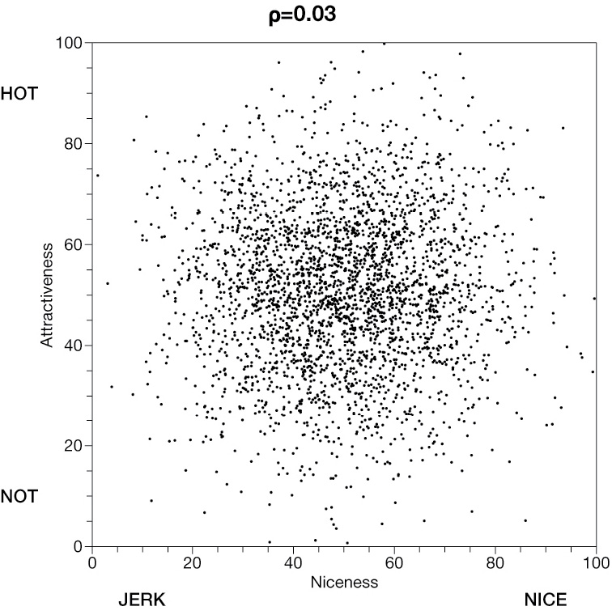 | 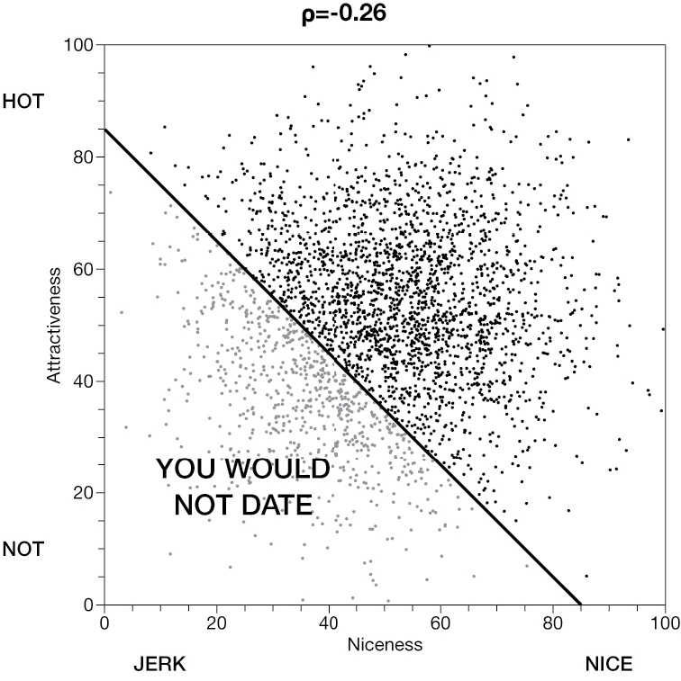 | 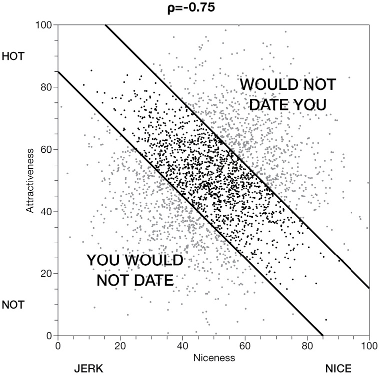 |

The underlying traits begin nearly unrelated. Selection makes them look strongly negatively related.

::: source
Source: Bergstrom and West (2021), Chapter 6.
:::

::: notes
Explain Berkson's paradox without requiring the term collider. In the full population, attractiveness and niceness are nearly unrelated. Restricting attention to people who are sufficiently high on either trait creates a tradeoff. A second selection rule strengthens it.

Text example: editors publish stories that are either highly newsworthy or exceptionally well sourced. Among published stories, newsworthiness and sourcing may appear negatively related even if they are unrelated among all pitches. Sampling only published texts conditions on a selection process influenced by both variables.
:::

## Selection into the archive can manufacture a pattern

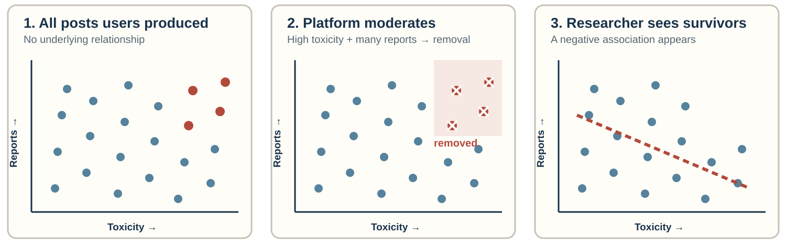{fig-alt="Three scatterplots showing unrelated toxicity and reporting among all posts, deletion of posts high on both variables, and an artificial negative relationship among surviving posts"}

::: {.fragment .key-line}
Among visible posts, highly toxic posts must have relatively few reports—and widely reported posts must be relatively nontoxic—to have survived.
:::

::: notes
Walk through the three graphs one at a time, using the same logic as the attractiveness-and-niceness example.

In the first graph, toxicity and reporting are unrelated among all posts users produced. Some highly toxic posts receive few reports, some receive many, and the same range appears among low-toxicity posts. The full population contains no systematic downward relationship.

In the second graph, impose a stylized moderation rule: the platform removes a post when it is both highly toxic and widely reported. The red upper-right observations are therefore missing from the archive. Emphasize that neither toxicity alone nor reports alone determines survival; availability depends jointly on both variables.

In the third graph, the researcher downloads only posts that remain accessible. Among these survivors, a highly toxic post could remain visible only if it attracted relatively few reports. A widely reported post could remain visible only if it was relatively nontoxic. The surviving dots therefore suggest a negative relationship that was absent among all produced posts.

Say: “Moderation did not merely reduce the number of observations. It changed the relationship visible in the data.” This is the corpus analogue of the attractiveness-and-niceness selection graph. Conditioning on availability creates the apparent tradeoff.

This example connects collider selection to corpus construction. Deleted content cannot be treated as missing at random, and a very large sample of surviving posts will reproduce the selected pattern with great precision.

Other examples: newspapers archive prominent stories more reliably than routine briefs; fact-checkers select claims using both perceived falsity and public importance; search engines rank documents using popularity and query relevance.
:::

## Sampling on the dependent variable

Suppose the outcome is whether a story contains a **violence frame**.

You search only for stories containing *riot*, *clash*, or *violent*.

::: {.fragment .key-line}
The search rule has already selected texts likely to score 1 on the outcome.
:::

::: notes
Sampling on the dependent variable means selecting cases based on the outcome or a close proxy for it. The resulting sample can be useful for studying what violence frames look like, but it cannot estimate how common violence framing is in all protest coverage.

The problem can be subtle. Students may say the query identifies “relevant” protest stories, but if outcome terms appear in the retrieval query, relevance and the dependent variable are entangled. Ask them to separate topic-identifying terms from outcome-identifying terms.
:::

## What outcome-based sampling destroys

:::::: triad
::: triad-item
**Prevalence**

The sample cannot show the share of all texts with the outcome.
:::

::: triad-item
**Variation**

Few or no outcome-negative cases remain for comparison.
:::

::: triad-item
**Association**

Relationships with sources, time, or a second concept can shrink, reverse, or become undefined.
:::
::::::

::: notes
Use a binary example. If every selected story includes a violence frame, the sample prevalence is 100 percent by construction. There is no outcome variation, so students cannot estimate whether framing differs by outlet or time.

Even partial outcome selection can distort associations. If highly emotional stories receive more engagement and the sample contains only highly shared stories, comparisons between emotion and another coded feature take place in a restricted, selected range.
:::

## Familiar forms of sampling on the outcome

| Research question | Tempting sample | Missing comparison |
|------------------------|------------------------|------------------------|
| Why do campaigns go viral? | Viral campaigns | Campaigns that did not go viral |
| What predicts policy adoption? | Adopted policies | Proposals that failed or never advanced |
| How common is misinformation? | Fact-checked claims | Claims never selected for fact-checking |
| Do apologies repair reputations? | Public apologies | Similar controversies without apologies |

::: notes
Emphasize that many famous research designs begin from outcome-positive cases because those cases are visible and easy to name. The issue is not moral failure. The issue is that the selection rule limits the estimand.

Fact-check archives are especially relevant to text research. They describe claims that fact-checkers chose to assess, not all public claims. Selection may depend on salience, perceived falsity, political importance, verifiability, and organizational priorities.
:::

## Outcome-based samples can answer narrower questions

An outcome-positive sample can support:

-   a **typology** of how the outcome appears
-   **measurement development** using information-rich cases
-   **process tracing** within cases where the outcome occurred
-   a case-control design when the sampling fractions and analysis match the design

::: {.fragment .key-line}
The design must narrow the claim rather than pretending the sample represents prevalence.
:::

::: notes
Do not teach a blanket prohibition. Purposive selection can be excellent for concept development and identifying forms of a phenomenon. A set of misinformation cases can help students refine a codebook. It cannot, by itself, estimate misinformation's prevalence.

Case-control studies deliberately sample on outcomes, but they reconstruct comparisons using controls and a model appropriate to the design. They can estimate some associations, especially odds ratios under standard conditions, but raw sample proportions do not estimate population risks.
:::

## Duplicates silently change the weights

One wire-service story appears at 24 local outlets.

You draw a random sample of **100 URLs**. Of those URLs:

-   24 contain versions of that wire story
-   76 contain other stories

> Should the wire story count once or 24 times? What would each choice make one observation represent?

::: notes
Do not answer the question on this slide. Give students thirty seconds to decide whether the wire story should count once or twenty-four times and require them to state the research question their choice answers.

Ask: “If all twenty-four versions contain the same episodic frame, what proportion of the one-hundred-URL sample contains that frame?” The answer is at least twenty-four percent before considering any other story. Then ask: “If we collapse those versions into one record, what has changed besides the sample size?” Collect predictions without resolving which estimate is correct.

Use the ambiguity to make the point that “duplicate” is not a purely technical property. Exact duplicates, lightly edited syndication, updated versions, and reposts can represent repeated exposure, repeated publication decisions, or one underlying editorial production. Advance before explaining the appropriate claim.
:::

## The duplicate rule defines the estimand {#duplicates-reveal}

::::: {.two-column .contrast}
::: column
### Keep every publication

Unit: a story as published by an outlet

Supports claims about **available coverage or exposure opportunities**.
:::

::: column
### Deduplicate the text

Unit: a distinct story or editorial production

Supports claims about **unique accounts or content production**.
:::
:::::

::: {.fragment .key-line}
Neither rule is automatically correct. Each changes the population and the weight given to syndicated content.
:::

::: notes
Now reveal the inferential consequence. Keeping all twenty-four publications gives the wire story twenty-four units because it was available through twenty-four outlets. That can be appropriate if the target is the coverage audiences could encounter or the set of outlet-level publication decisions.

Deduplicating gives the common text one unit. That can be appropriate if the target is distinct journalistic accounts, narratives, or editorial productions. But the resulting estimate no longer describes the distribution of stories across outlet pages. A widely syndicated story and a story published once receive equal weight.

Return to episodic framing. If syndicated wire stories are especially episodic, keeping every publication increases their contribution to the estimated prevalence. Deduplicating reduces that contribution. Neither operation reveals the uniquely correct prevalence because the two operations target different estimands.

Students should document the duplicate rule, similarity threshold, and which version survives. Deduplication after sampling differs from deduplication before sampling because the former can reduce the realized sample and change selection probabilities.
:::

## Time and availability shape the frame

| Decision | Pattern it can create |
|------------------------------------|------------------------------------|
| Sample one event week | Event-specific language looks typical |
| Stop after 300 results | Early or highly ranked texts dominate |
| Use only currently accessible URLs | Deleted and paywalled texts disappear |
| Collect from a live platform API | Platform and API rules define visibility |

::: notes
Stress that historical corpora are survivorship samples. Pages disappear, links rot, outlets change archives, and platform APIs return only permitted objects. “All posts” often means all posts still accessible through a particular interface at collection time.

For event-centered studies, the event may be part of the scope. Problems arise when students generalize from one unusually intense week to normal coverage.
:::

## What does this graph seem to show?

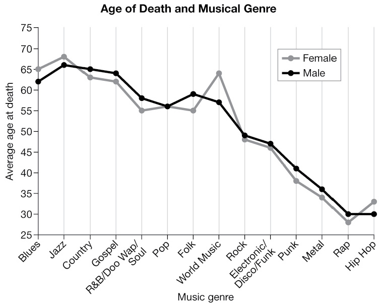{fig-alt="Line graph showing lower average age at death for musicians in newer genres, especially rap and hip-hop"}

::: source
Source: Bergstrom and West (2021), Chapter 6.
:::

::: notes
Say: “Look at the right side of the graph. The average recorded age at death for rap and hip-hop musicians is roughly thirty, compared with ages in the sixties for several older genres.”

Ask: “What conclusion does this graph invite?” Students will probably say that rap and hip-hop musicians die younger than jazz, blues, or country musicians. Ask for possible explanations, but do not yet name censoring. Students may propose violence, occupational risk, drug use, socioeconomic conditions, or characteristics of the music industry. Treat those as hypotheses the graph appears to invite.

Then ask the crucial data question: “Who had to be included in a dataset measuring age at death?” The answer is musicians who had already died. Pause there and advance to the next slide.
:::

## Censoring: unequal opportunity to observe an outcome

Hip-hop is a newer genre. Many artists who will eventually die at 70, 80, or 90 are **still alive** and therefore absent from a dataset of completed lifetimes.

> **Text-project RQ:** Are episodically framed stories associated with greater engagement?

Data collected on December 1:

| Story | Frame | Total shares | Time available to accumulate shares |
|----|----|---:|---:|
| Published September 1 | Thematic | 2,000 | 91 days |
| Published November 15 | Episodic | 900 | 16 days |

::: {.fragment .key-line}
Total engagement is not comparable when texts have unequal time at risk. Measure the same window, such as shares in the first seven days.
:::

::: notes
Reveal the explanation: hip-hop artists have had less calendar time to die at older ages. Blues and jazz have existed long enough for musicians from those genres to live into old age and then enter a dataset of deaths. Hip-hop emerged much later. Many hip-hop artists who will eventually die at seventy, eighty, or ninety are currently alive, so their eventual ages at death cannot yet appear. Among observed deaths, the newer genre is mechanically dominated by people who died unusually young.

Say: “The graph is not necessarily false about the recorded deaths. It is misleading about the lifespan of artists in each genre.” Inclusion depends on the outcome having occurred before the study ends. This is right censoring: some lifetimes are still in progress. Dropping those incomplete lifetimes makes recent cohorts or newer categories look shorter-lived.

Now translate it directly to a relational question in their text project. Say: “Imagine we want to know whether episodically framed stories receive more engagement than thematic stories. Engagement is the outcome, and it accumulates after publication.”

Read the table. The thematic story has two thousand shares and the episodic story has nine hundred. Ask: “Does this show that thematic framing produces more engagement?” The answer is no. The thematic story has had ninety-one days to accumulate shares, while the episodic story has had only sixteen. Publication time is built into the observed outcome.

Explain how this can bias an association across a larger sample. Suppose thematic stories were more common early in the semester and episodic stories became more common during a late breaking event. The thematic group will have longer exposure windows on average. A comparison of cumulative shares can make thematic framing look more engaging even if episodic and thematic stories accumulate shares at the same daily rate. The problem can also run in the opposite direction if the more recent stories receive an intense initial burst.

Recent stories have also had less time to receive corrections, fact-checks, deletion, or follow-up coverage. Comparing supposedly final outcomes across publication cohorts without equal observation windows can make recent texts look different by construction.

For their projects, the easiest remedy is to give every text the same follow-up window: shares accumulated during the first seven days, comments received during the first thirty days, or whether a correction appeared within sixty days. Then compare episodic and thematic stories using that common window. A more advanced study could model engagement over time or time to an event while retaining censored cases. If neither is possible, narrow the claim to engagement observed by a stated collection date and avoid treating totals as comparable exposure-adjusted outcomes.

End with: “Censoring is unequal opportunity to observe an outcome. It matters here because engagement develops after publication. Episodic framing can be measured when the story is published, but eventual engagement is not yet fully observed for recent stories.”
:::

## Probability and purposive samples answer different questions

::::: {.two-column .contrast}
::: column
### Probability sample

Known selection chances support population estimates and uncertainty calculations.
:::

::: column
### Purposive sample

Information-rich cases support concept refinement, typology building, and difficult coding tests.
:::
:::::

::: notes
Students may need both during the project. Use a purposive pilot to test the codebook against borderline and difficult cases. After freezing the codebook, draw a probability sample for the descriptive analysis.

Mixing the stages creates a problem if memorable pilot cases enter the final analysis with unknown probabilities. Keep pilot and final samples separate unless the final design explicitly incorporates them with known weights.
:::

## Random does not mean perfectly representative

```{=html}
<div id="sampling-simulation" class="sampling-simulation" aria-label="Interactive simulation of repeated simple random samples">
  <div class="sim-topline">
    <div><strong>Population:</strong> 30% gold texts</div>
    <div><strong>Current sample:</strong> <span data-sample-share>—</span></div>
    <div><strong>Average of samples:</strong> <span data-running-mean>—</span></div>
  </div>
  <div class="sim-population" data-population aria-label="Population of one hundred texts; thirty are gold"></div>
  <div class="sim-controls">
    <span>Sample size:</span>
    <button type="button" data-size="10" aria-pressed="true">10</button>
    <button type="button" data-size="30" aria-pressed="false">30</button>
    <button type="button" data-size="60" aria-pressed="false">60</button>
    <button type="button" data-draw>Draw once</button>
    <button type="button" data-run>Run 30 samples</button>
    <button type="button" data-clear>Clear</button>
  </div>
  <div class="sim-history" data-history aria-label="Estimates from repeated samples"></div>
  <div class="sim-axis"><span>0%</span><span class="truth">population = 30%</span><span>60%</span></div>
</div>
```

::: {.fragment .key-line}
Probability sampling makes the estimate correct **on average**. Larger random samples vary less. Neither fixes a population missing from the frame.
:::

::: notes
Say: “This population contains one hundred texts. Thirty are gold. Imagine gold means the text contains our coded frame. Because we can see the entire population, we know the true prevalence is 30 percent.”

Before touching the controls, ask: “If I take a simple random sample of ten texts, must exactly three be gold?” The answer is no. Every text has the same known chance of selection, but one realized sample can be unbalanced.

Leave the sample size at ten and click **Draw once** several times. Read the current percentages aloud. Say: “The estimate jumps because small samples contain substantial sampling error. Random does not mean perfectly representative every time.” Then click **Run 30 samples**. Each mark is one estimate. Ask students where the marks are centered. The estimates differ, but their average should move toward the population value of 30 percent.

Click **Clear** to empty the history, then change the sample size to sixty and run thirty samples again. Say: “The center has not changed. What changed is the spread. Larger random samples are more consistently close to the population.” This is the law-of-large-numbers intuition students need; do not promise that every large sample is exact.

Make the limitation explicit: “This demonstration starts from a complete frame. If climate-skeptical outlets are absent from the frame, random sampling from the remaining outlets faithfully represents the wrong population. Random selection controls sampling error within the frame; it does not repair coverage, retrieval, nonresponse, or coding error.”

For their project, preserve the complete list of eligible text IDs, use a reproducible random seed, and document what happened to sampled texts that could not be retrieved. Do not silently replace inaccessible cases with convenient ones.
:::

## Three ways to sample individual texts

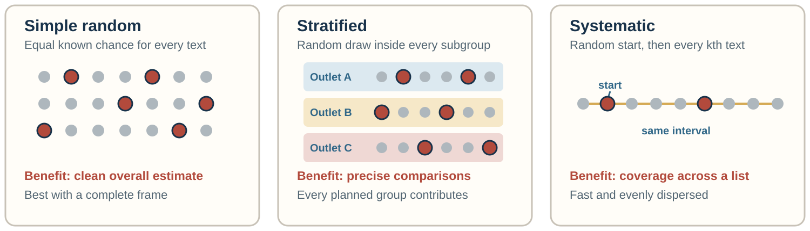{fig-alt="Diagrams comparing simple random, stratified, and systematic sampling and stating the benefit of each design"}

::: {.fragment .key-line}
For most class projects: stratify only on comparisons named in the research question.
:::

::: notes
Say: “These three designs select individual texts. The difference is how the draw is organized.”

For simple random sampling, every eligible text has the same known chance. Use it when the frame is complete and the central goal is one overall prevalence estimate. Its weakness is not bias; it is that a small but theoretically important group may contribute very few cases by chance. If five percent of the corpus comes from nonprofit outlets, a sample of one hundred contains only about five such texts on average.

For stratified sampling, split the frame into groups first and conduct a random draw inside every group. This is likely the most useful option when the research question explicitly compares outlets, genres, or periods. Suppose Outlet A supplies 80 percent of the frame and Outlet B supplies 20 percent. Drawing one hundred texts from each outlet makes the comparison much more precise. But the combined sample is now half A and half B, unlike the population. Weight the outlet-specific estimates by their population shares before reporting overall prevalence.

Emphasize that strata must be known before coding the focal outcome. Sampling equal numbers of texts that do and do not contain the frame is sampling on the dependent variable and destroys an ordinary prevalence estimate. Outlet, month, language, and source type can be legitimate design variables when they are available for the entire frame.

For systematic sampling, choose a random starting position and then take every kth record. If the frame contains 12,000 texts and the target is 300, take roughly every fortieth text after a random start. This is convenient and spreads the draw across the list. First inspect the ordering: if outlet types or weekdays repeat every fortieth record, the interval can repeatedly hit the same kind of case.

Conclude: “Choose the design from the claim. Simple random sampling prioritizes the overall corpus. Stratification prioritizes comparisons. Systematic sampling prioritizes even coverage of a long ordered frame.”
:::

## Two ways to sample groups before texts

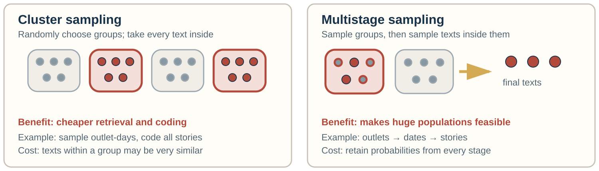{fig-alt="Diagrams comparing cluster and multistage sampling and stating the benefit and cost of each design"}

::: {.fragment .key-line}
Sampling three convenient events and every article about them is clustered—but not probability sampling.
:::

::: notes
Say: “Sometimes the practical unit we can sample first is a group rather than a text.”

In cluster sampling, define natural groups such as outlet-days, discussion threads, episodes, events, classrooms, or program sites. Randomly select groups and then code every eligible text in the selected groups. The payoff is logistical. A team may need to open only twenty daily archives rather than retrieve scattered documents from hundreds of pages.

The statistical cost is similarity within groups. Twenty articles about the same breaking-news event tend to share facts, language, and frames. They do not contain as much independent information as twenty articles dispersed across unrelated dates and topics. One hundred texts from five event clusters may therefore tell us less about routine coverage than one hundred texts spread across the semester.

Multistage sampling repeats probability selection at several levels. A national project might sample outlets, then sample dates within outlets, then sample texts within dates. This makes the frame-building task feasible: the researchers do not need a single national list of every text before sampling begins. But the final probability that a text is selected depends on every stage. The team must preserve the outlet, date, and text selection probabilities if it wants weighted population estimates.

Distinguish a probability cluster design from convenience: choosing three famous controversies and coding everything about them does not make the controversies representative. The texts may be exhaustively coded within each selected event, yet the event-selection step still limits the claim.

For most student projects, do not use multistage sampling merely because it sounds sophisticated. Use it only when the target population is too large to enumerate at the text level and every stage can be sampled and documented.
:::

## Choose the design from the inferential goal

| Primary goal | Best starting design | Why |
|------------------------|------------------------|------------------------|
| Estimate overall prevalence | **Simple random** | Mirrors the complete frame without deliberately changing its composition |
| Compare outlets, genres, or periods | **Stratified** | Guarantees usable samples from every planned comparison group |
| Spread cases across an ordered list | **Systematic** | Produces dispersed coverage with a random start |
| Reduce retrieval costs | **Cluster** | Concentrates work in selected outlet-days, events, or threads |
| Make a huge population feasible | **Multistage** | Builds and samples the frame in documented stages |

::: {.fragment .key-line}
There is no universally best design. Match the design to the claim and the practical constraint.
:::

::: notes
Use this as the decision slide after the diagrams. Ask students to state their primary inferential goal before naming a method.

If they want one overall estimate from a complete frame, simple random sampling is the clean baseline. If their research question compares groups, stratification is usually more useful because a simple random sample may yield too few cases from a small group. Systematic sampling is primarily a practical way to disperse observations across an ordered frame. Cluster sampling buys logistical efficiency at the cost of correlated observations. Multistage sampling is justified when the population cannot feasibly be listed at the text level in one step.

The same project may combine designs. A team might stratify by outlet type and draw a simple random sample within each stratum. Describe the actual sequence of selection operations rather than merely attaching one method label.
:::

## When you cannot draw a probability sample

Most project corpora come from an API, a keyword search, or a platform archive. You can still:

1.  **Redefine the population** as the frame you can actually enumerate, and say so
2.  **Document the selection process**: query, dates, platform rules, exclusions
3.  **Benchmark** the corpus against known distributions such as outlet mix, dates, or languages
4.  **Stratify or post-stratify** on variables known for the frame—never on the coded outcome
5.  **Run sensitivity checks**: alternative queries, windows, or duplicate rules
6.  **Narrow the claim** to what the selection process supports

::: {.fragment .key-line}
A convenience corpus with a documented selection process supports a narrower but honest claim.
:::

::: notes
Say: “Most of you will not have a complete list of texts and a random-number generator. That does not end the project; it changes the claim.”

Redefining the population is the most important move. “All posts returned by the academic API for query Q between dates D1 and D2” is a population you can describe exactly, even if it is not “public discourse.” Documentation makes the selection process inspectable by readers.

Benchmarks reveal how the corpus differs from a broader target. If a news database is 70 percent national outlets but national outlets publish 30 percent of relevant stories, the comparison shows the direction of likely distortion. Post-stratification can reweight the observed groups toward known shares, but only for variables known for both the corpus and the target, and only where the corpus contains cases from each group. We will return to that limit as “overlap” in Part 3.

Sensitivity checks make retrieval choices visible. If the estimated prevalence moves from 40 to 60 percent when the query changes, report that range rather than one number.

Remind students not to stratify on the coded concept itself: that is sampling on the dependent variable in a new form.
:::

## How many texts do you need?

| Texts coded | 95% margin of error, prevalence near 50% | Prevalence near 10% |
|---:|---:|---:|
| 100 | ± 9.8 points | ± 5.9 points |
| 300 | ± 5.7 points | ± 3.4 points |
| 1,000 | ± 3.1 points | ± 1.9 points |

-   Each **subgroup** comparison uses only that subgroup's *n*.
-   **Rare concepts**: at 5% prevalence, 300 texts yield about **15 positive cases**.
-   Texts clustered in outlets, events, or duplicates carry **less information** than *n* suggests.
-   **Coder capacity** limits *n*: rushed coding adds error that more texts cannot remove.

::: {.fragment .key-line}
A smaller probability sample can support a clearer claim than a large convenience sample.
:::

::: notes
These are simple-random-sample margins: 1.96 × √(p(1 − p)/n). The useful rule of thumb is that quadrupling the sample halves the margin. Going from 300 to 1,200 texts takes the margin near 50 percent prevalence from about ±6 to about ±3 points.

Then emphasize subgroups. If the research question compares four outlets, each outlet's estimate rests on roughly one quarter of the sample, so a 300-text study behaves like four 75-text studies for those comparisons. Stratification can guarantee each group enough cases.

For rare concepts, 15 positive cases is an expected count, not a guarantee. That may be enough for a rough prevalence estimate but too few for stable subgroup comparisons or reliability estimates. Options include increasing the sample, stratifying on a variable related to the concept but not defined by it, or a two-phase design: screen a large probability sample with a cheaper measure, then intensively code selected strata while retaining known probabilities. Simply searching for the outcome does not preserve prevalence.

Clustering inflates the margins in the table. Twenty texts about one event share facts and frames; they behave like fewer independent observations.

Avoid giving a universal minimum. A study estimating one overall proportion needs fewer observations than a study comparing six outlets across four periods. Coding quality also constrains sample size: expanding the corpus at the cost of rushed or inconsistent coding can increase total error even as sampling error falls.
:::

## Sampling the reliability subsample

Intercoder reliability is itself an estimate—from a sample of units.

-   Draw it **at random from the analysis sample**, not from pilot or hand-picked cases
-   Make sure **rare categories appear** often enough to test agreement on them; stratify if needed
-   Have every coder code it **independently**, after the codebook is frozen
-   Size depends on the **rarest category** and the minimum acceptable reliability, not a fixed percentage

::: {.fragment .key-line}
Reliability estimated on easy or atypical texts does not describe reliability on the texts you analyze.
:::

::: notes
Say: “You will report a reliability coefficient for your codebook. That coefficient generalizes from the reliability subsample to the full set of coded texts, so the same sampling logic applies.”

Pilot cases are usually chosen to be difficult or information-rich. They are perfect for revising the codebook and poor for estimating reliability, because their difficulty is unrepresentative. Conversely, a reliability sample in which the rare category barely appears can produce high percent agreement while saying almost nothing about whether coders agree on that category. Krippendorff recommends sizing the reliability sample so that the least frequent relevant category appears enough times to be tested, and Lacy and Riffe (1996) give formulas tying the size to the population size, expected agreement, and the desired precision.

If students oversample a rare category for reliability purposes, they should say so and remember that the reliability sample is then not a probability sample of texts.

Practical steps: draw the reliability IDs with a recorded seed, keep them in the main dataset with a flag, and resolve disagreements only after the coefficient has been computed.
:::

## How far does the claim travel? {.section-title}

[Part 3 of 4]{.kicker}

> A good sample supports a claim about its frame. When can that claim reach further—to other outlets, periods, platforms, or people?

::: notes
Mark the turn. Part 2 asked how to get an accurate estimate for the population a sample was drawn from. Part 3 asks how far beyond that population the result can travel. Remind students of the four opening cases: each had credible evidence, and each was stretched to a different target. We now name what changed, starting with external validity and ending with M-STOUT.
:::

## External validity

> To what population, setting, treatment, outcome, and time does this inference apply?

Findley, Kikuta, and Denly treat external validity as a property of an **inference**, not a badge attached to a method.

::: {.fragment .key-line}
The preceding studies did not all have weak evidence. Their evidence answered narrower questions than the claims people wanted to make.
:::

::: notes
Now name the shared problem. External validity concerns the relationship between an inference and its intended target. It is not a permanent badge attached to an experiment, a dataset, or a sampling method.

Return briefly to the cases. Opower changed sites and customers. The nudge literature selected which experimental results became visible and then moved into routine government settings. The newspaper example changed the time structure. The Twitter/X example changed the platform and the units, from posts to users to citizens.

A probability sample can support generalization to its frame, while the broader substantive claim may still travel poorly. This distinction prepares the next slide on generalizability and transportability.

Source: Findley, Kikuta, and Denly (2021), pp. 365–373.
:::

## Measurement and external-validity estimands

| Question | What must be specified? | Coding-project example |
|------------------------|------------------------|------------------------|
| **Measurement estimand** | What feature is measured, on which unit, and how it is summarized | Proportion of articles with at least one conflict frame |
| **External-validity estimand** | For which population, setting, and time that quantity is wanted | That proportion across all eligible local-newspaper articles during the semester |

::: {.fragment .key-line}
Measurement defines the quantity. External validity defines its intended scope.
:::

::: notes
Say: “There are two targets embedded in a content-analysis claim.”

First is the measurement estimand. What property of what unit will the coding represent? “Conflict framing” could mean at least one instance anywhere in an article, the number of conflict-frame sentences, or the proportion of paragraphs using the frame. Those are different quantities even before sampling enters the discussion. The codebook, unit of analysis, aggregation rule, and treatment of ambiguous cases determine which one is measured.

Second is the external-validity estimand. Over which population should that measurement be averaged? The target might be all eligible articles in a frozen database query, all reporting by twelve named outlets during one semester, or all U.S. local-newspaper coverage. Those targets require different evidence.

Give the complete example: “Our measurement estimand is the proportion of articles containing at least one conflict frame. Our external-validity estimand is that proportion among all eligible local-newspaper articles about campus protest published during the fall semester.”

External validity goes wrong when a study estimates the measurement quantity within the observed texts but silently changes the population attached to it. A reliable code does not show that the sampled outlets, dates, languages, or platforms represent a broader target.
:::

## Generalizability and transportability

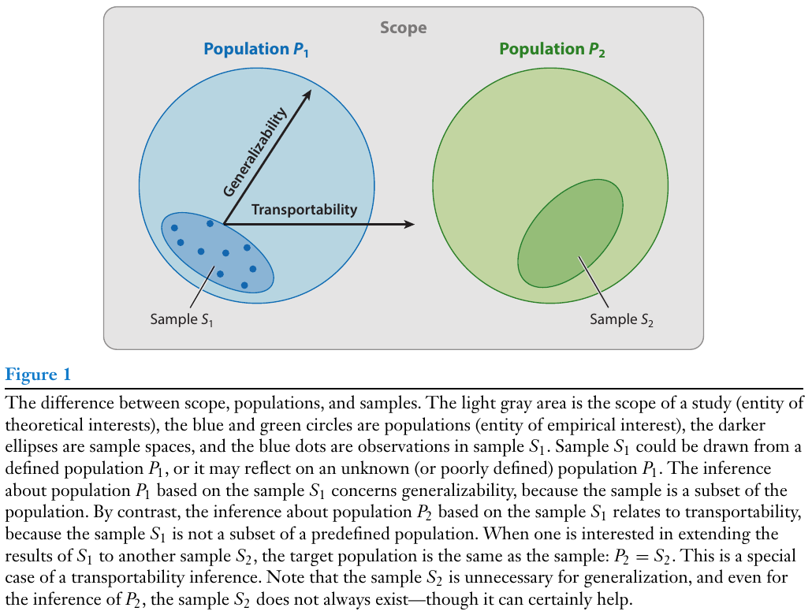{fig-alt="Diagram distinguishing generalization from sample S1 to population P1 and transport from P1 to P2"}

::: source
Source: Findley, Kikuta, and Denly (2021), Figure 1.
:::

::: notes
Generalizability moves from sample S1 to the population P1 from which it is understood to come. Transportability moves from S1 to a different population P2. The second move requires stronger justification because S1 was not drawn from P2.

Coding-project example: generalizing from a random sample to the full frozen LexisNexis frame is one inference. Claiming the same pattern characterizes television, social media, future coverage, or newspapers outside the source list is transportability.
:::

## Descriptive and causal external validity

| Descriptive study | Causal study |
|------------------------------------|------------------------------------|
| Does the observed pattern represent the target population? | Would the intervention have a similar effect in the target population? |
| Main concern: who or what enters the corpus | Main concern: whether effects vary across people, places, or implementations |
| Example: prevalence of a conflict frame | Example: effect of a conflict frame on sharing |

::: {.fragment .key-line}
Representativeness matters differently for describing a population and transporting an effect.
:::

::: notes
Say: “External validity is not exactly the same problem in descriptive and causal research.”

For a descriptive content analysis, the target quantity might be the prevalence of a conflict frame. If outlets, periods, or text types enter at different rates, the sample prevalence can differ from the target-population prevalence. Representativeness of the corpus is central.

For a causal study, the target quantity is an effect, such as how exposure to a conflict-framed headline changes sharing. A sample can differ demographically from the target yet still transport if the effect is genuinely similar across those differences. Conversely, a randomized experiment can estimate a credible effect inside the study while transporting poorly if the effect changes across people, settings, or treatment versions.

Use Opower to make the distinction. Random assignment supported the causal comparison in each utility. External validity failed because the size of the effect varied with baseline energy use, prior conservation interest, and implementation context, and those features differed between early and later sites.
:::

## When sample differences change the result

A **modifier** is a characteristic that changes the pattern or effect being estimated.

-   Baseline energy use modified Opower's effect.
-   Outlet type may modify the prevalence of a news frame.
-   Political interest may modify responses to a campaign message.

**Overlap** asks whether the sample contains cases comparable to those in the target.

::: {.fragment .key-line}
Reweighting can rebalance observed groups. It cannot invent evidence for target cases absent from the sample.
:::

::: notes
Define a modifier in plain language: a characteristic across which the result changes. In a descriptive study, call it a pattern modifier. In a causal study, call it an effect modifier.

Return to Opower. Higher-use households had more electricity consumption available to reduce, so the report produced larger reductions for them. As later programs included lower-use households, the average effect declined. Baseline use mattered because it modified the effect, not merely because the sample demographics looked different.

Now define overlap. To learn about the target, the study needs some cases comparable to the relevant target cases. If an experiment includes only high-use households, statistical weighting cannot reveal with confidence what the intervention would do among households with extremely low use. The needed comparison is outside the support of the data.

Give content-analysis examples. National-newspaper articles cannot simply be reweighted into TikTok videos. English-language texts provide no direct evidence that a code measures the same construct in Arabic. Election-period posts may contain no analogue of ordinary-period conversation. In each case, the problem is not an incorrect weight. The target contains cases the observed data do not represent.
:::

## Henrich: who supplied the evidence?

Henrich, Heine, and Norenzayan reviewed the populations behind claims about human psychology.

-   **96%** of participants in a major journal audit came from Western industrialized countries containing about **12%** of the world's population.
-   **68%** came from the United States.
-   A randomly selected American undergraduate was estimated to be over **4,000 times** more likely to become a research participant than someone outside the West.

::: {.fragment .key-line}
The most studied population was often treated as the default human population.
:::

::: notes
Introduce Henrich and colleagues as a review article, not one new experiment. Their question was: who supplies the evidence used to build general theories of human psychology, and how unusual are those participants when comparative evidence exists?

Explain the audit. The underlying journal review examined samples published in leading psychology journals. Sixty-eight percent of participants came from the United States, and 96 percent came from Western industrialized countries that contained about 12 percent of the world's population. Many samples consisted entirely of psychology undergraduates.

The 4,000-to-one comparison is meant to make the inclusion probability vivid. A randomly selected American undergraduate was estimated to be more than 4,000 times as likely to participate in a behavioral-science study as a randomly selected person outside the West.

Connect this to the framework. Even generalization to all American adults is uncertain when the sample consists of undergraduates near a university. Moving from those students to people in different societies is a transportability claim. Much of the literature skipped both steps and wrote about “people” or “humans.”

Source: Henrich, Heine, and Norenzayan (2010), drawing on Arnett (2008).
:::

## Henrich: even visual perception varied

::::: two-column
::: column
### The stimulus

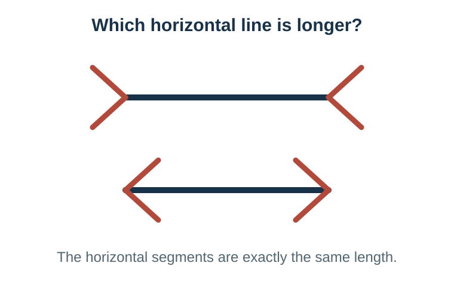{height="380px" fig-alt="Two equal horizontal lines with inward- and outward-facing fins that make the lines appear to have different lengths"}
:::

::: column
### The comparative result

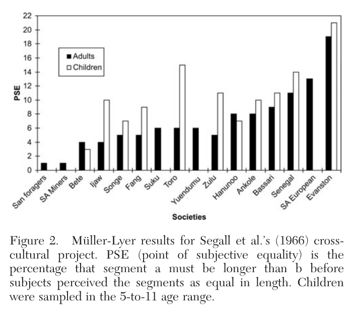{height="430px" fig-alt="Bar chart showing cross-cultural variation in susceptibility to the Muller-Lyer illusion"}
:::
:::::

American adults and children showed the strongest illusion. For San foragers, the measured effect was statistically indistinguishable from zero.

::: source
Source: Henrich, Heine, and Norenzayan (2010), Figure 2.
:::

::: notes
Begin with the stimulus on the left. Ask students which horizontal line appears longer. Then reveal that the center segments are exactly equal. The outward- and inward-facing fins change perceived length even though the physical line lengths do not differ.

Now explain the comparative test before interpreting the graph. Researchers varied the physical lengths until participants judged the lines to be equal. The vertical axis records how much one line had to be lengthened before it looked equal to the other. A higher value means a stronger illusion.

The comparison covered sixteen societies, including fourteen small-scale societies. American adults and children sat at the extreme. American adults required one line to be roughly a fifth longer before the two appeared equal, and their result differed significantly from every other society. At the other end, the estimate for San foragers could not be distinguished from zero.

The proposed explanation is the “carpentered world” hypothesis. People raised among rectangular rooms, straight roads, and right-angled buildings learn to interpret angled line junctions as depth cues. The point is not that one group sees correctly and another incorrectly. Visual systems calibrate to recurring features of their environments.

Ask what this contributes to transportability. A laboratory procedure can remain identical while the setting and developmental history of the units change the result. If even a supposedly basic perceptual effect varies, researchers cannot assume in advance that more socially embedded outcomes will travel.

Point ahead: the next slide shows that perception was not an isolated case.
:::

## Other ways WEIRD samples were unusual {#henrich-through-m-stout}

| Study task | Common WEIRD result | Comparative evidence |
|------------------------|------------------------|------------------------|
| **Ultimatum game** | High offers and strong punishment of unfair offers | Offers varied widely; market integration and community size predicted behavior |
| **Folk-biological reasoning** | Urban children treated humans as the default animal | Menominee and Maya children with ecological experience did not |
| **Spatial reasoning** | Locations described relative to the body: left and right | Some language communities relied on absolute directions such as north and south |
| **Visual attention** | Greater focus on a focal object | East Asian samples attended more to relationships and background context |

::: {.fragment .key-line}
WEIRD participants were frequently not near the global average—they sometimes occupied an extreme.
:::

::: source
Source: Henrich, Heine, and Norenzayan (2010).
:::

::: notes
Say: “The Müller-Lyer illusion was not an isolated example. Henrich and colleagues reviewed several research traditions in which findings from Western students had been treated as general features of human psychology.” Explain each task before discussing the comparison.

In the **ultimatum game**, one participant proposes how to divide a real sum of money. The second participant may accept, in which case both receive the proposed amounts, or reject, in which case both receive nothing. U.S. and other Western participants typically offered substantial shares and often rejected very unequal offers, thereby paying to punish unfairness. Across small-scale societies, both offers and rejection patterns varied widely. Communities with greater market integration and larger scale tended to make higher offers, while participation in world religions was associated with some forms of fairness toward anonymous others. The comparative evidence suggested that anonymous fairness behavior is shaped by institutions and market experience rather than generated by one universal preference in the same way everywhere.

In **folk-biological induction**, children learn that one species has a biological property and are asked which other species probably share it. Urban U.S. children often generalized outward from humans, treating humans as the default example of an animal. Rural Menominee and Yukatek Maya children, who had much more everyday contact with plants and animals, did not show the same human-centered pattern. What had been interpreted as a universal developmental tendency partly reflected growing up with limited ecological experience.

In **spatial-reasoning tasks**, English-speaking participants commonly represented locations relative to their own bodies using left, right, front, and behind. Some language communities instead relied heavily on absolute geographic coordinates comparable to north, south, east, and west—even at small spatial scales. Speakers maintained geographic orientation and remembered arrangements in ways that differed from the egocentric strategy familiar to Western researchers. The cognitive result traveled poorly because language and everyday navigation practices differed.

In **visual-attention studies**, Western participants were more likely to describe or remember a focal object independently of its background. East Asian participants more often attended to relationships among objects and to contextual background. A classic task displayed an animated underwater scene containing one prominent fish plus plants and smaller animals. American participants more readily reported the focal fish; Japanese participants reported more contextual details and relationships. This challenged theories that treated analytic attention to isolated objects as the human default.

After the four rows, ask: “Were the samples merely demographically different, or did the relevant experiences and institutions change the psychological process?” The answer is the latter. Markets, schooling, language, built environments, subsistence practices, and ecological experience provide more useful hypotheses than the undifferentiated statement that culture matters.

Connect this to M-STOUT only after the studies are understood. The units differed, but so did settings and mechanisms: market institutions, language systems, navigation demands, schooling, and ecological experience. The outcome task could also carry different meanings across populations. The lesson for text projects is structural: the easiest material to collect—national newspapers, English-language texts, highly visible posts, or fact-checked claims—may likewise occupy an extreme of the wider communication environment.
:::

## M-STOUT

::: mstout-row
**M**echanisms  **S**ettings  **T**reatments  **O**utcomes  **U**nits  **T**ime
:::

An inference travels when the relevant process remains comparable across these dimensions.

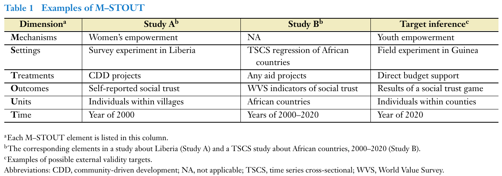{fig-alt="Findley, Kikuta, and Denly Table 1 comparing two aid studies and a target inference across mechanisms, settings, treatments, outcomes, units, and time" width="88%"}

::: source
Source: Findley, Kikuta, and Denly (2021), Table 1.
:::

::: notes
Walk across Findley and colleagues' Table 1. Study A is a survey experiment in Liberia on community-driven development projects, measuring self-reported trust among individuals in 2000. Study B is a cross-national regression on any aid across African countries, 2000–2020. The target is a 2020 field experiment in Guinea on direct budget support, measured with a trust game. Ask: on how many rows does each study match the target? The answer is almost none, which shows that “we have evidence on aid and trust” hides six separate transport questions.

The original UTOS framework includes units, treatments, outcomes, and settings. Findley and colleagues add mechanisms and time. The acronym is a diagnostic framework rather than a mechanical score.

For descriptive text projects, “treatment” may seem awkward. Treat it as the focal exposure or explanatory variable if the project makes an associational claim. If the project is purely descriptive, students should still ask whether the stimulus, message, intervention, or category has the same operational meaning across targets.
:::

## Mechanisms, treatments, and outcomes

| Dimension | Same label, different thing | Example |
|---|---|---|
| **Mechanism** | The same association, produced by a different process | Angry posts get engagement through arousal, group signaling, or algorithmic ranking |
| **Treatment** | The same label, delivered differently | “Misinformation exposure”: one survey headline, repeated posts from a trusted account, or an algorithmic feed |
| **Outcome** | The same construct, measured differently | “Sharing”: stated intention, a simulated click, or a real repost; a hostility dictionary built on news prose applied to slang |

::: {.fragment .key-line}
A finding about one version of the process does not automatically apply to another.
:::

::: notes
Tell students these three dimensions matter for understanding the literature, but they do not need to diagnose them for their current descriptive coding project.

**Mechanism** is the process that produces the result. If anger drives engagement through psychological arousal, transport depends on whether the target audience reacts similarly. If it works through identity signaling, it may weaken outside a polarized group context. If an algorithm supplies the amplification, the association may disappear after a platform redesign or on a platform with a different ranking system. A voter-information letter may likewise work through knowledge, trust in the government source, or felt social pressure; each implies different scope conditions.

**Treatment** is the intervention, message, exposure, or focal explanatory condition. Researchers often keep one label while changing what participants experience. A single headline shown once by a researcher has a controlled source, dose, and context. Real exposure may involve repetition, trusted friends, visible popularity, corrective comments, and algorithmic selection. Other variations: a fact-check shown before versus after a claim, a journalist versus an anonymous source, a human-written versus AI-generated appeal. A personalized reminder written by a research team may not predict the effect of an automated mass email.

**Outcome** is the result being measured, including its operationalization, scale, and observation window. Sharing intention may not predict actual sharing when behavior becomes public. A simulated click lacks a real audience. An observed repost depends on which opportunities the platform provides. In descriptive research, a sentiment or hostility dictionary trained on newspaper prose may misread sarcasm, emojis, dialect, or reclaimed slurs. This measurement-equivalence question is the one most relevant to their projects: does the same coding rule mean the same thing across the texts they want to compare?
:::

## External validity can fail even with a representative sample

| Threat | What changes outside the study? | Example |
|---|---|---|
| **Interference** | One unit's treatment changes another unit's outcome | Fact-checking one post changes what others share |
| **Scale and equilibrium** | Widespread adoption changes the environment | A rare alert attracts attention; alerts everywhere are ignored |

::: {.fragment .key-line}
A representative sample cannot rescue a treatment or social system that changes at the target.
:::

::: notes
Say: “We have emphasized who and what enters the sample. But external validity can fail even when the sample perfectly represents the target population.”

Interference means that one unit's treatment affects another unit's outcome. In a sharing experiment, correcting one participant may change what that participant's friends later see. The effect when five percent of users are treated may differ from the effect when everyone is treated. Standard individual-level estimates often assume those spillovers away.

Scale and equilibrium effects arise because broad adoption changes the environment. One unusual warning label may attract attention; warning labels on every item may be ignored. A job-training program may help a small group compete for fixed jobs but produce a different effect when offered to everyone. The target is no longer the same system observed in the study.

Keep their project diagnostic focused on settings, units, and time, which comes next.
:::

## Project focus: settings, units, and time

| Dimension | What may differ? | Examples |
|------------------------|------------------------|------------------------|
| **Settings** | Institutional, platform, or social environment | National newspaper versus campus outlet; database archive versus live feed |
| **Units** | People, texts, outlets, places | National outlets versus local outlets; original posts versus reposts; English-language versus multilingual texts |
| **Time** | Events, institutions, technology | Election month versus ordinary months; before versus after a platform redesign; 2026 language applied to a 2010 archive |

::: notes
Tell students explicitly: “For your current coding project, apply only S, U, and T: settings, units, and time. We are not asking you to make a causal claim about mechanisms or treatments, and we are holding the coded outcome definition fixed for now.”

For settings, ask whether institutional rules, platform affordances, or source environments differ. National and campus newspapers operate with different resources, audiences, and editorial routines.

For units, ask what pattern modifiers differ. An outlet's editorial model, audience, region, and ownership may matter. A population count alone does not show comparability.

For time, connect to concept drift. Terms change meaning, issue agendas shift, platforms change affordances, and models trained in one period degrade. A codebook can be reliable within a period yet fail to preserve the same construct historically.
:::

## The opening cases through M-STOUT

| Case | Most important dimensions | What would strengthen the broader claim? |
|------------------------|------------------------|------------------------|
| Opower | Settings, units, treatment, mechanisms | Later sites and lower-use customers |
| Nudges | Treatments, settings, outcomes, time | Complete archives and routine implementation |
| Newspapers | Time and setting | Dates distributed across the production cycle |
| Twitter | Units, settings, mechanisms | User benchmarks and evidence beyond the platform |

::: {.fragment .key-line}
M-STOUT is useful when it identifies what evidence the broader claim still needs.
:::

::: notes
Return to all four opening cases now that students know M-STOUT. Ask for the single most important dimension in each row before discussing the final column.

For Opower, settings and units are central; treatment and mechanism also changed as targeting expanded. For nudges, intervention intensity, delivery, institutional setting, and which results entered the published record all mattered. For newspapers, the central problem is time structured by a production cycle. For Twitter, the unit shifts from posts to users to citizens, while participation and platform mechanisms determine visibility.

Spend extra time on the two content-analysis rows. For newspapers, time has structure: Monday content resembles other Mondays more than Sunday content because staffing, sections, deadlines, and advertising repeat weekly. The constructed week works because it matches that production process. Social-media volume instead rises and falls around events, so the right time sample depends on how those texts are produced. Say: “A sampling method does not possess external validity on its own. Its performance depends on the data-generating process in the target corpus.”

For Twitter, walk down the population ladder: tweets stand for users only if we ignore that heavy posters contribute many more units; political tweeters stand for the public only if platform adoption, political interest, and willingness to post do not matter; an election window stands for ordinary politics only if campaigns do not change who speaks. Contrast the precise claim, “Thirty percent of the sampled tweets used a conflict frame,” with the unsupported claim, “Thirty percent of Americans framed the issue as conflict.” The code can be perfectly reliable while that transport claim fails.

Emphasize that “settings differ” is not yet a useful conclusion. A diagnosis should say which setting difference could change the result and what new sample, benchmark, or replication would test it.
:::

## Evidence that supports transport

1.  Sample directly from the intended target when possible.
2.  Measure plausible pattern or effect modifiers.
3.  Compare the sample with target-population benchmarks.
4.  Reweight only where sample and target overlap.
5.  Replicate across settings and times chosen to test the theory's boundaries—not three more national newspapers.
6.  Test whether the measure retains the same meaning.
7.  Narrow the claim when the evidence cannot support the broader target.

::: {.fragment .key-line}
External validity is an evidence-backed argument, not a property automatically conferred by a method.
:::

::: notes
This is the constructive slide. Work from the strongest solution to the weakest.

Direct sampling from the target reduces the inferential distance. Measuring plausible modifiers allows the researcher to test whether the pattern changes across the dimensions theory says should matter. External benchmarks reveal how the sample differs from the target.

Reweighting can correct differences in the composition of groups represented in both datasets, but it depends on measuring the relevant modifiers and having adequate overlap. It should not be presented as a universal repair.

Replication is most informative when the new setting challenges the proposed scope. Finding the same pattern in three national newspapers, two adjacent election months, and several English-language keyword variants establishes robustness within that slice. It does not show that the pattern travels to local news, other languages, ordinary periods, or other media. This is the content-analysis equivalent of repeatedly sampling WEIRD undergraduates. Ask students to propose a “hard” replication for their project: a source, period, or genre in which theory predicts the pattern should weaken or change.

Measurement equivalence matters because a code or scale can change meaning across targets. A sentiment dictionary validated on edited news prose may interpret slang, reclaimed language, or sarcasm incorrectly on a social platform.

Finally, narrowing the claim is a legitimate scientific result. If the available evidence supports a statement about twelve outlets during one semester, state that target precisely instead of borrowing the label “the media.”
:::

## S-U-T stress test for the coding project

Choose one intended claim and complete:

| Dimension | In the sample | In the target | Why the difference matters |
|-----------|---------------|---------------|----------------------------|
| Setting   |               |               |                            |
| Units     |               |               |                            |
| Time      |               |               |                            |

::: notes
Timing: 7 minutes in project pairs. State that this is intentionally narrower than the full M-STOUT framework. For this project, students should analyze settings, units, and time only. Require one concrete target beyond the current sample. Examples: transport from sampled outlets to all U.S. news, from one semester to another, or from news articles to social media posts.

Ask each pair to identify whether setting, units, or time is most likely to change the pattern. This converts the framework from a checklist into a prioritized threat analysis.
:::

## Sampling-plan template for the project {.section-title}

[Part 4 of 4 · Your sampling plan]{.kicker}

1.  **Target population:** What exact texts should the claim describe?
2.  **Frame:** What list can you actually construct?
3.  **Unit:** What has one chance to enter the sample?
4.  **Selection:** What is each unit's inclusion probability?
5.  **Coverage:** Which target texts cannot enter the frame?
6.  **Duplicates and missingness:** What rules will you apply?
7.  **Estimand:** What proportion, difference, or association will you report?
8.  **Scope:** Which setting, unit, and time differences bound the claim?

::: notes
This is the deliverable-oriented slide. Tell students their written sampling plan should allow another researcher to recreate the frame and the random draw.

The plan should also preserve metadata needed for weights and diagnostics: source, date, genre, retrieval query, duplicate cluster, sampling stratum, inclusion probability, download status, and final coding status.
:::

## Match the claim to what was sampled

| Evidence | Defensible claim | Overreach |
|------------------------|------------------------|------------------------|
| Random sample from a frozen frame | Prevalence in that frame | Prevalence in all media |
| Equal sample from each outlet | Outlet comparisons; weighted overall prevalence | Unweighted prevalence across the frame |
| Most-shared posts | Pattern among highly shared posts | What ordinary posts contain |
| Outcome-positive cases | Forms and mechanisms within those cases | How often the outcome occurs |

::: notes
This slide consolidates the main inferential discipline. Every sample supports some claim. The task is to name it accurately and avoid borrowing a broader population label than the design supports.

Ask students to rewrite one overreach into a defensible sentence. Require the population, dates, source types, unit, and selection rule to appear in the wording.
:::

## A defensible descriptive claim

> In a stratified probability sample of articles returned by our frozen query from twelve specified newspapers between September and November 2026, **X%** contained Concept A. The estimate uses outlet sampling weights. It describes this database frame, not all news or social media.

::: notes
Use this as a model of transparent wording. It names the design, frame, dates, sources, estimate, weighting, and scope limitation. Students can shorten the prose in a final paper after documenting the full design in the methods section.

Ask what additional evidence would be required to transport the result to all U.S. newspapers or to a different semester.
:::

## Before you code the full sample

::: question-list
**Freeze the population statement**\
The claim needs a boundary.

**Freeze the retrieval rule**\
Outcome terms should not define eligibility.

**Preserve the frame**\
Keep IDs, metadata, and exclusion reasons.

**Separate pilot from analysis**\
Information-rich cases develop the measure; probability cases estimate the pattern.

**Record selection probabilities**\
Strata and stages determine weights.

**Prestate scope limits**\
Name the setting, unit, and time boundaries of the claim.
:::

::: notes
Close the substantive portion with decisions students can implement immediately. The Wednesday workshop can turn this checklist into a completed sampling plan and organized corpus.
:::

## Exit question {.section-title}

Complete one sentence:

> Our planned sample can support a claim about \_\_\_\_\_\_\_\_, but not yet about \_\_\_\_\_\_\_\_.

::: notes
Collect a few answers aloud or on a shared board. Listen for specific populations rather than vague statements such as “it is not generalizable.” A strong answer distinguishes the frame the design represents from a target to which it would require transport.
:::
