## What would have happened otherwise?

> “This seminar made you a better researcher.”

What would you need to know to believe that?

::: {.fragment .key-line}
Every causal claim compares the world we saw with a world we did not see.
:::

::: notes
Open with a claim about the students themselves. Ask them to say what evidence would convince them that this seminar made them better researchers. Students usually suggest comparing themselves with people who did not take the course. Push on that answer: who chooses to take a research-design seminar, and would those people have improved anyway?

The goal is to surface the idea of a counterfactual before naming it. A causal claim is about the difference between what happened to you after the seminar and what would have happened to you without it. We only ever see one of those worlds.

Tell students that today's session moves from intuitions to a precise vocabulary in three steps. First, potential outcomes define what a causal effect is. Second, a short piece of algebra shows exactly how selection makes a correlation differ from that effect. Third, Rohrer's DAGs show where that selection comes from and what to do about it.
:::

## Today's route {#questions-for-today}

::: roadmap
| Part | Question |
|---------------------------|---------------------------------------------|
| 1 · Four claims | What would you need to know before believing this? |
| 2 · Potential outcomes | What does “X causes Y” actually mean? |
| 3 · How selection creates bias | Why does the difference in means differ from the effect? |
| 4 · Rohrer's DAGs | Where does the bias come from, and what should we control for? |
| 5 · Back to the cases | Can we now diagnose the opening claims, and our own? |
:::

::: notes
Frame the session in five parts. Part 1 uses four real-data cases, social media and depression (reverse causation), smoking and COVID in hospital studies (a collider), TV and test scores (a common cause), and elite colleges and earnings (selection into treatment), to build the need for vocabulary. Each case pairs a tempting correlation with a design that tested it. Part 2 uses *Thinking Clearly with Data* chapter 3 to define causal effects with potential outcomes. Part 3 uses chapter 9 to show how selection into treatment produces bias. Part 4 follows Rohrer's argument about DAGs and statistical control. Part 5 returns to the opening cases and to the coding projects.

Plan the break between Parts 3 and 4. Parts 1–3 run about 70 minutes; Part 4 is about 40; Part 5 about 10.

Point out the link to earlier weeks. Week 6 introduced estimands; today the causal estimand becomes precise. Week 9 covered selection into a sample; today we meet selection into treatment, and Part 4 shows how the two are related.
:::

## Four claims, one question {#four-claims .section-title}

[Part 1 of 5 · Four claims]{.kicker}

> For each case: do you believe it? What else could produce the same pattern? What evidence would settle it?

::: notes
Introduce the cases before naming any framework. Ask students to answer three questions for each case: do they believe the claim, what else could produce the same pattern, and what evidence would settle it.

Hold back the words confounder, reverse causation, and collider. Students should generate the alternative explanations in plain language first. The vocabulary arrives in Parts 3 and 4, and we will return to these cases at the end of the session to redraw each one.
:::

## Case 1: Social media and teen depression {#case-social-media}

Teens who spend more time on social media report **more depressive symptoms**.

Many parents, schools, and legislators read this as: social media is making teens depressed.

::: {.fragment .key-line}
Give three different stories that produce the same correlation.
:::

::: notes
Open with a case students will have strong views about. In many surveys, adolescents who use social media more report more depressive symptoms. Public debate often treats this as evidence that social media causes depression, and it has motivated school phone bans and proposed age limits.

Ask pairs to produce three stories that would generate the same correlation in a single survey. Give them one minute. Students usually generate: social media causes depression; depressed teens turn to social media, for example because they withdraw from in-person activities; and some third factor produces both. If no one suggests a concrete common cause, offer one: being bullied at school. The next slides develop it.

Write the three stories on the board. They become the three diagrams on the next slide. Do not resolve the debate here. The point is that a cross-sectional correlation cannot choose among the stories.
:::

## Case 1: Three stories, one correlation {#social-three-stories}

:::::: three-col

Social media → depression

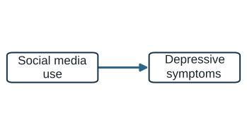{fig-alt="Arrow from social media use to depressive symptoms"}

Depression → social media

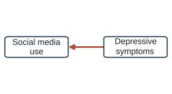{fig-alt="Arrow from depressive symptoms to social media use"}

A common cause produces both

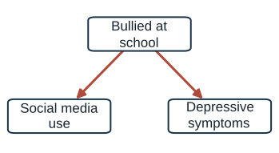{fig-alt="Being bullied at school causes both social media use and depressive symptoms"}

::::::

::: fragment
Following **594 adolescents** over two years: depressive symptoms predicted **later** social media use (among girls). Social media use did **not** predict later depression.
:::

::: {.fragment .key-line}
Timing can separate stories that a single survey cannot.
:::

::: source
Source: Heffer, Good, Daly, MacDonell, and Willoughby (2019), *Clinical Psychological Science* 7(3): 462–470; see also Orben and Przybylski (2019), *Nature Human Behaviour*.
:::

::: notes
Show the three diagrams. All three generate the same positive correlation in one survey; the data alone cannot choose.

Ask what evidence could separate them. Timing helps with direction. Heffer and colleagues followed 594 adolescents, surveyed annually for two years, and a separate sample of undergraduates. Social media use did not predict later depressive symptoms in either sample. Greater depressive symptoms predicted more social media use over time, but only among adolescent girls. That pattern fits the second diagram better than the first.

Add two cautions so this does not become a new overclaim. First, longitudinal ordering is evidence about direction, but it does not rule out a common cause that changes over time. Second, this literature is contested. Orben and Przybylski (2019), analyzing more than 300,000 adolescents in three large surveys, found that technology use explained at most 0.4 percent of the variation in well-being, an association about as large as that for regularly eating potatoes. Others, including Twenge and Haidt, read the evidence as more worrying. Facebook deactivation experiments, which we see later today, offer randomized evidence on a related question.

The lesson for today: a correlation is compatible with several causal structures, and different designs, timing, experiments, and natural experiments, can tell them apart.
:::

## Case 1: What a common cause looks like {#social-common-cause}

:::::: two-column
::: column
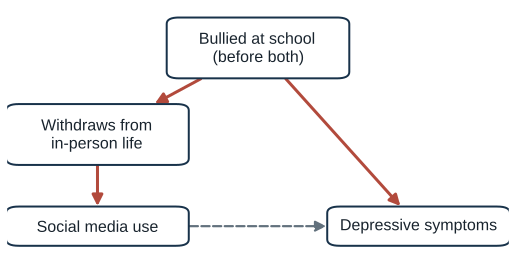{fig-alt="Being bullied at school leads to withdrawing from in-person life, which increases social media use; bullying also raises depressive symptoms; dashed arrow from social media to depression"}
:::

:::: column
A teen who is **bullied at school**:

-   pulls back from in-person friends and activities, and spends **more time online**
-   is **more likely to become depressed**, whether or not they use social media

::: {.fragment .key-line}
Bullied teens are overrepresented among heavy users. Heavy users look more depressed even if social media does **nothing**.
:::
::::
::::::

::: fragment
Other candidates: **family conflict** or a parent's divorce; **school closures** during COVID, which raised screen time and distress at the same moment.
:::

::: notes
Make the common cause concrete. Being bullied at school happens before both variables. A bullied teen often withdraws from in-person friendships, lunch tables, and after-school activities, and fills that time online. Bullying also raises the risk of depression directly, through humiliation, isolation, and stress, regardless of what the teen does on their phone.

Walk through the consequence. In a survey, the heavy-use group contains more bullied teens than the light-use group. Those teens would have higher depressive symptoms even if social media had no effect at all. The correlation between use and depression then partly reflects who the heavy users are. This is the same logic as Body Vibes: the groups differ before the treatment.

Note the arrow through “withdraws from in-person life.” It is a chain from bullying to use, so the whole path from use back to bullying and forward to depression is a back-door path. Controlling for bullying, measured before both, would block it. Controlling for withdrawal would also block it, but withdrawal might also be caused by depression, which complicates matters; that previews Rohrer's warnings in Part 4.

Mention other candidates briefly. Family conflict or a parent's divorce can push teens toward their phones and raise depression. COVID school closures are a time-varying common cause: in 2020, screen time and distress rose together for nearly everyone, so a before-and-after comparison would confound the pandemic with screen time.

Point out that bullying can also happen online, which complicates the diagram: cyberbullying is partly a consequence of social media use, and then it would sit on the causal path rather than behind it. Whether a variable is a confounder or a mediator depends on timing and setting, a theme that returns with Rohrer.
:::

## Case 2: Does smoking protect against COVID? {#case-covid}

Early in the pandemic, studies of hospital patients and of people tested for COVID found that **COVID-positive patients were less likely to smoke** than other patients or people who tested negative.

Some researchers and commentators suggested that smoking, or nicotine, might **protect** against the virus.

::: {.fragment .key-line}
Before asking what smoking does, ask: who ends up in a hospital study?
:::

::: notes
Present the claim as it appeared in 2020. Several studies of hospitalized or tested patients found that COVID-positive patients were less likely to smoke than comparison patients, and some commentators suggested that smoking or nicotine might protect against infection. There were even proposals to test nicotine patches.

Ask students to explain the pattern without any protective effect. Give them a hint if needed: who gets into a study of hospital patients? People are hospitalized for many reasons. Smokers are more likely than non-smokers to be hospitalized for other conditions, and COVID also puts people in the hospital.

Do not reveal the answer yet. Ask students to sketch what would happen if smoking and COVID were completely unrelated in the population but we only looked at people in the hospital. Some students will recognize the Week 9 Berkson picture. That is the point.
:::

## Case 2: Who ends up in the hospital {#covid-collider}

::::: two-column
::: column
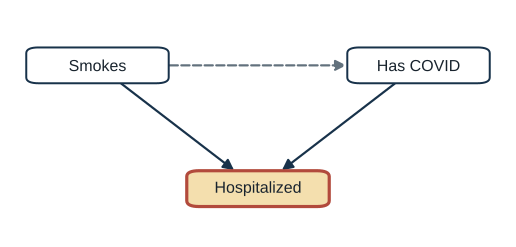{fig-alt="Smoking and COVID both cause hospitalization, which is conditioned on"}

Smoking and COVID **both** put people in the hospital. Studying only patients **conditions on** hospitalization.
:::

::: column
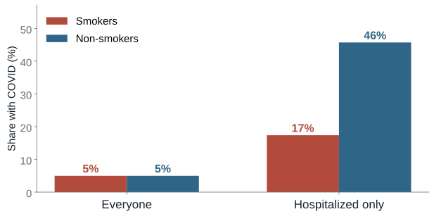{fig-alt="Simulated bar chart: COVID share equal for smokers and non-smokers in the full population but much lower for smokers among hospitalized patients"}

[Simulation: smoking has **no** effect on COVID.]{.source}
:::
:::::

::: {.fragment .key-line}
Among patients, a smoker is more likely to be there for some **other** reason. Smoking looks protective, with no effect at all.
:::

::: source
Source: Griffith et al. (2020), “Collider bias undermines our understanding of COVID-19 disease risk and severity,” *Nature Communications* 11: 5749.
:::

::: notes
Reveal the structure. Smoking makes hospitalization more likely, through other illnesses, and COVID makes hospitalization more likely. Hospitalization is therefore caused by both. Among hospitalized people, a smoker is more likely to be there for reasons other than COVID, so within the hospital, smoking and COVID become negatively associated, even if smoking has no effect on infection at all.

Griffith and colleagues showed that this pattern is what collider bias predicts, and that collider bias alone can produce associations as large as the reported protective effect.

The chart is our simulation, not the paper's data. In it, 20 percent of people smoke and 5 percent have COVID, independently. Hospitalization probability rises with both. In the full population, COVID prevalence is the same for smokers and non-smokers. Among hospitalized people, it is much lower for smokers.

Name the difference from the other cases. Here nothing is wrong with who got the treatment. The problem is who got into the data. This is Week 9's selection into the sample, and in Part 4 we will see that it has a different shape from confounding. The fix is not to control for more, but to stop conditioning: study people outside the hospital too.

The public-health stakes were real: a message that smoking protects against COVID could have led people to keep smoking.
:::

## Case 2: The arithmetic inside the hospital {#covid-arithmetic}

100,000 people. **20%** smoke and **5%** have COVID, **unrelated**. Chance of hospitalization: **1%**, plus **4** points for smoking, plus **15** points for COVID.

| Group                | People | Chance of hospitalization | Hospitalized |
|----------------------|-------:|--------------------------:|-------------:|
| Non-smoker, no COVID | 76,000 |                        1% |          760 |
| Non-smoker, COVID    |  4,000 |                       16% |          640 |
| Smoker, no COVID     | 19,000 |                        5% |          950 |
| Smoker, COVID        |  1,000 |                       20% |          200 |

::: fragment
Inside the hospital: **17%** of smokers have COVID (200 of 1,150) vs. **46%** of non-smokers (640 of 1,400).
:::

::: {.fragment .key-line}
Knowing a patient smokes makes it less likely that COVID is why they are there. One cause **explains away** the other.
:::

[Invented numbers for illustration; the bar chart on the previous slide uses the same numbers.]{.source}

::: notes
Walk through the table row by row. Smoking and COVID are independent in the population: 20 percent smoke, 5 percent have COVID, so 1,000 people are smokers with COVID. Hospitalization depends on both: everyone has a 1 percent chance, smoking adds 4 points through other illnesses, and COVID adds 15.

Now look only at the last column, the hospital. Of the 1,150 hospitalized smokers, 200 have COVID, 17 percent. Most hospitalized smokers are there for smoking-related illness. Of the 1,400 hospitalized non-smokers, 640 have COVID, 46 percent. Non-smokers rarely end up in the hospital unless something like COVID puts them there. Turn it around: smokers are 24 percent of COVID patients but 56 percent of the other patients. Compared with the rest of the ward, COVID patients look like non-smokers.

Name the logic: explaining away. If you know why someone is in the hospital, one cause makes the other less necessary. Learning that a patient smokes makes it less likely that COVID is the reason they are there. That is what conditioning on a collider does.

Add an important caveat about the comparison. The collider explains why COVID looks less common among smokers when we compare within the hospital, or among people who were tested. It does not by itself explain why some early studies found a lower smoking rate among COVID patients than in the general population; in this table, smokers are 24 percent of COVID patients, slightly above the 20 percent population rate. Those population comparisons had other problems: hospitalized COVID patients skewed older, and older people smoke less; smoking status was often missing from emergency records; and smokers, who cough more, were more likely to be tested, which adds them to the pool of negatives. Each of these is worth naming: the first is a confounder (age), the second is measurement error, and the third is another collider (testing).
:::

## Case 3: Does TV lower children's test scores? {#case-tv}

Children who watch more television tend to score **lower** on achievement tests.

Pediatric guidance has long urged parents to limit young children's screen time.

::: fragment
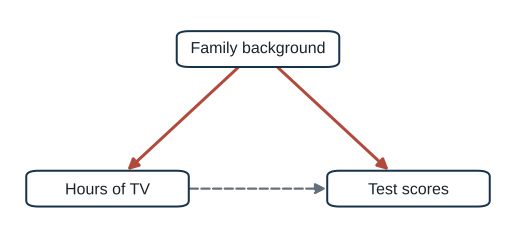{fig-alt="Family background causes hours of TV and test scores; dashed arrow from TV to scores" width="55%"}
:::

::: {.fragment .key-line}
Which families let young children watch more TV? Would those children have scored lower anyway?
:::

::: notes
Present the familiar pattern: in cross-sectional data, children who watch more television tend to score lower on tests. The pattern helped motivate long-standing advice to limit young children's screen time.

Ask which families let preschoolers watch more TV. Students will mention parental education, income, time available for reading and play, and the quality of child care. Those same factors raise test scores directly. Show the diagram: family background is a common cause of TV hours and scores, and the dashed arrow is the effect we want.

Ask what would have to be true for limiting TV to raise scores. The arrow from TV to scores would have to exist. Then ask what evidence could reveal it, given that we cannot randomize children's TV for years.
:::

## Case 3: When TV arrived {#tv-rollout}

:::::: two-column
::: column
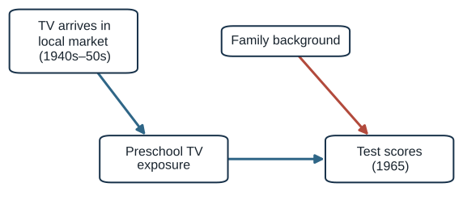{fig-alt="TV arriving in the local market causes preschool TV exposure; family background causes scores; TV causes scores"}
:::

:::: column
An **FCC licensing freeze (1948–52)** delayed TV in some markets.

Children born **1948–54** got more or fewer preschool years of TV depending on **where** and **when** they were born. Tested in **1965**.

::: {.fragment .key-line}
No evidence of harm: about **+0.02 SD** per year of preschool TV; harms larger than **0.03 SD** ruled out.
:::
::::
::::::

::: source
Source: Gentzkow and Shapiro (2008), *Quarterly Journal of Economics* 123(1): 279–323.
:::

::: notes
Gentzkow and Shapiro used the staggered introduction of television across US local markets. Most cities got TV between the early 1940s and the mid-1950s, and the Federal Communications Commission froze new station licenses from September 1948 to April 1952, which delayed some markets for regulatory reasons unrelated to local families. Children born between 1948 and 1954 were the first generation raised with TV, and how many preschool years they had TV depended on when broadcasting reached their area, not on their families' choices. The outcome was standardized test scores in the 1965 Coleman Study.

Explain the comparison carefully, because it is a difference-in-differences. Within a market, older and younger students had different numbers of preschool years with TV. Across markets, the arrival year differed. The authors ask whether the grade-to-grade pattern of scores differs between early-adopting markets (TV by 1948), middle (1949–51), and late (1952 or later). Formally, arrival year interacted with grade serves as an instrument for preschool TV years.

Name the assumption. Early-adopting cities were larger and richer, so a simple comparison of early and late cities would be confounded. The design avoids that by comparing cohorts within markets, but it still assumes that, without TV, grade-to-grade differences would have been the same in early and late markets. The licensing freeze makes that more plausible, because it delayed TV for reasons unrelated to children's trajectories.

Their preferred estimate: an additional year of preschool TV exposure raised average adolescent test scores by about 0.02 standard deviations, and they could reject negative effects larger than about 0.03 standard deviations per year. Positive effects on reading and general knowledge were largest for children from households where English was not the primary language, whose mothers had less than a high school education, and nonwhite children. The authors' explanation: for these children, the activities TV crowded out were likely less cognitively stimulating.

Draw the lesson. The raw correlation between TV and scores largely reflects who watches TV. The design added a cause of TV exposure, the arrival of a signal, that was unrelated to family background. Note the scope: this is TV in the 1950s, not tablets today. That is an external-validity question from Week 9.
:::

## Case 4: Does an elite college pay off? {#case-college}

Graduates of more **selective colleges** earn more than graduates of less selective ones.

::: fragment
Does that gap measure what the **college** adds?
:::

::: fragment
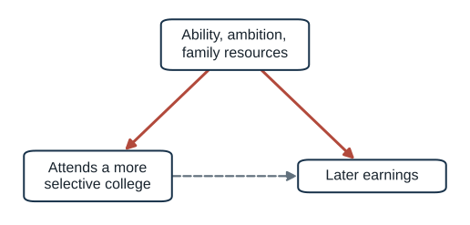{fig-alt="Ability, ambition, and family resources cause both attending a selective college and later earnings; dashed arrow from college to earnings" width="55%"}
:::

::: {.fragment .key-line}
Students choose colleges, and colleges choose students. The gap mixes the college's effect with who got in.
:::

::: notes
Move to a case outside communication, chosen for a different design. Graduates of more selective colleges earn more. Ask whether that gap measures what attending a selective college adds to a person's earnings.

Students should quickly see selection into treatment. Selective colleges admit students with high grades, test scores, and ambition, and those students are more likely to apply in the first place. Family resources matter too. All of these raise earnings regardless of where a student enrolls. Show the diagram: ability, ambition, and family resources cause both attendance and earnings, and the dashed arrow is the college effect.

This case is personal for graduate students, many of whom made exactly this choice. Ask what comparison would isolate the college's effect. Push toward comparing students who looked the same to admissions offices but ended up at different schools.
:::

## Case 4: Same admissions, different colleges {#college-design}

:::::: two-column
::: column
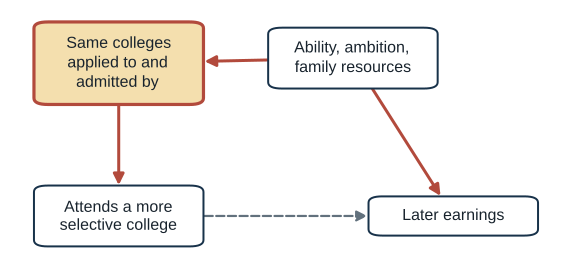{fig-alt="Ability causes which colleges a student applied to and was admitted by; that admission set, which is conditioned on, causes attendance; ability also causes earnings"}
:::

:::: column
Compare students who **applied to and were admitted by the same colleges**, but enrolled at different ones.

::: {.fragment .key-line}
The selective-college premium **largely disappeared**. Exception: students from **low-income families** did earn more.
:::
::::
::::::

::: source
Source: Dale and Krueger (2002), *Quarterly Journal of Economics* 117(4): 1491–1527; Dale and Krueger (2014), *Journal of Human Resources*.
:::

::: notes
Dale and Krueger used the College and Beyond data, plus the National Longitudinal Study of the High School Class of 1972. Their key move was to use information on where each student applied and where they were admitted and rejected. Admissions decisions reflect what admissions officers saw, including things researchers usually cannot measure, such as essays, recommendations, and ambition. The schools a student chooses to apply to also reveal ambition.

They compared students with the same set of admissions outcomes who ended up at colleges of different selectivity. Among such matched students, those who attended more selective colleges did not earn more. Their 2014 follow-up, using Social Security earnings records over the career, found the same pattern. The exception in both papers: students from low-income or less-educated families did earn more if they attended a selective college.

Name the design in today's terms. Unlike a lottery or a rollout, nothing here was random. The design is statistical control with an unusually good control variable: the admission set acts as a proxy for the unmeasured ability and ambition that drive both college choice and earnings. In DAG terms, conditioning on it blocks the back door. That is Rohrer's back-door logic, and its weakness is the same as Rohrer warns about: if students admitted to the same schools still differ in ways that affect both enrollment and earnings, for example financial need or career plans, the back door is only partly closed.

Add that the finding is contested. Caroline Hoxby and others argue that the identification strategy is less credible than a randomized design and that other measures of selectivity do pay off. Use the debate to show that a design-based answer is still an argument about assumptions.
:::

## What changed between the correlation and the claim? {#what-changed}

::: question-list
**Reverse causation.** Does depression drive social media use?

**Who got into the data.** Did hospital records create the smoking pattern?

**A common cause.** Does family background drive both TV and scores?

**Who chose the treatment.** Were elite-college students headed for high earnings anyway?
:::

::: {.fragment .key-line}
Today: a language that makes each of these precise, and tells us what evidence would settle them.
:::

::: notes
Collect what the students generated across the four cases and map it onto the four headings on the slide. Reverse causation came from social media and depression, selection into the data from smoking and COVID, a common cause from TV and test scores, and selection into treatment from elite colleges.

Point out the pattern across all four: in each case, the raw correlation pointed one way, and a design that changed the treatment for reasons unrelated to the outcome, timing, looking beyond hospital patients, the arrival of a TV signal, or comparing students with the same admissions, told a different or more modest story.

Tell students that each of these has a precise name and a precise picture. Potential outcomes will define what effect we want. The baseline-difference idea will show that the treatment problems work the same way: the groups we compare would have differed even without the treatment. DAGs will show the structure that produces each problem.

This is a good moment to ask students whether any of these patterns appear in their own reading for other courses. Communication research is full of exposure–attitude correlations with the same structure as these cases.
:::

## What does “X causes Y” mean? {#potential-outcomes .section-title}

[Part 2 of 5 · Potential outcomes]{.kicker}

> A causal effect compares two versions of the same unit: one with the treatment and one without.

::: notes
Transition from cases to definition. Tell students that *Thinking Clearly with Data* chapter 3 gives a definition of causation that is simple to state and has deep consequences.

The definition is counterfactual. A cause makes a difference to an outcome compared with what would have happened without it. The rest of today follows from taking that definition seriously.
:::

## Two worlds {#two-worlds}

You buy Goop's “Body Vibes” stickers at **\$6 each**. They are “pre-programmed to an ideal frequency” and promise clearer skin.

::::: two-column
::: column
### World A

You wear the Body Vibes stickers.
:::

::: column
### World B

Identical until the moment you put them on, when a friend secretly swaps them for **10¢** stickers.
:::
:::::

::: {.fragment .key-line}
The effect of Body Vibes on your skin = your skin in World A − your skin in World B.
:::

::: source
Source: Bueno de Mesquita and Fowler, *Thinking Clearly with Data*, ch. 3, pp. 38–39.
:::

::: notes
Tell the Body Vibes story from the book. Goop sold stickers for six dollars each, claiming they were pre-programmed to an ideal frequency and would fill deficiencies in your energy reserves. Suppose you bought them and insist that they cleared your skin. What does that claim mean?

The book's answer is a thought experiment. Imagine an alternative world that is identical to this one up to the moment you put on the stickers, when a friend secretly swaps them for ten-cent stickers that are not pre-programmed. If your skin would be worse in the swapped world, Body Vibes have a positive effect. If it would be the same, no effect. If better, a negative effect.

Stress the phrase “identical up until.” That clause carries the definition. A causal effect compares the actual world with a counterfactual world that differs only in the cause. The book also notes that neither world has to be real: we can compare two imagined worlds, such as cheap stickers versus magic crystals.
:::

## Potential outcomes {#po-notation}

| Symbol | Meaning |
|------------------------------------|------------------------------------|
| $T_i$ | Treatment for person $i$: 1 = wears Body Vibes, 0 = does not |
| $Y_{1i}$ | Person $i$'s skin **if** they wear Body Vibes |
| $Y_{0i}$ | Person $i$'s skin **if** they do not |
| $Y_{1i} - Y_{0i}$ | The **causal effect** of Body Vibes for person $i$ |

::: {.fragment .key-line}
Each person has **two** potential outcomes. Each person shows us only **one**.
:::

::: notes
Introduce the notation slowly. T is the treatment, coded 1 or 0. Which value counts as “treated” is often arbitrary. Y is the outcome. Each person has two potential outcomes: Y-one is the outcome they would have if treated, and Y-zero is the outcome they would have if not treated. The individual causal effect is the difference.

Read the subscripts aloud: “Y-one-i is person i's skin if treated.” Students who have not seen this notation often confuse potential outcomes with observed outcomes. Emphasize the word *if*. Potential outcomes are properties of a person that exist before and regardless of treatment. The treatment only determines which one we get to see.

Connect to Week 6. Lundberg and colleagues wrote the causal estimand as an average of Y(1) minus Y(0). This is the same idea; today we use the book's subscript notation.
:::

## The view from nowhere: the full table {#po-full-table}

::: po-table
| Person | Group    | $Y_{1i}$ (with) | $Y_{0i}$ (without) |  Effect   |
|--------|----------|:---------------:|:------------------:|:---------:|
| 1      | Wears    |  [**1**]{.obs}  |      [1]{.cf}      | [0]{.eff} |
| 2      | Wears    |  [**0**]{.obs}  |      [0]{.cf}      | [0]{.eff} |
| 3      | Wears    |  [**0**]{.obs}  |      [0]{.cf}      | [0]{.eff} |
| 4      | Wears    |  [**1**]{.obs}  |      [1]{.cf}      | [0]{.eff} |
| 5      | Wears    |  [**1**]{.obs}  |      [1]{.cf}      | [0]{.eff} |
| 6      | Does not |    [0]{.cf}     |   [**0**]{.obs}    | [0]{.eff} |
| 7      | Does not |    [0]{.cf}     |   [**0**]{.obs}    | [0]{.eff} |
| 8      | Does not |    [1]{.cf}     |   [**1**]{.obs}    | [0]{.eff} |
| 9      | Does not |    [1]{.cf}     |   [**1**]{.obs}    | [0]{.eff} |
| 10     | Does not |    [0]{.cf}     |   [**0**]{.obs}    | [0]{.eff} |
:::

[1 = clear skin. **Bold** = what happened. Grey = what would have happened.]{.source}

::: {.fragment .key-line}
Body Vibes have **no effect on anyone**.
:::

::: notes
This is TCD Table 3.1. Because the example is invented, we can see both potential outcomes for every person. Bold cells are what actually happened; grey cells are the counterfactuals.

Walk through two rows. Person 1 wore the stickers and has clear skin; without them, person 1 would also have had clear skin. Effect zero. Person 6 did not wear them and has unclear skin; with them, person 6 would still have had unclear skin. Effect zero.

Every effect in the table is zero. People 1, 4, 5, 8, and 9 have clear skin either way. People 2, 3, 6, 7, and 10 have unclear skin either way. Body Vibes do nothing.

Tell students to remember this table. On the next slide we hide what no researcher could ever see.
:::

## What a researcher actually sees {#po-observed-table}

::: po-table
| Person | Group    | $Y_{1i}$ (with) | $Y_{0i}$ (without) |  Effect   |
|--------|----------|:---------------:|:------------------:|:---------:|
| 1      | Wears    |  [**1**]{.obs}  |     [?]{.unk}      | [?]{.unk} |
| 2      | Wears    |  [**0**]{.obs}  |     [?]{.unk}      | [?]{.unk} |
| 3      | Wears    |  [**0**]{.obs}  |     [?]{.unk}      | [?]{.unk} |
| 4      | Wears    |  [**1**]{.obs}  |     [?]{.unk}      | [?]{.unk} |
| 5      | Wears    |  [**1**]{.obs}  |     [?]{.unk}      | [?]{.unk} |
| 6      | Does not |    [?]{.unk}    |   [**0**]{.obs}    | [?]{.unk} |
| 7      | Does not |    [?]{.unk}    |   [**0**]{.obs}    | [?]{.unk} |
| 8      | Does not |    [?]{.unk}    |   [**1**]{.obs}    | [?]{.unk} |
| 9      | Does not |    [?]{.unk}    |   [**1**]{.obs}    | [?]{.unk} |
| 10     | Does not |    [?]{.unk}    |   [**0**]{.obs}    | [?]{.unk} |
:::

::: {.fragment .key-line}
Half of every row is missing, and so is every individual effect.
:::

::: notes
Now hide the counterfactual cells. This is all a researcher ever observes: one potential outcome per person. Every individual effect is unknown.

Pause here and let students look at the pattern of question marks. Ask: “Is there any way, with more data on these ten people, to fill in the question marks?” The answer is no. More measurement of person 1 cannot tell us what person 1's skin would have been without the stickers.

The book adds a wry note: the fact that the absence of any effect cannot be observed is probably “key to \[Goop's\] business model.”
:::

## The fundamental problem of causal inference {#fundamental-problem}

> “Causal effects as we've defined them can never, ever be directly observed.”

You can attend college **or** not. You can watch the debate **or** not. Each unit lives in one world.

::: {.fragment .key-line}
Causal inference is a missing-data problem: we must fill in the counterfactual with something.
:::

::: source
Source: *Thinking Clearly with Data*, ch. 3, p. 41.
:::

::: notes
Name the problem. Because each unit is observed in only one state, individual causal effects can never be directly observed. The book's running example is college: your effect of college is your outcome with college minus your outcome without it, and you can only live one of those lives. The problem applies to any unit: a person, a newsroom, a country.

Reframe causal inference as a missing-data problem. Every causal method is a strategy for filling in the missing counterfactual cells with something credible. The obvious strategy is to use other people's observed outcomes. The next slide shows what happens when we do that naively.
:::

## The naive comparison {#naive-comparison}

::::: two-column
::: column
### Wore Body Vibes

Clear skin: persons 1, 4, 5

**3 of 5 = 60%**
:::

::: column
### Did not

Clear skin: persons 8, 9

**2 of 5 = 40%**
:::
:::::

::: {.fragment .key-line}
Difference in means: **+20 points**. True effect: **0 for everyone**.
:::

::: fragment
Where did the 20 points come from?
:::

::: notes
Compare the bold cells only, as a naive analyst would. Three of five wearers have clear skin; two of five non-wearers do. The difference in means is 20 percentage points in favor of Body Vibes.

But we know from the full table that the true effect is zero for every single person. Ask the students where the 20 points came from before explaining.

The answer: the people who happened to wear the stickers were people who would have had clear skin anyway. Among wearers, three of five have clear skin even without stickers; among non-wearers, two of five. The comparison picks up that difference between the groups. Note that the book does not compute this in chapter 3; it is our arithmetic on the book's table, and it sets up chapter 9 exactly.
:::

## Where the +20 came from {#where-plus-twenty}

::::: two-column
::: column
### Skin **without** stickers, among wearers

Persons 1–5: $Y_0$ = 1, 0, 0, 1, 1

Clear skin anyway: **3 of 5**
:::

::: column
### Skin **without** stickers, among non-wearers

Persons 6–10: $Y_0$ = 0, 0, 1, 1, 0

Clear skin anyway: **2 of 5**
:::
:::::

::: {.fragment .key-line}
The wearers would have had clearer skin **even without the stickers**. That baseline difference is the bias.
:::

::: notes
Go back to the full Body Vibes table. Look only at the without-stickers column. Among people who wore the stickers, three of five would have had clear skin without them. Among people who did not, two of five. The groups differ by 20 points before any sticker touches anyone's skin.

That 20-point baseline difference is exactly the 20-point difference in means, because the true effect is zero. Call it a baseline difference; Part 3 applies the idea to real cases. Tell students this is the whole idea of selection bias in causal inference: the treated and untreated groups would have differed even if nobody had been treated.

Contrast this with Week 9. Last week's selection was about who enters the sample. This is about who receives the treatment. We will put the two side by side at the end of Part 3.
:::

## Who buys Body Vibes? {#goop-simulation}

People who already care for their skin (sunscreen, dermatologists, \$6 to spare) may be the likeliest buyers. The stickers do **nothing** unless you change the true effect.

::: {#goop-sim-root .goop-sim aria-label="Interactive simulation of selection into buying Body Vibes"}
:::

::: notes
Use this simulation to let students see selection happen. Each dot is a person, placed by skin quality on a 0–10 scale. Red dots bought Body Vibes and blue dots did not. The vertical lines mark each group's average. The true effect of the stickers starts at zero, so any gap between the lines is pure selection.

Step 1. Leave the slider at “coin flip.” Buying is random, so the baseline difference is zero on average, but any one population shows a small chance gap, typically within about ±0.2. Click “New population” several times to show it bouncing around zero. This is the distinction between bias and noise: bias is a gap that persists across draws; noise averages out. It is also what a randomized experiment looks like.

Step 2. Drag the slider toward “better skin buys.” People who already have good skin, because they are wealthier, use sunscreen, or see dermatologists, become more likely to buy. Watch the red line move right. The difference in means grows, but the true effect is still zero: the entire gap is the baseline difference from the previous slide.

Step 3. Set the true effect to +1 with strong selection. Now the difference in means equals 1 plus the baseline difference. The raw comparison overstates the sticker's real benefit.

Step 4. Drag the slider toward “worse skin buys,” as when people with acne go looking for a fix, and keep the effect at +1. Now the bias is negative, and it can hide or even reverse a real benefit. This previews the next example, the flu shot: a real positive effect that looks negative.

Point to the readout at the bottom. It always shows the central idea of TCD chapter 9: difference in means equals true effect plus baseline difference. Randomization (the coin flip) is the only setting in which the second term is zero by design.

The simulation uses 400 simulated people with skin quality drawn from a normal distribution centered at 5. The probability of buying is logistic in skin quality, with the slider setting the slope.
:::

## A second example: the flu shot {#flu-setup}

At Thanksgiving, a relative says: **“I got the flu shot last year and still got the flu. It doesn't work.”**

Let $Y = 1$ if you **stay healthy**. People come in three types:

| Type | Healthy **with** the shot ($Y_1$) | Healthy **without** it ($Y_0$) | Effect of the shot |
|------------------|:----------------:|:----------------:|:----------------:|
| **Always sick** | 0 | 0 | 0 |
| **Never sick** | 1 | 1 | 0 |
| **Vaccine responder** | 1 | 0 | **+1** |

::: {.fragment .key-line}
Only responders benefit. A shot can work **on average** even though some vaccinated people still get sick.
:::

::: source
Source: *Thinking Clearly with Data*, ch. 3, pp. 44–46.
:::

::: notes
Set up the book's second example slowly. Start with the Thanksgiving skeptic: “I got the flu shot and still got the flu, so it doesn't work.” The implicit logic is that if the shot worked, no vaccinated person would get sick, so one counterexample refutes it.

Define the outcome: Y equals 1 if you stay healthy, 0 if you get the flu. Then introduce the three types, one row at a time. The always-sick get the flu whether or not they are vaccinated, perhaps because of heavy exposure or a weak immune response; their effect is zero. The never-sick stay healthy either way; effect zero. Vaccine responders stay healthy only if they get the shot; their effect is +1.

Ask: “Which type is the relative?” They got the shot and still got sick, so they are always-sick, and the shot did nothing for them. That is fully consistent with the shot working for responders. The book's point is that causal claims about vaccines are about average effects across people with different biology and exposure, and that because you do not know your own type, the shot raises your chance of staying healthy.
:::

## The full flu-shot table {#flu-full}

::: po-table
| Person | Type        | Group   | $Y_{1i}$ (shot) | $Y_{0i}$ (no shot) |    Effect     |
|------------|------------|------------|:----------:|:----------:|:----------:|
| 1      | always sick | Shot    |  [**0**]{.obs}  |      [0]{.cf}      |   [0]{.eff}   |
| 2      | responder   | Shot    |  [**1**]{.obs}  |      [0]{.cf}      | [**1**]{.eff} |
| 3      | always sick | Shot    |  [**0**]{.obs}  |      [0]{.cf}      |   [0]{.eff}   |
| 4      | always sick | Shot    |  [**0**]{.obs}  |      [0]{.cf}      |   [0]{.eff}   |
| 5      | never sick  | Shot    |  [**1**]{.obs}  |      [1]{.cf}      |   [0]{.eff}   |
| 6      | never sick  | No shot |    [1]{.cf}     |   [**1**]{.obs}    |   [0]{.eff}   |
| 7      | never sick  | No shot |    [1]{.cf}     |   [**1**]{.obs}    |   [0]{.eff}   |
| 8      | always sick | No shot |    [0]{.cf}     |   [**0**]{.obs}    |   [0]{.eff}   |
| 9      | responder   | No shot |    [1]{.cf}     |   [**0**]{.obs}    | [**1**]{.eff} |
| 10     | never sick  | No shot |    [1]{.cf}     |   [**1**]{.obs}    |   [0]{.eff}   |
:::

[1 = stays healthy. **Bold** = what happened. Grey = what would have happened.]{.source}

::: {.fragment .key-line}
Two responders out of ten: the average treatment effect is **2/10 = +0.2**. The shot helps.
:::

::: notes
This is TCD Table 3.2, rebuilt with a type column. Persons 1–5 got the shot; persons 6–10 did not. Bold cells are what happened; grey cells are the counterfactuals that only the author of an invented example can see.

Walk through three rows. Person 2 is a responder who got the shot: healthy with it, would have been sick without it, effect +1. Person 9 is also a responder but did not get the shot: got sick, would have stayed healthy with it, effect +1 even though we never see it. Person 5 is never sick: healthy either way, effect 0.

Count the effect column: two ones and eight zeros. The average treatment effect is 0.2. In this population, the flu shot raises the probability of staying healthy by 20 percentage points.

Ask students to hold that number in mind. On the next slide we hide the grey cells and see what a researcher would conclude.
:::

## What a researcher sees {#flu-observed}

::::::: two-column
:::: column
::: po-table
| Person | Group   |   $Y_{1i}$    |   $Y_{0i}$    |
|--------|---------|:-------------:|:-------------:|
| 1      | Shot    | [**0**]{.obs} |   [?]{.unk}   |
| 2      | Shot    | [**1**]{.obs} |   [?]{.unk}   |
| 3      | Shot    | [**0**]{.obs} |   [?]{.unk}   |
| 4      | Shot    | [**0**]{.obs} |   [?]{.unk}   |
| 5      | Shot    | [**1**]{.obs} |   [?]{.unk}   |
| 6      | No shot |   [?]{.unk}   | [**1**]{.obs} |
| 7      | No shot |   [?]{.unk}   | [**1**]{.obs} |
| 8      | No shot |   [?]{.unk}   | [**0**]{.obs} |
| 9      | No shot |   [?]{.unk}   | [**0**]{.obs} |
| 10     | No shot |   [?]{.unk}   | [**1**]{.obs} |
:::
::::

:::: column
### Got the shot

Healthy: persons 2, 5 → **2 of 5 = 40%**

### No shot

Healthy: persons 6, 7, 10 → **3 of 5 = 60%**

::: {.fragment .key-line}
Difference in means: **−20 points**. The shot looks **harmful**. True effect: **+20 points**.
:::
::::
:::::::

::: notes
Hide the counterfactual cells. A researcher sees only the bold column for each person, and no types.

Compute the naive comparison with the class. Among the vaccinated, persons 2 and 5 stayed healthy: two of five, 40 percent. Among the unvaccinated, persons 6, 7, and 10 stayed healthy: three of five, 60 percent. The difference in means is minus 20 percentage points. A researcher who trusted it would conclude that the flu shot makes people sicker.

Pause for effect. The true effect is +20 points; the comparison says −20. The sign is wrong. Note that this calculation is ours, not the book's, but it uses only the book's table.

Ask: “What would have to be true about the two groups for this to happen?” Let students propose answers before the next slide.
:::

## Why the sign flipped {#flu-why}

::::: two-column
::: column
### Got the shot

-   always sick: **3** (persons 1, 3, 4)
-   never sick: **1** (person 5)
-   responder: **1** (person 2)

Healthy **even without the shot**: **1 of 5**
:::

::: column
### No shot

-   always sick: **1** (person 8)
-   never sick: **3** (persons 6, 7, 10)
-   responder: **1** (person 9)

Healthy **without the shot**: **3 of 5**
:::
:::::

::: {.fragment .key-line}
The vaccinated group was full of people who get sick anyway. Their baseline was **40 points worse**, enough to bury a +20-point benefit.
:::

::: fragment
Who seeks out flu shots in real life? Older people, people with chronic illness, people who get sick often.
:::

::: notes
Count types in each group. The vaccinated group contains three always-sick people, one never-sick person, and one responder. The unvaccinated group contains one always-sick person, three never-sick people, and one responder. Responders are evenly split, so the shot helps both groups equally in principle. What differs is the baseline.

Without the shot, only one of the five vaccinated people would have stayed healthy (person 5); among the unvaccinated, three of five stay healthy. The vaccinated group starts 40 points worse. A +20-point treatment effect plus a −40-point baseline difference gives the −20-point difference in means. Tell students we will write exactly this equation in Part 3.

Make it realistic. In practice, the people most likely to get flu shots are often older, have chronic conditions, or get sick easily, so vaccinated groups can have worse baseline health than unvaccinated groups. Then contrast with Body Vibes, where the people who buy stickers likely already have better skin. Selection can push the comparison in either direction. The next slide shows the same reversal in a real medical controversy.
:::

## A real sign flip: hormone replacement therapy {#hrt}

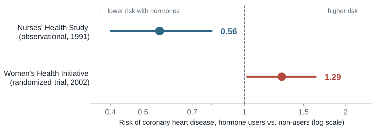{fig-alt="Dot plot: Nurses' Health Study relative risk 0.56 versus Women's Health Initiative hazard ratio 1.29 for coronary heart disease" width="85%"}

::: {.fragment .key-line}
“The most plausible alternative … is that healthier women are selected for such therapy.” — the observational study's own authors, 1991
:::

::: source
Sources: Stampfer et al. (1991), *NEJM* 325(11) (48,470 nurses, 10 years); Writing Group for the WHI (2002), *JAMA*; Hernán et al. (2008), *Epidemiology*.
:::

::: notes
Show that the flu-table reversal happens with real data and real prescriptions. In the Nurses' Health Study, 48,470 postmenopausal nurses were followed for ten years. Current users of estrogen had about half the risk of major coronary disease compared with never-users: a relative risk of 0.56, with a 95 percent confidence interval of 0.40 to 0.80. For a decade, hormone therapy was widely prescribed partly on the strength of evidence like this.

Then the Women's Health Initiative randomized women to estrogen plus progestin or placebo. The hazard ratio for coronary heart disease was 1.29, with an interval of 1.02 to 1.63: a higher risk, not a lower one.

The observational study's authors had named the problem themselves in 1991: healthier women were selected for hormone therapy. Women who chose hormones were wealthier, more health-conscious, and saw doctors more often. Their heart risk without hormones was lower.

A coda for curious students: Hernán and colleagues (2008) reanalyzed the Nurses' data as if it were a trial, comparing women who started hormones with similar women who did not, and got results much closer to the randomized trial. Later work also showed that risk depends on age and time since menopause.
:::

## Averages answer a different question {#averages}

We **can't** see anyone's individual effect.

We **can** see the average outcome in the **treated** group and in the **control** group.

::: equation
Treated average − control average = average treatment effect, **if the groups are balanced**
:::

::: {.fragment}
**Balanced:** the two groups don't differ on anything else that affects the outcome.
:::

::: {.fragment .key-line}
Body Vibes and the flu shot failed this test. Randomization is how we guarantee it.
:::

::: {.fragment}
This answers the FDA's question (what happens **on average**), not a court's (would **this** person have been harmed **but for** the action).
:::

::: source
Source: *Thinking Clearly with Data*, ch. 3, pp. 41–42.
:::

::: notes
Introduce averages as the way out of the fundamental problem. We can never see an individual effect, because each person shows us only one potential outcome. But we can see two averages: the average outcome among people who got the treatment and the average among people who did not.

The key condition is balance. If the treated and control groups do not differ on anything else that affects the outcome, then the control group's average tells us what the treated group's average would have been without treatment. The difference between the two averages is then the average treatment effect.

Tie it back to the tables. Body Vibes failed this test: the wearers had better skin to begin with, so the difference in averages was +20 points while the true effect was zero. The flu shot failed it in the other direction: the vaccinated group was full of people who get sick anyway. In both cases, the groups were not balanced on something that affects the outcome.

Point ahead. Part 3 shows what happens when groups are not balanced, and how a lottery produces balance. Randomization does not make any one person's counterfactual visible; it makes the groups alike on average, so the comparison of averages works.

The book contrasts two institutions. The FDA asks an average question: if the drug is approved, how will health change on average? Randomized trials answer that by comparing balanced groups. A court asks an individual question: would this particular harm have happened but for this person's action? No method can observe that. The book's broader lesson: “Part of clear thinking about causal relationships involves admitting that sometimes we cannot answer certain questions with complete confidence, even when those questions are very important.”
:::

## Correlation = effect + selection {#selection-bias .section-title}

[Part 3 of 5 · How selection creates bias]{.kicker}

> Why does the difference in means differ from the effect, and when does it not?

::: notes
Transition to *Thinking Clearly with Data* chapter 9. The goal of Part 3 is to apply one idea to real cases: the difference in means equals the effect plus a baseline difference plus noise. Students met this idea with Body Vibes and the simulation; Part 3 uses no new notation.

Tell students that this idea explains what they already found in the opening cases. The elite-college graduates, the heavy TV-watching children, and the hormone users would all have differed from the comparison group even without the treatment.
:::

## Preuss School: the raw gap {#preuss-raw}

:::::: two-column
::: column
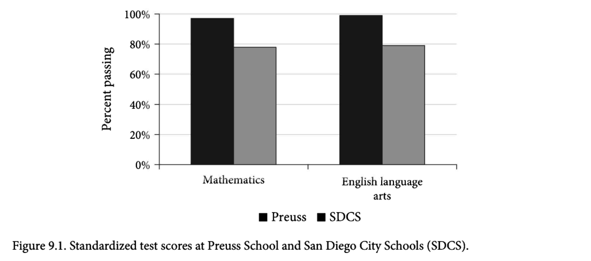{fig-alt="Bar chart: percent passing math and English tests at Preuss School versus San Diego City Schools"}
:::

:::: column
The Preuss School serves low-income students and sends **almost 100%** to higher education.

Preuss students pass state tests at close to **100%**, versus a little under **80%** in San Diego City Schools.

::: {.fragment .key-line}
Is Preuss a better school, or does it get better students?
:::
::::
::::::

::: source
Source: *Thinking Clearly with Data*, ch. 9, Figure 9.1.
:::

::: notes
Introduce the book's worked case. Charter schools are publicly funded but run independently. Oversubscribed charters must admit by random lottery, sometimes hundreds of applicants for a couple dozen spots. The Preuss School at UC San Diego serves low-income students and has been repeatedly praised as a top transformative high school.

Read the figure. Preuss students pass the math and English tests at close to 100 percent, while San Diego City Schools students pass at a little under 80 percent. The book does not print the numbers; these are read from the chart.

End on the question: is Preuss a better school, or does it get better students? Let students offer answers; the next slide draws the worry as a DAG.
:::

## Preuss: a possible confounder {#preuss-dag}

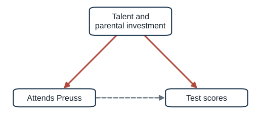{fig-alt="Talent and parental investment cause attending Preuss and test scores; dashed arrow from Preuss to scores" width="58%"}

::: {.fragment .key-line}
If talent and parental investment drive both who attends and how students score, the raw gap mixes the school's effect with **who got in**.
:::

::: notes
Draw the worry before discussing the lottery. Talent and parental investment could affect both whether a child attends Preuss and how that child scores on tests. The dashed arrow from Preuss to test scores is the school's effect, the thing we want to know.

This is the same structure as the confounder cases students have already seen: family background in the TV case and ability and ambition in the college case. Note that it is a preview of Part 4, where Rohrer names this structure a fork.

Ask: if this diagram is right, what would the raw gap between Preuss and San Diego City Schools contain? Answer: the school's effect, if any, plus the difference between the kinds of students who end up at each. The next slide asks where that difference comes from.
:::

## Who enters the lottery? {#preuss-selection}

Preuss admits by lottery, but families **choose** whether to apply.

The book suggests who applies:

- parents who believe their child is **especially talented**
- parents who are **especially invested** in education

> “If all children went to the exact same school, the children who are currently at the charter schools would still be above average.”

::: {.fragment .key-line}
In other words: Preuss students would have scored higher than others **at any school**.
:::

::: source
Source: *Thinking Clearly with Data*, ch. 9, pp. 161–162.
:::

::: notes
Now explain how the confounder gets in. Preuss uses a lottery, but only among families who apply, and applying is a choice. The book suggests that disadvantaged families who enter charter lotteries include parents who believe their child is especially talented and parents who are especially invested in education. Both talent and parental involvement raise achievement directly, which is exactly the confounder on the previous slide.

Read the book's sentence aloud. It is a plain-language statement of the baseline difference: even if all children attended the same school, the children now at Preuss would still score above average.

Then set up the next slide. If the problem is who applies, the fix is to compare only applicants: children whose families all chose to apply, and who were separated by luck.
:::

## The lottery comparison {#preuss-lottery}

:::::: two-column
::: column
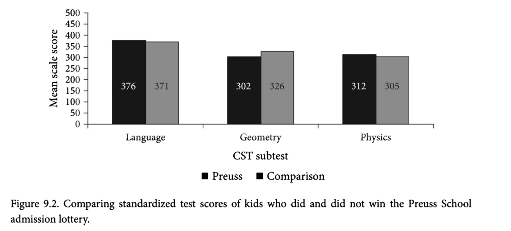{fig-alt="Bar chart: test scores for Preuss lottery winners versus lottery losers in language, geometry, and physics"}
:::

:::: column
Compare **lottery winners** with **lottery losers**. Every applicant was motivated enough to apply; luck decided who got in.

| Test     | Winners − losers |
|----------|:----------------:|
| Language |        +5        |
| Geometry |       −24        |
| Physics  |        +7        |

::: {.fragment .key-line}
The gap disappears.
:::
::::
::::::

::: source
Source: *Thinking Clearly with Data*, ch. 9, Figure 9.2 (data from McClure et al. 2005).
:::

::: notes
Present the apples-to-apples comparison. The ideal question, whether the same child would score differently at Preuss, is unanswerable. The workable question is whether two groups that are identical on average differ. The lottery provides such groups: every applicant was motivated enough to apply, and luck decided who got in.

The comparison uses scale scores on three California Standards Test subtests, a different test from the previous figure. Lottery winners scored 376 versus 371 in language, 302 versus 326 in geometry, and 312 versus 305 in physics. There is no consistent advantage. The book concludes that “the correlation disappears.”

Add two cautions. First, the figure shows no sample sizes or standard errors, so “no difference” is a reading of mixed point estimates, not a precise zero. Second, the wider charter literature is mixed. Lottery studies of some urban charters, such as Boston's, find sizable positive effects; others find none. The defensible lesson is that effects vary by school and setting. The methodological lesson, raw comparison versus lottery comparison, holds regardless.
:::

## Why randomization removes the bias {#why-randomization}

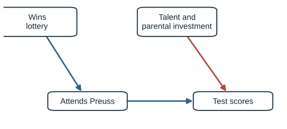{fig-alt="Winning the lottery causes attending Preuss; talent causes test scores but no longer causes attendance" width="62%"}

::: {.fragment .key-line}
The lottery “broke the link between talent (the confounder) and going to Preuss (the treatment).”
:::

::: fragment
Randomization makes the groups' potential outcomes equal **on average**. The baseline difference becomes zero in expectation; what remains is noise.
:::

::: source
Source: *Thinking Clearly with Data*, ch. 9, pp. 167–168.
:::

::: notes
Explain why randomization works in both languages. In the diagram, the lottery becomes the only cause of attendance among applicants, so the arrow from talent to attendance disappears. Talent still affects scores, but it no longer differs systematically between winners and losers.

In potential-outcomes language, randomization guarantees that the treated and untreated groups have the same potential outcomes on average. The baseline-difference term is therefore zero in expectation. Any single lottery can still produce chance differences between groups; that is noise, and it shrinks with sample size.

The book's line: without an experiment, “social processes” decide who is treated, and that is why raw correlations mislead.
:::

## The lottery in a potential-outcomes table {#lottery-po-table}

Ten applicants. Suppose Preuss has **no effect**, so each child's score is the same either way ($Y_1 = Y_0$).

::: po-table
| Applicant | Talent | Lottery | $Y_{1i}$ (Preuss) | $Y_{0i}$ (regular school) | Effect |
|------------|------------|------------|:----------:|:----------:|:----------:|
| 1 | high | **Win** | [**82**]{.obs} | [82]{.cf} | [0]{.eff} |
| 2 | low | **Win** | [**64**]{.obs} | [64]{.cf} | [0]{.eff} |
| 3 | high | **Win** | [**79**]{.obs} | [79]{.cf} | [0]{.eff} |
| 4 | low | **Win** | [**61**]{.obs} | [61]{.cf} | [0]{.eff} |
| 5 | high | **Win** | [**76**]{.obs} | [76]{.cf} | [0]{.eff} |
| 6 | high | Lose | [80]{.cf} | [**80**]{.obs} | [0]{.eff} |
| 7 | low | Lose | [63]{.cf} | [**63**]{.obs} | [0]{.eff} |
| 8 | high | Lose | [77]{.cf} | [**77**]{.obs} | [0]{.eff} |
| 9 | low | Lose | [66]{.cf} | [**66**]{.obs} | [0]{.eff} |
| 10 | high | Lose | [74]{.cf} | [**74**]{.obs} | [0]{.eff} |
:::

::: {.fragment .key-line}
At a regular school, winners would have averaged **72.4** and losers **72.0**. Same talent mix (3 high, 2 low). Difference in means = 0 + **0.4** of noise.
:::

[Invented numbers for illustration.]{.source}

::: notes
Return to potential outcomes, now for the lottery. This table is invented, like the book's tables, so we can see both potential outcomes. To match the book's reading of the Preuss evidence, suppose attending Preuss has no effect: each child would score the same at Preuss or at a regular school.

Everyone in the table applied, so every family was motivated enough to enter. Talent still varies. A coin decided who won. By luck, each group ended up with three high-talent and two low-talent children.

Compute the without-Preuss averages. Winners' Y-zero averages 72.4; losers' averages 72.0. The groups would have scored almost the same at a regular school, so the baseline-difference term is close to zero. The observed difference in means is 72.4 minus 72.0, or 0.4, and since the true effect is zero, all 0.4 is chance.

Contrast with the raw comparison against San Diego City Schools. Non-applicants are a different population with lower Y-zero, so that comparison carried a large positive baseline difference. The lottery compares children drawn from the same pool of applicants.

Stress “on average.” With ten children, a different coin flip could put four high-talent children among the winners and create a few points of imbalance. That imbalance is noise, not bias: across many lotteries it averages to zero, and it shrinks as the number of applicants grows. The next slide shows this with many applicants.
:::

## Winners and losers look alike on everything else {#lottery-balance}

::: {#lottery-balance-root .lot-sim aria-label="Interactive balance table comparing lottery winners, losers, and non-applicants"}
:::

::: {.fragment .key-line}
The lottery balances **everything**, measured or not, including the score each child would have gotten anyway. Applicants still differ from non-applicants.
:::

::: notes
This is an interactive balance table with simulated data. Four hundred families apply for two hundred seats. Two thousand families in the same district do not apply. Every characteristic in the table was measured before the lottery and predicts later test scores: fifth-grade scores, parental education, family income, and absences. The last row is the score each child would get at a regular school, Y-zero, which no real study observes; we can show it because the data are simulated.

Read across the columns. Winners and losers are nearly identical on every row; the difference column hovers around zero. Applicants as a whole are very different from non-applicants: higher prior scores, more educated parents, higher incomes, fewer absences. That right-hand column is the selection that biased the raw Preuss comparison.

Click “Run the lottery again” several times. The winner–loser differences bounce around zero, sometimes slightly positive and sometimes slightly negative. That is noise. The applicant–non-applicant gap stays large every time, because the lottery cannot change who applied.

Make two points. First, randomization balances characteristics we did not measure as well as those we did, including potential outcomes themselves. Statistical control, by contrast, can only adjust for what we measured. Second, real lottery studies report a table like this, often called a balance table or randomization check, to show readers that winners and losers were comparable before the lottery. When students read an experiment, the balance table is one of the first things to check.

Finally, note what the lottery does not buy. The comparison is among applicants, so it estimates the effect for families who apply, not for every family in the district. That is the external-validity question from Week 9.
:::

## Elite colleges in the same terms {#college-decomposition}

::: equation
Earnings gap $=$ effect of the college on its graduates $+$ how they would have done anyway
:::

::::: two-column
::: column
### Raw comparison

Elite-college students were already more able, ambitious, and advantaged.

The baseline-difference term is **large and positive**.
:::

::: column
### Same admissions, different colleges

Students who looked alike to admissions offices.

The baseline difference shrinks, and so does the premium (except for low-income students).
:::
:::::

::: notes
Apply the same idea to the college case from Part 1. The earnings gap between graduates of more and less selective colleges equals the effect of the college on the students who attended plus the difference in how those students would have earned anyway. Because selective colleges enroll students who are more able, ambitious, and advantaged, the second term is large and positive.

Dale and Krueger's comparison shrinks the baseline-difference term by comparing students admitted to the same set of colleges. If those students are similar in everything that affects earnings, the remaining difference estimates the college effect, which turned out to be small for most students and larger for students from low-income families.

Ask students what assumption the design relies on: that among students admitted to the same schools, the choice of where to enroll is unrelated to future earnings potential. Ask them for a violation. Students who choose a less selective school because of a scholarship, or because they plan a career that does not require a prestigious credential, might differ in earnings potential. This is a good moment to contrast statistical control, which depends on the proxy, with randomization, which does not.
:::

## Two sources of baseline differences {#two-sources}

::::: two-column
::: column
### Confounders

A feature that affects **treatment** and, separately, the **outcome**.

Talent → Preuss; talent → scores.

Health-consciousness → hormones; health-consciousness → heart disease.
:::

::: column
### Reverse causality

The **outcome** affects **treatment**.

Civil war damages the economy.

Depressed teens turn to social media.
:::
:::::

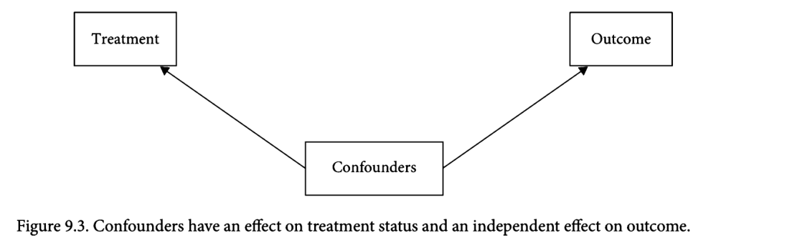{fig-alt="TCD Figure 9.3: confounders affect treatment status and independently affect outcome" width="55%"}

::: source
Source: *Thinking Clearly with Data*, ch. 9, pp. 168–170, Figure 9.3.
:::

::: notes
Name the two sources of baseline differences in the book. A confounder must satisfy two conditions: it affects treatment status, and it affects the outcome over and above its effect through treatment. Talent is a confounder in the Preuss case. Health-consciousness is a confounder in the hormone case.

Reverse causality means the outcome affects treatment status. The book's example is civil war and economic output: war destroys infrastructure and lowers output, so a negative correlation between the economy and war could reflect war causing poverty. The social media case from Part 1 also fits, since depressive symptoms predicted later use.

Use the book's figure as a checklist. A variable belongs in the confounders box only if both arrows make sense: one into treatment and one into the outcome that does not run through the treatment. Note that the figure deliberately omits the treatment-to-outcome arrow; it shows only the biasing paths.
:::

## Reverse causality with real data: police and crime {#police-crime}

:::::: two-column
::: column
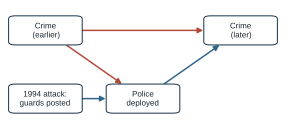{fig-alt="Earlier crime causes police deployment and later crime; police cause later crime; the 1994 attack causes guards to be posted"}
:::

:::: column
Cities and blocks with more police often have **more** crime, because police go where crime is.

After the **1994 AMIA bombing** in Buenos Aires, every Jewish institution got 24-hour police guards.

::: {.fragment .key-line}
Car thefts on protected blocks fell about **75%**, with no detectable change one or two blocks away.
:::
::::
::::::

::: source
Source: Di Tella and Schargrodsky (2004), *American Economic Review* 94(1): 115–133.
:::

::: notes
Give a real reverse-causality case. Places with more police often have more crime, because police are deployed in response to crime. A raw correlation across cities or neighborhoods can therefore suggest that police cause crime.

After the July 1994 terrorist attack on the AMIA Jewish center in Buenos Aires, the government posted 24-hour police protection at every Jewish institution, including schools, synagogues, and clubs. The location of those guards depended on the location of Jewish institutions, not on car-theft rates.

Di Tella and Schargrodsky collected car thefts per block in three neighborhoods from April to December 1994. Comparing blocks with protected institutions to other blocks, before and after the guards arrived, car thefts fell by about 75 percent on protected blocks. The effect was very local: no detectable change one or two blocks away. The authors acknowledge they cannot rule out displacement to unobserved areas.

Point to the diagram. Time-indexing crime as earlier and later turns reverse causality into a fork through earlier crime. The attack adds a new cause of police deployment that is unrelated to crime.
:::

## Signing the bias {#signing-bias}

:::::: two-column
::: column
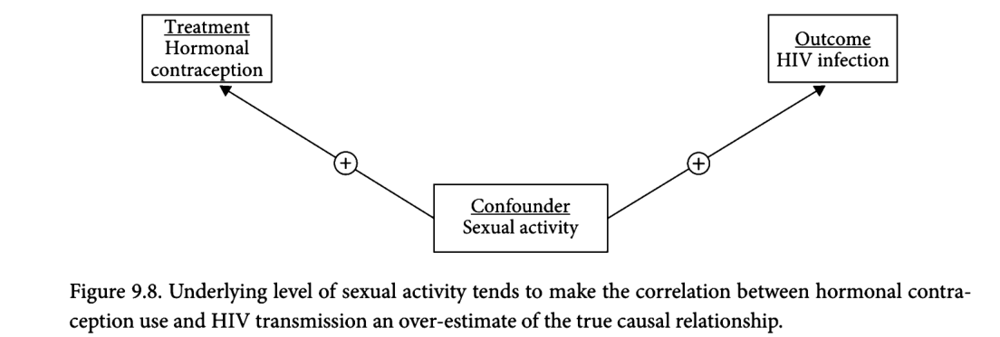{fig-alt="TCD Figure 9.8: sexual activity as a confounder of hormonal contraception and HIV"}
:::

:::: column
Women using hormonal contraception were **twice as likely** to acquire HIV from infected partners.

Sexual activity → choosing contraception **(+)**

Sexual activity → HIV risk **(+)**

::: {.fragment .key-line}
(+) × (+) = positive bias. The doubling is probably an **overestimate**.
:::
::::
::::::

::: source
Source: *Thinking Clearly with Data*, ch. 9, pp. 179–181, Figure 9.8.
:::

::: notes
Introduce the book's tool for reasoning about bias we cannot measure: signing it. If a confounder raises the chance of treatment and raises the outcome, the bias is positive. If the two signs differ, it is negative.

The book's example is a study of serodiscordant couples in Africa. HIV-negative women using hormonal contraception were twice as likely to acquire HIV from infected partners, controlling for self-reported condom use, and the result was widely reported. But women were not randomized; they chose contraception. Women who expect to be more sexually active are more likely to choose hormonal contraception, and sexual activity raises HIV risk directly. Both signs are positive, so the bias is positive and the doubling likely overstates any effect.

The coda, from outside the book: the ECHO trial, published in the Lancet in 2019, randomized women in several African countries to three contraceptive methods and found no substantial difference in HIV incidence. The randomized evidence agreed with the authors' suspicion.
:::

## Your turn: sign the bias {#activity-statins}

Middle-aged men who take **statins** are less likely to die of heart attacks.

Statin users had **higher cholesterol before** they started taking statins.

1.  Draw the arrows: cholesterol → statins? cholesterol → death?
2.  What is the sign of the bias?
3.  Does the observational study **overstate** or **understate** the benefit of statins?

::: {.fragment .key-line}
And if cholesterol were measured **after** treatment began?
:::

::: notes
Give pairs two minutes. This builds on the book's statins quiz, which asks readers to sign the bias for pre-treatment cholesterol but does not answer.

Answer: high cholesterol makes men more likely to be prescribed statins (positive) and more likely to die of a heart attack (positive). The bias is positive for the outcome death, so statin users look more likely to die than they would without confounding. The observational study therefore understates the protective benefit of statins.

The follow-up question sets up Part 4. Cholesterol measured after statins begin is not a confounder; it is a mechanism, because statins lower cholesterol, which lowers heart-attack risk. In a randomized trial, the statin group would also have lower cholesterol, and that is how the drug works. Whether cholesterol is a confounder or a mediator depends on when it was measured. Rohrer's diagrams will make this distinction visual.
:::

## Two kinds of selection {#two-selections}

::::: two-column
::: column
### Selection into the **sample** (Week 9)

Which units end up in our data?

Archive survival, query rules, publication, moderation.

Threatens what the data can **represent**, and can create spurious associations.
:::

::: column
### Selection into **treatment** (today)

Which units end up treated?

Talent, ideology, health, intention.

Creates **baseline differences** between the groups we compare.
:::
:::::

::: {.fragment .key-line}
In both cases, a process we did not control decides what we observe. Part 4 shows they have **different shapes**.
:::

::: notes
Put last week and this week side by side. Students will otherwise merge the two meanings of “selection bias.”

Selection into the sample is about which units appear in the data at all: archived articles, posts that survived moderation, published studies. Last week we saw that this can create associations that do not exist in the population, through Berkson's paradox.

Selection into treatment is about which units receive the treatment. It produces baseline differences between treated and untreated groups, which is the bias term in today's equation.

Tell students that after the break we will draw both. Selection into treatment is a fork: a common cause of treatment and outcome. Selection into the sample is a collider: a variable caused by two others that we condition on by restricting the sample. That distinction determines what we should and should not control for.

Take the break here.
:::

## Drawing the bias: Rohrer's DAGs {#dags .section-title}

[Part 4 of 5 · Rohrer's DAGs]{.kicker}

> I cannot randomize. Which variables should I control for, and which should I leave alone?

::: notes
Transition to Rohrer. Part 3 ended with the conclusion that bias comes from baseline differences. Rohrer answers the practical question that follows: if we cannot randomize, what should we control for?

Her central claim is that controlling for a variable can help, do nothing, or make things worse, depending on where the variable sits in the causal structure. The rest of this part follows her argument in order.
:::

## Rohrer's dilemma {#rohrer-dilemma}

Many important questions cannot be randomized:

-   divorce and well-being
-   social class and prosocial behavior
-   childhood adversity and adult health
-   **years of media exposure and political attitudes**

::: {.fragment .key-line}
“It is impossible to infer causation from correlation without background knowledge about the domain.” The question is whether that knowledge is stated openly.
:::

::: source
Source: Rohrer (2018), pp. 27–28.
:::

::: notes
Present Rohrer's starting point. Randomized experiments are the gold standard, but for many questions manipulation is unfeasible, unethical, or impossible. Her examples: we cannot assign couples to divorce, randomly resettle people into social classes, or randomize children to adversity. Add a communication example: we cannot assign people to years of partisan media.

Rohrer argues that causal inference from observational data requires assumptions, and so do experiments, for example when generalizing from a lab to everyday life. The important question is whether the assumptions are made explicit. DAGs are a tool for making them explicit.
:::

## Three common workarounds {#three-workarounds}

:::::: triad
::: triad-item
Surrogate interventions

Manipulate a lab proxy instead of the real cause: priming people to **feel** lower in class instead of studying social class.

Is the proxy the cause you care about?
:::

::: triad-item
Avoiding causal language

“Associated with… future experiments are needed.”

The question is still causal, and readers read it causally.
:::

::: triad-item
Throwing in controls

Control for whatever is in the data set, because more control seems safer.

Rohrer: “a methodological urban legend at best.”
:::
::::::

::: {.fragment .key-line}
Which of these have you seen in communication papers?
:::

::: source
Source: Rohrer (2018), pp. 27–28; Piff et al. (2010); Achen (2005) on “garbage-can regressions.”
:::

::: notes
Walk through Rohrer's three coping strategies and what is wrong with each.

Surrogate interventions manipulate a proxy. Her example is Piff and colleagues (2010), who asked participants to compare themselves with people at the top or bottom of a social ladder to temporarily change perceived social class. The question is whether a brief manipulation of perceived class captures the effects of actually living in a social class.

Avoiding causal language means writing about associations and links and then adding a disclaimer. Rohrer argues the substantive question is still causal, readers interpret it causally, and the disclaimer lets authors avoid stating their assumptions. Connect to Bergstrom and West's point that grammar and graph layout imply causation.

Throwing in controls means choosing covariates by convention or availability. Achen called the results garbage-can regressions. Rohrer calls the belief that more control is always better a methodological urban legend.

Ask which of these students have seen. Most will recognize the second and third immediately. This motivates the rest of Part 4.

Flag that Isch and colleagues, the last reading for today, recommend associational wording for cross-sectional papers, which sits uneasily with Rohrer's critique of avoiding causal language. We return to this tension in Part 5.
:::

## Reading a DAG {#reading-a-dag}

-   **Nodes** are variables. **Arrows** are direct causal effects.
-   An arrow means: if we could intervene on the variable at its start, the variable at its end would change.
-   Arrows allow **any** functional form, not only linear effects.
-   **No cycles.** Feedback is handled by indexing variables by time, as in the social media case (depression at t₀ → use at t₁).
-   Include every **common cause** of any two variables already in the graph.

::: source
Source: Rohrer (2018), pp. 28–31.
:::

::: notes
Give the grammar. A DAG is a directed acyclic graph. Nodes are variables; arrows are direct causal effects. Rohrer's interventionist reading: a manipulation of the variable at the start of an arrow, holding everything else constant, would change the variable at the end.

Two differences from path diagrams that students may know from structural equation modeling. First, DAG arrows assume nothing about functional form. Second, there are no double-headed arrows; a shared unmeasured cause is drawn as an explicit variable.

Acyclicity sounds restrictive because social processes involve feedback. Rohrer's solution is to index variables by time. That is how reverse causality fits into a DAG, as in the social media case.

Completeness: a DAG must include every common cause of any pair of variables in it. It does not need every cause of every variable; a factor that affects only one variable can be left out.
:::

## Rohrer's running example {#rohrer-running-example}

::::: two-column
::: column
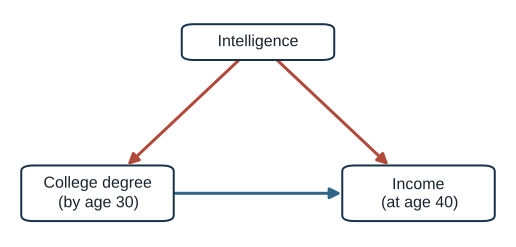{fig-alt="Intelligence causes college degree and income; degree causes income"}
:::

::: column
People with a college degree by age 30 earn about **\$1,500/week** at 40; people without one earn about **\$700**.

The \$800 gap combines two paths:

-   Degree → Income (**causal**)
-   Degree ← Intelligence → Income (**back door**)
:::
:::::

::: source
Source: Rohrer (2018), Figure 1 and p. 28.
:::

::: notes
Introduce Rohrer's running example. We want the causal effect of educational attainment on income. Education is simplified to a college degree by age 30; income is measured at age 40 to fix the time order. Graduates earn about \$1,500 per week and non-graduates about \$700.

The \$800 difference cannot be read as the effect of a degree, because intelligence affects both. The DAG shows two paths connecting education and income: the causal path straight from degree to income, and a back-door path from degree back to intelligence and forward to income.

The raw difference adds the two paths together. Controlling for intelligence would block the back-door path and leave the causal one. Tell students that the next slides explain why that works and when controlling would make things worse.
:::

## Three building blocks {#three-building-blocks}

::: small-table
| Structure | Form | Open with no control? | Controlling for the middle variable… | Example |
|---------------|---------------|:-------------:|---------------|---------------|
| **Chain** | X → M → Y | yes (causal) | blocks part of the real effect: **overcontrol** | charter → AP classes → scores |
| **Fork** | X ← C → Y | yes (non-causal) | **removes** the bias | parental wealth → patience, SAT |
| **Inverted fork** | X → C ← Y | **no** | **creates** bias: collider bias | rigor → publication ← innovation |
:::

::: {.fragment .key-line}
Every path, however long, is built from these three pieces.
:::

::: source
Source: Rohrer (2018), p. 30 (following Elwert 2013); *Thinking Clearly with Data*, ch. 9, p. 181.
:::

::: notes
Present the three elementary structures. Every path between two variables, however long, is built from chains, forks, and inverted forks.

A chain transmits a causal association; the middle variable is a mediator. A fork transmits a non-causal association; the middle variable is a confounder. An inverted fork does not transmit an association unless we condition on the middle variable, which is called a collider.

The fourth column is the key to the rest of Part 4. Controlling for a mediator removes part of the real effect. Controlling for a confounder removes bias. Controlling for a collider creates bias. The next three slides show each one with simulated data.
:::

## Chain: controlling removes a real effect {#chain}

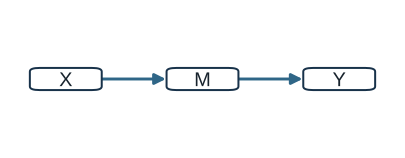{fig-alt="X causes M causes Y" width="38%"}

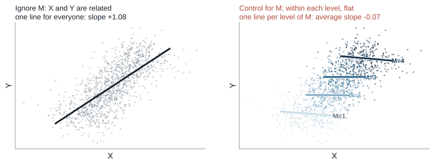{fig-alt="Simulated scatterplots: X and Y positively related among all units; unrelated among units with M near zero" width="88%"}

::: notes
Show the chain with simulated data. X affects M, and M affects Y. Across all units, X and Y are positively related, and that relationship is entirely causal: it runs through M.

Now look at the right panel, which shows what “controlling for M” means. The same points are split into the four levels of M, with one line within each level. Inside any one level, X no longer predicts Y: the lines are flat, because the only route from X to Y runs through M, and within a level M is held fixed. Regression with M as a control averages these within-level slopes. Controlling for a mediator removes the very effect we want.

Give the book's example: if charter schools raise scores partly by offering more AP classes, controlling for AP access hides part of the charter effect. AP access is a mechanism, not a confounder, because it is caused by attending the charter.

The simulation uses 1,200 simulated units. M takes four levels so that “holding M fixed” is literal; with a continuous M, regression does the same thing by comparing units with similar M.
:::

## Fork: controlling removes bias {#fork}

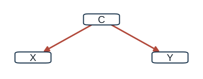{fig-alt="C causes X and C causes Y" width="38%"}

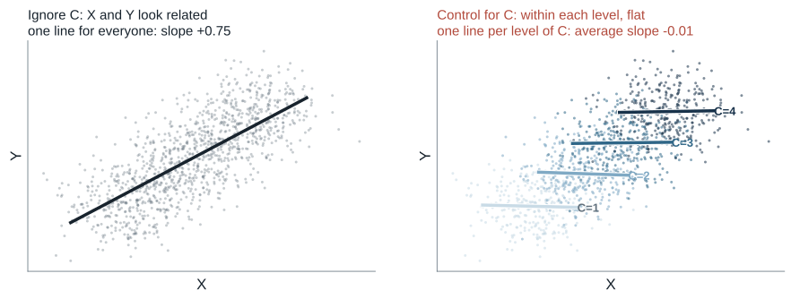{fig-alt="Simulated scatterplots: X and Y positively related among all units; unrelated among units with C near zero" width="88%"}

::: notes
Show the fork. C causes both X and Y, and X has no effect on Y in this simulation. Across all units, X and Y are clearly correlated, but the correlation is entirely produced by C.

Now the right panel. Split the same points by the four levels of C and fit a line within each level. Within any level the lines are flat: once we compare units with the same value of the confounder, X and Y are unrelated. The overall slope came entirely from the fact that units with higher C have higher X and higher Y. Holding the confounder fixed removes the spurious association.

Connect to the earlier cases. Family background in the TV case, talent in the Preuss case, health-consciousness in the hormone case, and ability and ambition in the college case are all forks. Selection into treatment is a fork: a common cause of who gets treated and how they turn out.
:::

## Collider: controlling creates bias {#collider}

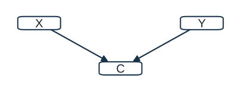{fig-alt="X causes C and Y causes C" width="38%"}

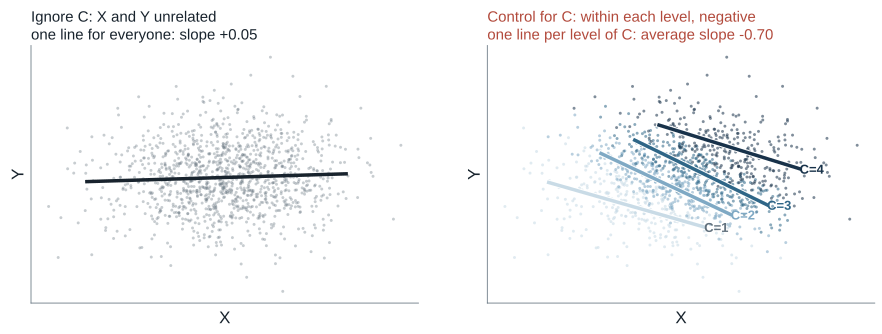{fig-alt="Simulated scatterplots: X and Y unrelated among all units; negatively related among units with high C" width="88%"}

::: notes
Show the collider. X and Y are independent in the simulation; both cause C. Across all units there is no relationship between X and Y.

Now split the points by the four levels of C and fit a line within each level. Every within-level line slopes down. Within a given level of C, a unit with low X must have high Y to reach that level, and vice versa. Controlling for the collider, whether by adding it to a regression or by keeping only one level as a sample, created an association out of nothing.

This is the reverse of the fork. Leaving a collider alone keeps the path blocked; controlling for it, or selecting the sample on it, opens the path.
:::

## You have seen the collider before {#collider-callback}

::::: two-column
::: column
### Rohrer: published studies

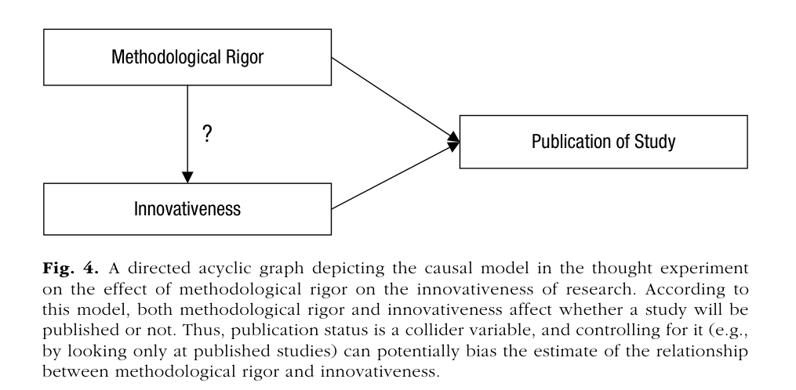{fig-alt="Rohrer Figure 4: methodological rigor and innovativeness both cause publication"}

Among published studies, rigor and innovation look like a **trade-off**, even if they are unrelated overall.
:::

::: column
### Week 9: what reaches the archive

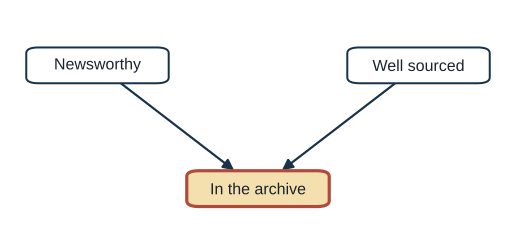{fig-alt="Newsworthy and well sourced both cause a story to be in the archive, which is conditioned on"}

If editors publish stories that are newsworthy **or** well sourced, the archive shows a false trade-off.
:::
:::::

::: {.fragment .key-line}
Selection into the **sample** is conditioning on a collider.
:::

::: source
Source: Rohrer (2018), Figure 4, p. 35; Week 9 Berkson example (Bergstrom and West 2021, ch. 6).
:::

::: notes
Connect Rohrer's collider example to last week. Suppose methodological rigor has no effect on innovativeness. Both make publication more likely. Among published studies, the low–low corner is missing because those studies were not published, and the high–high corner is rare. The remaining studies show a negative association, a trade-off that does not exist in the full population. Rohrer adds that analyzing unpublished studies separately produces the same spurious trade-off, because it also conditions on publication.

Now recall the Week 9 Berkson example. If editors publish stories that are either newsworthy or well sourced, then among published stories newsworthiness and sourcing look negatively related. Same picture.

Make the synthesis explicit. Last week's selection into the sample is conditioning on a collider. Today's selection into treatment is a fork. Rohrer generalizes: when membership in a group depends on several desirable features, conditioning on membership creates or exaggerates trade-offs between them.
:::

## Back-door paths {#back-door}

A **back-door path** starts with an arrow **into** the treatment and ends at the outcome.

To identify a causal effect:

1.  Block every back-door path by controlling for a **non-collider** on it.
2.  Do not control for anything **caused by** the treatment.

::: {.fragment .key-line}
If the DAG is right and every back door is blocked, the effect is identified, even with observational data.
:::

::: source
Source: Rohrer (2018), p. 31 (Pearl's back-door criterion).
:::

::: notes
State the back-door criterion informally. A back-door path is any path from treatment to outcome that begins with an arrow pointing into the treatment. Those paths carry non-causal association. To identify the effect, block every back-door path by conditioning on a non-collider somewhere on it, and do not condition on anything caused by the treatment.

Any non-collider on a path will do. It is efficient to choose variables that block several paths at once.

Stress the condition: “if the DAG is right.” The criterion guarantees identification only under the assumption that the graph captures the true causal structure. Identification is also separate from estimation, a point we return to at the end of this part.
:::

## Practice: what should we control for? {#practice-grades}

::::: two-column
::: column
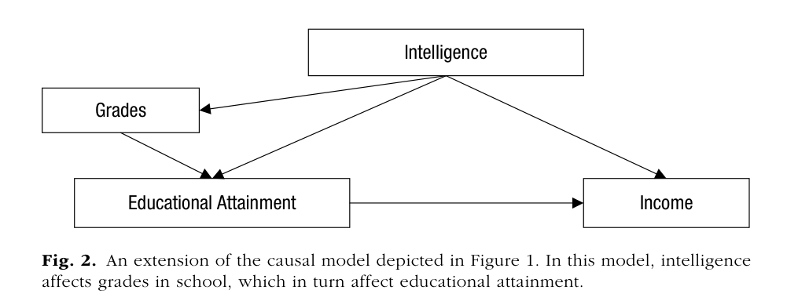{fig-alt="Rohrer Figure 2: intelligence causes grades, educational attainment, and income; grades cause attainment; attainment causes income"}
:::

::: column
List every path from **Educational Attainment** to **Income**. Then decide:

| Control for…            |            Effect identified?             |
|-------------------------|:-----------------------------------------:|
| Nothing                 |              [No]{.fragment}              |
| Grades only             | [No: one back door still open]{.fragment} |
| Intelligence            |             [Yes]{.fragment}              |
| Intelligence and grades | [Yes: grades are unnecessary]{.fragment}  |
:::
:::::

::: source
Source: Rohrer (2018), Figure 2, pp. 30–31.
:::

::: notes
Give pairs two minutes to list the paths. There are three. The causal path runs from education straight to income. One back-door path runs from education back to intelligence and forward to income. A second back-door path runs from education back to grades, back to intelligence, and forward to income.

Reveal the table one row at a time. With no controls, both back doors are open. Controlling for grades blocks the longer path but leaves the direct intelligence path open. Controlling for intelligence blocks both, because intelligence sits on both paths. Adding grades as well is harmless here but unnecessary.

This is Rohrer's point that choosing a node that blocks several paths at once is efficient.
:::

## Practice: a skeptic's DAG {#practice-genetic}

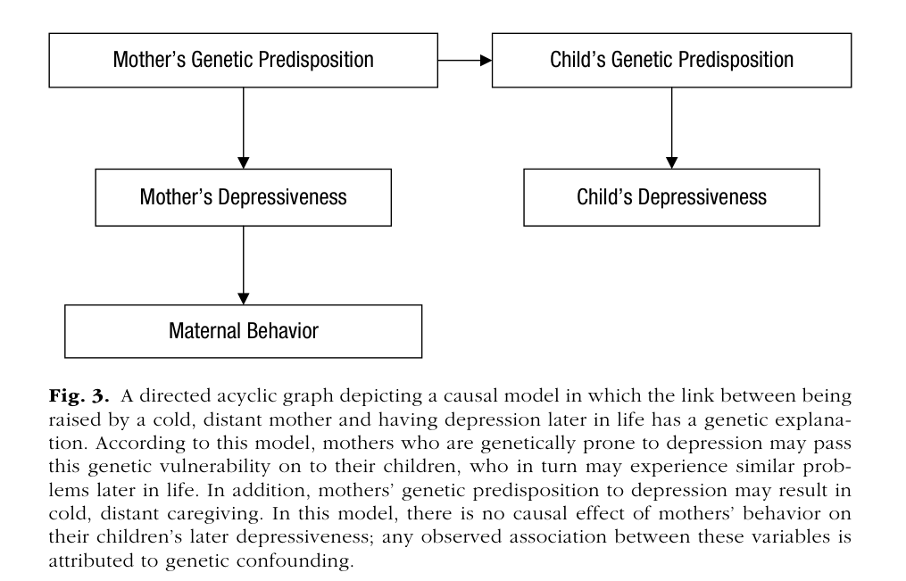{fig-alt="Rohrer Figure 3: mother's genetic predisposition causes mother's depressiveness and child's genetic predisposition; mother's depressiveness causes maternal behavior; child's genes cause child's depressiveness" width="72%"}

Children who were rarely held by their mothers are more depressed as adults. Find the back-door path. What could block it?

::: source
Source: Rohrer (2018), Figure 3, pp. 33–34, adapted from Turkheimer (2000).
:::

::: notes
This is the skeptic's model. It deliberately contains no arrow from maternal behavior to the child's depression. If this DAG is correct, the observed association is entirely produced by genetic confounding.

Ask students to find the back-door path. It runs from maternal behavior back to the mother's depressiveness, back to the mother's genetic predisposition, forward to the child's genetic predisposition, and forward to the child's depressiveness. It contains no collider, so it is open.

What could block it? Rohrer suggests controlling for the mother's depressiveness, which is measurable. Genes would also block it in principle, but they are rarely measured. Turkheimer's warning: because almost every trait is somewhat heritable, correlations among biological relatives cannot be taken as evidence of social causes. That leads to designs that remove the path entirely.
:::

## Practice: a confounder and a mediator {#practice-mediator}

::: two-column
::: column
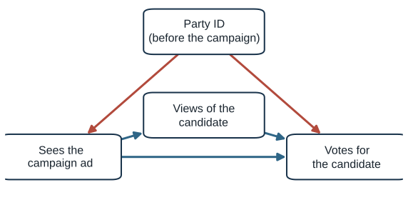{fig-alt="Party identification causes seeing the ad and voting; the ad changes views of the candidate, which affect voting; the ad also affects voting directly"}
:::

::: column
We want the **total effect** of seeing a campaign ad on voting for the candidate.

| Control for… | Effect identified? |
|---|:-:|
| Nothing | [No: back door through party ID open]{.fragment} |
| Party ID | [**Yes**]{.fragment} |
| Views of the candidate | [No: back door open, **and** part of the effect removed]{.fragment} |
| Party ID and views | [No: only the **direct** effect remains]{.fragment} |
:::
:::

::: notes
Give pairs two minutes. Ask them to list the paths from seeing the ad to voting, then fill in the table.

There are three paths. Two are causal: the ad affects the vote directly, and the ad changes views of the candidate, which then affect the vote. Views of the candidate are a mediator. One path is a back door: the ad is more likely to reach people of the candidate's party, through targeting and media habits, and party identification affects the vote.

Reveal the rows. With no controls, the back door is open, so the raw comparison overstates the ad's effect. Controlling for party identification, measured before the campaign, blocks the back door and leaves both causal paths open: that identifies the total effect. Controlling for views of the candidate alone is doubly wrong: it leaves the back door open and removes the part of the effect that works by changing views. Controlling for both blocks the back door but also removes the mediated path, so what remains is only the direct effect, the part of the ad's influence that does not run through views of the candidate.

Make the point that controlling for the mediator is not always a mistake; it answers a different question. If the research question is whether the ad works through changing views of the candidate or through something else, the direct effect is the target. But that is a mediation question, and Rohrer warns later today that estimating it requires its own assumptions.
:::

## Control by design {#control-by-design}

Instead of measuring every confounder, choose a design in which the back door does not exist.

-   **Identical twins.** Religiosity and delinquency are negatively correlated, but **within** identical-twin pairs the association disappears.
-   **Adoption** cuts the arrow from the parent's genes to the child's.
-   **Lotteries and natural experiments.** The Preuss lottery; TV's arrival; the Buenos Aires guards.

::: source
Source: Rohrer (2018), p. 34; Turkheimer and Harden (2014).
:::

::: notes
Present Rohrer's alternative to statistical control: change the design so the back-door path does not exist.

Twin designs: identical twins share genes and family background. Turkheimer and Harden (2014) found the familiar negative correlation between religiosity and delinquency in the whole sample. But within identical-twin pairs, the more religious twin was not less likely to become delinquent. If religiosity affected delinquency, the association should have held within pairs. The null challenges a causal interpretation.

Adoption studies cut the arrow from the rearing mother's genes to the child's genes, under the assumption that children are not placed in matching families.

Natural experiments are “lucky accidents” that remove many back-door paths at once. Rohrer describes them as an intermediate case between observational studies and experiments. Callbacks: the Preuss lottery, the arrival of TV, and the police guards in Buenos Aires. Dale and Krueger's college comparison is a different strategy: conditioning on a well-chosen proxy for the confounder, which is statistical control rather than design.
:::

## Communication designs that cut the back door {#comm-designs}

:::::: design-panels

Facebook deactivation

**Problem:** heavy users differ from light users.

**Design:** randomly pay users to deactivate for the 4 weeks before the 2018 midterms.

**Result:** less polarization and news knowledge, higher well-being; 80% said it was good for them.

Randomizing the news

**Problem:** editors cover what audiences already care about.

**Design:** 48 outlets published stories on dates the researchers **randomly assigned**.

**Result:** discussion of the topic on social media rose about **62.7%** of a day's volume (about 13,166 posts over the week).

Sinclair acquisitions

**Problem:** Sinclair chooses which stations to buy.

**Design:** difference-in-differences: 10 acquired stations vs. other programs in the same markets.

**Result:** national politics coverage up **about 25%**, local down **about 10%**, slant shifted right.

::::::

::: source
Sources: Allcott, Braghieri, Eichmeyer, and Gentzkow (2020), *AER*; King, Schneer, and White (2017), *Science*; Martin and McCrain (2019), *APSR*.
:::

::: notes
Show three communication studies that removed the selection problem by design.

Facebook deactivation: Allcott and colleagues recruited Facebook users and randomly paid some of them to deactivate their accounts for the four weeks before the 2018 midterm elections. Deactivation reduced online activity, increased offline activities, reduced factual news knowledge and political polarization, and increased subjective well-being. Eighty percent of the deactivated group said deactivation was good for them. This is a randomized experiment on the real treatment, not a lab proxy, which answers Rohrer's worry about surrogate interventions. Avoid quoting effect sizes in standard-deviation units unless you check them in the paper.

Randomizing the news: King, Schneer, and White (2017, *Science*) recruited 48 mostly small news outlets. The outlets agreed to write and publish articles in broad policy areas the researchers approved, on dates the researchers randomly assigned. Because the publish date was random, public concern could not have caused the timing of coverage. This answers the reverse-causation worry about agenda setting: audiences do drive coverage, but randomized coverage still moved public discussion. (Sesame Street, Kearney and Levine 2019, is another strong example, but its design, staggered reception, repeats the TV case.)

Sinclair: Martin and McCrain studied ten local stations that Sinclair acquired in 2017 and compared them with other news programs in the same media markets before and after. Coverage of national politics rose by about 25 percent, local politics fell by about 10 percent, the slant measured from transcripts shifted right, and viewership fell slightly. Note that the outcomes are measured from text, which we return to in Part 5.

If you want to add a fourth example, Lelkes, Sood, and Iyengar (2017) used state right-of-way laws as a source of variation in broadband access to study partisan affect.
:::

## Learning to let go {#learning-to-let-go}

> “It is not true that simply adding more covariates will always improve the estimate of a causal effect.”

**Confounders** cause the treatment. **Mediators** and **colliders** are caused by it: they are **post-treatment** variables.

::: {.fragment .key-line}
Rule of thumb: do not control for post-treatment variables.
:::

::: source
Source: Rohrer (2018), p. 34; Rosenbaum (1984); Rubin (1974).
:::

::: notes
Introduce Rohrer's section “Learning to let go.” Some fields reward studies that use more controls than previous studies. Rohrer agrees that omitting confounders is bad, but argues that adding covariates can make things worse.

The two kinds of variables not to control for are mediators and colliders. Both are typically caused by the treatment, which makes them post-treatment variables. The rule of thumb, from Rosenbaum and Rubin: do not control for post-treatment variables when estimating a total effect.

The next slides show where this goes wrong in practice: in data collection, including the hospital studies from Case 2, and in mediation analysis.
:::

## Colliders built into data collection {#endogenous-selection}

::::: two-column
::: column
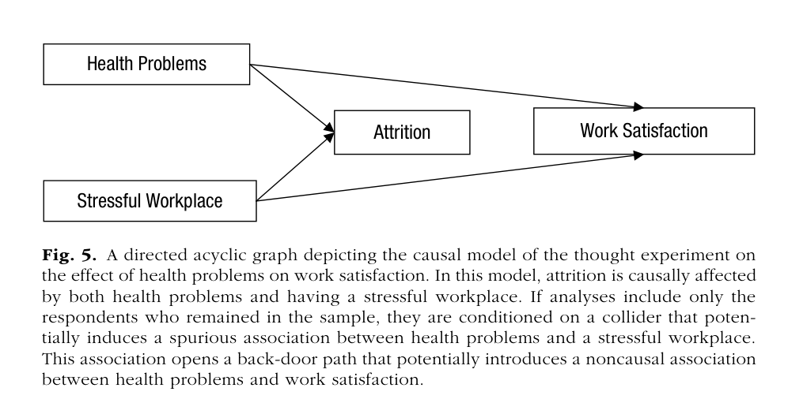{fig-alt="Rohrer Figure 5: health problems and stressful workplace both cause attrition"}
:::

::: column
Rohrer's **endogenous selection**: the sample itself conditions on a collider.

-   only **completed** questionnaires (grit, intelligence)
-   only panel **stayers** (attrition)
-   only **college students**
-   for texts: posts that **survived moderation**, articles that reached the **archive**
:::
:::::

::: source
Source: Rohrer (2018), pp. 36–37, Figure 5.
:::

::: notes
Present Rohrer's examples of collider bias produced by the sampling procedure rather than by a choice of covariates. She calls it endogenous selection bias.

Nonresponse: suppose a long, burdensome survey measures grit and intelligence. Both help people finish. Among completers, people low in one trait compensated with the other, so grit and intelligence look negatively related even if they are unrelated in the population.

Attrition, Figure 5: in a panel study of health problems and work satisfaction, people drop out because of health problems or because of stressful workplaces. Among people who stay, health problems and workplace stress become negatively associated, opening a non-causal path to work satisfaction.

Nonrepresentative samples: studying only college students conditions on everything that affects becoming a college student, such as socioeconomic status, ability, and attitudes. This makes convenience samples a threat to internal validity, not only external validity.

For text data, the same logic applies to posts that survived moderation and articles that survived in an archive. That is the direct bridge to the Week 9 material, and to Case 2: the hospital studies of smoking and COVID conditioned on hospitalization in exactly this way.
:::

## Mediators: controlling away the effect {#mediator-fig6}

:::::: two-column
::: column
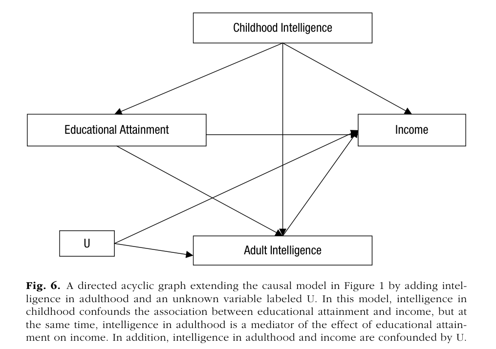{fig-alt="Rohrer Figure 6: childhood intelligence, educational attainment, adult intelligence, income, and an unmeasured variable U"}
:::

:::: column
Education raises **adult** intelligence, which raises income.

Controlling for adult intelligence:

1.  blocks a real causal path (**overcontrol**), and
2.  opens a path through **U**, because adult intelligence is also a **collider**.

::: {.fragment .key-line}
Control for childhood intelligence; leave adult intelligence alone.
:::
::::
::::::

::: source
Source: Rohrer (2018), Figure 6, pp. 37–38.
:::

::: notes
Return to Rohrer's running example, now with a twist. Education raises intelligence in adulthood, and adult intelligence raises income. Rohrer also adds an unmeasured variable U that affects both adult intelligence and income.

If we control for adult intelligence, two things go wrong. First, we block the part of education's effect that runs through raising adult intelligence. That is overcontrol: if we could randomly assign education, it would change adult intelligence, which would change income, and that is part of the effect. Second, adult intelligence is a collider between education and U. Controlling for it opens a non-causal path from education through adult intelligence to U and on to income.

The right choice for the total effect: control for childhood intelligence, which blocks the back doors, and leave adult intelligence alone. Rohrer adds that we should not control for descendants of mediators either; her example is chess performance as a noisy proxy for adult intelligence.
:::

## Mediation analysis in communication research {#mediation-process}

Classic mediation analysis (Baron and Kenny; Hayes's PROCESS) estimates a direct effect by **controlling for the mediator**.

::: fragment
Rohrer: this can be biased **even in a randomized experiment**, unless the mediator is also randomized.
:::

::: {.fragment .key-line}
Randomizing X closes back doors into X. It does nothing about back doors between the mediator and Y.
:::

::: source
Source: Rohrer (2018), p. 38; Hayes (2009), *Communication Monographs*; Bullock, Green, and Ha (2010).
:::

::: notes
Bring Rohrer's warning home to communication. Mediation analysis in the Baron and Kenny tradition, and Hayes's PROCESS macro, estimate direct and indirect effects by statistically controlling for the mediator. Hayes's influential 2009 paper appeared in *Communication Monographs*, and many students will have run PROCESS models.

Rohrer's point: controlling for a mediator turns it into a collider whenever some unmeasured variable affects both the mediator and the outcome. This is true even in an experiment. Randomizing the treatment rules out back-door paths into the treatment, but it does nothing about confounding between the mediator and the outcome. A message experiment that measures, say, anger as a mediator of attitude change cannot rule out that some trait affects both anger and attitudes.

Do not tell students never to study mechanisms. Tell them that mediation estimates require additional assumptions, and that the strongest designs manipulate the mediator directly. Bullock, Green, and Ha (2010) make this argument for political science.
:::

## Control or not? Today's examples {#control-or-not}

::: small-table
| We want the effect of… | on… | Should we control for… | Role | Control? |
|---------------|---------------|---------------|---------------|---------------|
| taking statins | dying of a heart attack | cholesterol, measured **before** starting statins | [confounder]{.fragment} | [**yes**]{.fragment} |
| taking statins | dying of a heart attack | cholesterol, measured **after** starting statins | [mediator]{.fragment} | [**no**]{.fragment} |
| a study's rigor | its innovativeness | whether it was **published** | [collider]{.fragment} | [**no**]{.fragment} |
| education | income | chess skill, a proxy for **adult** intelligence | [descendant of a mediator]{.fragment} | [**no**]{.fragment} |
| attending a selective college | earnings | which colleges admitted the student | [proxy for a confounder]{.fragment} | [**yes**, if it captures ability well]{.fragment} |
:::

::: {.fragment .key-line}
Same variable, different role: cholesterol is a confounder or a mediator depending on **when** it is measured.
:::

::: source
Sources: *Thinking Clearly with Data*, ch. 9, pp. 181–182 (statins); Rohrer (2018), pp. 35 and 38 (publication, chess); Dale and Krueger (2002).
:::

::: notes
Run this as a rapid-fire classification. Read each row, say the treatment and outcome out loud, and have students call out the role before revealing it.

Statins, first row. The study is observational: middle-aged men who take statins, a cholesterol-lowering drug, are less likely to die of a heart attack. Doctors prescribe statins to men with high cholesterol, and high cholesterol independently raises heart-attack risk. So cholesterol measured before treatment affects both who takes statins and who dies: a confounder. Control for it. Without controlling, statin users look sicker at baseline, which hides some of the drug's benefit; this is the bias students signed in Part 3.

Statins, second row. Statins work by lowering cholesterol. Cholesterol measured after men start statins is therefore caused by the treatment and sits on the path to the outcome: a mediator. Controlling for it compares users and non-users with the same post-treatment cholesterol, which removes the main way the drug helps. Do not control for it if you want the drug's total effect. In a randomized trial the statin group would also have lower cholesterol, and that is the drug working, not a problem with the comparison.

Publication status, from Rohrer: rigor and innovativeness both make publication more likely, so publication is a collider. Analyzing only published studies, or controlling for publication, creates a false trade-off.

Chess skill, from Rohrer: education raises adult intelligence, which raises income, and chess skill reflects adult intelligence. Chess skill is a descendant of a mediator, a noisy stand-in for it. Controlling for it partly blocks the effect of education. Do not control for it.

Selective college, from Case 4: the set of colleges that admitted a student reflects ability and ambition that drive both college choice and earnings. It is a proxy for the confounder. Control for it, with the caveat that a proxy only blocks the path as well as it captures the confounder.

Close with the key line: the same variable can play different roles depending on when it is measured, which is why time order belongs in every DAG.
:::

## Control or not? More practice {#control-practice-1}

::: small-table
| We want the effect of… | on… | Should we control for… | Role | Control? |
|---------------|---------------|---------------|---------------|---------------|
| watching cable news | political knowledge | interest in politics, measured **before** | [confounder]{.fragment} | [**yes**]{.fragment} |
| exercising | weight | calories burned | [mediator]{.fragment} | [**no**]{.fragment} |
| parents' income | child's test scores | which school the child attends | [mediator]{.fragment} | [**no**]{.fragment} |
| ad spending | sales | time of year (holiday season) | [confounder]{.fragment} | [**yes**]{.fragment} |
| a candidate's looks | a candidate's competence | **winning** the election | [collider]{.fragment} | [**no**]{.fragment} |
:::

::: notes
Run these quickly. Read each row aloud and ask students to call out the role before revealing it. For each, ask one question: does the variable come before the treatment and affect both, does it sit between treatment and outcome, or is it caused by both?

Cable news and political knowledge: people who are interested in politics watch more cable news and also know more about politics regardless of what they watch. Interest measured before viewing is a confounder. Control for it.

Exercise and weight: exercise reduces weight largely by burning calories. Calories burned is the mechanism. Controlling for it would make exercise look useless. Do not control for it if you want the total effect.

Parents' income and test scores: income buys access to better schools, which raise scores. The school is on the path from income to scores, so it is a mediator. Controlling for it asks a different question: the effect of income among children at the same school.

Ad spending and sales: firms spend more on ads before the holidays, when sales would rise anyway. Season is a confounder. Control for it.

Looks and competence among winners: both attractive candidates and competent candidates are more likely to win. Among winners only, looks and competence will look negatively related even if they are unrelated among all candidates. Winning is a collider. Do not condition on it, which here means do not study only winners.
:::

## Control or not? Round two {#control-practice-2}

::: small-table
| We want the effect of… | on… | Should we control for… | Role | Control? |
|---------------|---------------|---------------|---------------|---------------|
| seeing misinformation | vaccine hesitancy | partisanship, measured **before** | [confounder]{.fragment} | [**yes**]{.fragment} |
| a college degree | income | the job the person took after college | [mediator]{.fragment} | [**no**]{.fragment} |
| social media use | depression | hours of sleep after using social media | [mediator]{.fragment} | [**no**]{.fragment} |
| a post's humor | a post's accuracy | the post **went viral** | [collider]{.fragment} | [**no**]{.fragment} |
| a newspaper's ownership | its local coverage | the size of the city it serves | [confounder]{.fragment} | [**yes**]{.fragment} |
:::

::: {.fragment .key-line}
Ask: does it come **before** the treatment and affect both? Sit **between** them? Or is it **caused by** both?
:::

::: notes
Second round, same routine.

Misinformation and vaccine hesitancy: partisanship shapes which sources people follow, so it affects exposure to misinformation, and it independently shapes vaccine attitudes. Measured before exposure, it is a confounder. Control for it.

College and income: a degree opens access to better-paid jobs. The job is part of how college raises income. Controlling for the job would compare graduates and non-graduates in the same job and miss much of the effect. Mediator: do not control for it for the total effect.

Social media and depression: one proposed mechanism is that late-night scrolling cuts sleep, and lost sleep worsens mood. Sleep measured after use is a mediator. Contrast this with bullying from Case 1, which comes before use and is a confounder. The same study can contain both kinds of variable.

Humor and accuracy among viral posts: funny posts and accurate, important posts are both more likely to go viral. Among viral posts only, funny ones will tend to be less accurate even if humor and accuracy are unrelated across all posts. Virality is a collider, and a dataset of viral posts conditions on it. This is the Week 9 archive problem again.

Newspaper ownership and local coverage: chains tend to buy papers in larger cities, and city size independently affects how much local news there is to cover. City size is a confounder. Control for it.

Close with the three questions on the slide. Students should be able to apply them to any variable in their own projects.
:::

## What a DAG cannot do {#dag-limits}

:::::: triad
::: triad-item
Identification ≠ estimation

The right control set still needs the right functional form. A quadratic confounder controlled linearly leaves residual confounding.
:::

::: triad-item
Measurement error

A noisy confounder is only partly controlled. In large samples, false-positive rates can **approach 100%**.
:::

::: triad-item
The DAG is an assumption

State it openly. Check robustness across plausible DAGs. Triangulate across designs.
:::
::::::

::: source
Source: Rohrer (2018), pp. 31–33, 38–40; Westfall and Yarkoni (2016).
:::

::: notes
End Part 4 with Rohrer's limits.

Identification versus estimation: a correct DAG tells you which variables to adjust for, not how. If a confounder affects treatment and outcome nonlinearly and you control for it linearly, residual confounding remains. Stratification, regression, and matching are different ways of estimating the same identified quantity; propensity scores do not fix a wrong adjustment set.

Measurement error: confounders like intelligence or ideology are measured with error. Controlling for a noisy measure removes only part of the confounding. Westfall and Yarkoni (2016) showed that with measurement error in a control variable, false-positive rates for the effect of interest can approach 100 percent in large samples.

The DAG is an assumption: Rohrer asks researchers to state their assumptions, consider several plausible DAGs, and see how conclusions change. She notes that some causal claims are accepted without randomized trials, such as smoking and lung cancer, human-caused climate change, and parachutes, because many different designs and mechanisms converge. That leads directly into the fever example.
:::

## Back to the cases {#back-to-cases .section-title}

[Part 5 of 5 · Back to the cases]{.kicker}

> Draw it, find the back door, and say what evidence would close it.

::: notes
Transition to the final part. Students now have potential outcomes, the baseline-difference idea, and DAGs. Return to the opening cases and apply all three.
:::

## Back to the opening cases {#draw-cases}

Suppose you had only **one survey**, with no design. In pairs, take one case: **social media**, **smoking and COVID**, **TV**, or **elite colleges**.

1.  Redraw the DAG, with time order.
2.  Mark every back-door path.
3.  What would you control for? What would you **not** control for?
4.  What would remain uncertain even after controls?

::: notes
Give pairs four minutes. Students have already seen a design-based answer for each case. Now ask them to imagine they had only a single cross-sectional survey and had to rely on statistical control, as Rohrer describes.

Push on the Part 4 ideas. For social media and depression: is loneliness a confounder or a mediator? It could be either, depending on timing, which is Rohrer's point about variables measured once. For smoking and COVID: with only hospital records, can any control variable fix the problem? No, because conditioning on hospitalization is the problem; you need data on people outside the hospital. For TV: family background is a confounder, but is the child's vocabulary at age four a confounder or a mediator of TV's effect? For colleges: what happens if you control for the student's first job, which is caused by the college?

The final question matters most. Students should see that even a carefully chosen control set leaves uncertainty about unmeasured confounders and measurement error, which is why the designs in Part 1 were so valuable.
:::

## The four cases, drawn {#cases-drawn}

::::::: dag-grid

Social media: reverse causation; timing helps

{fig-alt="Depressive symptoms cause social media use"}

Smoking & COVID: a collider; study everyone, not just patients

{fig-alt="Smoking and COVID both cause hospitalization, which is conditioned on"}

TV: a fork through family background; TV's arrival cuts it

{fig-alt="TV arrival causes exposure; family background confounds"}

College: self-selection; matching on admissions blocks it

{fig-alt="Conditioning on the admission set blocks the path from ability to college choice"}

:::::::

::: {.fragment .key-line}
Different structures, different fixes: break the back door, or stop conditioning.
:::

::: notes
Reveal the four diagrams side by side. For social media, show the reverse-direction diagram that the longitudinal evidence favored, and remind students that the question is still debated. For smoking and COVID, the structure is a collider: the pattern came from studying only hospital patients, and it disappears in data on the general population. For TV, the arrival of a broadcast signal created variation in exposure unrelated to family background. For colleges, comparing students admitted to the same schools blocked the path from ability to college choice.

Name the logic. For the three treatment cases, designs added a new cause of the treatment that had no path to the outcome except through the treatment: that is what randomization does by construction and natural experiments do by luck. The college design instead conditioned on a proxy that blocks the back door, which works only as well as the proxy.

Ask the pairs to compare their survey-only DAGs with these. Differences are useful: they show which assumptions are contested. Disagreement about a DAG is a substantive disagreement about the world, which is exactly what Rohrer wants researchers to state openly.
:::

## How a causal case gets built: fever {#fever}

:::::: two-column
::: column
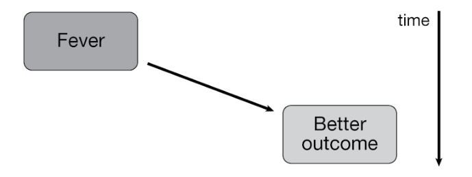{fig-alt="Fever causes better outcome"}

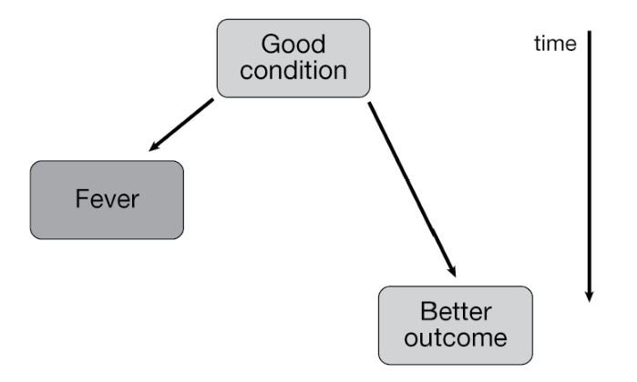{fig-alt="Good condition causes fever and better outcome"}
:::

:::: column
Patients who mount a fever are **more likely to survive** a bloodstream infection.

Does fever help? Or are patients in **better condition** both more able to mount a fever and more likely to recover?

::: {.fragment .key-line}
Correlation alone cannot tell these DAGs apart.
:::
::::
::::::

::: source
Source: Bergstrom and West (2021), ch. 4, Figures 12a–b.
:::

::: notes
Close with Bergstrom and West's only constructive example: how a research program builds a causal case step by step.

We usually think of fever as something disease does to us, so we take aspirin, Tylenol, or Advil. But people who mount a fever are more likely to survive bloodstream infections. That is a correlation. Bergstrom and West draw two DAGs. In one, fever improves outcomes. In the other, patients in better condition, healthier overall, better nourished, with less severe infections, are both more able to mount a fever and more likely to recover. That is a fork.

Ask students what evidence would distinguish the two. Then show the sequence on the next slide.
:::

## Fever: each design rules out a DAG {#fever-sequence}

::::: two-column
::: column
1.  **Correlation:** fever patients survive more.
2.  **Natural variation:** patients given fever reducers recover more slowly, but drugs were not randomly given.
3.  **Randomized trials:** blocking fever **slows recovery** and **increases transmission**.
4.  **Isolate the mechanism:** cooling lab animals **without drugs** has the same effect.
:::

::: column
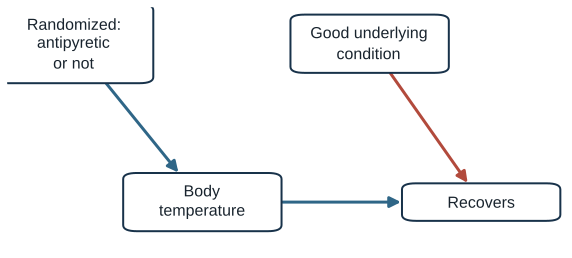{fig-alt="Randomized antipyretic causes body temperature which causes recovery; underlying condition causes recovery but not treatment"}
:::
:::::

::: {.fragment .key-line}
Potential outcomes say what effect we want. The baseline difference says why the correlation misleads. The DAG says which alternative each design rules out.
:::

::: notes
Walk through the four steps. First, the correlation raises the hypothesis. Second, natural variation in who receives fever-reducing drugs suggests that blocking fever slows recovery, but the drugs were not randomly assigned: sicker patients may be more likely to receive them. Third, randomized trials in less severe illnesses, with consent, show that fever-reducing drugs slow recovery and increase the chance of spreading illness. Randomization closes the back door through underlying condition. Fourth, the drugs might harm patients through some side effect rather than by lowering temperature. Researchers physically cooled laboratory animals without drugs and found the same effect. That isolates the mechanism: the chain runs through body temperature.

Use this as the synthesis of the session. Potential outcomes define the effect we want. The baseline difference explains why the raw correlation can mislead. The DAG shows which alternative structure each design rules out. Bergstrom and West note that this chapter cites no specific studies for this example, so present it as an illustration of a research program.
:::

## How often do papers overclaim? {#isch-prevalence}

::::: two-column
::: column
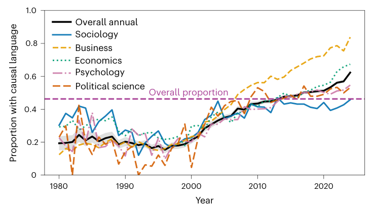{fig-alt="Isch et al. Figure 2: annual share of cross-sectional articles with causal language, 1980–2024, overall and by discipline"}
:::

::: column
An LLM classified **194,631** cross-sectional articles, 1980–2024.

**46.3%** used causal language about their own findings in the title or abstract.

Roughly **20%** until 2000; over **60%** by 2024.

2024: business **84%**, economics **67%**, psychology **55%**, political science **53%**, sociology **46%**.
:::
:::::

::: source
Source: Isch, Dörr, Fasching, Jennings, and Watts (2026), *Nature Human Behaviour*, Figure 2.
:::

::: notes
Bring in the Isch reading. The question is how often social scientists do what Bergstrom and West criticize journalists for doing: describing correlational findings in causal language.

The authors used large language models to classify 321,322 social-science articles, identified 194,631 with cross-sectional designs, and then classified whether each title and abstract made causal claims about the study's own findings. They validated the classifiers against human coders; the summary in the readings folder walks through the validation.

Results: 46.3 percent of cross-sectional abstracts used causal language. The rate was roughly 20 percent from 1980 to 2000 and rose to over 60 percent by 2024. The rise appears in every discipline. By 2024, business was highest at 84 percent and sociology lowest at 46 percent. Communication is not a separate category in their data.

Ask students to guess, before revealing the numbers, what share of correlational papers make causal claims. Most will guess low. Then ask what might explain the rise since 2000: incentives to claim impact, the growth of policy-relevant framing, and editorial pressure for “implications” sections are common answers.

Add one caution about measurement, consistent with Week 7. The classifier's definition of causal language includes asking a causal research question, such as “examines the influence of,” which some methodologists, including Rohrer, would not count as overreach. When the authors read the full texts of elite-journal articles labeled cross-sectional, only 68 percent strictly met the cross-sectional criteria.
:::

## Where the causal claims hide {#isch-full-text}

:::::: triad
::: triad-item
Higher-impact journals

Above-median impact: **54.4%** causal, vs. **43.3%** below.

Even the *Journal of Quantitative Description*, which bans causal claims: **12.9%**.
:::

::: triad-item
Behind careful abstracts

Among articles whose abstracts made only **descriptive** claims, **44%** still made an unhedged causal claim in the full text.
:::

::: triad-item
In the framing sections

Unhedged causal claims appeared in the **introduction** (60.0%) and **discussion** (55.1%), but rarely in the **methods** (6.1%).
:::
::::::

::: {.fragment .key-line}
The causal claim usually lives where authors explain why the study matters, not where they describe what they did.
:::

::: source
Source: Isch et al. (2026), pp. 3–4, Figures 3–4.
:::

::: notes
Present three findings about where overclaiming appears.

Journal impact: abstracts in journals above the median impact factor used causal language 54.4 percent of the time, versus 43.3 percent below. The correlation between impact factor and causal language across journals was modest. Even the Journal of Quantitative Description, whose editorial policy prohibits causal claims, had causal language in 12.9 percent of abstracts, which says something about both authors and the classifier.

Full texts: for a subset of articles, the authors searched the full text for claims about the same finding. Every article with an unhedged causal claim in the abstract had one in the text. Among articles whose abstracts were purely descriptive, 44 percent still made at least one unhedged causal claim about the same finding somewhere in the paper.

Sections: those claims cluster in the introduction, 60.0 percent of articles, and discussion, 55.1 percent, and appear in the methods only 6.1 percent of the time. Authors describe the design accurately and then interpret it causally when explaining why it matters.

Connect to the project. Students will write introductions and discussions. That is where to check verbs.
:::

## Does the wording change what readers believe? {#isch-experiment}

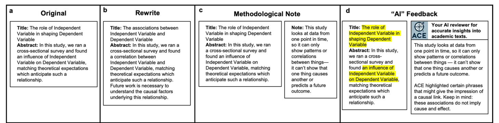{fig-alt="Isch et al. Extended Data Figure 5: four experimental conditions: original abstract, associational rewrite, methodological note, AI feedback" width="92%"}

::::: two-column
::: column
**N = 1,105** readers, randomly assigned. “This study provides causal evidence” (1–7):

Original **5.1** · rewrite **−0.4** · note **−0.5** · AI feedback **−0.8**
:::

::: column
Readers' own summaries that were causal:

Original **71%** · rewrite **50%** · note **64%** · AI **59%**
:::
:::::

::: source
Source: Isch et al. (2026), pp. 4–5, Extended Data Fig. 5 and Extended Data Table 1.
:::

::: notes
Describe the experiment. 1,105 participants each read one of 28 real abstracts from cross-sectional studies that used causal language. They were randomly assigned to one of four versions: the original abstract; a minimal rewrite replacing causal phrases with associational ones; the original plus a short methodological note explaining that a single-time-point study can show patterns but not causes; or the original with highlighted phrases and a note framed as AI feedback.

Point out the design. This is a randomized experiment, so differences between conditions are causal effects of the wording, which is today's whole lesson applied to the paper's own question.

Results on the item “the study provides causal evidence,” on a 1–7 scale: readers of the original averaged 5.1. The rewrite lowered agreement by about 0.4 points, the methodological note by 0.5, and the AI-style feedback by 0.8. When readers wrote their own summaries, 71 percent of summaries in the original condition were causal; the rewrite brought that down to 50 percent, the note to 64 percent, and the AI condition to 59 percent.

Two subtleties. First, the effects are real but modest: even after the rewrite, average agreement stayed well above the midpoint. Second, on a subtler set of items about implied causality, none of the conditions produced a statistically significant change. Wording helps, but readers bring causal interpretations of their own.
:::

## LLM summaries amplify the claim {#isch-llm}

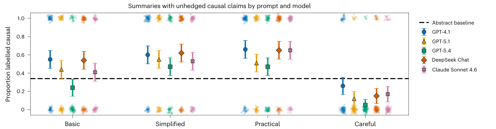{fig-alt="Isch et al. Figure 6a: share of summaries with unhedged causal claims by prompt and model, against the abstract baseline" width="85%"}

::::: two-column
::: column
Five models each summarized **100** abstracts under four prompts.

Abstracts: **34%** unhedged causal. “Simplified” and “practical” summaries: about **55–59%**.
:::

::: column
A “careful” prompt brought it **below** the abstracts.

GPT-4.1 rated the abstracts only **3.1/7** as causal evidence, yet **99.3%** of its own summaries of them were causal.
:::
:::::

::: source
Source: Isch et al. (2026), pp. 5–7, Figure 6a; Extended Data Tables 2–3.
:::

::: notes
The final component tests large language models. Five models, GPT-4.1, GPT-5.1, GPT-5.4, DeepSeek Chat, and Claude Sonnet 4.6, each summarized 100 cross-sectional abstracts under four prompts: a basic summary, a simplified summary, a summary of practical implications, and a careful summary that asked the model to avoid overstating causal claims.

Thirty-four percent of the original abstracts contained unhedged causal claims. Simplified and practical summaries raised that to roughly 55 to 59 percent across models, by dropping hedges and turning associations into causal statements. The careful prompt reduced causal claims below the abstracts' own rate. The paper's text and figure disagree slightly about the careful-prompt average, 5.0 percent in the text versus about 15 percent computed from the figure, so present it as “well below the abstracts.”

The GPT-4.1 result from the reader experiment is striking. When asked directly, GPT-4.1 rated the original abstracts as weak causal evidence, 3.1 out of 7, lower than human readers. Yet 99.3 percent of the summaries it wrote of those same abstracts used causal language. The model can recognize the limits of the design and still write as if they did not exist.

Make it practical. Students using LLMs to summarize readings or draft write-ups should expect causal inflation and should prompt for caution and check every verb.
:::

## Isch vs. Rohrer: should we avoid causal language? {#isch-rohrer}

::::: two-column
::: column
### Isch et al.

Cross-sectional papers should use **associational** wording, and readers benefit from explicit notes about design limits.
:::

::: column
### Rohrer

“Avoiding causal language” hides the causal question and the **assumptions** behind it. State the causal goal and the DAG openly.
:::
:::::

::: {.fragment .key-line}
Isch's own data: the explicit **design note** moved readers more than the associational rewrite. What should a cross-sectional paper say?
:::

::: notes
Set up a short discussion. The two readings appear to give opposite advice. Isch and colleagues treat causal wording in cross-sectional papers as overreach and test associational rewrites as a fix. Rohrer lists avoiding causal language as one of three flawed coping strategies: the underlying question is still causal, readers interpret findings causally anyway, and the hedge lets authors avoid stating the assumptions that would justify or undermine a causal reading.

Point out that Isch's data partly support Rohrer. The associational rewrite reduced causal beliefs only modestly, and on the subtler items not significantly. The methodological note, which explicitly told readers what the design could and could not show, did somewhat better on the causal-evidence item, and the AI-feedback version did best.

Ask students to reconcile the two positions. A defensible synthesis: say the causal question out loud, state the assumptions under which the association would be causal (draw the DAG), and describe the evidence in language that matches the design. That is neither causal overclaiming nor evasive association-talk. It is what the project write-ups should do.
:::

## Your project: from a causal-sounding claim to a defensible one {#project-tie-in}

Descriptive write-ups drift into causal language: “coverage **drives**…”, “outlets **respond to**…”, “framing **shapes**…”

1.  Write one causal-sounding claim your coded data invite.
2.  Draw its DAG. Where is the back door?
3.  Rewrite it as the descriptive or associational claim your data **can** support.
4.  Check the introduction and discussion, and anything an LLM drafted, for causal verbs.

::: {.fragment .key-line}
Sinclair shows when coded text **can** carry a causal claim: when a design, not the coding, removes the selection.
:::

::: notes
Turn to the projects. The coding projects are descriptive, but write-ups often slide into causal language. Give groups five minutes, if time allows, or assign it as homework.

Each group writes one causal-sounding claim their data seem to invite. For example: “Outlets that use more episodic frames drive lower trust.” Then they draw its DAG: what causes an outlet to use episodic frames, and does that also affect the outcome? Then they rewrite the claim as what the data support, for example: “Outlets with more episodic framing have audiences with lower trust, a pattern consistent with several causal structures.”

Close with Sinclair. Martin and McCrain measured their outcomes from transcripts, the same kind of coded-text outcome the students are building. Their study supports a causal claim because the acquisition design removed the selection problem, not because of the coding. Ask each group: is there any event or rule in their domain, like an acquisition, a policy change, or a platform outage, that could do the same?

Also remind students of Bergstrom and West's point that axis placement and grammar imply causation. Check figures and verbs in the write-ups.
:::

## Exit question {#exit-question .section-title}

> Name one correlation in your own area that is usually read causally.
>
> Draw the DAG that would make it **non-causal**.

::: notes
Collect exit responses on paper or in the course form. Each student names a correlation from their own area that is usually interpreted causally, and draws a DAG in which the correlation would arise without any causal effect.

Read a few responses at the start of next week. Good answers will include a fork through selection into treatment and, ideally, a collider through sample selection. Use weak answers to identify students who need help distinguishing confounders from mediators.
:::