## Where we left off {#where-we-left-off}

Last week: an experiment closes back doors **by design**. Correll randomized a résumé cue.

Still to do: **Craig & Richeson**, who went one step further and manipulated the **mechanism** itself.

::: {.fragment .key-line}
Today: finish that case, revisit mediation and moderation, then ask what to do when we **can't** randomize at all.
:::

::: notes
Open by reconnecting to Week 11. Students saw that randomization closes the back door from confounders into the treatment, and they worked through Correll, Benard, and Paik's motherhood-penalty experiment. The second case, Craig and Richeson, was not finished. It is worth finishing because it does something Correll did not: it manipulates the proposed mechanism, status threat, rather than only measuring it.

what was the mechanism there, how did they test it?
That makes a natural bridge to the rest of the day. Craig and Richeson set up a careful return to mediation (how an effect travels) and moderation (when or for whom it holds), with one new example of each. Then the session turns to the central methodological question for the second half: what can we do when the treatment we care about cannot be randomized at all? That is the job of natural experiments.
:::

## Today's route {#questions-for-today}

::: roadmap
| Part | Question |
|---------------------------|---------------------------------------------|
| 1 · Craig & Richeson | How do you manipulate a mechanism, not just measure it? |
| 2 · Mediation, again | Why do liberals drink lattes, and what can a survey say about *why*? |
| 3 · Moderation, again | When does a strong argument beat a famous source? |
| 4 · Natural experiments | When we can't randomize, what stands in for it, and what must we assume? |
| 5 · Two cases | What did a funding cutoff and a badly timed attack let researchers learn? |
:::

::: notes
Walk through the route. Part 1 finishes the Week 11 case. Parts 2 and 3 revisit mediation and moderation with two short readings: Mutz and Rao on liberals and lattes, and Petty, Cacioppo, and Goldman's classic involvement experiment. Part 4 builds a toolbox of natural experiments from Dunning and Grosz and colleagues, drawing each design as a naive DAG next to a design DAG and naming what each one has to assume. Part 5 goes deep on two cases: Bol and colleagues' regression discontinuity around a grant-funding threshold, and Balcells and Torrats-Espinosa's comparison of survey respondents interviewed just before and just after terrorist attacks.

Plan the break between Parts 3 and 4.
:::

## Craig & Richeson — majority-minority status threat {#case-craig-richeson .section-title}

[Part 1 of 5 · Finishing Week 11: does the racial shift push Whites right?]{.kicker}

> More local Black population share predicts more White Republican registration.

::: notes
**Talk track**

The second case asks how White Americans respond politically to information that the United States is becoming a majority-minority country. As before, we need to separate the broad social puzzle from the narrower effect the experiments can identify.

**Teaching detail**

Open today by finishing Week 11's second case: Craig and Richeson (2014, Psychological Science), "On the Precipice of a 'Majority-Minority' America," with the 2015 corrigendum.
:::

## Demographic change correlates with conservatism, but why? {#craig-richeson-puzzle}

Giles and Hertz (1994): Louisiana parish data, more local Black population share predicts more White Republican registration.

**Majority-minority** means no single racial or ethnic group exceeds 50% of the population; the national shift was then projected for 2042.

::: {.fragment .key-line}
Real-world correlation. What's actually driving it?
:::

::: source
Source: Giles and Hertz (1994), cited in Craig and Richeson (2014).
:::

::: notes
**Talk track**

Places experiencing demographic change have sometimes shown greater White conservatism, but a geographic correlation is compatible with many causal stories. The experiment begins by changing exposure to information rather than changing the population itself.

**Ask students**

What are two explanations for the geographic correlation other than status threat?

**Teaching detail**

This correlational finding motivates the whole paper. It's consistent with a racial-threat story, but it's also consistent with several other structures, which is exactly what the next slide gets students to generate themselves.
:::

## What could explain the parish correlation? {#craig-richeson-naive-draw}

**Racial composition** ⟷ **White conservatism**. Set aside status threat. What else could produce this correlation?

:::::: comparison
::: side
**A confound**

Name a variable that comes *before* both. Then explain **both** arrows: how it raises Black population share *and* how it raises White Republican registration.
:::

::: versus
or
:::

::: side
**A different causal path**

Could the arrow run the other way? Could people be sorting into parishes? Could the link run through something other than threat?
:::
::::::

::: notes
**Talk track**

Before accepting the threat explanation, have students generate alternatives themselves. Give pairs about three minutes, then collect answers on the board, sorting each one into "common cause" or "other causal path." Do not reveal the next slide until the board has several candidates. Then point out that the explanations aren't equally strong.

**Ask students**

For each proposed confound: How does it raise Black population share? How does it raise White Republican registration? Does it come before both in time? For each reverse or sorting story: Does it predict a *positive* correlation, or could it just as easily predict a negative one?

**Answer bank: what students are likely to propose, and how to push**

*Common causes (confounds):*

-   **Plantation agriculture / slavery / segregation history.** This is the cleanest one. It concentrated Black populations in particular parishes, and it built entrenched racial hierarchies and polarized White politics in those same places. It also clearly precedes both variables.
-   **Rurality / urbanicity.** Push on the sign. In Louisiana many heavily Black parishes are rural (the Delta and the river parishes), and rural Whites lean Republican. But New Orleans is both heavily Black and Democratic. Students have to commit to a direction.
-   **Local economic structure.** Agricultural or low-wage economies, income, and White education levels can shape both who lives in a parish and White partisanship.
-   **Religion.** Evangelical Protestant density versus Catholic south Louisiana tracks both settlement history and White partisanship.
-   **Age structure / out-migration.** Young and more liberal residents leaving declining rural parishes could change both composition and the political profile of the Whites who stay.

*Other causal paths:*

-   **Political feedback / reverse causation.** Earlier racially conservative politics shapes later composition through housing policy, zoning, schools, and climate. The sign is ambiguous (see below).
-   **Selective White sorting.** Racially liberal Whites leave, or avoid moving into, heavily Black parishes. That changes *which* Whites are measured, not how any given White person responds. It's composition, not persuasion.
-   **Party-image sorting rather than threat.** Where Black voters make up a large share of the local Democratic coalition, the local Democratic Party becomes identified with Black interests, and Whites register Republican for policy or coalition reasons. This is a different mechanism from psychological status threat, even though it runs in the same direction.
-   **Realignment timing.** Southern White Democrats switched to the Republican Party unevenly. If the switch came first or faster in Black Belt parishes for historical reasons, the cross-section picks up timing differences.

If students only name a variable ("income," "education"), make them draw both arrows and give the sign before it goes on the board.

**Teaching detail**

Start by being precise about the variables in the Giles and Hertz correlation. Racial composition is an observed parish population share, not a respondent's perception or report. Therefore political feedback cannot simply mean “conservatives notice demographic change more.” It requires an actual process through which earlier White racial politics affects later migration or residence patterns.

**Political feedback, step by step:**

1.  A parish begins with more racially conservative White politics or leadership.
2.  Housing enforcement, zoning, public investment, school policy, and the broader political climate can influence who moves in, who leaves, and who remains.
3.  Exclusionary policy could reduce Black in-migration or encourage Black out-migration, lowering Black population share. White flight could instead shrink the White denominator and raise Black population share.
4.  Earlier politics can therefore make later composition endogenous, but the sign is not determined without a more specific mechanism.

The arrow is therefore earlier White racial politics → later racial composition, but this is not a self-sufficient explanation for the observed positive correlation. A researcher would need to specify and document a mechanism—such as White flight—that moves the variables in the observed direction. Present this as a possible feedback problem, not as an equally clean rival theory.

**Regional confounding, step by step:**

1.  Louisiana parishes differ in historical plantation agriculture, slavery, segregation, economic development, rurality, and migration patterns.
2.  Those historical processes help determine where Black communities are concentrated today.
3.  The same processes can also shape racial polarization, party realignment, economic interests, and White Republican registration.
4.  Local Black population share and White conservatism can therefore move together even if neither directly causes the other.

Use plantation and segregation history as the clearest illustrative confounder because it temporally precedes both contemporary population composition and contemporary registration. Economy or urbanicity can also be proposed, but students must explain both arrows rather than merely name a variable.

Finish by contrasting the structures carefully. Political feedback points the arrow from earlier politics toward later composition but does not determine its sign. Confounding adds a prior common cause and is the cleaner rival explanation for the positive parish correlation. The authors' theory proposes local composition → status threat → White conservatism. Cross-sectional parish data cannot establish which process generated the association.
:::

## One correlation does not make all three stories equally strong {#craig-richeson-candidates}

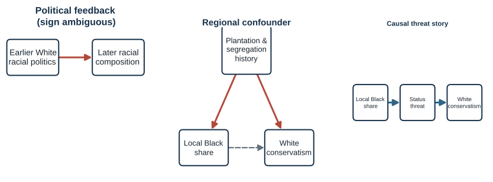{fig-alt="Three candidate structures. First, earlier White racial politics may feed back into later racial composition, although the sign is ambiguous. Second, regional plantation and segregation history shapes both local Black population share and White conservatism. Third, higher local Black population share increases status threat, which increases White conservatism." width="96%"}

::: {.fragment .key-line}
Political feedback makes composition **endogenous**, but regional history is the cleaner alternative explanation for the positive correlation.
:::

::: notes
**Talk track**

Read the diagrams from left to right. The first adds a possible feedback arrow from earlier politics to later composition, but its sign is ambiguous. The second adds a common cause that can generate the positive association. The third is the authors' threat mechanism. The correlation alone cannot separate them, but that does not make the stories equally well specified.

**Ask students**

Which rival story does random assignment eliminate for the message-exposure effect? Does that mean the experiment identifies the effect of actually changing a parish's racial composition?

**Teaching detail**

Walk through each panel explicitly.

-   **Political feedback:** earlier White racial politics may help shape later composition through policy and residential sorting. Exclusion may lower Black share, whereas White flight may raise it, so the arrow alone does not predict the observed sign.
-   **Regional confounding:** plantation and segregation history is upstream of both current Black population share and current White conservatism. The open fork creates an association without requiring a causal effect of composition.
-   **Causal threat story:** higher local Black population share raises perceived group-status threat, which shifts White politics in a conservative direction.

Then explain exactly what the experiments do and do not solve. Randomly assigning a demographic-shift message makes message exposure independent of prior ideology, residential sorting, and regional history in expectation. Those variables cannot explain why one experimental group received the message and the other did not. That identifies the causal effect of **message exposure** under the study conditions.

But the experiment does not manipulate a parish's actual racial composition. It therefore does not prove that the third panel explains the original Louisiana correlation, rule out long-run political feedback, or estimate what decades of demographic change do to voting. It tests a narrower implication of the threat theory: making a projected status shift salient can move attitudes. The next slide makes that estimand change explicit.
:::

## Same theory, different question: fill in the table {#craig-richeson-estimand-blank}

Craig & Richeson can't randomize who lives where. Instead, they **randomly assign White Americans to read that Whites are losing majority status**, then measure their politics. How does that change what we learn?

|                    | Giles & Hertz (parishes) | Craig & Richeson (experiments) |
|-----------------|-------------------------|-------------------------------|
| **Unit**           |                          |                                |
| **What varies**    |                          |                                |
| **Who assigns it** |                          |                                |
| **Outcome**        |                          |                                |
| **Time horizon**   |                          |                                |
| **Estimand**       |                          |                                |

::: notes
**Talk track**

Have students fill in the table before showing the answers. They can work in the same pairs as the confound activity, or you can fill it in together on the board one row at a time. Two to three minutes is enough.

**Ask students**

Go row by row. What is the unit of analysis in each study? What actually varies, and is it the same thing? Who or what decides each unit's value on that variable? What is measured as the outcome? Over what time span does the "treatment" operate? Then put it together: in one sentence, what effect does each study estimate?

**Teaching detail**

Students usually get Unit and Outcome right away. Push hardest on **What varies** (lived local composition vs. a message about a national trend) and **Who assigns it** (this is what links back to the confounds they just listed). If they write the same estimand in both columns, ask whether a one-paragraph press release is the same treatment as living in a parish for decades.
:::

## The experiments answer a narrower question {#craig-richeson-estimand}

Craig & Richeson can't randomize who lives where. Instead, they **randomly assign White Americans to read that Whites are losing majority status**, then measure their politics.

|   | Giles & Hertz (parishes) | Craig & Richeson (experiments) |
|-----------------|-------------------------|-------------------------------|
| **Unit** | Louisiana parishes | Individual White respondents |
| **What varies** | Actual *local* Black population share | A news-style message about the *national* (or California) shift |
| **Who assigns it** | History, migration, politics | The researcher, at random |
| **Outcome** | Republican registration | Self-reported party lean, ideology, policy views |
| **Time horizon** | Decades | Minutes |
| **Estimand** | Effect of *living with* demographic change on White politics | Short-term effect of making the shift **salient** on White attitudes |

::: {.fragment .key-line}
Random assignment rules out every confound you just proposed, but only for the effect of the *message*. Whether threat explains the parish correlation is still an open question.
:::

::: notes
**Talk track**

Here is the segue from the puzzle to the design. Giles and Hertz give us a correlation we can't untangle, because nobody assigns racial composition at random: history, migration, and politics do. Craig and Richeson change the question to one they *can* answer. They take the middle link of the threat story, the perception that one's group is losing status, and trigger it with information. If the threat theory is right, simply telling White Americans about the shift should push them right, even though nothing about their actual community has changed.

Walk down the table row by row. Every row changes, not just the treatment. The unit goes from places to people. The treatment goes from local, lived composition to a brief message about a national or state trend. The assignment mechanism goes from history to a coin flip. The outcome goes from registration behavior to survey answers. The time horizon goes from decades to minutes. So the estimand goes from "what does living with demographic change do to White politics?" to "what does hearing about the projected shift do to White attitudes right now?"

**Ask students**

Go back to the confounds on the board. Which of them can explain a difference between the treatment and control groups in this experiment? (None. Plantation history, rurality, and sorting are balanced across conditions in expectation.) Then ask: what has the experiment given up to get that? (Local composition, real behavior, and long-run exposure.)

What is the treatment here: demographic change itself, or exposure to a message about it?

**Teaching detail**

Frame this as a test of an *implication* of the threat theory, not as a test of the parish correlation itself. If status threat drives the observational pattern, then making status loss salient should produce a conservative shift. Finding that shift supports the mechanism's plausibility. It does not show that the mechanism produced the Louisiana pattern, and a null would not rule threat out there either, since a one-paragraph message is a weak stand-in for decades of lived change.

Note the shift in scale as well: Giles and Hertz is about *local* Black population share, while the experiments describe *national* (or California) change in which Latino and Asian American growth drives most of the projection. Threat from a neighbor and threat from a national trend are not obviously the same psychological process.

Make the estimand switch as explicit as it was in Correll last week. The parish-level correlation motivates the theory, but the experiments manipulate information about demographic change. Their internally valid claim concerns the short-term attitudinal effect of that exposure under the specific survey conditions. They do not identify the effect of a community's actual demographic composition, repeated partisan media coverage, or years of social change on real voting behavior.

can we still learn something
:::

## What is the theory, and what else could carry the effect? {#motivated-cognition}

::: mstout-row
Majority-minority message → **group-status threat** → conservatism
:::

**The theory:** Whites read the shift as zero-sum: "as minorities gain status, Whites lose it." Threat pushes people toward conservatism (Jost et al. 2003).

-What *else* could the message trigger that would also push people right?

::::::: fragment
:::::: triad
::: triad-item
**System threat**

"The American way of life is threatened." Diffuse worry about society, not about one's own group.
:::

::: triad-item
**System justification**

"People usually get what they deserve." Defending the status quo as fair.
:::

::: triad-item
**Uncertainty**

Feeling unsure about where American society is headed.
:::
::::::
:::::::

::: source
Source: Jost, Glaser, Kruglanski, and Sulloway (2003); Craig and Richeson (2014), Study 2.
:::

::: notes
**Talk track**

First pin down the theory. The message is supposed to work through one specific mediator: **group-status threat**, measured as agreement that "increases in racial minorities' status will reduce White Americans' status." It is relative and zero-sum. It isn't dislike of minorities or discomfort with diversity. The second link comes from motivated social cognition (Jost et al. 2003): threat and uncertainty make conservatism more appealing because it promises stability and defends existing hierarchy.

Then ask the question before the reveal. If the message moves people right, how do we know *status threat* is the reason? The same message could plausibly set off several other processes that the same literature says lead to conservatism.

**Ask students**

Give pairs a minute to propose alternative mediators. For each one, ask them to state both links: why would the majority-minority message raise it, and why would it push people right?

Students may also propose things outside the paper. Accept and sort them:

-   **Generic anxiety or negative mood:** any unsettling news might make people more conservative.
-   **Prejudice or out-group animus:** the message activates dislike of minorities rather than concern for relative status.
-   **Partisan cueing:** "majority-minority" news is coded as good for Democrats, so Whites react as partisans.
-   **Economic or job competition:** concern about material resources rather than status.
-   **Demand effects:** respondents guess what the study is about.

**Teaching detail**

Reveal the three alternatives Craig and Richeson actually measured in Study 2. All three come from the threat–conservatism literature, so they are the most serious theoretical rivals:

-   **System threat** (Jost et al. 2007): a sense that the broader social system, not specifically one's racial group, is in danger.
-   **System justification** (Kay & Jost 2003): the motivation to see the current system as fair and legitimate.
-   **Uncertainty:** not knowing where society is headed, which is the core of the original Jost et al. account.

Preview what's coming: Study 2 measures all four. Only group-status threat differed by condition and mediated the effect. The theoretical contribution is extending the threat–conservatism logic, mostly tested with physical and mortality threats like terrorism, to a slow, abstract, decades-out *social status* threat. Flag now that measuring a mediator is weaker than manipulating it. That is the point of Studies 3a and 3b.
:::

## What control isolates the majority-status implication? {#craig-richeson-design-1}

You want to test whether it's specifically the *status* framing doing the work, not just any news about demographic change. What's your control condition?

::: notes
**Talk track**

A useful control must contain racial-composition information without implying that White majority status is disappearing. That lets the design isolate the status meaning of the message rather than simple exposure to racial news.

**Ask students**

What should the control condition contain, and what should it deliberately omit?

**Teaching detail**

Let pairs propose a control before revealing. The actual Study 1 control: a survey form asking whether respondents had heard that Hispanics and Blacks were roughly equal in number nationally — racial-composition news, but without the majority-status framing. This holds "exposure to racial-composition news in general" constant while varying whether the shift implies a change in who is the numerical majority.
:::

## An old Pew split becomes an experiment {#craig-richeson-study1-design}

Pew's *News Interest Index* randomly assigned White political independents (*n* = 369) to two survey forms:

| Racial-shift condition | Racial-composition control |
|------------------------------------|------------------------------------|
| “Have you heard California is now majority-minority?” | “Have you heard Hispanics and Blacks are now similar in number nationally?” |

**Outcomes:** Republican versus Democratic party lean and general political ideology.

::: {.fragment .key-line}
Researcher-caused, statistical solution — repurposed from an existing dataset, not purpose-built.
:::

::: source
Source: Craig and Richeson (2014), p. 1191; Pew Research Center (2001).
:::

::: notes
**Talk track**

Study 1 repurposes an existing randomized split in a Pew survey. White independents saw either the majority-minority question or a racial-composition control, and the authors examined party leaning and ideology.

**Teaching detail**

Place this in Druckman's typology: cell 1, researcher-caused and statistical-solution, but opportunistic rather than purpose-built—the randomization already existed in Pew's survey design, and the authors found a use for it years later. The control holds exposure to racial-composition news roughly constant while removing the change-in-majority-status implication. Explain the restriction to political independents: the outcome is party leaning, so committed partisans have less room to move and are less informative about a short-term shift.
:::

## The corrigendum weakens Study 1 {#corrigendum-error}

A 2015 corrigendum corrected a **probability-weighting error** in Studies 1 and 2 — frequency weights were mishandled as probability weights in the statistical software.

::: fragment
-   National party lean: *p* = .081
-   General ideology: no effect
-   West subsample: *n* = 49, *p* = .063
:::

::: {.fragment .key-line}
The corrected Study 1 evidence is inconclusive. Later studies must carry the argument.
:::

::: source
Source: Craig and Richeson (2015), *Psychological Science*, 26(6), 950–952.
:::

::: notes
**Talk track**

The corrigendum changes how strongly we should describe Study 1. After the weighting error was corrected, the national party-lean result was no longer conventionally significant, ideology did not move, and the West estimate remained imprecise.

**Ask students**

After the correction, what language is justified: strong evidence, suggestive evidence, or no information at all?

**Teaching detail**

Use this as a methods lesson and calibrate the evidence at the same time. This kind of weighting error is a real pitfall with complex survey weights, and a public corrigendum—rather than silence—is the correction system working. But transparency does not restore the original result: the corrected national estimate is inconclusive, general ideology did not move, and the larger West estimate is based on 49 respondents and also falls short of the conventional threshold. The paper's argument must therefore rest on convergence with Studies 2–3, not a decisive Study 1.
:::

## The corrigendum, part two: what changed {#corrigendum-numbers visibility="hidden"}

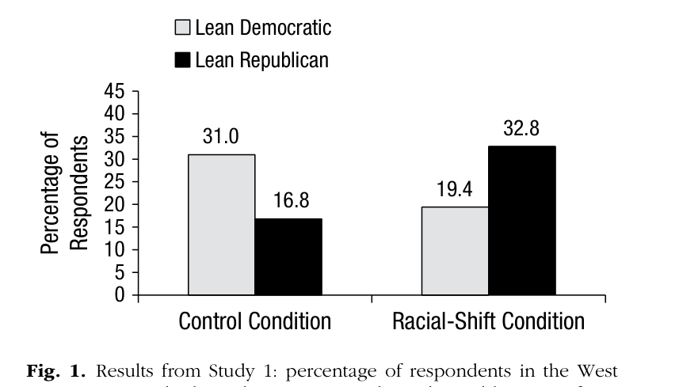{width="70%"}

::: {.fragment .key-line}
Corrected evidence is weak: national party lean *p* = .081; West subsample *p* = .063; general ideology did not change.
:::

::: source
Source: Craig and Richeson (2014/2015 corrigendum), Figure 1.
:::

::: notes
The flagship Study 1 result shrank from conventionally significant to inconclusive after correction. The West estimate is larger but comes from only 49 respondents and also misses the conventional threshold; treat it as exploratory rather than a rescue of the national result. Self-reported general ideology never moved in Study 1. Ask how much this should downgrade confidence in the whole program, then explain that later studies—not Study 1 alone—must carry the substantive conclusion.
:::

## What does Study 1 still leave unresolved? {#craig-richeson-critique-1}

Before Study 2: what does Study 1 *not* establish yet?

::: fragment
-   The corrected party-lean evidence is inconclusive, and ideology did not move.
-   No mechanism was measured.
-   Outcomes were self-reported attitudes, not behavior.
-   One opportunistic dataset cannot establish robustness across treatments and samples.
:::

::: notes
**Talk track**

Study 1 offers a randomized contrast, but it has weak corrected evidence and no direct test of the proposed mechanism. It also relies on self-reported attitudes from a secondary dataset not designed around the full theory.

**Ask students**

What part of the causal chain has not been measured or manipulated yet?

**Teaching detail**

Push toward: Study 1 has a measured outcome (party lean, ideology) but no mediator at all — no test of *why* the shift would move conservatism; it's a single secondary dataset; and it measures self-reported party lean, not any behavior. All three motivate Study 2's design, which we see next.
:::

## Study 2 builds the experiment the theory needed {#craig-richeson-study2-design}

National probability-based online sample: *N* = 620 overall; **415 White respondents** in the focal analysis.

| Racial-shift treatment | Societal-change control |
|------------------------------------|------------------------------------|
| Census press release: racial minorities projected to become a majority by 2042 | Press release about increasing geographic mobility |

**Outcomes:** conservative endorsement of race-related and race-neutral policies.

**Candidate mediators:** group-status threat, system threat, system justification, and uncertainty.

::: notes
**Talk track**

Study 2 is purpose-built. It compares a racial-shift press release with a geographic-mobility control, measures both race-related and race-neutral policy attitudes, and measures several possible psychological mediators.

**Teaching detail**

This is the design information missing from the earlier version. The control matches the broad form of a press release about social change but removes racial content. The focal policy outcomes include three race-related items and two race-neutral items, allowing the authors to ask whether the response is targeted or ideologically broader. The reliability of the two short subscales is modest, which belongs in the later critique.
:::

## What participants actually read {#craig-richeson-stimuli}

::::: two-column
::: column
**Racial-shift article**

> **In a Generation, Racial Minorities May Be the U.S. Majority**
>
> New U.S. Census Bureau data suggest that America will become a "majority-minority" nation much faster than once predicted. The nation's racial minority population is steadily rising... Demographers calculate that by 2042, Americans who identify themselves as Hispanic, Black, Asian, American Indian, Native Hawaiian, or Pacific Islander will together outnumber non-Hispanic Whites.
:::

::: column
**Geographic-mobility control article**

> **U.S. Census Bureau Reports Residents Now Move at a Higher Rate**
>
> New U.S. Census Bureau data suggest that the rate of geographical mobility, or the number of individuals who have moved within the past year, is increasing. The national mover rate increased from 11.9 percent in 2008... to 12.5 percent in 2009.
:::
:::::

::: {.fragment .key-line}
Same source (Census data), same form (a short wire-style article), same closing hedge about trends. Only the content differs.
:::

::: source
Source: Craig and Richeson, Study 2 experimental stimuli, OSF Supplemental Material (osf.io/dzv6r).
:::

::: notes
**Talk track**

Show students the actual words, not just the labels "racial-shift" and "control." Both articles are built to the same template: a Census Bureau statistic, a few sentences of supporting detail, and the same closing hedge sentence almost verbatim — "The latest figures are predicated on current and historical trends, which can be thrown awry by several variables, including prospective overhauls of public policy." That shared boilerplate is doing real design work: it holds constant the *genre* (a wire-service-style Census news brief) and the *epistemic hedge* at the end, so the only thing that differs between conditions is the substantive content — racial composition versus geographic mobility.

**Full text, for reference if a student asks to see the whole thing**

*Racial-shift article (complete):* "In a Generation, Racial Minorities May Be the U.S. Majority. New U.S. Census Bureau data suggest that America will become a 'majority-minority' nation much faster than once predicted. The nation's racial minority population is steadily rising, advancing an unmistakable trend that could make minorities the new American majority by midcentury. The data show a declining number of White adults and growing under-18 populations of Hispanics, Asians, and other minorities. Demographers calculate that by 2042, Americans who identify themselves as Hispanic, Black, Asian, American Indian, Native Hawaiian, or Pacific Islander will together outnumber non-Hispanic Whites. The main reasons for the accelerating change are rapid immigration growth and significantly higher birthrates among racial and ethnic minorities. As White baby boomers age past their childbearing years, younger Hispanic parents are having children – and driving U.S. population growth. For example, there are now roughly 9 births for every 1 death among Hispanics, compared to a roughly one-to-one ratio for Whites. The latest figures are predicated on current and historical trends, which can be thrown awry by several variables, including prospective overhauls of public policy."

*Control article (complete):* "U.S. Census Bureau Reports Residents Now Move at a Higher Rate. New U.S. Census Bureau data suggest that the rate of geographical mobility, or the number of individuals who have moved within the past year, is increasing. The national mover rate increased from 11.9 percent in 2008 (the lowest rate since the U.S. Census Bureau began tracking the data) to 12.5 percent in 2009. According to the new data, 37.1 million people changed residences in the U.S. within the past year. 84.5 percent of all movers stayed within the same state. Renters were more than five times more likely to move than homeowners. The estimates also reveal that many of the nation's fastest-growing cities are suburbs. Specifically, principal cities within metropolitan areas experienced a net loss of 2.1 million movers, while the suburbs had a net gain of 2.4 million movers. For those who moved to a different county or state, the reasons for moving varied considerably by the length of their move. The latest figures are predicated on current and historical trends, which can be thrown awry by several variables, including prospective overhauls of public policy."

**Bridge to Study 3**, if teaching that slide in the same sitting: Study 3's status-threat and assuaged-threat articles use a longer, bylined ("By: S. Roberts") version of the same racial-shift content, with the assuaged-threat version adding one extra paragraph at the end: "Despite the shift in the demographic make-up, the relative societal status of different racial groups is likely to remain steady... White Americans are expected to continue to have higher average incomes and wealth compared to members of other racial groups." That one paragraph is the entire manipulation of the mediator in Study 3 — everything else about the article is held character-for-character identical to the status-threat condition.
:::

## Study 2: policy attitudes shifted, but not every item did {#craig-richeson-study2}

::: small-table
| Outcome index | Corrected result |
|------------------------------------|------------------------------------|
| Overall conservative policy endorsement | Shifted conservative (*p* = .011) |
| Race-neutral policies | Shifted conservative (*p* = .025) |
| Race-related policies | Borderline (*p* = .052) |
| Immigration and citizenship items | No reliable individual-item effect |
:::

::: {.fragment .key-line}
Only **group-status threat** changed by condition and carried a detectable indirect effect.
:::

::: source
Source: Craig and Richeson (2014), pp. 1192–1194, Table 2.
:::

::: notes
**Talk track**

The combined policy index moved in the conservative direction, but the item-level pattern is uneven. Only group-status threat responded as the theory predicted and showed a detectable indirect association. That is supportive, not conclusive, mechanism evidence.

**Ask students**

Which findings support the theory, and which findings should make us cautious?

**Teaching detail**

Four candidate mediators were measured, but only group-status threat tracked the manipulation and produced bootstrapped indirect-effect intervals excluding zero. That narrows the theoretical story beyond generic anxiety or uncertainty. Do not overstate it: the race-related index was borderline after correction, and the immigration and citizenship items—the most obvious demographic-shift policies—did not reliably move. The strongest corrected pattern is the broader shift in the combined and race-neutral indices.

This is evidence consistent with mediation, not a causal decomposition. The next slide explains why: randomizing the upstream article does not randomize the relationship between measured threat and policy attitudes.
:::

## Measuring threat cannot prove that it carries the effect {#craig-richeson-mediator-warning}

Controlling for or analyzing a *measured* mediator can be biased even in a randomized experiment — unmeasured confounding between the mediator and the outcome is still possible.

::: {.fragment .key-line}
What would fix it?
:::

::: source
Source: Rohrer (2018), p. 38 (Week 10); Druckman (2023), pp. 40–42 (Week 11).
:::

::: notes
**Talk track**

Measured mediation cannot rule out a common cause of reported threat and policy attitudes. To make a stronger mechanism claim, the researchers need an intervention that changes the status implication while keeping the demographic information itself constant.

**Ask students**

What design would be stronger than measuring threat after the message?

**Teaching detail**

Direct callback, now cashed out against a real case. Study 2 cannot, on its own, rule out some unmeasured variable affecting both perceived status threat and policy attitudes. Ask students what would actually fix this before revealing Studies 3a/3b — the right answer is to manipulate the mediator directly, not just measure it.
:::

## How would you change threat while holding information constant? {#craig-richeson-design-2}

You need to manipulate the **status implication** while holding the demographic information constant. What's your third condition?

::: notes
**Talk track**

The design problem is to preserve the fact of demographic change but remove its implication of status loss. The added reassurance paragraph is the paper’s solution: it says Whites’ relative economic standing is expected to remain stable.

**Ask students**

How could you reduce status threat without removing the demographic forecast?

**Teaching detail**

Give pairs a few minutes before revealing. The actual design: an identical racial-shift article, plus one added paragraph stating that Whites' relative societal status (income, wealth) is expected to remain stable despite the demographic shift. If students propose something structurally similar—holding the fact constant while varying its status implication—they have derived the paper's methodological high point themselves.
:::

## The reassurance condition targets one link in the chain {#craig-richeson-full-dag}

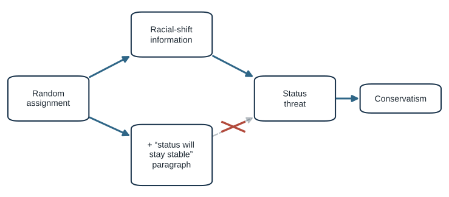{.nostretch fig-alt="Random assignment causes both the racial-shift information and the added status-will-stay-stable paragraph. Racial-shift information causes status threat, which causes conservatism; the reassurance paragraph cuts the arrow into status threat" width="95%"}

::: notes
**Talk track**

This is the answer to the previous slide's question, shown as a design before we see the specific conditions or any results. Random assignment decides both whether people get the racial-shift information and whether they also get the reassurance paragraph. The reassurance is intended to weaken the link from demographic information to status threat. If threat is the mechanism, cutting that link should remove the conservative shift; the next two slides show the conditions and whether it did. That is stronger than simply measuring threat, although the interpretation still depends on reassurance changing only the construct the theory names.

**Ask students**

What must be true about the reassurance paragraph for this to identify the threat mechanism?

**Teaching detail**

Draw this live alongside the image. The assuaged-threat condition is designed to weaken the arrow from information to threat while leaving the demographic information constant. This is stronger evidence for the proposed mechanism than measured mediation alone, but it still depends on the construct-validity claim that the added reassurance changes status threat without introducing some other consequential message.
:::

## Reassurance changes the status implication {#craig-richeson-3ab-design}

White U.S. MTurk participants: Study 3a *n* = 180; Study 3b *n* = 198.

| Control | Status-threat | Assuaged-threat |
|------------------------|------------------------|------------------------|
| Geographic-mobility article | Racial-shift article | **Same racial-shift article** + Whites' relative status will remain stable |

**3a outcomes:** ideology plus race-related and race-neutral policies\
**3b outcomes:** ideology plus race-neutral policies only

::: fragment
**Manipulation check:** perceived threat was higher in status-threat than in both other conditions; control and assuaged-threat did not differ.
:::

::: {.fragment .key-line}
The added paragraph is an experimental lever on the proposed mediator—not literal assignment of experienced threat.
:::

::: source
Source: Craig and Richeson (2014), pp. 1194–1195.
:::

::: notes
**Talk track**

The status-threat and assuaged-threat conditions contain the same demographic forecast. What changes is the forecast’s implication for hierarchy. The manipulation check then asks whether that wording actually changes perceived threat.

**Teaching detail**

The samples were heavily male (89% in 3a and 84% in 3b) and relatively young, a limitation to return to explicitly. The three-condition design holds the demographic information constant between status-threat and assuaged-threat while varying its implication for hierarchy. Manipulation checks show the status-threat condition raised perceived threat relative to both other conditions, while control and assuaged-threat did not differ. This supports the intended treatment contrast without claiming threat itself was perfectly assigned.
:::

## What participants actually read in Study 3 {#craig-richeson-stimuli-study3}

The status-threat and assuaged-threat articles are **identical** through the demographic forecast. The assuaged-threat version adds one paragraph at the end.

> ...The Census Bureau projects that ethnic and racial minorities will constitute a majority of the nation's children under 18 by 2023 and of working-age Americans by 2039. Indeed, about 49.6 percent of babies born in 2011 were White, compared to about 50.4 percent who were racial minorities.
>
> **[Assuaged-threat condition adds:]** Despite the shift in the demographic make-up, the relative societal status of different racial groups is likely to remain steady. Largely due to continuing differences in educational attainment, White Americans are likely to remain the majority in powerful corporate and political positions. White Americans are expected to continue to have higher average incomes and wealth compared to members of other racial groups. Overall, despite the numerical shift, racial groups' relative positions in society are likely to remain the same as they are now.

::: {.fragment .key-line}
Every word above the bracket is held character-for-character identical across both conditions. Only the added paragraph varies.
:::

::: source
Source: Craig and Richeson, Study 3 experimental stimuli, OSF Supplemental Material (osf.io/dzv6r).
:::

::: notes
**Talk track**

Point at exactly where the two conditions diverge. The status-threat and assuaged-threat articles in Study 3 are a longer, bylined ("By: S. Roberts") version of the same racial-shift content from Study 2 — same demographic statistics, same Census framing, same quote from demographer Campbell Gibson ("What's happening now in terms of increasing diversity is unprecedented"). The assuaged-threat version then appends exactly one additional paragraph, reproduced above, asserting that Whites' relative status (corporate and political power, income, wealth) will remain unchanged despite the numerical shift.

This is the cleanest possible illustration of manipulating a mediator rather than measuring it: the "treatment" and the "assuaged-treatment" conditions are the same stimulus, word for word, up to one paragraph. If status threat is really what's doing the causal work, adding this paragraph — and only this paragraph — should eliminate the downstream conservative shift. That is exactly the result Table 3 shows two slides ago.

**Full text of the added paragraph (complete):** "Despite the shift in the demographic make-up, the relative societal status of different racial groups is likely to remain steady. Largely due to continuing differences in educational attainment, White Americans are likely to remain the majority in powerful corporate and political positions. White Americans are expected to continue to have higher average incomes and wealth compared to members of other racial groups. Overall, despite the numerical shift, racial groups' relative positions in society are likely to remain the same as they are now."

**Ask students**

If you were a reviewer, what's the strongest objection to calling this a "pure" manipulation of status threat alone? (The paragraph bundles several distinct claims — political power, corporate power, income, wealth — so a skeptic could argue it manipulates general reassurance about the future broadly, not status threat specifically. This is the construct-validity concern flagged on the design slide two slides back, now made concrete.)
:::

## The assuaging paragraph usually eliminates the shift {#craig-richeson-table3}

::: small-table
| Result | Study 3a | Study 3b |
|------------------------|------------------------|------------------------|
| Status-threat vs. control | More conservative policies and ideology | More conservative ideology; policy contrast marginal (*p* = .066) |
| Status-threat vs. assuaged | More conservative policies and ideology | More conservative policies and ideology |
| Control vs. assuaged | No detectable difference | No detectable difference |
:::

::: {.fragment .key-line}
The replicated ideology pattern is strongest; the Study 3b policy comparison with control is weaker.
:::

::: source
Source: Craig and Richeson (2014), Table 3.
:::

::: notes
**Talk track**

The key comparison is between the same demographic message with and without reassurance. Study 3a shows the cleanest elimination pattern. Study 3b replicates the ideology result, while the policy comparison with the control is weaker.

**Ask students**

Which comparison is the cleanest test of the proposed mechanism?

**Teaching detail**

This is the pattern supporting the mechanism: the same demographic information produces different outcomes when its status implication changes. Keep the strength of evidence calibrated. Study 3a supports the full elimination pattern for policy and ideology. Study 3b cleanly replicates ideology and distinguishes status-threat from assuaged-threat, but the policy contrast between status-threat and control is only marginal.
:::

## The mechanism evidence is stronger, but not definitive {#craig-richeson-critique-2}

The mechanism experiment strengthens the claim, but it still leaves open:

::: fragment
-   Brief self-reported attitude changes are not voting or durable ideological realignment.
-   Most corrected effects are small to modest, not wholesale partisan conversion.
-   Studies 3a/3b are heavily male, young MTurk samples.
-   Immigration and citizenship attitudes did not reliably move in Study 2.
-   The reassurance paragraph may change more than status threat alone.
-   Repeated, partisan real-world coverage may operate differently from one press release.
:::

::: notes
**Talk track**

The mechanism evidence is better, but several limits remain: brief self-reports are not durable behavior, some policy items do not move, the samples provide limited coverage, and reassurance may communicate more than reduced status threat.

**Ask students**

Which limitation concerns internal validity, which concerns construct validity, and which concerns generalization?

**Teaching detail**

Ask first, then reveal. Immigration attitudes specifically did not move significantly, which sits awkwardly with a clean race-status story given immigration is arguably the policy most proximate to the manipulation. The MTurk samples provide poor coverage of women. The stimuli are brief compared with repeated political-media exposure, all outcomes are self-reports, and divergent patterns for Black and Latino respondents sit outside the focal White-sample theory. The assuaging paragraph also bundles status reassurance with explicit information about continued income and wealth hierarchy, so its exclusion restriction is arguable rather than automatic.
:::

## What did each manipulation actually identify? {#craig-richeson-bridge-synthesis}

What did Correll's randomization close? What did Craig & Richeson's *mechanism manipulation* address that measured mediation could not?

::: notes
**Talk track**

Put the two papers next to each other. Correll randomizes the cue and measures the mechanism. Craig and Richeson randomize the message and then alter its status implication. Each intervention supports a different level of causal claim.

**Ask students**

What did Correll randomize? What did Craig and Richeson randomize? Which paper has the stronger mechanism test?

**Teaching detail**

Pairs discuss for a minute before we turn to mediation. Correll randomized the parental-status cue, closing the back door from actual qualifications into the assigned cue. Craig and Richeson randomized the upstream message, then added a treatment designed to manipulate the proposed mediator while holding demographic information fixed. That is stronger evidence about mechanism than Correll's measured competence/commitment mediation, without pretending experienced threat itself was assigned perfectly.
:::

## Mediation and moderation ask different questions {#med-mod .section-title}

[Part 2 of 5 · Mediation, again]{.kicker}

> Mediation asks **how** an effect travels. Moderation asks **when, or for whom**, it holds.

::: notes
Transition from Craig and Richeson. Their Studies 3a and 3b manipulated the proposed mediator, status threat, while holding the demographic information fixed. That is the strongest kind of mediation evidence. Most mediation claims in the literature rest on something weaker: measuring a candidate mechanism and watching what happens when it is added to a regression. Mutz and Rao's latte paper is a clear, short example of that weaker approach, so it is a good place to ask what measured mediation can and cannot show.
:::

## Mediation: how does the effect travel? {#mediation-recap}

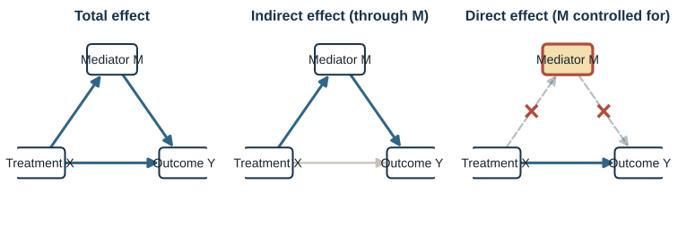{fig-alt="Three panels: total effect shows X causing Y both directly and through M; indirect effect shows only the X-M-Y path highlighted with the direct path faint; direct effect shows M conditioned on (gold), with both its arrows cut, leaving only the direct X to Y arrow" width="92%"}

::: {.fragment .key-line}
Craig & Richeson **manipulated** M. Most studies only **measure** it.
:::

::: notes
Walk the three panels left to right instead of reciting the bullet definitions. Panel 1, **total effect**: every causal path from X to Y, direct arrow and through-M arrow both live. Panel 2, **indirect effect**: the through-M path is what's highlighted; the direct arrow is grayed out because the indirect effect is specifically the part that runs through the mediator. Panel 3, **direct effect**: this is what conditioning on M actually does to the picture — M is drawn conditioned (gold box, Part 1's convention), and both of its arrows are cut with a red X, because holding M fixed blocks the one path that carried the indirect effect. What's left, the lone surviving arrow, is the direct effect. This is the same "control for a mediator" move from Part 1, just drawn as a before/after instead of described in prose: controlling for M doesn't estimate the total effect, it deliberately removes the indirect part and leaves only the direct arrow standing.

Then name the two ways to get evidence about M, and place Craig and Richeson's own two studies on the panels: Study 2 only measured status threat and put it in a regression, which is the move panel 3 depicts — and Rohrer's Week 10 warning applies directly, that this only isolates the indirect effect cleanly if nothing else affects both M and Y. Studies 3a/3b instead manipulated the mechanism directly — the assuaging paragraph lowered status threat while holding the demographic message constant, and the conservative shift largely disappeared — which is a strictly stronger way to demonstrate the indirect-effect panel than regression adjustment ever can be, because it isolates M's causal role by design rather than by assumption. The latte paper, next, shows what the weaker, regression-only version of panel 3 looks like in practice.
:::

## Do liberals really drink more lattes? {#latte-puzzle}

:::::: two-column
::: column
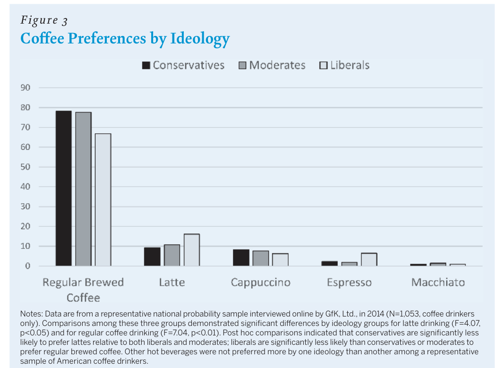{fig-alt="Mutz and Rao Figure 3: coffee drink preferences by ideology"}
:::

:::: column
A national probability sample, **2014** (GfK). Coffee drinkers only: **N = 1,059**.

"Which drink would you order at a coffee shop?"

Prefer a latte: liberals **16%**, moderates **\~11%**, conservatives **9%**.

::: {.fragment .key-line}
The stereotype is real. **Why** does it hold?
:::
::::
::::::

::: source
Source: Mutz and Rao (2018), *PS: Political Science & Politics* 51(4), Figure 3.
:::

::: notes
Introduce the puzzle. The phrase “latte liberal” is a political insult, used since at least the 2004 campaign. Mutz and Rao first check whether the stereotype holds. They used a national probability-based online panel fielded by GfK in 2014. Of more than 1,500 respondents, about 72 percent drink coffee, which gives 1,059 cases. Respondents chose the drink they would order at a coffee shop, and the outcome is coded 1 for a latte.

The difference is real but small in absolute terms: 16 percent of liberals, about 11 percent of moderates, and 9 percent of conservatives prefer lattes. Ideology is measured on a 7-point scale, and in a probit model it significantly predicts latte preference.

Ask students for explanations before showing the authors' list. Typical answers: liberals live in cities with more coffee shops, liberals are richer, women are more liberal and like milk drinks, and liberals like things that seem foreign or European.
:::

## Four candidate explanations {#latte-four}

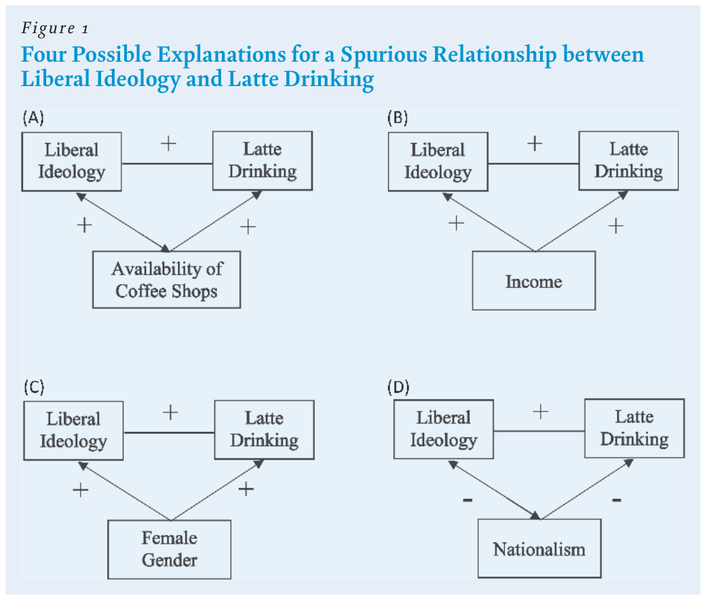{fig-alt="Mutz and Rao Figure 1: four possible explanations for a spurious relationship between liberal ideology and latte drinking: coffee shop availability, income, female gender, nationalism" width="80%"}

::: {.fragment .key-line}
The authors call every one of these a reason the link might be **spurious**. Are they all the same kind of variable?
:::

::: source
Source: Mutz and Rao (2018), Figure 1.
:::

::: notes
Show the authors' Figure 1. They test four third variables: the availability of coffee shops near the respondent, income, gender, and nationalism. The figure's title calls each one an explanation for a spurious relationship, which is confounder language.

Look closely at the arrows. In panels B and C, income and gender point into both ideology and latte drinking, a clean confounder. In panels A and D, the arrow between ideology and the third variable has heads at both ends. The authors leave the direction open. That ambiguity matters, because if ideology causes the third variable, it is a mediator, not a confounder. Ask students to sort the four before the next slide.
:::

## Which are confounders and which are mediators? {#latte-roles}

::::: r-stack
::: {.fragment .fade-out fragment-index="1"}
**Your turn:** For **gender**, **income**, **coffee-shop availability**, and **nationalism**, sketch the arrows. Which way does each one run between ideology and latte drinking? Is it a confounder or a mediator?
:::

::: {.fragment fragment-index="1"}
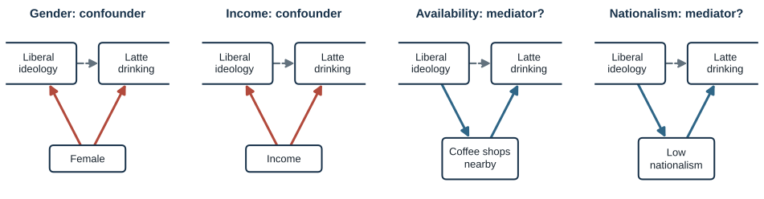{.nostretch width="100%" fig-alt="Four DAGs: gender and income as confounders pointing into both ideology and latte drinking; coffee-shop availability and low nationalism as possible mediators on a path from ideology to lattes"}
:::
:::::

::: {.fragment .key-line fragment-index="2"}
Same regression, different meaning. Controlling for a **confounder** removes bias. Controlling for a **mediator** removes part of the effect.
:::

::: notes
Pause here. Give pairs a minute or two to sketch a diagram for each of the four variables and label it confounder or mediator before you click. The first click swaps the prompt for the diagrams; the second click shows the punchline.

Classify each candidate.

Gender: being female plausibly affects both ideology and drink preference, and nothing about ideology changes gender. A confounder.

Income: income could shape both, though the direction is messy, since higher income usually goes with more conservative voting. Still a pre-existing common cause, so a confounder.

Availability: liberals may choose to live in dense urban areas, where coffee shops are common. Then ideology causes location, which causes access: a mediator. But reverse arrows are also plausible: coffee shops open where demand for lattes exists.

Nationalism: if liberal ideology lowers national-superiority attitudes, and those attitudes make people avoid foreign-seeming products, nationalism is a mediator. The authors' own wording of this hypothesis, liberals have lower nationalism, “thus leading them” to lattes, is a mediation chain.

The punchline: the regression is the same whether the added variable is a confounder or a mediator. Its interpretation is not.
:::

## What happens to the ideology coefficient? {#latte-table}

::: small-table
| Model | Variable added | Ideology coefficient (SE) | N |
|------------------|------------------|:----------------:|:----------------:|
| Baseline | none | **0.08 (0.03)** \* | 1,059 |
| A | Starbucks in ZIP code: 0.09 (0.03) \* | **0.08 (0.03)** \* | 1,059 |
| B | Income: 0.05 (0.01) \*\*\* | **0.08** \* | 1,059 |
| C | Female: 0.26 (0.10) \* | **0.08 (0.03)** \* | 1,059 |
| D | Nationalism: −0.38 (0.09) \*\*\* | **0.01 (0.04)**, n.s. | 896 |
| All four | all of the above | **0.01 (0.04)**, n.s. | 896 |
:::

::: {.fragment .key-line}
Only nationalism absorbs the ideology gap. Authors: nationalism “most parsimoniously explain\[s\] this relationship.”
:::

::: source
Source: Mutz and Rao (2018), Table 1 (probit models); quotation p. 766.
:::

::: notes
Walk through Table 1. Ideology's probit coefficient is 0.08 in the baseline model. Adding coffee-shop availability (the number of Starbucks in the respondent's ZIP code), income, or gender leaves it at 0.08: each of those variables predicts latte preference, but none explains the ideology gap. Adding nationalism, a three-item national-superiority scale (alpha = .77), drops the ideology coefficient to 0.01, no longer significant, and nationalism itself is a strong negative predictor. The model with all four looks the same.

The authors' conclusion: “nationalistic attitudes toward the superiority of one's country, and, by implication, its products, most parsimoniously explain this relationship.” In the discussion they go further: “Conservatives shun lattes because they sound foreign.”

One printed standard error for model B (0.06) is probably a typo for 0.03, since the coefficient is still starred. Leave it off the slide.
:::

## Nationalism explains the gap. What kind of variable is it? {#latte-nationalism}

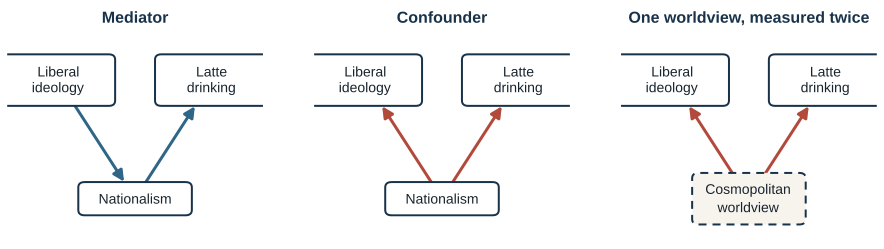{fig-alt="Three DAGs: nationalism as a mediator between ideology and lattes; nationalism as a confounder causing both; ideology and nationalism as two measures of one cosmopolitan worldview"}

::: {.fragment .key-line}
All three pictures produce the **same** shrinking coefficient. A cross-sectional survey cannot tell them apart.
:::

::: notes
Show three structures that all fit the regression result. If ideology lowers nationalism, which lowers latte drinking, nationalism is a mediator, and the 0.08-to-0.01 drop measures an indirect effect. If nationalism comes first, shaping both ideology and taste, it is a confounder, and the drop shows the ideology–latte link was never causal. If ideology and nationalism are two measures of one underlying cosmopolitan worldview, adding one simply soaks up the other.

Each story implies a different causal claim, and the survey cannot distinguish them, because everything is measured at the same time and nothing is manipulated. This is Rohrer's warning from Week 10 in a concrete case.
:::

## What the latte study can and cannot show {#latte-limits}

::::: two-column
::: column
### Shows

The ideology–latte gap is real.

Availability, income, and gender do **not** account for it.

Nationalism is strongly associated with both.
:::

::: column
### Does not show

That nationalism **carries** an effect of ideology.

That drinks are avoided because they “**sound foreign**” (never measured).

That the drop from 0.08 to 0.01 is significant (not tested; N also falls to 896).
:::
:::::

::: {.fragment .key-line}
How would you test the “sounds foreign” mechanism the way Craig & Richeson tested status threat?
:::

::: notes
Separate what the paper establishes from what it claims. It establishes a real gap, rules out three obvious explanations as accounting for it, and shows that nationalism is strongly associated with both ideology and drink choice.

It does not show that nationalism mediates an effect of ideology, for the reasons on the previous slide. The discussion's claim that conservatives avoid lattes because they sound foreign rests on a variable that was never measured; the summary in the readings folder also notes that conservatives choose cappuccino, another Italian-named drink, slightly more often than liberals. The drop in the ideology coefficient is never formally tested, its confidence interval in model D still overlaps the baseline estimate, and the nationalism models lose 163 respondents, so part of the change could come from who dropped out. Comparing probit coefficients across models with different controls also needs care.

Close with a design prompt. Students should propose manipulating the mechanism: randomly vary whether the same drink is presented with an Italian name or an English one (for example, “latte” versus “milky coffee”) and test whether conservatives' preferences shift. That is Craig and Richeson's move applied to coffee.
:::

## Moderation: when does an effect hold? {#moderation .section-title}

[Part 3 of 5 · Moderation, again]{.kicker}

> A moderator does not carry the effect. It changes how **big** it is.

::: notes
Transition to moderation. Mediation asked how an effect travels. Moderation asks whether the size or direction of an effect depends on a third variable. In Week 11 the running example was whether a selective college helps lower-SES students more than higher-SES students. Today's example is a classic persuasion experiment in which the moderator was itself randomized.
:::

## Moderation in a DAG {#moderation-dag}

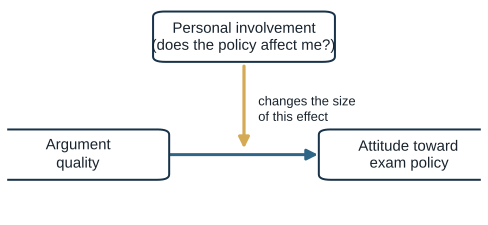{fig-alt="Argument quality causes attitude toward exam policy; personal involvement points to the arrow, changing the size of the effect" width="62%"}

-   A moderator is **not** on the path from X to Y.
-   Standard DAGs do not draw moderation. Here the arrow points **at the arrow**.
-   In a regression: an **interaction**, X × Z.

::: notes
Show the convention. A mediator sits between X and Y. A moderator sits off the path and changes the strength of the arrow, which standard DAGs cannot draw, because a DAG says only whether an effect exists, not how big it is. The picture here, an arrow pointing at another arrow, is a teaching convention, not formal DAG notation.

In data, moderation appears as an interaction: the effect of X on Y differs across levels of Z, estimated with an X × Z term. The cleanest evidence comes when both X and Z are randomized, as in the next study.
:::

## The Elaboration. Likelihood Model {#petty-hypotheses}

People rely on different information when responding to messages based on how motivated they are to process the information. 

Two routes to persuasion. **Personal involvement** decides which one people take.

::::: two-column
::: column
### Central route

People **think about the arguments**.

**H1:** Under **high** involvement, argument quality should matter **more**.
:::

::: column
### Peripheral route

People **use a cue**: "an expert said so."

**H2:** Under **low** involvement, source expertise should matter **more**.
:::
:::::

::: {.fragment .key-line}
Two interactions with **opposite** signs: involvement × argument quality and involvement × expertise. Sketch what each plot should look like before we see the data.
:::

::: source
Source: Petty, Cacioppo, and Goldman (1981), pp. 847–849.
:::

::: notes
**Talk track**

State the hypotheses before showing any results. The authors' own wording (p. 849): "under conditions of high personal involvement, persuasion would be affected more by the quality of the message arguments employed but that under low-involvement conditions, persuasion would be tied more strongly to the expertise of the source."

The theory has two routes. On the central route, attitudes change because people carefully weigh the arguments. On the peripheral route, attitudes change because of a simple cue, such as an expert source, without much thought about the issue. Personal involvement is the proposed moderator. When the policy affects you, you are motivated to think, so the arguments should matter. When it doesn't, you take the shortcut, so the source should matter.

**Ask students**

Before clicking to the results: draw two plots with involvement on the x-axis. In the first, draw one line for strong arguments and one for weak arguments. In the second, draw one line for the expert and one for the high-school class. Where should the lines be far apart, and where should they be close together?

Also ask: why vary argument *quality* rather than the *number* of arguments? (Because a listener can notice "lots of arguments" without thinking about any of them. Quality can only be detected by actually processing the content. This was the authors' critique of Chaiken 1980.)

**Teaching detail**

Emphasize that this is a moderation hypothesis with two parts that point in opposite directions. Involvement should *strengthen* the effect of argument quality and *weaken* the effect of source expertise. Two opposite interactions sharing one moderator are much harder to explain away than a single interaction, for example by saying "involved people are just more persuadable." Note also what the theory does *not* predict: no main effect of involvement on agreement. Involvement changes *what* persuades, not *how much*.
:::

## Petty, Cacioppo & Goldman: the design {#petty-design}

**145** University of Missouri undergraduates heard a taped message: seniors should have to pass a **comprehensive exam** to graduate.

::: small-table
| Factor | Levels |
|------------------------------------|------------------------------------|
| **Personal involvement** | exams would start **next year** (affects you) vs. in **ten years** (doesn't) |
| **Argument quality** | 8 strong arguments (data, statistics) vs. 8 weak ones (quotations, opinion, anecdotes) |
| **Source expertise** | Carnegie Commission on Higher Education vs. a local **high-school class** |
:::

Outcome: agreement with the exam policy (standardized index). A **2 × 2 × 2** experiment, every factor randomized.

::: source
Source: Petty, Cacioppo, and Goldman (1981), *JPSP* 41(5), pp. 849–850.
:::

::: notes
Walk through the design. Students listened to a tape described as a candidate for a campus radio broadcast. The message argued that seniors should have to pass a comprehensive exam in their major before graduating, a position students strongly disliked.

Three factors were crossed. Involvement: students were told the policy might start at their own university next year, which would affect them, or not for ten years, which would not. Argument quality: eight strong arguments based on statistics and evidence, or eight weak arguments based on quotations, personal opinion, and anecdotes; both sets were pretested. Source expertise: the tape was attributed to a report by the Carnegie Commission on Higher Education, chaired by a Princeton professor, or to a report by a local high-school class.

The dependent variable combined semantic-differential ratings of comprehensive exams with an agreement item, standardized. Because all three factors were randomized, the study can estimate how the effect of argument quality and the effect of source expertise depend on involvement.
:::

## Results: involvement flips what persuades {#petty-results}

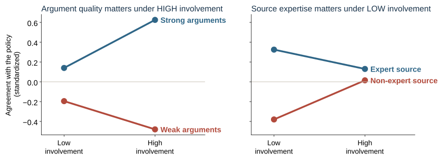{fig-alt="Two interaction plots: strong versus weak arguments diverge under high involvement; expert versus non-expert sources diverge under low involvement" width="92%"}

Involvement × argument quality: *F*(1, 137) = **6.05**, *p* \< .02. Involvement × expertise: *F*(1, 137) = **3.92**, *p* \< .05.

::: source
Source: Petty, Cacioppo, and Goldman (1981), Figure 1 and Table 1; points are Table 1 means averaged over the third factor.
:::

::: notes
Read the two panels. Left: when the policy affected students, strong arguments produced far more agreement than weak ones, and weak arguments backfired. When it did not affect them, the gap between strong and weak arguments was much smaller. Right: when the policy did not affect students, the expert source persuaded much more than the high-school class. When it did affect them, the source barely mattered.

Both two-way interactions are significant. Both main effects of argument quality and expertise are also significant, and there is no main effect of involvement and no three-way interaction. Involvement did not change how much students were persuaded on average; it changed what persuaded them.

The plotted points are the paper's Table 1 cell means averaged over the third factor. The original Figure 1 shows the same pattern without printed values.
:::

## Reading the interaction {#petty-reading}

::::: two-column
::: column
### High involvement

People **think about the arguments**.

Argument quality matters; the source barely does.
:::

::: column
### Low involvement

People **use a shortcut**.

The source's credentials matter; argument quality matters less.
:::
:::::

::: {.fragment .key-line}
No single “effect of argument quality.” Its size depends on involvement. That is moderation.
:::

::: notes
Interpret the pattern in the authors' terms, which became the Elaboration Likelihood Model. When an issue is personally relevant, people scrutinize the content, so argument quality drives attitudes. When it is not, people rely on cues such as source credentials.

Methodologically, the lesson is that asking for “the” effect of argument quality is the wrong question. The effect is large under high involvement and small under low involvement. Averaging over involvement would hide both.

Add the cautions from the summary. The paper's significance statements about simple effects rest on post-hoc tests with about 18 participants per cell; the expertise manipulation check moved ratings of the speaker's qualifications by only 1.1 points while argument quality moved them by 2.7; and one printed involvement-check statistic is impossible as printed, probably a misprint.
:::

## Mediator or moderator? {#med-vs-mod-table}

::: small-table
|   | Mediator | Moderator |
|------------------------|------------------------|------------------------|
| Question | **How** does X affect Y? | **When / for whom** does X affect Y? |
| Position | on the path X → M → Y | off the path; changes the X → Y arrow |
| Timing | after X | before X (or fixed) |
| Analysis | indirect and direct effects | X × Z interaction |
| Today's case | nationalism in the latte study | involvement in Petty et al. |
| Strongest design | manipulate M (Craig & Richeson) | randomize Z, or both X and Z |
:::

::: notes
Summarize the contrast. A mediator is caused by the treatment and carries part of its effect. A moderator is set before the treatment, or is a fixed trait, and changes the size of the effect. They call for different analyses: decomposing the effect versus estimating an interaction.

Quick check: ask students for one variable in their own project that could be a mediator and one that could be a moderator. For a coded-news project, a mediator might be audience emotion; a moderator might be the outlet's partisanship.
:::

## When you can't randomize {#natural-experiments .section-title}

[Part 4 of 5 · Natural experiments]{.kicker}

> Sometimes nature, a lottery, a rule, or bad luck assigns the treatment **for us**.

::: notes
Take the break here if you have not already.

Then frame Part 4. Craig, Correll, and Petty all randomized. Many of the treatments we care most about cannot be randomized: wealth, military service, prison, a grant, a terrorist attack. Natural experiments are situations in which something outside the researcher's control assigned the treatment in a way that is random or as good as random. Dunning's chapter and Grosz and colleagues' article give the vocabulary and the toolbox.
:::

## What makes it a natural experiment? {#ne-definition}

:::::: triad
::: triad-item
Treatment vs. comparison

Like any experiment, two or more groups are compared.
:::

::: triad-item
Random or as-if random

Assignment is unrelated to the outcome-relevant traits of the units.
:::

::: triad-item
Not controlled by the researcher

A lottery, a rule, nature, or history did the assigning.
:::
::::::

::: {.fragment .key-line}
Dunning: natural experiments are “neither natural nor experiments.” The **as-if random** claim has to be argued, not assumed.
:::

::: source
Source: Dunning (2012), ch. 1.
:::

::: notes
Give Dunning's definition through the hallmarks of a true experiment. A natural experiment shares two of them: a comparison of treatment and control groups, and random or as-if random assignment. It lacks the third: the researcher does not control the manipulation.

His joke, that natural experiments are “neither natural nor experiments,” makes two points. The interventions are usually human, such as lotteries, laws, and borders, not natural. And they are not experiments, because no researcher assigned anything. Everything rests on the claim that assignment was as good as random, and that claim has to be supported with evidence about how assignment happened and whether groups look balanced.
:::

## Snow's map: two companies, one neighborhood {#snow-map}

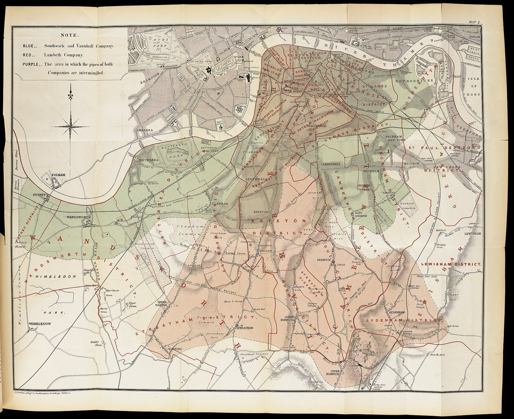{fig-alt="John Snow's 1855 map of south London water supply: areas served by the Southwark and Vauxhall Company, the Lambeth Company, and a large central area where both companies' pipes are intermingled" width="70%"}

Blue (faded to green): **Southwark & Vauxhall** · Red: **Lambeth** · Purple (center): **both companies' pipes intermingled**

::: source
Source: John Snow (1855), *On the Mode of Communication of Cholera*, 2nd ed., Map 2. Wellcome Collection, CC BY 4.0.
:::

::: notes
Show Snow's second map before the logic. It covers the districts south of the Thames. Snow's legend: blue for the Southwark and Vauxhall Company, red for the Lambeth Company, and purple for the area in which the pipes of both companies are intermingled. On this scan the blue has faded to green.

Point to the large purple area in the center, around Kennington, Walworth, and Southwark. There, the two companies' pipes ran down the same streets, and neighboring houses could get water from different companies. Ask: what does that mixing let Snow compare? Houses on the same street, with similar residents, similar air, and similar poverty, that differ mainly in which company pumped their water. That is the as-if random assignment, and the next slide draws it.
:::

## The first natural experiment: John Snow and cholera {#snow}

::::: two-column
::: column
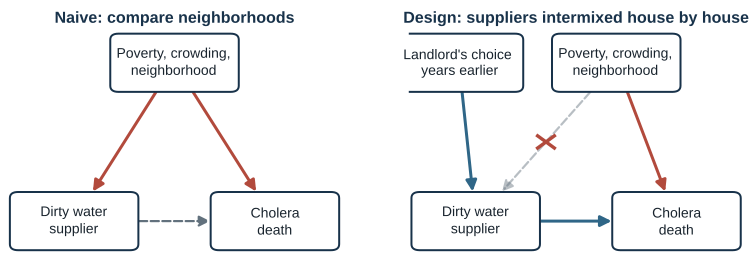{fig-alt="Naive DAG: poverty causes both dirty water supplier and cholera death. Design DAG: landlord's choice years earlier causes the water supplier; the arrow from poverty to supplier is cut"}
:::

::: column
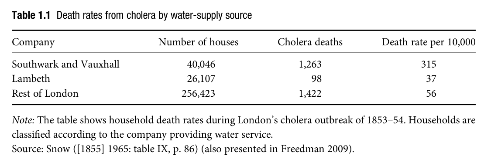{fig-alt="Dunning Table 1.1: cholera death rates by water supplier, London 1853-54"}

Deaths per 10,000 houses: **315** (Southwark & Vauxhall) vs. **37** (Lambeth).
:::
:::::

::: source
Source: Dunning (2012), ch. 1, Table 1.1, pp. 12–15.
:::

::: notes
Tell Snow's story as the template. In 1853–54, two water companies supplied London households. Lambeth had moved its intake upstream of the city's sewage in 1852; Southwark and Vauxhall still drew water downstream. Comparing neighborhoods would be confounded, because poor, crowded neighborhoods might have both dirtier water and more cholera for other reasons, including the then-popular “bad air” theory.

Snow's insight was that the two companies' pipes were intermixed house by house, and landlords had chosen suppliers years earlier, before anyone knew about the risk. So neighboring houses with similar residents got different water for reasons unrelated to their residents. The design DAG cuts the arrow from poverty to water supplier.

The result: 315 deaths per 10,000 houses supplied by Southwark and Vauxhall, versus 37 for Lambeth and 56 for the rest of London.

Be precise about what those numbers cover. The 315 vs. 37 comparison pools *all* houses each company supplied (40,046 and 26,107), including houses in the single-company districts on the map, not just the purple intermixed area. The intermixed districts are what justify treating the supplier as as-if random. A stricter version of the design would restrict the comparison to them.

**Ask students:** What would you gain and lose by keeping only the purple area? (Gain: a cleaner comparison, since neighbors share poverty, air, and neighborhood. Lose: sample size, and possibly generalizability to the rest of south London.)
:::

## The natural-experiment toolbox {#toolbox}

::: small-table
| Design | What creates the variation | Example |
|------------------------|------------------------|------------------------|
| **Lottery** | an actual random draw, run by someone else | Swedish lottery prizes; Vietnam draft |
| **As-if random event** | nature, history, or administration | Snow's water companies; Argentine land titles |
| **Regression discontinuity** | a cutoff on a score | merit certificates; class-size caps; grant thresholds |
| **Instrumental variables** | a random push toward treatment | judge assignment; draft lottery → service |
:::

::: notes
Lay out the toolbox before going through each design. The first two are what Dunning and Grosz call standard natural experiments: treatment is assigned by a real lottery or by an as-if random process. Regression discontinuity uses a rule that assigns treatment above a cutoff. Instrumental variables use something random that pushes people toward treatment without determining it.

A fifth design, comparing before and after an unexpected event (including difference-in-differences), is not in Grosz's article; students already saw the logic in Week 10 (TV's staggered arrival), and Balcells and Torrats-Espinosa's before/after-an-attack design gets its own full treatment in Part 5, so it isn't repeated here as a separate toolbox entry.

For each design, the next slides show the naive comparison, what the design solves, and what it has to assume.
:::

## 1. Lotteries {#lottery}

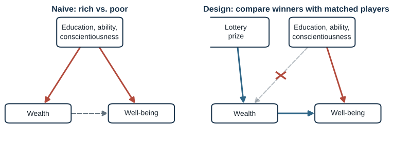{fig-alt="Naive DAG: education and ability cause wealth and well-being. Design DAG: lottery prize causes wealth; the arrow from ability to wealth is cut"}

::: {.fragment .key-line}
Among people who bought the **same number of tickets**, who wins is pure chance. Compare winners with those matched non-winners.
:::

::: source
Source: Grosz et al. (2024), Box 1 (Lindqvist et al. 2020).
:::

::: notes
Lotteries are the cleanest natural experiments, because the assignment really is random. Grosz and colleagues' Box 1 uses Lindqvist and colleagues' Swedish lottery study. Wealth and well-being are confounded by education, ability, and conscientiousness. Among lottery players, though, prizes are random within groups of players who bought the same number of tickets, so comparing large-prize winners with matched non-winners cuts the arrow from those traits to wealth.

The assumption to state: the lottery was actually random, and the comparison is made within the groups the lottery randomized over. Players who buy more tickets are more likely to win and may differ in other ways, which is why the comparison is within ticket groups. The next slide shows what two lotteries found.
:::

## Lottery results {#lottery-results}

::::: two-column
::: column
### Swedish lottery winners

**3,362** players surveyed **5–22 years** after winning.

An extra **\$100,000** (after tax) raised life satisfaction by **0.037 SD**, with **no fading** over time.

Effects on **happiness** and **mental health** were much smaller.
:::

::: column
### Vietnam draft lottery

Draft eligibility set by lottery over **birth dates**.

White men made eligible in the 1971 lottery earned **\$15,814** in 1984, vs. **\$16,172** for those not eligible: **\$358 (about 2%) less**.
:::
:::::

::: {.fragment .key-line}
Random assignment makes the comparison simple: a difference in means.
:::

::: source
Sources: Lindqvist, Östling, and Cesarini (2020), *Review of Economic Studies* 87: 2703–2726; Dunning (2012), pp. 8–9 (Angrist 1990).
:::

::: notes
Report the results. Lindqvist, Östling, and Cesarini surveyed 3,362 Swedish lottery players 5 to 22 years after a lottery event, following a preregistered analysis plan; the prize pool totaled about 277 million dollars. An after-tax prize of 100,000 dollars raised overall life satisfaction by 0.037 standard deviations, and the effect showed no sign of fading with years since the win. Effects on happiness and mental health were significantly smaller. The authors conclude that wealth changes how people evaluate their lives more than how they feel day to day, and that much of the effect runs through financial satisfaction.

The Vietnam draft lottery is Dunning's running example. In 1970 to 1972, draft eligibility was set by lottery numbers assigned to birth dates. Angrist compared men by eligibility. Among white men in the 1971 lottery, those made eligible earned 15,814 dollars in 1984, versus 16,172 for those not eligible: about 358 dollars, or 2 percent, less. That is the effect of being made eligible; the effect of actually serving is larger, and estimating it uses the lottery as an instrument (coming up).

Dunning notes that the 1970 lottery was poorly mixed, with later birth dates drawn disproportionately early, a reminder to check even real lotteries.
:::

## 2. As-if random events {#as-if-random}

No lottery. Something else assigned treatment in a way **unrelated to people's traits**.

-   **Argentine land titles:** squatters got titles under a 1984 law, but some original owners **sued**, delaying titles for their plots. Titled families invested more in housing and children's schooling, with **no** gain in credit.
-   **The sex of a child or sibling:** set at conception.
-   **An earthquake in the middle of a survey.**

::: {.fragment .key-line}
The burden: show assignment was unrelated to anything that affects the outcome. Check **balance**.
:::

::: source
Sources: Dunning (2012), pp. 9–12 (Galiani and Schargrodsky); Grosz et al. (2024), pp. 6, 9.
:::

::: notes
As-if random designs have no actual lottery, so the argument for randomness is harder. In Galiani and Schargrodsky's Argentine study, squatters had occupied land in 1981. A 1984 law expropriated it and gave titles, but some original owners challenged the expropriation in court, delaying titles for their plots. Whether an owner sued was unrelated to the squatters on the plot, and the titled and untitled groups were similar on measured characteristics. Titled families invested more in their houses, had smaller households, and educated their children more, but got no more credit, contradicting a famous argument that titles unlock loans. Dunning gives no numbers for these effects.

The next three slides work through two other kinds of as-if random assignment in detail: the sex of a child or sibling, and an earthquake that struck during a survey.
:::

## Boy or girl? Daughters and legislators {#daughters}

::::: two-column
::: column
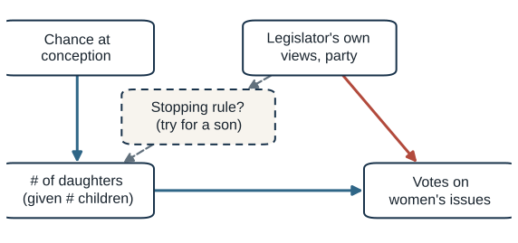{fig-alt="Chance at conception determines the number of daughters given the number of children, which affects votes on women's issues; legislators' own views affect votes; a possible stopping rule could link views to number of daughters"}
:::

::: column
**Question:** does raising daughters change how legislators vote?

**Design:** compare members of Congress with the **same number of children** but different numbers of **daughters**.

**Result:** each daughter raised scores on women's issues (NOW, AAUW) by about **a quarter** of the gap between male and female legislators, especially on **reproductive rights**.
:::
:::::

::: {.fragment .key-line}
Threat: a stopping rule (“keep trying for a son”). Check: a first-born daughter does **not** predict family size.
:::

::: source
Source: Washington (2008), *American Economic Review* 98(1): 311–332.
:::

::: notes
Walk through Washington's design. Do children shape their parents' politics? Comparing legislators with and without daughters is confounded by everything that predicts family size and composition. But conditional on the total number of children, the number of daughters is set by chance at conception. Washington compares members of the U.S. House with the same number of children and different numbers of daughters, using interest-group scores on women's issues from the National Organization for Women and the American Association of University Women, plus roll-call votes.

Result: conditional on total children, each additional daughter raises a legislator's score by about one quarter of the difference associated with the legislator's own gender, and the effect is strongest on reproductive rights.

The key threat is a stopping rule. If some legislators keep having children until they have a son, then among families of a given size, the number of daughters would be related to the parents' preferences, which might also predict their votes. Washington checks this: for the 227 members whose first child's sex she could identify, a first-born daughter predicts the gender mix of the family but not the total number of children. That is a balance-style check on the assumption.

Mention the follow-up: Sood and Costa's replication extends the analysis to later Congresses and finds the effect weaker in later sessions, a reminder that natural-experiment estimates are tied to a time and place.
:::

## Sibling sex and personality {#sibling-sex}

**Question:** does having a younger **sister** rather than a younger **brother** shape your personality?

**Design:** the sex of your **next-younger sibling** is set at conception, **after** you were born. **85,887** people, **12** samples, **9** countries.

**Checks:**

-   **Balance:** people with a younger sister vs. brother looked alike on traits fixed **before** that sibling's birth (e.g., number of older siblings).
-   **Robustness:** **3** samples dropped over concerns about sex-selective abortion.

::: {.fragment .key-line}
Result: **no meaningful effect** on risk tolerance, trust, patience, locus of control, or the Big Five. A well-powered, informative null.
:::

::: source
Sources: Grosz et al. (2024), p. 9; Dudek, Brenøe, Feld, and Rohrer (2022), *Psychological Science* 33(9): 1574–1587.
:::

::: notes
Present Grosz and colleagues' most detailed example of as-if randomization. Dudek and colleagues asked whether growing up with a next-younger sister rather than a next-younger brother changes one's own personality. The sex of a future sibling is essentially random at conception, and because that sibling is born after the focal person, it cannot be caused by the focal person's own traits.

Threats: sex differences in survival, and sex-selective abortion, could make the sibling's sex less than random. The authors ran two checks. First, balance: people with a younger sister and a younger brother should look alike on variables fixed before the sibling's birth, such as the number of older siblings, and they did. Second, robustness: they excluded three samples with concerns about sex-selective abortion or other imbalances.

Result, from the paper rather than Grosz and colleagues: no meaningful causal effect of the next-younger sibling's sex on risk tolerance, trust, patience, locus of control, or the Big Five, across 85,887 people from 12 samples in 9 countries. With that much power, the null is informative.

Note the narrow estimand that Grosz and colleagues flag: the design identifies the effect of the next-younger sibling's sex, not of older siblings or of siblings in general.
:::

## An earthquake in the middle of a survey {#earthquake}

::::: two-column
::: column
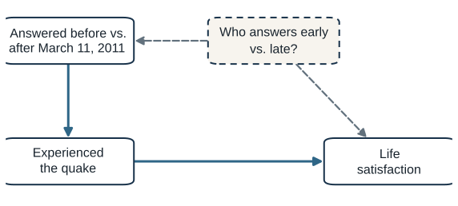{fig-alt="Answering before or after March 11, 2011 determines whether a respondent experienced the quake, which affects life satisfaction; a possible threat is that early and late respondents differ"}
:::

::: column
A Japanese consumer survey was in the field on **March 11, 2011**, when the Great East Japan Earthquake struck.

About **half** the respondents answered **before**, half **after**.

**Result:** people who answered after the quake reported **lower life satisfaction**.
:::
:::::

::: {.fragment .key-line}
Threat: people who answer a survey late may differ from early responders. Check: compare them on traits the quake couldn't change.
:::

::: source
Sources: Grosz et al. (2024), pp. 6, 11; Oishi, Kohlbacher, and Choi (2018), *Social Psychological and Personality Science* 9: 364–371.
:::

::: notes
Present Oishi and colleagues' earthquake study, which Grosz and colleagues cite twice: as a standard natural experiment and as a time threshold. No one can assign an earthquake. But an online survey about consumer attitudes, which also included a life-satisfaction measure and a brief Big Five inventory, happened to be in the field on March 11, 2011, when the Great East Japan Earthquake struck. Roughly half the respondents had answered before and half after. Comparing them, with regression-discontinuity analyses around the date, estimates the short-run effect of the disaster.

Result: respondents who answered after the earthquake reported lower life satisfaction, as the authors predicted from earlier work on adaptation to disasters. Fragments of the paper available online suggest an effect of about d = 0.21; check the article before quoting the size.

The threat is the same one students will meet in Balcells and Torrats-Espinosa: people who answer a survey late may differ from early responders. The check is to compare early and late respondents on characteristics the earthquake could not have changed. This design is sometimes called an unexpected event during survey design.
:::

## 3. Regression discontinuity {#rd}

::::: two-column
::: column
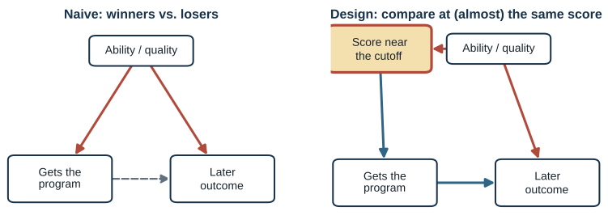{fig-alt="Naive DAG: ability causes both getting the program and the outcome. Design DAG: score near the cutoff is conditioned on; the score determines the program"}
:::

::: column
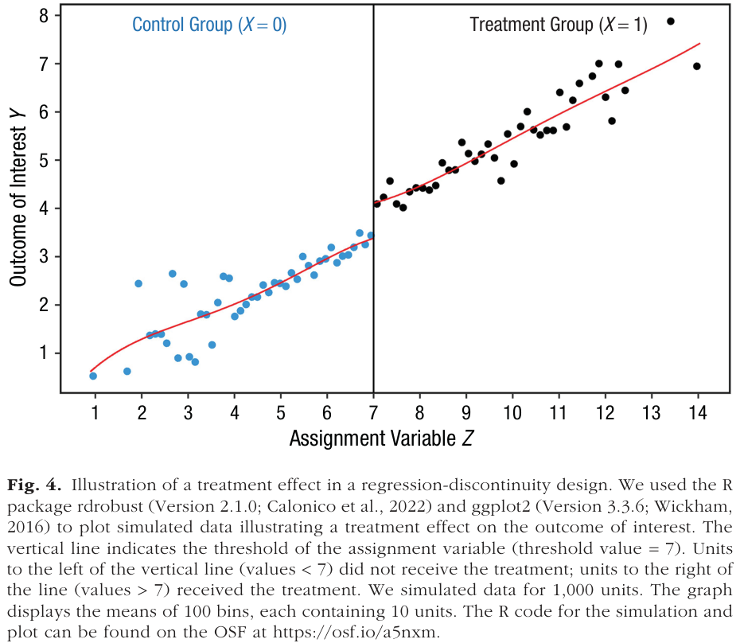{fig-alt="Grosz et al. Figure 4: simulated regression discontinuity plot with a jump at the cutoff"}
:::
:::::

People just above and just below a cutoff are nearly identical, except one got the treatment.

::: source
Sources: Grosz et al. (2024), Figure 4 and Box 3 (Thistlethwaite and Campbell 1960).
:::

::: notes
Regression discontinuity uses a rule: treatment goes to everyone above a cutoff on some score. The naive comparison of everyone treated with everyone untreated is confounded, because the score reflects ability, which also affects outcomes. But people with scores just above the cutoff and just below it are nearly identical in ability; only the rule separates them. So the design compares outcomes right at the cutoff, effectively conditioning on the score.

Grosz and colleagues' Box 3 uses the original RD study, Thistlethwaite and Campbell (1960): students just above and just below the score needed for a National Merit Certificate of Merit. The simulated figure shows the logic: the outcome rises smoothly with the score, then jumps at the cutoff. The jump is the effect.

Two assumptions to name now; we will test them on Bol and colleagues. Potential outcomes change smoothly through the cutoff, and people cannot precisely manipulate which side they land on. And the estimate is local: it applies to people near the cutoff.
:::

## The first RD: Thistlethwaite & Campbell (1960) {#thistlethwaite}

::::: two-column
::: column
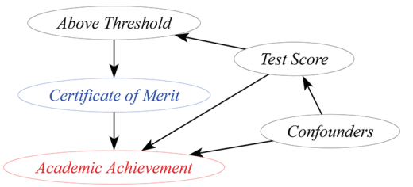{fig-alt="Grosz et al. Box 3 DAG: test score determines being above the threshold, which determines the certificate of merit; test score and confounders affect academic achievement"}
:::

::: column
**Treatment:** a National Merit **Certificate of Merit** (public recognition).

**Assignment:** awarded if your qualifying-test score met your state's cutoff.

**Comparison:** students **at** the cutoff vs. **one score interval below**. 1957 near-winners: **5,126** certificates, **2,848** commendations.
:::
:::::

::: {.fragment .key-line}
An earlier **matching** study said recognition raised intellectual attitudes. The RD **confirmed** more outside scholarships, **contradicted** the attitude effect, and was equivocal on career plans.
:::

::: source
Sources: Grosz et al. (2024), Box 3 and p. 11; Thistlethwaite and Campbell (1960), *Journal of Educational Psychology*.
:::

::: notes
Present the original RD study, published in a psychology journal. The question: does public recognition, a Certificate of Merit from the National Merit program, change students' later achievement and attitudes? Comparing recognized and unrecognized students is confounded by intelligence, personality, and social support, all of which affect both the test score and later outcomes.

The certificate went to students whose qualifying-test score met their state's cutoff. Thistlethwaite and Campbell compared students just at the cutoff with students one score interval below, who were probably very similar except for the certificate. The data came from near-winners in the 1957 National Merit program: 5,126 certificate recipients and 2,848 recipients of letters of commendation.

The result, from the original paper rather than Grosz and colleagues: an earlier study using matching had suggested that recognition raised intellectual attitudes, plans for MD or PhD study, and success winning other scholarships. The RD analysis confirmed the effect on winning scholarships from other donors, contradicted the effect on attitudes, and was equivocal on career plans. A design-based analysis overturned part of what statistical matching had found.

Note that Grosz and colleagues' Box 3 presents a modernized version of the design; the 1960 analysis was largely graphical, with coarse score intervals.
:::

## Regression discontinuity by formula: Maimonides' rule {#maimonides}

:::::: two-column
::: column
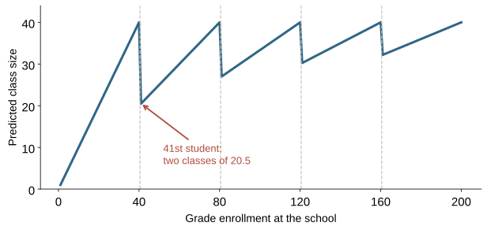{fig-alt="Predicted class size by grade enrollment under Maimonides' rule: size rises to 40, then drops to 20.5 when the 41st student enrolls, repeating at each multiple of 40"}
:::

:::: column
Israeli schools cap classes at **40**. Enroll a **41st** student and the grade splits into two classes of about **20**.

Schools with 40 vs. 41 students are nearly identical, but their class sizes differ by almost half.

::: {.fragment .key-line}
Smaller classes raised **5th-grade** reading and math and **4th-grade** reading; no effect in **3rd** grade.
:::
::::
::::::

::: source
Source: Angrist and Lavy (1999), *Quarterly Journal of Economics* 114(2): 533–575.
:::

::: notes
Add a classic regression discontinuity outside the readings. Israeli public schools follow a rule attributed to the twelfth-century scholar Maimonides: no more than 40 students per class. Predicted class size rises with enrollment up to 40, then drops when the 41st student enrolls, because the grade splits into two classes averaging 20.5. The pattern repeats at 80, 120, and so on, producing the sawtooth in the figure.

The naive comparison of small and large classes is confounded: small classes are more common in small, rural, or disadvantaged schools, and in classes formed for weaker students. But schools with 40 and 41 students in a grade are nearly identical, while their predicted class sizes differ by almost half. The cutoff, not the school's traits, drives the difference.

This is a fuzzy RD: schools do not follow the rule exactly, so the rule shifts class size without fully determining it, and the analysis uses the rule as an instrument, combining the logic of this slide and the next one. Angrist and Lavy found that smaller classes raised fifth graders' reading and math scores and fourth graders' reading scores, with no detectable effect for third graders.
:::

## 4. Instrumental variables {#iv}

> An **instrument (Z)** is something that (1) nudges people toward treatment, (2) is itself random or as-if random, and (3) affects the outcome **only** by changing the treatment.

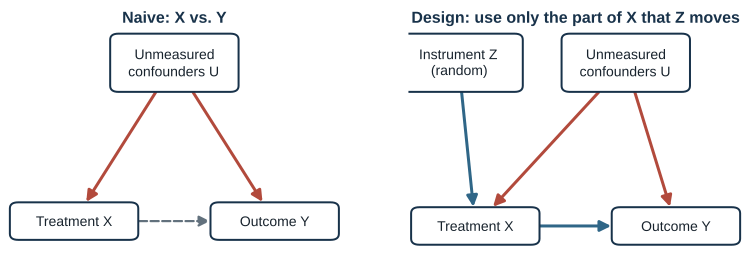{.nostretch fig-alt="Naive DAG: unmeasured confounders U (record, home life, risk of school failure) cause both juvenile incarceration X and adult incarceration Y, with the X to Y arrow dashed and unresolved. Design DAG: a random judge incarceration propensity Z causes juvenile incarceration X; U still causes X and Y, but the analysis uses only the variation in juvenile incarceration that the judge produces, and the X to Y arrow from juvenile incarceration to adult incarceration is now solid" width="55%"}

Why a juvenile offender gets incarcerated (X) has two kinds of causes:

::: fragment
-   **Their record, home life, risk of school failure (U).** These also affect adult outcomes. *Confounded.*
-   **Which judge they happened to draw (Z).** This is as-if random. *Clean.*
:::

::: source
Sources: Aizer and Doyle (2015), *QJE*; Grosz et al. (2024); Dunning (2012).
:::

::: notes
**Talk track**

Open with the general idea before the case, since "instrument" is new vocabulary: an instrument is a variable that pushes people toward a treatment without being the treatment itself, that is random or as-if random, and that reaches the outcome *only* through the treatment it pushes on. Point at the blockquote definition and at the DAG side by side — Z (the judge's incarceration propensity) has exactly one arrow leaving it, into X (juvenile incarceration), and no arrow of its own into Y (adult incarceration). That single-arrow-in-only-through-X picture *is* the exclusion restriction, drawn rather than stated.

Then the problem. We want the effect of juvenile incarceration on adult outcomes. But juveniles who get incarcerated differ from those who don't: worse records, different home environments, higher baseline risk of dropping out. Those same things plausibly affect adult crime directly. Comparing incarcerated and non-incarcerated juveniles head-on is confounded, and we can't measure everything in U.

The IV idea: split the variation in X into two parts. One part comes from U, the juvenile's own characteristics and circumstances. That part is contaminated. The other part comes from Z, the luck of the draw: which judge heard the case. Because Z is as-if random, that part of X is unrelated to U. IV uses only that clean part.

How it works in two steps:

1.  **First stage:** how much does Z change X? Aizer and Doyle's first-stage coefficient is 1.06 (statistically indistinguishable from 1): a juvenile assigned to a judge who is 10% more likely to incarcerate other juveniles is about 10% more likely to be incarcerated himself. A two-standard-deviation increase in a judge's incarceration rate raises the juvenile's own incarceration probability by 8.5 percentage points — about 37% of the sample mean.
2.  **Reduced form:** how much does Z change Y? Compare adult incarceration rates between juveniles who happened to draw high-propensity versus low-propensity judges. Because Z is as-if random, this difference is causal, but it is the effect of the *judge draw*, not of incarceration itself.
3.  **Divide:** if Z changes Y only by changing X, then the effect of X is the reduced form divided by the first stage.

The next slide walks through that arithmetic with Aizer and Doyle's actual numbers and states the result plainly, before the slide after that asks whether the design producing it is trustworthy.

**Why this is a different design from a lottery, not just a smaller version of one.** In a lottery design (design 1), the random event more or less *is* the treatment: winning the lottery is the extra wealth; being served by one water company is the water exposure. The randomized groups can be compared directly, because there's nothing standing between the randomization and the treatment. Here, the randomly assigned judge only *pushes* on the treatment; a lenient judge still incarcerates some juveniles, a strict judge still releases some. The judge and the treatment are two different variables, linked only probabilistically. That's exactly why step 3 exists: comparing judges directly, with no division, would give the effect of the *judge*, not of *incarceration*. Dividing by the first stage is what recovers the treatment's own effect. A pure lottery design never needs this step, because there's nothing to divide by — the random assignment and the treatment it's standing in for are the same thing.

**Ask students**

Why can't we just compare juveniles who were incarcerated with those who weren't? Why does it matter that we divide by the first stage instead of just reporting the judge-to-judge difference?

**Teaching detail**

Instrumental variables are for treatments people (or the system) partly, not fully, assign by chance. Aizer and Doyle (2015, *QJE*) study juveniles in Chicago whose cases were assigned, within a courtroom calendar, based on the sequence in which cases happened to arrive and which judge was sitting — effectively random, and confirmed by court administrators. Each judge's historical incarceration rate on juveniles' initial cases becomes the instrument Z.

The draft lottery works the same way for military service: the lottery changed who served, so it can estimate the effect of service, not only of eligibility.

Assumptions: the instrument is random (independence); it actually moves the treatment (relevance, checkable in the first stage); it affects the outcome only through the treatment (exclusion, not checkable, only argued); and it does not push anyone away from treatment (monotonicity). The estimate applies to compliers: juveniles whose incarceration status depended on which judge they drew.
:::

## The arithmetic, and the actual result {#iv-result}

::: {.key-line}
Effect of X = (how much Z moves Y) ÷ (how much Z moves X)
:::

::: {.fragment .key-line}
**Result:** juveniles on the margin of incarceration are about **13 points** less likely to complete high school, and about **22–26 points** more likely to be incarcerated as adults, than otherwise-similar juveniles whose judge draw didn't push them into custody.
:::

::: source
Source: Aizer and Doyle (2015), *QJE*.
:::

::: notes
**Talk track**

This is Aizer and Doyle's actual 2SLS point estimate, not a hypothetical: divide the reduced-form effect of judge assignment on adult incarceration by the first-stage effect of judge assignment on juvenile incarceration, and what's left is the effect of incarceration itself, for the compliers whose judge draw changed their status. Pause on the size of these numbers — 13 points off high school completion and 22–26 points onto adult incarceration are large effects for a single juvenile-court decision.

**Teaching detail**

Broken down by crime type, the adult recidivism effect is concentrated in violent crime (about 15 points), property crime (about 14 points), and drug offenses (about 10 points), with a smaller, imprecise effect for homicide. The next slide asks whether the design that produced this number is trustworthy — starting with whether judge assignment really was as good as random.
:::

## Are judge propensities really as good as random? {#iv-calendars}

**Chicago, 1990–2006:** more than 35,000 juvenile offenders. Each case assigned, within a courtroom calendar, by the sequence cases happened to arrive — effectively random.

Split juveniles into those drawing an **above-median** vs. **below-median** incarceration-propensity judge. If assignment is really as-if random, the two groups should look alike on everything determined *before* the judge was assigned.

::: small-table
| Characteristic (measured before assignment) | High-propensity judge | Low-propensity judge |
|-----------------------------------|------------------------|------------------------|
| Gender | *statistically indistinguishable* | *statistically indistinguishable* |
| Race | *statistically indistinguishable* | *statistically indistinguishable* |
| Age at offense | *statistically indistinguishable* | *statistically indistinguishable* |
| Special-education status | *statistically indistinguishable* | *statistically indistinguishable* |
:::

::: {.fragment .key-line}
Balance on every pre-determined characteristic is the direct empirical test of "as-if random" — not an assumption taken on faith.
:::

::: source
Sources: Aizer and Doyle (2015), *QJE*, Table 1 and Section 5.1.
:::

::: notes
**Talk track**

This is the test every "as-if random" design owes you, and the one most natural-experiment papers only gesture at. Aizer and Doyle can't test whether juveniles with unobservably low risk are assigned to lenient judges — U is unobserved by construction — but they *can* test whether juveniles differ on everything observable that was determined before the judge was assigned: gender, race, age at offense, special-education status. They find these are statistically indistinguishable across judges with high versus low incarceration propensities. That is the balance test; it's necessary, not sufficient, but it's exactly the kind of check a DAG forces you to go looking for.

**Ask students**

What would it mean, substantively, if juveniles drawing strict judges were disproportionately older, or more likely to have a prior record? (It would mean the "random" assignment wasn't random — cases were being sorted to judges in a way correlated with risk, reopening the back door the instrument was supposed to close.)

**Teaching detail**

The mean judge-level incarceration rate on initial cases is 0.09; the overall rate of ever being incarcerated as a juvenile is 0.23. The first-stage coefficient of 1.06 (t-statistics around 11) is both strong and precisely estimated — this is what makes the 2SLS estimates from two slides ago credible rather than noisy.

To be clear about which study found what: Aizer and Doyle *do* find a significant, large effect of incarceration on both outcomes, already shown two slides back. That is a different result from Green and Winik's (2010) D.C. judicial-calendar design — a different study, a different population (adult drug defendants, not juveniles), and a much smaller sample (1,003 defendants) — which found no detectable effect of prison or probation time on re-arrest. Don't let the contrast in sample size and precision between the two designs blur into a contrast in findings within Aizer and Doyle's own results.

**Exclusion, pushed on directly:** judges set more than the incarcerate/don't-incarcerate decision — probation terms, program referrals, fines. If a judge's leniency on incarceration is correlated with being systematically more lenient on everything else too, the instrument could be picking up more than incarceration itself. Aizer and Doyle argue this is unlikely to explain their results given the size and consistency of the effects across outcomes, but it is the right place to push a paper, including this one.

**Contrast, not just contradiction:** Bhuller, Dahl, Løken, and Mogstad (2020, *JPE*) use a similar random-judge design for *adult* offenders in Norway and find that incarceration *reduces* recidivism — the opposite sign from Aizer and Doyle's juveniles. Rather than treating this as one study being "wrong," use it to ask what's different: different ages (juveniles pulled out of school during a formative period vs. adults), different systems (Chicago vs. Norway), and different mechanisms (human-capital disruption for kids who are supposed to be in school, versus whatever Norway's prisons do differently for adults). Aizer and Doyle's own framing is that juvenile incarceration's costs run through interrupted human-capital accumulation, not through a failure of deterrence — which is exactly why the high-school-completion result matters as much as the recidivism result.
:::

## What each design assumes, and how to check {#assumptions-table}

::: small-table
| Design | Key assumption | How to probe it |
|------------------------|------------------------|------------------------|
| Lottery | assignment really random (within strata) | verify the mechanism; balance on pre-treatment traits |
| As-if random | assigner didn't select on outcome-relevant traits | balance tables; knowledge of how assignment happened |
| Regression discontinuity | no precise sorting around the cutoff; outcomes smooth through it | density test (bunching just past the cutoff); balance **at** the cutoff; placebo cutoffs |
| Instrumental variables | instrument affects Y **only** through X; it moves X | first-stage strength (testable); exclusion (argue) |
| Before / after | no other change at the same time; similar paths before | pre-trends; placebo dates; who was reached when |
:::

::: {.fragment .key-line}
Every design trades one assumption (no confounding) for others. The question is which assumption is more believable.
:::

::: notes
Pull the assumptions together. No natural experiment is assumption-free. Each replaces the ordinary observational assumption, that we measured every confounder, with a different assumption that is often easier to defend and to probe.

Some assumptions are testable in part. Balance on pre-treatment characteristics, the first-stage effect of an instrument, the density of scores around a cutoff, and pre-trends can all be examined in data. Others, such as the exclusion restriction in IV or the absence of any other change exactly at the cutoff, can only be argued from knowledge of the setting.

This table is the checklist for the two cases in Part 5.
:::

## Not every “natural experiment” is one {#not-ne}

Dunning's contrast case: a **speeding crackdown in Connecticut**. After a deadly year, the governor cracked down on speeding. Deaths fell.

::: {.fragment .key-line}
Who or what decided the treatment, and could it have responded to the outcome or its causes?
:::

::: source
Source: Dunning (2012), pp. 19–20.
:::

::: notes
Introduce the contrast case Dunning uses to show what is not a natural experiment. The treatment was assigned by a person responding to circumstances, not by chance. Ask the diagnostic question before showing the evidence.
:::

## Connecticut, 1955: the study and the claim {#ct-claim}

::::: two-column
::: column
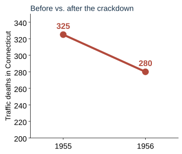{fig-alt="Connecticut traffic deaths fell from 325 in 1955 to 280 in 1956"}
:::

::: column
After a record **325** traffic deaths in 1955, Governor Ribicoff ordered a crackdown on speeding (Dec. 1955): license suspensions for speeders.

In 1956, deaths fell to **280**.

The governor's conclusion: the crackdown saved about **40 lives**.
:::
:::::

::: {.fragment .key-line}
What else could produce this drop?
:::

::: source
Sources: Campbell and Ross (1968), *Law & Society Review* 3(1): 33–53; data from the fastR2 R package, Traffic dataset.
:::

::: notes
Present the claim as it was made. In 1955 Connecticut recorded an unusually high number of traffic deaths, about 325 in these data. In late December 1955, Governor Abraham Ribicoff began an exceptionally strict crackdown on speeding, including license suspensions for convicted speeders. In 1956 deaths fell to about 280, and the governor credited the crackdown with saving lives.

Campbell and Ross's paper became the classic analysis of why this two-point comparison is weak evidence. Ask students what else could produce the drop before showing the full series.

Note that Dunning describes this as a law; Campbell and Ross describe it as an enforcement crackdown. The governor's own figures (324 and 284 deaths, 40 lives) differ slightly from the published dataset plotted here (325 and 280).
:::

## Connecticut: the explanation and the problem {#ct-problem}

::::: two-column
::: column
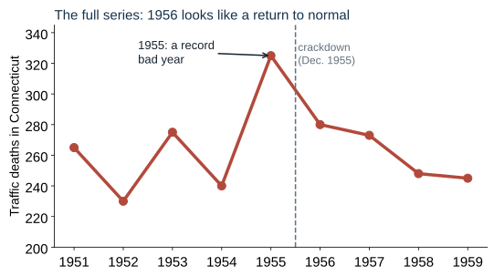{fig-alt="Connecticut traffic deaths 1951 to 1959, with 1955 an unusually high year followed by a decline"}
:::

::: column
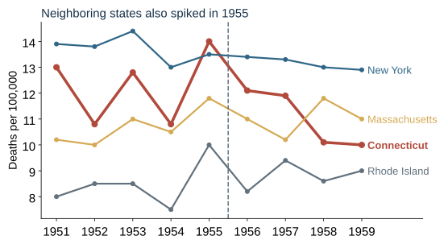{fig-alt="Traffic deaths per 100,000 in Connecticut, New York, Massachusetts, and Rhode Island, 1951 to 1959; several states spiked in 1955"}
:::
:::::

**The problem:** the crackdown happened **because** 1955 was a bad year. After an unusually bad year, the next is usually better anyway: **regression to the mean**. Neighbors also spiked in 1955 and fell in 1956.

::: source
Sources: Campbell and Ross (1968); data from the fastR2 R package, Traffic dataset (deaths and deaths per 100,000, 1951–1959).
:::

::: notes
Show the full series. Connecticut's deaths bounce around from year to year; 1955 is the high point. The crackdown was triggered by that high point, so treatment timing depended on the outcome. After an unusually high year, the next year is likely to be lower even with no intervention, because part of what made 1955 high was chance. That is regression to the mean, and it alone predicts a drop in 1956.

The right panel adds neighboring states that had no crackdown. Rhode Island and Massachusetts also spiked in 1955 and fell in 1956, which points to common causes such as weather or driving conditions rather than Connecticut's policy. Campbell and Ross concluded that the evidence for the crackdown's effect was weak, though Connecticut did continue to decline relative to its neighbors in later years.

The general lesson: when a treatment is triggered by an extreme value of the outcome, a before/after comparison is not as-if random. In DAG terms, the earlier outcome causes the treatment, which is reverse causation from Week 10.
:::

## Judging a natural experiment {#dunning-cube}

::::: two-column
::: column
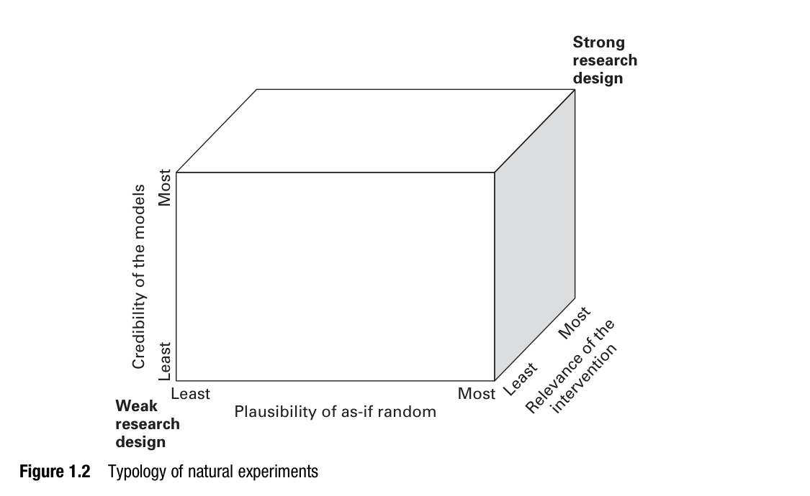{fig-alt="Dunning Figure 1.2: a cube with three dimensions: plausibility of as-if random, credibility of models, substantive relevance"}
:::

::: column
1.  **Plausibility of as-if random:** how convincing is the assignment story?
2.  **Credibility of the models:** does the analysis rest on simple comparisons or heavy modeling?
3.  **Substantive relevance:** does the answer speak to the question we care about?
:::
:::::

::: {.fragment .key-line}
Lotteries score high on (1) but often low on (3): lottery winnings are not earned income.
:::

::: source
Source: Dunning (2012), Figure 1.2, p. 31.
:::

::: notes
Present Dunning's three evaluative dimensions. A strong natural experiment has a convincing as-if random story, an analysis close to a simple comparison of means rather than an elaborate model, and an answer that bears on the substantive question.

These can trade off. Dunning's lottery example: lottery winnings are as random as it gets, but players are not representative of voters, and a windfall is not the same thing as earned income, so the result may not answer a question about how income shapes political attitudes. Regression discontinuity answers a question about people near the cutoff, which may or may not be the population of interest.

**Natural experiments are everywhere, but that doesn't make the question interesting.** Dunning's third dimension is his answer to critics like Deaton (2009), who argued that "the causes that Nature deigns to assign at random" are often substantively trivial and that the payoff is "a focus that is too narrow and too local." Once you start looking, as-if random variation is everywhere: birthdays, weather, alphabetical order, lotteries, sports scores, the day of the week a survey was answered. The risk is that the available variation picks the question, rather than the question picking the design. That is the drunk looking for his keys under the streetlight because that's where the light is. Examples to give:

-   **Rain on election day.** Weather is as-if random, and rain does lower turnout (Gomez, Hansford, and Krause 2007, "The Republicans Should Pray for Rain"). That's clean, but how much does "rain lowers turnout a little" tell us about why people vote? Rain has also been used as an instrument for so many different things (crop yields, economic growth, conflict, protest, turnout) that every one of those uses is a possible exclusion violation for the others. Mellon catalogued about 194 such channels in "Rain, Rain, Go Away."
-   **Ballot order.** Candidates are often listed alphabetically or by lottery, so being listed first is as-if random. Being first gives a small boost in low-information races. That's useful for election administrators, but narrow.
-   **Local sports wins before an election.** Healy, Malhotra, and Mo (2010) found that home college-football wins just before an election raised incumbent vote share. That's clever and as-if random, but later reanalysis (Fowler and Montagnes 2015) suggested the result may be a false positive. Clean designs on curiosity questions still need replication.
-   **Lotteries** (already on the slide). The assignment is perfectly random, but a windfall isn't earned income, and lottery players aren't voters in general.
-   **Month of birth and relative age.** Children born just after a school or sports-league cutoff are the oldest in their cohort. That's a clean RD, and it shows up in hockey rosters, school grades, and ADHD diagnoses. It's a real effect but a narrow one: the effect of being a few months older than your classmates, not the effect of maturity or ability in general.

Contrast these with designs where the variation and the question line up: the draft lottery for the effect of military service, Snow's water companies for whether cholera is waterborne, or Bol and colleagues' grant cutoff for the Matthew effect in science. There, the natural experiment answers a question people already cared about.

**Ask students:** Think of a question in your own research. Is there a natural experiment that answers *that* question? Or can you only find natural experiments that answer a nearby, easier question? Which would you rather publish?

Students will use these three dimensions to judge Bol and colleagues and Balcells and Torrats-Espinosa.
:::

## Two natural experiments up close {#cases .section-title}

[Part 5 of 5 · Two cases]{.kicker}

> A funding cutoff and a badly timed attack. What did each design solve, and what did it assume?

::: notes
Transition to the two cases. Bol and colleagues use a regression discontinuity around a grant-funding threshold. Balcells and Torrats-Espinosa compare survey respondents interviewed just before and just after terrorist attacks. For each, ask the same four questions: what is the naive comparison, what does the design solve, what does it assume, and how well does it check those assumptions?
:::

## Bol et al.: does winning a grant make you win more grants? {#bol-question}

The **Matthew effect**: “to everyone who has, more will be given.” Do early winners pull ahead because of **merit** or because of the **win itself**?

Since 2000, the Dutch Veni/Vidi/Vici program concentrated **€2.4 billion** in **3,660** applicants.

::: fragment
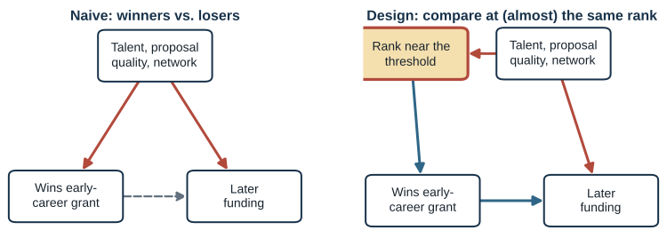{fig-alt="Naive DAG: talent and proposal quality cause both winning an early-career grant and later funding. Design DAG: rank near the threshold is conditioned on and determines winning"}
:::

::: source
Source: Bol, de Vaan, and van de Rijt (2018), *PNAS* 115(19): 4887–4890.
:::

::: notes
Introduce the theory. Robert Merton named the Matthew effect: recognition flows to those already recognized. In science funding, early winners go on to win more. The question is whether that happens because winners are better scientists or because winning itself, through status, money, or confidence, produces later success.

The naive comparison of grant winners and losers cannot separate these, because talent, proposal quality, and networks affect both the early grant and later funding. Bol and colleagues use the Netherlands' main personal-grant program. The early-career Veni grant is worth about 250,000 euros; later Vidi and Vici grants are larger. Since 2000 the program has concentrated about 2.4 billion euros in 3,660 applicants.

The design: reviewers score and rank applicants, and a budget sets the funding threshold. Applicants just above and just below the threshold had nearly identical evaluations, but only those above got the grant. Show the design DAG: conditioning on rank near the threshold cuts the confounding.
:::

## Near-winners and near-losers looked the same before {#bol-balance}

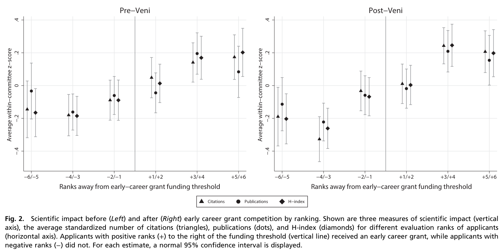{fig-alt="Bol et al. Figure 2: publications, citations, and h-index by rank around the funding threshold, before and after the competition; no jump at the threshold" width="88%"}

::: {.fragment .key-line}
No jump at the threshold in publications, citations, or h-index, **before or after** the grant.
:::

::: source
Source: Bol et al. (2018), Figure 2.
:::

::: notes
Show the balance check first. Bol and colleagues plot scientific productivity, publications, citations, and h-index, by rank relative to the threshold. Before the competition, there is no jump at the threshold: near-winners and near-losers were equally productive scientists. That supports the RD assumption that the threshold separates otherwise similar people.

The same figure shows no jump after the competition either. That matters for the mechanism: if winners went on to get more grants, it was not because they suddenly produced more or better science.
:::

## ...but their careers diverged {#bol-results}

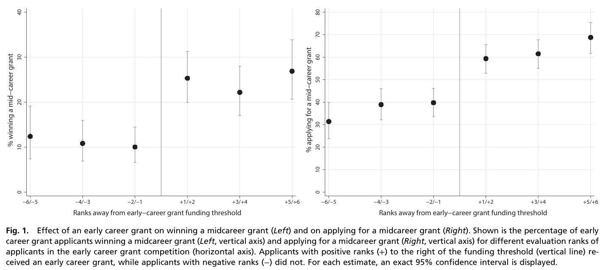{fig-alt="Bol et al. Figure 1: percent winning a mid-career grant (about 10 percent just below versus 26 percent just above) and percent applying (40 versus 59 percent) by rank around the threshold" width="92%"}

Won a mid-career grant: **10%** (near-losers) vs. **26%** (near-winners). Applied for one: **40%** vs. **59%**.

::: source
Source: Bol et al. (2018), Figure 1, pp. 4888–4889.
:::

::: notes
Read Figure 1. The horizontal axis is rank relative to the funding threshold; the vertical line is the threshold. Left panel: about 10 percent of applicants just below the threshold later won a mid-career Vidi grant, versus 26 percent just above it, about two and a half times as many. Right panel: 40 percent of near-losers applied for a Vidi, versus 59 percent of near-winners.

Point out what makes this an RD plot: the outcome is roughly flat on each side and jumps at the threshold. The jump, not the overall upward slope, is the causal effect of winning the early grant for applicants near the threshold.
:::

## The gap kept growing {#bol-cumulative}

::::: two-column
::: column
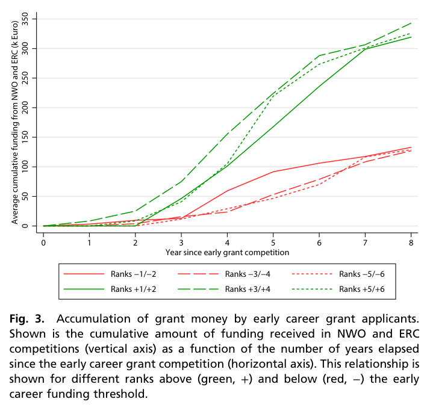{fig-alt="Bol et al. Figure 3: cumulative additional funding for near-winners versus near-losers over eight years"}
:::

::: column
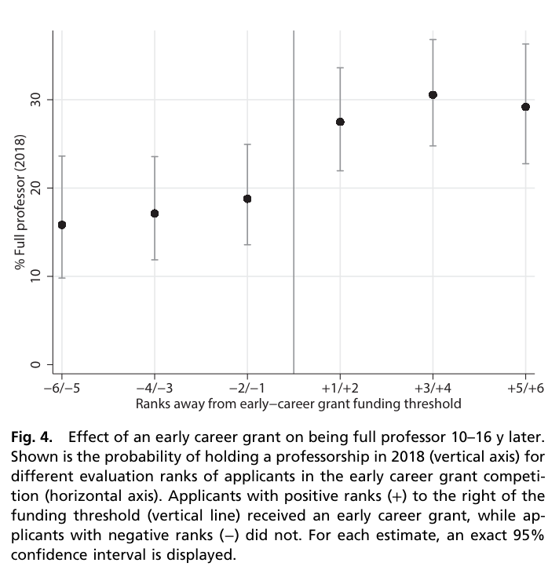{fig-alt="Bol et al. Figure 4: share who became full professors, 19 percent versus 28 percent"}
:::
:::::

Extra funding: about **€40,000** after 4 years, about **€180,000** after 8 (beyond the Veni itself). Full professor by 2018: **19%** vs. **28%**.

::: source
Source: Bol et al. (2018), Figures 3 and 4, p. 4889.
:::

::: notes
Show the accumulation. Beyond the Veni grant itself, near-winners received about 40,000 euros more in later funding after four years and about 180,000 euros more after eight years, more than twice as much as near-losers. The authors note that this 180,000 euros is about 40 percent of the funding difference between the best and worst applicants in the competition.

Careers diverged too: 28 percent of near-winners were full professors by 2018, 10 to 16 years after the competition, versus 19 percent of near-losers.

The interpretation: a nearly arbitrary early difference, a rank or two around a budget line, produced lasting inequality in funding and status.
:::

## Why did this happen? {#bol-why}

::: notes
Leave the slide blank and let students generate mechanisms. A rank or two around a budget line produced lasting gaps in funding and promotion. Why would winning one early grant lead to winning more later?

Push for specific mechanisms, each with its own arrow:

-   **Participation / discouragement:** near-losers stop applying.
-   **Status signal:** reviewers treat a past grant as evidence of quality.
-   **Resources:** the grant money itself buys staff, data, and publications that make later proposals stronger.
-   **Confidence or motivation:** winning makes people more ambitious.

Then ask: which of these could you check with the data the authors have? The next slide shows the two they examined.
:::

## Two mechanisms: participation and status {#bol-mechanism}

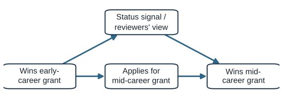{fig-alt="Winning an early-career grant leads to applying for a mid-career grant and to a status signal, both of which lead to winning a mid-career grant" width="62%"}

-   Near-losers **applied less** (40% vs. 59%).
-   Among those who applied, near-winners still won more (about **44%** vs. **25%**).

::: {.fragment .key-line}
Discouragement explains part of the gap. A status signal may explain the rest.
:::

::: source
Source: Bol et al. (2018); win rates among applicants calculated from Figure 1 (reading summary).
:::

::: notes
Turn to mechanisms. The abstract emphasizes participation: losing discouraged applicants from trying again. Figure 1's right panel shows the participation gap, 40 versus 59 percent.

But participation is not the whole story. Dividing the win rates by the application rates, among people who applied for a Vidi, near-winners won about 44 percent of the time and near-losers about 25 percent. That calculation comes from the reading summary, not the paper. So even among those who tried again, the early win helped, consistent with reviewers treating a past grant as a status signal.

Note the connection to Part 2: these are mediators of the effect of winning, and they are measured, not manipulated. The RD identifies the total effect of the early grant cleanly; the decomposition into participation and status is weaker evidence.
:::

## What the funding RD assumes {#bol-assumptions}

::: small-table
| Assumption | Why it might fail | Evidence |
|------------------------|------------------------|------------------------|
| Similar just above and below | committees might push favored applicants over the line | no jump in prior publications, citations, h-index |
| No sorting around the threshold | applicants can't choose their rank; committee can decide borderline cases | addressed indirectly; no density test reported |
| Losers didn't leave science | near-losers might exit, lowering their later funding mechanically | checked in the supplement (not in our PDF) |
| Local estimand | applies to applicants **near** the threshold | effect for the best or worst applicants unknown |
:::

::: notes
Run the assumptions checklist on Bol and colleagues. The balance figure supports the claim that near-winners and near-losers were similar. The main manipulation worry is not applicants sorting themselves, since they cannot choose their rank, but committees deciding borderline cases in ways related to future success. The paper addresses this only indirectly. A standard density test would say little here, because every rank is filled by construction.

The authors report checks that near-losers did not leave academia or the country, but those are in the supplementary information, which is not in the course PDF. And the estimate is local: it tells us what an early grant does for applicants near the threshold, not for the strongest or weakest applicants.

On Dunning's dimensions: high plausibility of as-if random near the threshold, simple and transparent analysis, and strong substantive relevance for science policy.
:::

## Balcells & Torrats-Espinosa: do terrorist attacks change elections? {#balcells-question}

Two questions: do attacks change whether people **vote**, and **whom** they vote for?

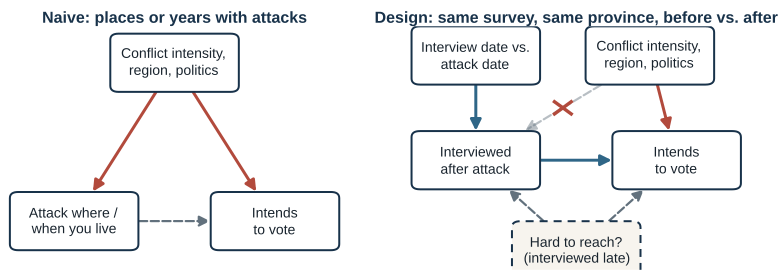{fig-alt="Naive DAG: conflict intensity causes both attacks and voting. Design DAG: interview date relative to attack date determines treatment within the same survey and province; the conflict arrow is cut; hard-to-reach respondents remain a threat" width="92%"}

::: source
Source: Balcells and Torrats-Espinosa (2018), *PNAS* 115(42): 10624–10629.
:::

::: notes
Introduce the question. Do terrorist attacks change democratic participation, and do they punish or reward the incumbent? Naive comparisons, across places or years with and without attacks, are confounded: attacks happen where and when conflict is intense and politics are polarized, which also affects voting.

The design uses timing. Spain's public-opinion institute, the CIS, surveys people over several days. The authors found eight attacks by ETA, the Basque separatist group, between 1989 and 1997 that happened while a CIS survey was in the field. Within the same survey and the same province, people interviewed just after an attack form the treatment group, and people interviewed just before form the control group. That cuts the confounding from conflict intensity and region, since those are the same for both groups.

The design DAG shows the remaining threat: if people interviewed later in the fieldwork period are different, for example harder to reach, then interview timing is not as-if random.
:::

## The design: eight attacks during survey fieldwork {#balcells-design}

-   **8** ETA attacks (1989–1997) during **7** CIS surveys
-   Compare respondents **within the same survey and province**, interviewed before vs. after
-   Windows of **±1, ±3, ±5 days**; respondents interviewed on the attack day dropped
-   Outcomes: would you vote “tomorrow”? would you vote for the **incumbent**?

::: {.fragment .key-line}
N = 3,810 (±1 day), 9,135 (±3), 11,848 (±5).
:::

::: source
Source: Balcells and Torrats-Espinosa (2018), pp. 10625, 10628; SI Table S1.
:::

::: notes
Walk through the details. The authors matched CIS fieldwork calendars against ETA attacks and kept the overlaps: eight attacks across seven surveys, five of them nationally representative. Treatment is being interviewed after the attack. Because interview times are not recorded, respondents interviewed on the day of the attack are dropped. The comparison uses windows of one, three, and five days on either side.

The model is a linear probability model with province-by-survey fixed effects, so every comparison is within the same survey and province, with controls for prior vote, gender, age, education, employment, and town size. Standard errors are clustered by the survey's sampling unit.

Outcomes: whether the respondent would vote if a general election were held tomorrow, and whether they would vote for the incumbent party.
:::

## People said they would vote, but not for anyone in particular {#balcells-results}

::::: two-column
::: column
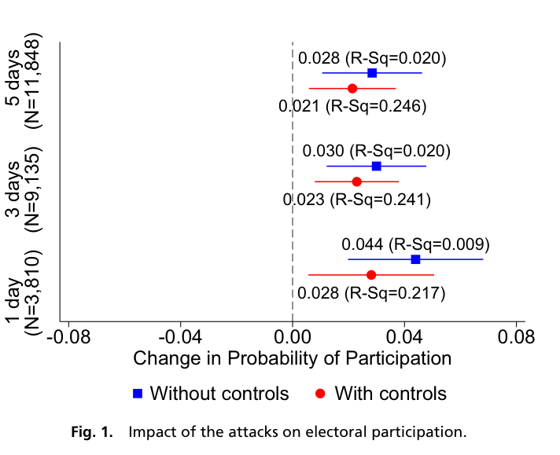{fig-alt="Balcells and Torrats-Espinosa Figure 1: effect of attacks on turnout intention at 1, 3, and 5 days, with and without controls"}

Turnout intention: **+2.8 pts** (±1 day, controls); +4.4 without.
:::

::: column
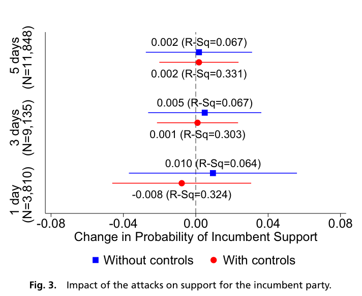{fig-alt="Balcells and Torrats-Espinosa Figure 3: no effect of attacks on incumbent support"}

Incumbent support: between **−0.8 and +1.0 pts**, never significant.
:::
:::::

::: source
Source: Balcells and Torrats-Espinosa (2018), Figures 1 and 3.
:::

::: notes
Present the main results. People interviewed after an attack were more likely to say they would vote: 2.8 percentage points within one day with controls, 4.4 without, and about 2 points at three and five days. All six estimates are positive and significant. Before attacks, about 89 percent already said they would vote, so 2.8 points cuts would-be abstention from about 11 to about 8 percent.

There is no change in whom people would vote for: estimates of incumbent support range from minus 0.8 to plus 1.0 points across all six specifications, and vote switching does not change either. The authors interpret this as a rally in democratic participation, not a punishment or reward for the government.
:::

## Who was activated? {#balcells-heterogeneity}

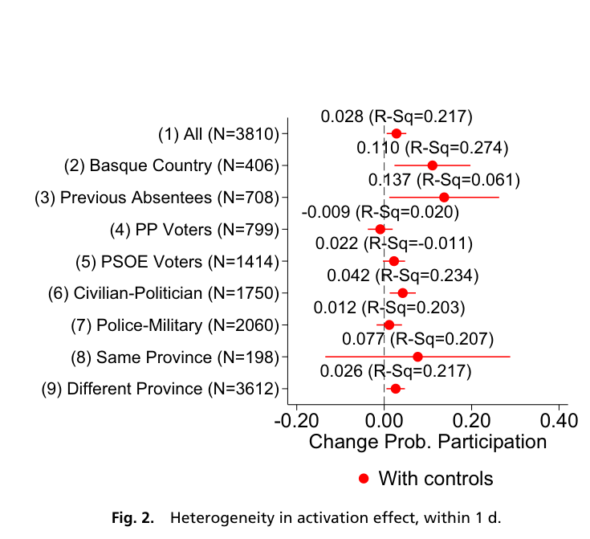{fig-alt="Balcells and Torrats-Espinosa Figure 2: heterogeneity in the turnout effect by subgroup within 1 day" width="70%"}

Prior abstainers **+13.7** (N = 708) · Basque residents **+11** (N = 406) · civilian or politician victims **+4.2** vs. police or military **+1.2**

::: source
Source: Balcells and Torrats-Espinosa (2018), Figure 2; SI Table S6.
:::

::: notes
Show the heterogeneity, and connect it to Part 3: these subgroup differences are moderation. The effect is largest among people who did not vote in the previous election, 13.7 points, and among residents of the Basque Country, 11 points. Attacks on civilians or politicians raised turnout intention by 4.2 points, attacks on police or military by 1.2, though that difference is significant only at p \< .10.

Add the caveats from the summary. The Basque estimate comes mostly from one attack in a regional survey with only 41 post-attack respondents in the one-day window. Among people who voted last time, about 80 percent of the sample, the effect is close to zero: the whole effect is among prior abstainers. And the subgroups are not randomized, so these are differences in effects across kinds of people, not effects of being Basque.
:::

## What the timing design assumes {#balcells-assumptions}

::: small-table
| Assumption | Why it might fail | Evidence |
|------------------------|------------------------|------------------------|
| Interview timing as-if random | harder-to-reach people interviewed later | balance table: joint test *p* = .18, but post-attack respondents **2 pts** less likely to be prior abstainers |
| No differential nonresponse | attacks change who agrees to answer | contact attempts and refusals similar (reported in prose only) |
| Controls are pre-treatment | “prior vote” is **recalled after** the attack | the 4.4 → 2.8 drop comes from this control |
| Nothing else changed that day | other news, other events | coverage tables; leave-one-attack-out estimates stay positive |
:::

::: {.fragment .key-line}
Robust to unobservables? Selection on unobservables would need to be **1.5–5.9×** as strong as on observables (Oster test).
:::

::: notes
Run the checklist. The central assumption is that whether someone was interviewed before or after the attack is unrelated to their likelihood of voting. The balance table mostly supports that, joint p = .18, but post-attack respondents were 2 points less likely to report having abstained in the last election, and in the one-day window the gap is larger. Fewer abstainers reached after attacks would inflate the raw estimate.

There is a subtle bad-control problem. The authors control for recalled prior vote, which is reported after the attack. If the attack changed how people remember or report past voting, controlling for it removes part of the true effect. The drop from 4.4 to 2.8 points comes entirely from this one control, so the true effect plausibly lies between them.

Other checks: contact attempts and refusals were similar before and after (described in prose only); leave-one-attack-out estimates all stay positive; and the Oster sensitivity test says unobservable selection would have to be 1.5 to 5.9 times as strong as observable selection to erase the effect. The paper runs no placebo-date test; the reading summary reports a quick placebo with no sign of a rising pre-trend.
:::

## Two designs compared {#cases-compared}

::: small-table
|   | Bol et al. | Balcells & Torrats-Espinosa |
|------------------------|------------------------|------------------------|
| Design | regression discontinuity | before vs. after an unexpected event |
| What assigns treatment | a rank relative to a budget line | the attack date relative to the interview date |
| Naive confounder cut | talent, proposal quality | conflict intensity, region, politics |
| Key assumption | applicants near the line are comparable | interview timing unrelated to voting |
| Main threat | committees deciding borderline cases | who is reachable after an attack |
| Estimand | effect for applicants near the threshold | short-run effect on stated intention |
:::

::: notes
Put the two cases side by side using the vocabulary of the day. Both cut an obvious confounder by exploiting how treatment happened to be assigned. Both rest on an assumption that can be partly checked, balance at the threshold or before and after the attack, and partly only argued. Both estimate something narrower than the broad question: the effect of an early grant for applicants near the threshold, and the effect of an attack on stated vote intention within days.

Ask students to score each on Dunning's three dimensions. Bol and colleagues likely score high on all three. Balcells and Torrats-Espinosa score high on plausibility within surveys, but stated intention a few days later is a long way from actual turnout at the next election, which matters for substantive relevance.
:::

## Exit question {#exit-question .section-title}

> Pick a question from your project that you could never randomize.
>
> What **lottery, cutoff, timing, or accident** could stand in for random assignment, and what would you have to assume?

::: notes
Collect exit responses. Good answers name a specific source of variation, such as a policy cutoff, the timing of a platform change or outage, a newspaper closure, or a random assignment of journalists to beats, and state the key assumption that would have to hold. Read several at the start of next week.
:::