## Where we left off {#where-we-left-off}

Last week: an experiment closes back doors **by design**. Correll randomized a résumé cue.

Still to do: **Craig & Richeson**, who went one step further and manipulated the **mechanism** itself.

::: {.fragment .key-line}
Today: finish that case, revisit mediation and moderation, then ask what to do when we **can't** randomize at all.
:::

::: notes
Open by reconnecting to Week 11. Students saw that randomization closes the back door from confounders into the treatment, and they worked through Correll, Benard, and Paik's motherhood-penalty experiment. The second case, Craig and Richeson, was not finished. It is worth finishing because it does something Correll did not: it manipulates the proposed mechanism, status threat, rather than only measuring it.

That makes a natural bridge to the rest of the day. Craig and Richeson set up a careful return to mediation (how an effect travels) and moderation (when or for whom it holds), with one new example of each. Then the session turns to the central methodological question for the second half: what can we do when the treatment we care about cannot be randomized at all? That is the job of natural experiments.
:::

## Today's route {#questions-for-today}

::: roadmap
| Part | Question |
|------|----------|
| 1 · Craig & Richeson | How do you manipulate a mechanism, not just measure it? |
| 2 · Mediation, again | Why do liberals drink lattes, and what can a survey say about *why*? |
| 3 · Moderation, again | When does a strong argument beat a famous source? |
| 4 · Natural experiments | When we can't randomize, what stands in for it, and what must we assume? |
| 5 · Two cases | What did a funding cutoff and a badly timed attack let researchers learn? |
:::

::: notes
Walk through the route. Part 1 finishes the Week 11 case. Parts 2 and 3 revisit mediation and moderation with two short readings: Mutz and Rao on liberals and lattes, and Petty, Cacioppo, and Goldman's classic involvement experiment. Part 4 builds a toolbox of natural experiments from Dunning and Grosz and colleagues, drawing each design as a naive DAG next to a design DAG and naming what each one has to assume. Part 5 goes deep on two cases: Bol and colleagues' regression discontinuity around a grant-funding threshold, and Balcells and Torrats-Espinosa's comparison of survey respondents interviewed just before and just after terrorist attacks.

Plan the break between Parts 3 and 4.
:::

## Craig & Richeson — majority-minority status threat {#case-craig-richeson .section-title}

[Part 1 of 5 · Finishing Week 11: does the racial shift push Whites right?]{.kicker}

> More local Black population share predicts more White Republican registration.

::: notes
**Talk track**

The second case asks how White Americans respond politically to information that the United States is becoming a majority-minority country. As before, we need to separate the broad social puzzle from the narrower effect the experiments can identify.

**Teaching detail**

Open today by finishing Week 11's second case: Craig and Richeson (2014, Psychological Science), "On the Precipice of a 'Majority-Minority' America," with the 2015 corrigendum.
:::

## Demographic change correlates with conservatism, but why? {#craig-richeson-puzzle}

Giles and Hertz (1994): Louisiana parish data, more local Black population share predicts more White Republican registration.

**Majority-minority** means no single racial or ethnic group exceeds 50% of the population; the national shift was then projected for 2042.

::: {.fragment .key-line}
Real-world correlation. What's actually driving it?
:::

::: source
Source: Giles and Hertz (1994), cited in Craig and Richeson (2014).
:::

::: notes
**Talk track**

Places experiencing demographic change have sometimes shown greater White conservatism, but a geographic correlation is compatible with many causal stories. The experiment begins by changing exposure to information rather than changing the population itself.

**Ask students**

What are two explanations for the geographic correlation other than status threat?

**Teaching detail**

This correlational finding motivates the whole paper. It's consistent with a racial-threat story, but it's also consistent with several other structures, which is exactly what the next slide gets students to generate themselves.
:::

## What could explain the parish correlation? {#craig-richeson-naive-draw}

Two boxes: **Racial composition** and **White conservatism**. What structures could produce Giles & Hertz's correlation?

::: {.fragment}
::: comparison
::: side
**Political feedback — sign unclear**

Earlier White racial politics could affect later composition through housing policy and migration—but this does not automatically predict the positive correlation.
:::

::: versus
or
:::

::: side
**Regional confounding**

Regional history—such as plantation agriculture and segregation—could shape both local Black population share and White racial politics.
:::
:::
:::

::: notes
**Talk track**

Before accepting the threat explanation, generate alternatives, but do not present them as equally strong. Political feedback says earlier White politics may help produce later population patterns, although its direction is ambiguous. Regional confounding says a third variable helps produce both the population pattern and White politics.

**Ask students**

How might earlier racial politics influence later migration? Would exclusion and White flight move Black population share in the same direction? What historical feature could shape both current Black population share and White Republican alignment?

**Teaching detail**

Start by being precise about the variables in the Giles and Hertz correlation. Racial composition is an observed parish population share, not a respondent's perception or report. Therefore political feedback cannot simply mean “conservatives notice demographic change more.” It requires an actual process through which earlier White racial politics affects later migration or residence patterns.

**Political feedback, step by step:**

1. A parish begins with more racially conservative White politics or leadership.
2. Housing enforcement, zoning, public investment, school policy, and the broader political climate can influence who moves in, who leaves, and who remains.
3. Exclusionary policy could reduce Black in-migration or encourage Black out-migration, lowering Black population share. White flight could instead shrink the White denominator and raise Black population share.
4. Earlier politics can therefore make later composition endogenous, but the sign is not determined without a more specific mechanism.

The arrow is therefore earlier White racial politics → later racial composition, but this is not a self-sufficient explanation for the observed positive correlation. A researcher would need to specify and document a mechanism—such as White flight—that moves the variables in the observed direction. Present this as a possible feedback problem, not as an equally clean rival theory.

**Regional confounding, step by step:**

1. Louisiana parishes differ in historical plantation agriculture, slavery, segregation, economic development, rurality, and migration patterns.
2. Those historical processes help determine where Black communities are concentrated today.
3. The same processes can also shape racial polarization, party realignment, economic interests, and White Republican registration.
4. Local Black population share and White conservatism can therefore move together even if neither directly causes the other.

Use plantation and segregation history as the clearest illustrative confounder because it temporally precedes both contemporary population composition and contemporary registration. Economy or urbanicity can also be proposed, but students must explain both arrows rather than merely name a variable.

Finish by contrasting the structures carefully. Political feedback points the arrow from earlier politics toward later composition but does not determine its sign. Confounding adds a prior common cause and is the cleaner rival explanation for the positive parish correlation. The authors' theory proposes local composition → status threat → White conservatism. Cross-sectional parish data cannot establish which process generated the association.
:::

## One correlation does not make all three stories equally strong {#craig-richeson-candidates}

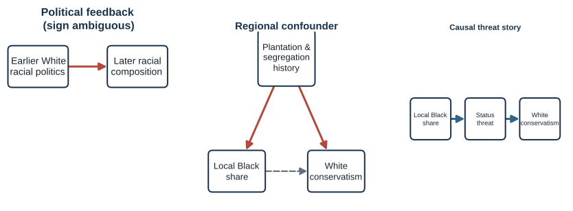{fig-alt="Three candidate structures. First, earlier White racial politics may feed back into later racial composition, although the sign is ambiguous. Second, regional plantation and segregation history shapes both local Black population share and White conservatism. Third, higher local Black population share increases status threat, which increases White conservatism." width="96%"}

::: {.fragment .key-line}
Political feedback makes composition **endogenous**, but regional history is the cleaner alternative explanation for the positive correlation.
:::

::: notes
**Talk track**

Read the diagrams from left to right. The first adds a possible feedback arrow from earlier politics to later composition, but its sign is ambiguous. The second adds a common cause that can generate the positive association. The third is the authors' threat mechanism. The correlation alone cannot separate them, but that does not make the stories equally well specified.

**Ask students**

Which rival story does random assignment eliminate for the message-exposure effect? Does that mean the experiment identifies the effect of actually changing a parish's racial composition?

**Teaching detail**

Walk through each panel explicitly.

- **Political feedback:** earlier White racial politics may help shape later composition through policy and residential sorting. Exclusion may lower Black share, whereas White flight may raise it, so the arrow alone does not predict the observed sign.
- **Regional confounding:** plantation and segregation history is upstream of both current Black population share and current White conservatism. The open fork creates an association without requiring a causal effect of composition.
- **Causal threat story:** higher local Black population share raises perceived group-status threat, which shifts White politics in a conservative direction.

Then explain exactly what the experiments do and do not solve. Randomly assigning a demographic-shift message makes message exposure independent of prior ideology, residential sorting, and regional history in expectation. Those variables cannot explain why one experimental group received the message and the other did not. That identifies the causal effect of **message exposure** under the study conditions.

But the experiment does not manipulate a parish's actual racial composition. It therefore does not prove that the third panel explains the original Louisiana correlation, rule out long-run political feedback, or estimate what decades of demographic change do to voting. It tests a narrower implication of the threat theory: making a projected status shift salient can move attitudes. The next slide makes that estimand change explicit.
:::

## The experiments answer a narrower question {#craig-richeson-estimand}

::: comparison
::: side
**Observational puzzle**

What is the effect of actually living through demographic change on political behavior?
:::

::: versus
≠
:::

::: side
**Experimental question**

What is the short-term effect of making the projected shift **salient** to White respondents?
:::
:::

::: {.fragment .key-line}
The studies randomize exposure to a message—not racial composition, long-term media exposure, or voting behavior.
:::

::: notes
**Talk track**

Keep the estimand narrow. These studies identify the short-term attitudinal effect of seeing a particular message. They do not identify the effect of living through decades of demographic change or repeated partisan coverage on voting behavior.

**Ask students**

What is the treatment here: demographic change itself, or exposure to a message about it?

**Teaching detail**

Make the estimand switch as explicit as it was in Correll last week. The parish-level correlation motivates the theory, but the experiments manipulate information about demographic change. Their internally valid claim concerns the short-term attitudinal effect of that exposure under the specific survey conditions. They do not identify the effect of a community's actual demographic composition, repeated partisan media coverage, or years of social change on real voting behavior.
:::

## Status threat could connect the message to conservatism {#motivated-cognition}

Threat and uncertainty → conservatism (Jost et al. 2003), mostly studied with **physical/mortality** threats (post-9/11, terrorism).

::: {.fragment .key-line}
Craig & Richeson's extension: a slow, abstract, **decades-out social status** threat.
:::

::: source
Source: Jost, Glaser, Kruglanski, and Sulloway (2003); Bonanno and Jost (2006).
:::

::: notes
**Talk track**

The proposed chain is that a message about losing numerical majority status creates group-status threat, which then shifts political attitudes in a conservative direction. The mechanism is social and symbolic rather than an immediate physical threat.

**Teaching detail**

The motivated-cognition literature mostly tested mortality salience and terrorism threat. The theoretical contribution here is extending the same logic to a specifically social, zero-sum status threat — the perception that a rising minority share mechanically lowers the in-group's own relative standing — with no proximate physical danger and a multi-decade time horizon.
:::

## What control isolates the majority-status implication? {#craig-richeson-design-1}

You want to test whether it's specifically the *status* framing doing the work, not just any news about demographic change. What's your control condition?

::: notes
**Talk track**

A useful control must contain racial-composition information without implying that White majority status is disappearing. That lets the design isolate the status meaning of the message rather than simple exposure to racial news.

**Ask students**

What should the control condition contain, and what should it deliberately omit?

**Teaching detail**

Let pairs propose a control before revealing. The actual Study 1 control: a survey form asking whether respondents had heard that Hispanics and Blacks were roughly equal in number nationally — racial-composition news, but without the majority-status framing. This holds "exposure to racial-composition news in general" constant while varying whether the shift implies a change in who is the numerical majority.
:::

## An old Pew split becomes an experiment {#craig-richeson-study1-design}

Pew's *News Interest Index* randomly assigned White political independents (*n* = 369) to two survey forms:

| Racial-shift condition | Racial-composition control |
|---|---|
| “Have you heard California is now majority-minority?” | “Have you heard Hispanics and Blacks are now similar in number nationally?” |

**Outcomes:** Republican versus Democratic party lean and general political ideology.

::: {.fragment .key-line}
Researcher-caused, statistical solution — repurposed from an existing dataset, not purpose-built.
:::

::: source
Source: Craig and Richeson (2014), p. 1191; Pew Research Center (2001).
:::

::: notes
**Talk track**

Study 1 repurposes an existing randomized split in a Pew survey. White independents saw either the majority-minority question or a racial-composition control, and the authors examined party leaning and ideology.

**Teaching detail**

Place this in Druckman's typology: cell 1, researcher-caused and statistical-solution, but opportunistic rather than purpose-built—the randomization already existed in Pew's survey design, and the authors found a use for it years later. The control holds exposure to racial-composition news roughly constant while removing the change-in-majority-status implication. Explain the restriction to political independents: the outcome is party leaning, so committed partisans have less room to move and are less informative about a short-term shift.
:::

## The corrigendum weakens Study 1 {#corrigendum-error}

A 2015 corrigendum corrected a **probability-weighting error** in Studies 1 and 2 — frequency weights were mishandled as probability weights in the statistical software.

::: {.fragment}
- National party lean: *p* = .081
- General ideology: no effect
- West subsample: *n* = 49, *p* = .063
:::

::: {.fragment .key-line}
The corrected Study 1 evidence is inconclusive. Later studies must carry the argument.
:::

::: source
Source: Craig and Richeson (2015), *Psychological Science*, 26(6), 950–952.
:::

::: notes
**Talk track**

The corrigendum changes how strongly we should describe Study 1. After the weighting error was corrected, the national party-lean result was no longer conventionally significant, ideology did not move, and the West estimate remained imprecise.

**Ask students**

After the correction, what language is justified: strong evidence, suggestive evidence, or no information at all?

**Teaching detail**

Use this as a methods lesson and calibrate the evidence at the same time. This kind of weighting error is a real pitfall with complex survey weights, and a public corrigendum—rather than silence—is the correction system working. But transparency does not restore the original result: the corrected national estimate is inconclusive, general ideology did not move, and the larger West estimate is based on 49 respondents and also falls short of the conventional threshold. The paper's argument must therefore rest on convergence with Studies 2–3, not a decisive Study 1.
:::

## The corrigendum, part two: what changed {#corrigendum-numbers visibility="hidden"}

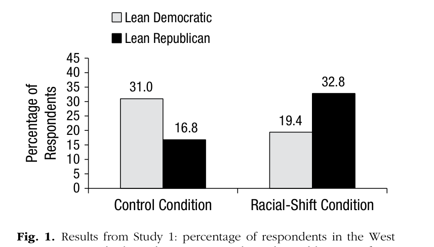{width="70%"}

::: {.fragment .key-line}
Corrected evidence is weak: national party lean *p* = .081; West subsample *p* = .063; general ideology did not change.
:::

::: source
Source: Craig and Richeson (2014/2015 corrigendum), Figure 1.
:::

::: notes
The flagship Study 1 result shrank from conventionally significant to inconclusive after correction. The West estimate is larger but comes from only 49 respondents and also misses the conventional threshold; treat it as exploratory rather than a rescue of the national result. Self-reported general ideology never moved in Study 1. Ask how much this should downgrade confidence in the whole program, then explain that later studies—not Study 1 alone—must carry the substantive conclusion.
:::

## What does Study 1 still leave unresolved? {#craig-richeson-critique-1}

Before Study 2: what does Study 1 *not* establish yet?

::: {.fragment}
- The corrected party-lean evidence is inconclusive, and ideology did not move.
- No mechanism was measured.
- Outcomes were self-reported attitudes, not behavior.
- One opportunistic dataset cannot establish robustness across treatments and samples.
:::

::: notes
**Talk track**

Study 1 offers a randomized contrast, but it has weak corrected evidence and no direct test of the proposed mechanism. It also relies on self-reported attitudes from a secondary dataset not designed around the full theory.

**Ask students**

What part of the causal chain has not been measured or manipulated yet?

**Teaching detail**

Push toward: Study 1 has a measured outcome (party lean, ideology) but no mediator at all — no test of *why* the shift would move conservatism; it's a single secondary dataset; and it measures self-reported party lean, not any behavior. All three motivate Study 2's design, which we see next.
:::

## Study 2 builds the experiment the theory needed {#craig-richeson-study2-design}

National probability-based online sample: *N* = 620 overall; **415 White respondents** in the focal analysis.

| Racial-shift treatment | Societal-change control |
|---|---|
| Census press release: racial minorities projected to become a majority by 2042 | Press release about increasing geographic mobility |

**Outcomes:** conservative endorsement of race-related and race-neutral policies.

**Candidate mediators:** group-status threat, system threat, system justification, and uncertainty.

::: notes
**Talk track**

Study 2 is purpose-built. It compares a racial-shift press release with a geographic-mobility control, measures both race-related and race-neutral policy attitudes, and measures several possible psychological mediators.

**Teaching detail**

This is the design information missing from the earlier version. The control matches the broad form of a press release about social change but removes racial content. The focal policy outcomes include three race-related items and two race-neutral items, allowing the authors to ask whether the response is targeted or ideologically broader. The reliability of the two short subscales is modest, which belongs in the later critique.
:::

## Study 2: policy attitudes shifted, but not every item did {#craig-richeson-study2}

::: small-table
| Outcome index | Corrected result |
|---|---|
| Overall conservative policy endorsement | Shifted conservative (*p* = .011) |
| Race-neutral policies | Shifted conservative (*p* = .025) |
| Race-related policies | Borderline (*p* = .052) |
| Immigration and citizenship items | No reliable individual-item effect |
:::

::: {.fragment .key-line}
Only **group-status threat** changed by condition and carried a detectable indirect effect.
:::

::: source
Source: Craig and Richeson (2014), pp. 1192–1194, Table 2.
:::

::: notes
**Talk track**

The combined policy index moved in the conservative direction, but the item-level pattern is uneven. Only group-status threat responded as the theory predicted and showed a detectable indirect association. That is supportive, not conclusive, mechanism evidence.

**Ask students**

Which findings support the theory, and which findings should make us cautious?

**Teaching detail**

Four candidate mediators were measured, but only group-status threat tracked the manipulation and produced bootstrapped indirect-effect intervals excluding zero. That narrows the theoretical story beyond generic anxiety or uncertainty. Do not overstate it: the race-related index was borderline after correction, and the immigration and citizenship items—the most obvious demographic-shift policies—did not reliably move. The strongest corrected pattern is the broader shift in the combined and race-neutral indices.

This is evidence consistent with mediation, not a causal decomposition. The next slide explains why: randomizing the upstream article does not randomize the relationship between measured threat and policy attitudes.
:::

## Measuring threat cannot prove that it carries the effect {#craig-richeson-mediator-warning}

Controlling for or analyzing a *measured* mediator can be biased even in a randomized experiment — unmeasured confounding between the mediator and the outcome is still possible.

::: {.fragment .key-line}
What would fix it?
:::

::: source
Source: Rohrer (2018), p. 38 (Week 10); Druckman (2023), pp. 40–42 (Week 11).
:::

::: notes
**Talk track**

Measured mediation cannot rule out a common cause of reported threat and policy attitudes. To make a stronger mechanism claim, the researchers need an intervention that changes the status implication while keeping the demographic information itself constant.

**Ask students**

What design would be stronger than measuring threat after the message?

**Teaching detail**

Direct callback, now cashed out against a real case. Study 2 cannot, on its own, rule out some unmeasured variable affecting both perceived status threat and policy attitudes. Ask students what would actually fix this before revealing Studies 3a/3b — the right answer is to manipulate the mediator directly, not just measure it.
:::

## How would you change threat while holding information constant? {#craig-richeson-design-2}

You need to manipulate the **status implication** while holding the demographic information constant. What's your third condition?

::: notes
**Talk track**

The design problem is to preserve the fact of demographic change but remove its implication of status loss. The added reassurance paragraph is the paper’s solution: it says Whites’ relative economic standing is expected to remain stable.

**Ask students**

How could you reduce status threat without removing the demographic forecast?

**Teaching detail**

Give pairs a few minutes before revealing. The actual design: an identical racial-shift article, plus one added paragraph stating that Whites' relative societal status (income, wealth) is expected to remain stable despite the demographic shift. If students propose something structurally similar—holding the fact constant while varying its status implication—they have derived the paper's methodological high point themselves.
:::

## Reassurance changes the status implication {#craig-richeson-3ab-design}

White U.S. MTurk participants: Study 3a *n* = 180; Study 3b *n* = 198.

| Control | Status-threat | Assuaged-threat |
|---|---|---|
| Geographic-mobility article | Racial-shift article | **Same racial-shift article** + Whites' relative status will remain stable |

**3a outcomes:** ideology plus race-related and race-neutral policies  
**3b outcomes:** ideology plus race-neutral policies only

::: {.fragment}
**Manipulation check:** perceived threat was higher in status-threat than in both other conditions; control and assuaged-threat did not differ.
:::

::: {.fragment .key-line}
The added paragraph is an experimental lever on the proposed mediator—not literal assignment of experienced threat.
:::

::: source
Source: Craig and Richeson (2014), pp. 1194–1195.
:::

::: notes
**Talk track**

The status-threat and assuaged-threat conditions contain the same demographic forecast. What changes is the forecast’s implication for hierarchy. The manipulation check then asks whether that wording actually changes perceived threat.

**Teaching detail**

The samples were heavily male (89% in 3a and 84% in 3b) and relatively young, a limitation to return to explicitly. The three-condition design holds the demographic information constant between status-threat and assuaged-threat while varying its implication for hierarchy. Manipulation checks show the status-threat condition raised perceived threat relative to both other conditions, while control and assuaged-threat did not differ. This supports the intended treatment contrast without claiming threat itself was perfectly assigned.
:::

## The assuaging paragraph usually eliminates the shift {#craig-richeson-table3}

::: small-table
| Result | Study 3a | Study 3b |
|---|---|---|
| Status-threat vs. control | More conservative policies and ideology | More conservative ideology; policy contrast marginal (*p* = .066) |
| Status-threat vs. assuaged | More conservative policies and ideology | More conservative policies and ideology |
| Control vs. assuaged | No detectable difference | No detectable difference |
:::

::: {.fragment .key-line}
The replicated ideology pattern is strongest; the Study 3b policy comparison with control is weaker.
:::

::: source
Source: Craig and Richeson (2014), Table 3.
:::

::: notes
**Talk track**

The key comparison is between the same demographic message with and without reassurance. Study 3a shows the cleanest elimination pattern. Study 3b replicates the ideology result, while the policy comparison with the control is weaker.

**Ask students**

Which comparison is the cleanest test of the proposed mechanism?

**Teaching detail**

This is the pattern supporting the mechanism: the same demographic information produces different outcomes when its status implication changes. Keep the strength of evidence calibrated. Study 3a supports the full elimination pattern for policy and ideology. Study 3b cleanly replicates ideology and distinguishes status-threat from assuaged-threat, but the policy contrast between status-threat and control is only marginal.
:::

## The reassurance condition weakens one link in the chain {#craig-richeson-full-dag}

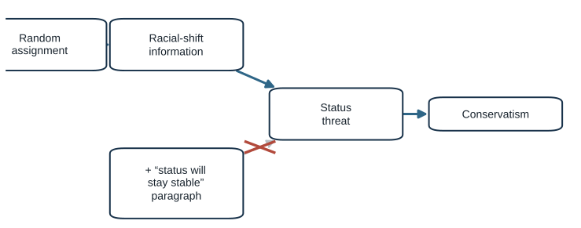{fig-alt="Random assignment causes racial-shift information, which causes status threat, which causes conservatism; the assuaged-threat paragraph cuts the arrow from information to threat" width="92%"}

::: notes
**Talk track**

In the diagram, reassurance is intended to weaken the link from demographic information to status threat. That is stronger than simply measuring threat, although the interpretation still depends on reassurance changing only the construct the theory names.

**Ask students**

What must be true about the reassurance paragraph for this to identify the threat mechanism?

**Teaching detail**

Draw this live alongside the image. The assuaged-threat condition is designed to weaken the arrow from information to threat while leaving the demographic information constant. This is stronger evidence for the proposed mechanism than measured mediation alone, but it still depends on the construct-validity claim that the added reassurance changes status threat without introducing some other consequential message.
:::

## The mechanism evidence is stronger, but not definitive {#craig-richeson-critique-2}

The mechanism experiment strengthens the claim, but it still leaves open:

::: {.fragment}
- Brief self-reported attitude changes are not voting or durable ideological realignment.
- Most corrected effects are small to modest, not wholesale partisan conversion.
- Studies 3a/3b are heavily male, young MTurk samples.
- Immigration and citizenship attitudes did not reliably move in Study 2.
- The reassurance paragraph may change more than status threat alone.
- Repeated, partisan real-world coverage may operate differently from one press release.
:::

::: notes
**Talk track**

The mechanism evidence is better, but several limits remain: brief self-reports are not durable behavior, some policy items do not move, the samples provide limited coverage, and reassurance may communicate more than reduced status threat.

**Ask students**

Which limitation concerns internal validity, which concerns construct validity, and which concerns generalization?

**Teaching detail**

Ask first, then reveal. Immigration attitudes specifically did not move significantly, which sits awkwardly with a clean race-status story given immigration is arguably the policy most proximate to the manipulation. The MTurk samples provide poor coverage of women. The stimuli are brief compared with repeated political-media exposure, all outcomes are self-reports, and divergent patterns for Black and Latino respondents sit outside the focal White-sample theory. The assuaging paragraph also bundles status reassurance with explicit information about continued income and wealth hierarchy, so its exclusion restriction is arguable rather than automatic.
:::

## What did each manipulation actually identify? {#craig-richeson-bridge-synthesis}

What did Correll's randomization close? What did Craig & Richeson's *mechanism manipulation* address that measured mediation could not?

::: notes
**Talk track**

Put the two papers next to each other. Correll randomizes the cue and measures the mechanism. Craig and Richeson randomize the message and then alter its status implication. Each intervention supports a different level of causal claim.

**Ask students**

What did Correll randomize? What did Craig and Richeson randomize? Which paper has the stronger mechanism test?

**Teaching detail**

Pairs discuss for a minute before we turn to mediation. Correll randomized the parental-status cue, closing the back door from actual qualifications into the assigned cue. Craig and Richeson randomized the upstream message, then added a treatment designed to manipulate the proposed mediator while holding demographic information fixed. That is stronger evidence about mechanism than Correll's measured competence/commitment mediation, without pretending experienced threat itself was assigned perfectly.
:::

## Mediation and moderation ask different questions {#med-mod .section-title}

[Part 2 of 5 · Mediation, again]{.kicker}

> Mediation asks **how** an effect travels. Moderation asks **when, or for whom**, it holds.

::: notes
Transition from Craig and Richeson. Their Studies 3a and 3b manipulated the proposed mediator, status threat, while holding the demographic information fixed. That is the strongest kind of mediation evidence. Most mediation claims in the literature rest on something weaker: measuring a candidate mechanism and watching what happens when it is added to a regression. Mutz and Rao's latte paper is a clear, short example of that weaker approach, so it is a good place to ask what measured mediation can and cannot show.
:::

## Mediation: how does the effect travel? {#mediation-recap}

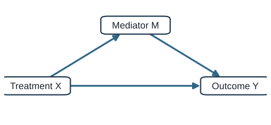{fig-alt="Treatment X causes mediator M, which causes outcome Y; X also causes Y directly" width="52%"}

- **Total effect:** every causal path from X to Y
- **Indirect effect:** the part that runs through M
- **Direct effect:** the part that does not

::: {.fragment .key-line}
Craig & Richeson **manipulated** M. Most studies only **measure** it.
:::

::: notes
Restate the three quantities. The total effect is everything X does to Y. The indirect effect is the part that runs through the mediator. The direct effect is whatever remains.

Then name the two ways to get evidence about M. Craig and Richeson manipulated the mechanism: the assuaging paragraph lowered status threat while holding the demographic message constant, and the conservative shift largely disappeared. The common alternative is to measure M and add it to a regression, hoping that the shrinkage of X's coefficient reveals the indirect effect. Rohrer warned in Week 10 that this works only if nothing else affects both M and Y. The latte paper shows what that approach looks like in practice.
:::

## Do liberals really drink more lattes? {#latte-puzzle}

::: two-column
::: column
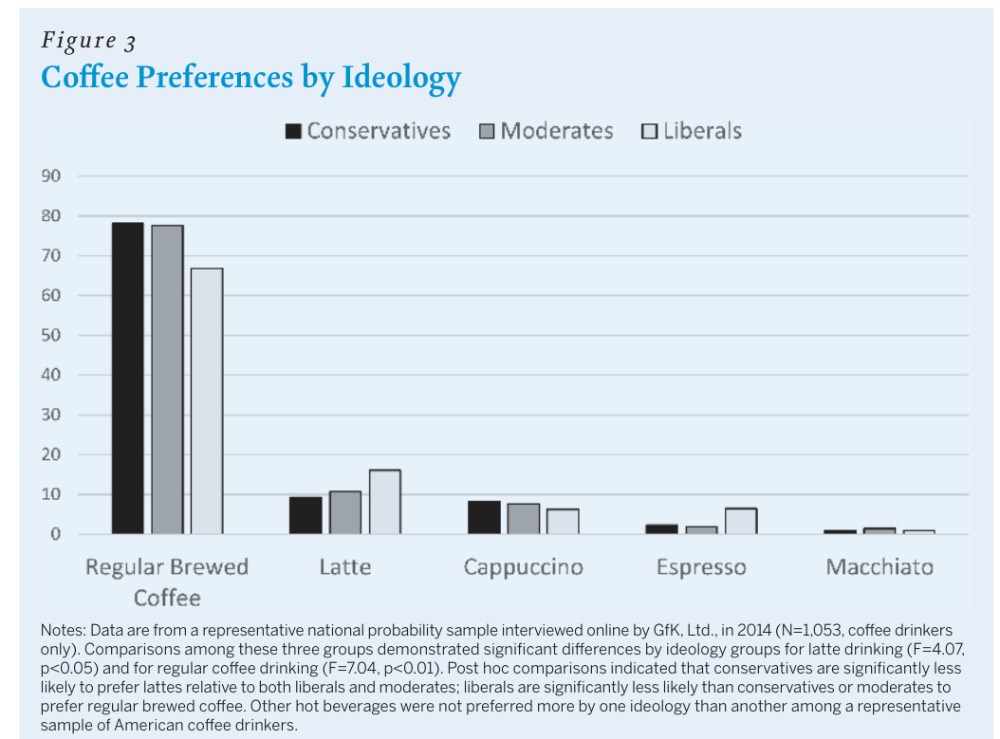{fig-alt="Mutz and Rao Figure 3: coffee drink preferences by ideology"}
:::

::: column
A national probability sample, **2014** (GfK). Coffee drinkers only: **N = 1,059**.

"Which drink would you order at a coffee shop?"

Prefer a latte: liberals **16%**, moderates **~11%**, conservatives **9%**.

::: {.fragment .key-line}
The stereotype is real. **Why** does it hold?
:::
:::
:::

::: source
Source: Mutz and Rao (2018), *PS: Political Science & Politics* 51(4), Figure 3.
:::

::: notes
Introduce the puzzle. The phrase “latte liberal” is a political insult, used since at least the 2004 campaign. Mutz and Rao first check whether the stereotype holds. They used a national probability-based online panel fielded by GfK in 2014. Of more than 1,500 respondents, about 72 percent drink coffee, which gives 1,059 cases. Respondents chose the drink they would order at a coffee shop, and the outcome is coded 1 for a latte.

The difference is real but small in absolute terms: 16 percent of liberals, about 11 percent of moderates, and 9 percent of conservatives prefer lattes. Ideology is measured on a 7-point scale, and in a probit model it significantly predicts latte preference.

Ask students for explanations before showing the authors' list. Typical answers: liberals live in cities with more coffee shops, liberals are richer, women are more liberal and like milk drinks, and liberals like things that seem foreign or European.
:::

## Four candidate explanations {#latte-four}

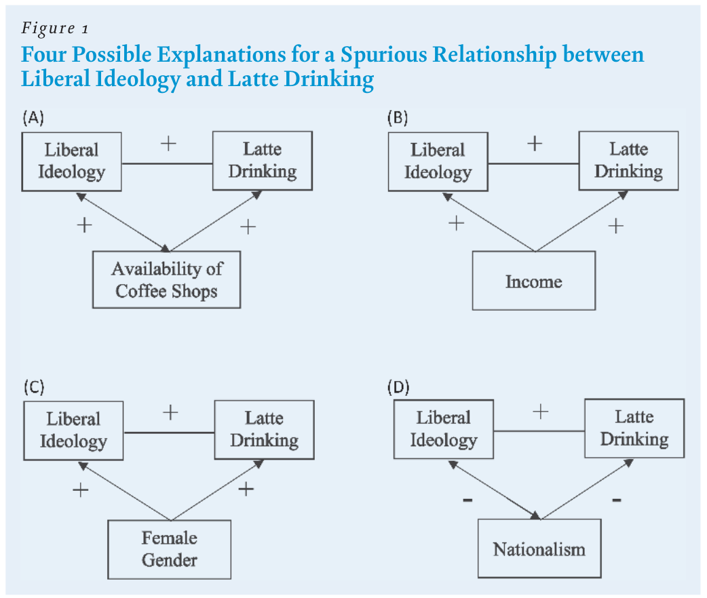{fig-alt="Mutz and Rao Figure 1: four possible explanations for a spurious relationship between liberal ideology and latte drinking: coffee shop availability, income, female gender, nationalism" width="80%"}

::: {.fragment .key-line}
The authors call every one of these a reason the link might be **spurious**. Are they all the same kind of variable?
:::

::: source
Source: Mutz and Rao (2018), Figure 1.
:::

::: notes
Show the authors' Figure 1. They test four third variables: the availability of coffee shops near the respondent, income, gender, and nationalism. The figure's title calls each one an explanation for a spurious relationship, which is confounder language.

Look closely at the arrows. In panels B and C, income and gender point into both ideology and latte drinking, a clean confounder. In panels A and D, the arrow between ideology and the third variable has heads at both ends. The authors leave the direction open. That ambiguity matters, because if ideology causes the third variable, it is a mediator, not a confounder. Ask students to sort the four before the next slide.
:::

## Which are confounders and which are mediators? {#latte-roles}

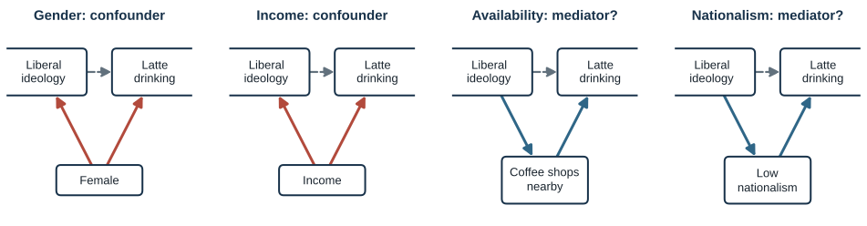{fig-alt="Four DAGs: gender and income as confounders pointing into both ideology and latte drinking; coffee-shop availability and low nationalism as possible mediators on a path from ideology to lattes"}

::: {.fragment .key-line}
Same regression, different meaning. Controlling for a **confounder** removes bias. Controlling for a **mediator** removes part of the effect.
:::

::: notes
Classify each candidate.

Gender: being female plausibly affects both ideology and drink preference, and nothing about ideology changes gender. A confounder.

Income: income could shape both, though the direction is messy, since higher income usually goes with more conservative voting. Still a pre-existing common cause, so a confounder.

Availability: liberals may choose to live in dense urban areas, where coffee shops are common. Then ideology causes location, which causes access: a mediator. But reverse arrows are also plausible: coffee shops open where demand for lattes exists.

Nationalism: if liberal ideology lowers national-superiority attitudes, and those attitudes make people avoid foreign-seeming products, nationalism is a mediator. The authors' own wording of this hypothesis, liberals have lower nationalism, “thus leading them” to lattes, is a mediation chain.

The punchline: the regression is the same whether the added variable is a confounder or a mediator. Its interpretation is not.
:::

## What happens to the ideology coefficient? {#latte-table}

::: small-table
| Model | Variable added | Ideology coefficient (SE) | N |
|---|---|:-:|:-:|
| Baseline | none | **0.08 (0.03)** \* | 1,059 |
| A | Starbucks in ZIP code: 0.09 (0.03) \* | **0.08 (0.03)** \* | 1,059 |
| B | Income: 0.05 (0.01) \*\*\* | **0.08** \* | 1,059 |
| C | Female: 0.26 (0.10) \* | **0.08 (0.03)** \* | 1,059 |
| D | Nationalism: −0.38 (0.09) \*\*\* | **0.01 (0.04)**, n.s. | 896 |
| All four | all of the above | **0.01 (0.04)**, n.s. | 896 |
:::

::: {.fragment .key-line}
Only nationalism absorbs the ideology gap. Authors: nationalism “most parsimoniously explain[s] this relationship.”
:::

::: source
Source: Mutz and Rao (2018), Table 1 (probit models); quotation p. 766.
:::

::: notes
Walk through Table 1. Ideology's probit coefficient is 0.08 in the baseline model. Adding coffee-shop availability (the number of Starbucks in the respondent's ZIP code), income, or gender leaves it at 0.08: each of those variables predicts latte preference, but none explains the ideology gap. Adding nationalism, a three-item national-superiority scale (alpha = .77), drops the ideology coefficient to 0.01, no longer significant, and nationalism itself is a strong negative predictor. The model with all four looks the same.

The authors' conclusion: “nationalistic attitudes toward the superiority of one's country, and, by implication, its products, most parsimoniously explain this relationship.” In the discussion they go further: “Conservatives shun lattes because they sound foreign.”

One printed standard error for model B (0.06) is probably a typo for 0.03, since the coefficient is still starred. Leave it off the slide.
:::

## Nationalism explains the gap. What kind of variable is it? {#latte-nationalism}

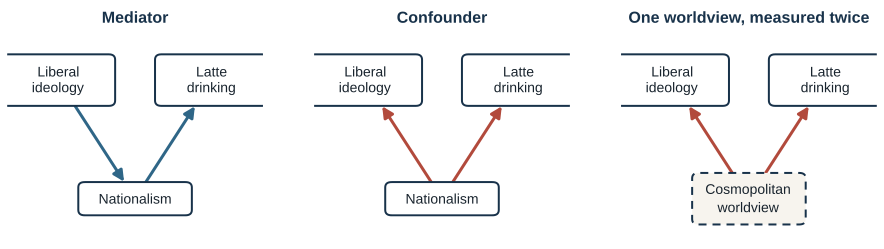{fig-alt="Three DAGs: nationalism as a mediator between ideology and lattes; nationalism as a confounder causing both; ideology and nationalism as two measures of one cosmopolitan worldview"}

::: {.fragment .key-line}
All three pictures produce the **same** shrinking coefficient. A cross-sectional survey cannot tell them apart.
:::

::: notes
Show three structures that all fit the regression result. If ideology lowers nationalism, which lowers latte drinking, nationalism is a mediator, and the 0.08-to-0.01 drop measures an indirect effect. If nationalism comes first, shaping both ideology and taste, it is a confounder, and the drop shows the ideology–latte link was never causal. If ideology and nationalism are two measures of one underlying cosmopolitan worldview, adding one simply soaks up the other.

Each story implies a different causal claim, and the survey cannot distinguish them, because everything is measured at the same time and nothing is manipulated. This is Rohrer's warning from Week 10 in a concrete case.
:::

## What the latte study can and cannot show {#latte-limits}

::: two-column
::: column
### Shows

The ideology–latte gap is real.

Availability, income, and gender do **not** account for it.

Nationalism is strongly associated with both.
:::

::: column
### Does not show

That nationalism **carries** an effect of ideology.

That drinks are avoided because they “**sound foreign**” (never measured).

That the drop from 0.08 to 0.01 is significant (not tested; N also falls to 896).
:::
:::

::: {.fragment .key-line}
How would you test the “sounds foreign” mechanism the way Craig & Richeson tested status threat?
:::

::: notes
Separate what the paper establishes from what it claims. It establishes a real gap, rules out three obvious explanations as accounting for it, and shows that nationalism is strongly associated with both ideology and drink choice.

It does not show that nationalism mediates an effect of ideology, for the reasons on the previous slide. The discussion's claim that conservatives avoid lattes because they sound foreign rests on a variable that was never measured; the summary in the readings folder also notes that conservatives choose cappuccino, another Italian-named drink, slightly more often than liberals. The drop in the ideology coefficient is never formally tested, its confidence interval in model D still overlaps the baseline estimate, and the nationalism models lose 163 respondents, so part of the change could come from who dropped out. Comparing probit coefficients across models with different controls also needs care.

Close with a design prompt. Students should propose manipulating the mechanism: randomly vary whether the same drink is presented with an Italian name or an English one (for example, “latte” versus “milky coffee”) and test whether conservatives' preferences shift. That is Craig and Richeson's move applied to coffee.
:::

## Moderation: when does an effect hold? {#moderation .section-title}

[Part 3 of 5 · Moderation, again]{.kicker}

> A moderator does not carry the effect. It changes how **big** it is.

::: notes
Transition to moderation. Mediation asked how an effect travels. Moderation asks whether the size or direction of an effect depends on a third variable. In Week 11 the running example was whether a selective college helps lower-SES students more than higher-SES students. Today's example is a classic persuasion experiment in which the moderator was itself randomized.
:::

## Moderation in a DAG {#moderation-dag}

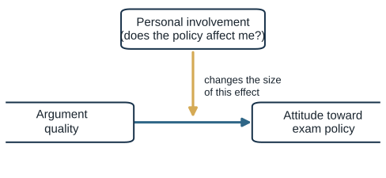{fig-alt="Argument quality causes attitude toward exam policy; personal involvement points to the arrow, changing the size of the effect" width="62%"}

- A moderator is **not** on the path from X to Y.
- Standard DAGs do not draw moderation. Here the arrow points **at the arrow**.
- In a regression: an **interaction**, X × Z.

::: notes
Show the convention. A mediator sits between X and Y. A moderator sits off the path and changes the strength of the arrow, which standard DAGs cannot draw, because a DAG says only whether an effect exists, not how big it is. The picture here, an arrow pointing at another arrow, is a teaching convention, not formal DAG notation.

In data, moderation appears as an interaction: the effect of X on Y differs across levels of Z, estimated with an X × Z term. The cleanest evidence comes when both X and Z are randomized, as in the next study.
:::

## Petty, Cacioppo & Goldman: the design {#petty-design}

**145** University of Missouri undergraduates heard a taped message: seniors should have to pass a **comprehensive exam** to graduate.

::: small-table
| Factor | Levels |
|---|---|
| **Personal involvement** | exams would start **next year** (affects you) vs. in **ten years** (doesn't) |
| **Argument quality** | 8 strong arguments (data, statistics) vs. 8 weak ones (quotations, opinion, anecdotes) |
| **Source expertise** | Carnegie Commission on Higher Education vs. a local **high-school class** |
:::

Outcome: agreement with the exam policy (standardized index). A **2 × 2 × 2** experiment, every factor randomized.

::: source
Source: Petty, Cacioppo, and Goldman (1981), *JPSP* 41(5), pp. 849–850.
:::

::: notes
Walk through the design. Students listened to a tape described as a candidate for a campus radio broadcast. The message argued that seniors should have to pass a comprehensive exam in their major before graduating, a position students strongly disliked.

Three factors were crossed. Involvement: students were told the policy might start at their own university next year, which would affect them, or not for ten years, which would not. Argument quality: eight strong arguments based on statistics and evidence, or eight weak arguments based on quotations, personal opinion, and anecdotes; both sets were pretested. Source expertise: the tape was attributed to a report by the Carnegie Commission on Higher Education, chaired by a Princeton professor, or to a report by a local high-school class.

The dependent variable combined semantic-differential ratings of comprehensive exams with an agreement item, standardized. Because all three factors were randomized, the study can estimate how the effect of argument quality and the effect of source expertise depend on involvement.
:::

## Results: involvement flips what persuades {#petty-results}

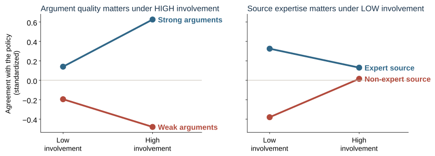{fig-alt="Two interaction plots: strong versus weak arguments diverge under high involvement; expert versus non-expert sources diverge under low involvement" width="92%"}

Involvement × argument quality: *F*(1, 137) = **6.05**, *p* < .02. Involvement × expertise: *F*(1, 137) = **3.92**, *p* < .05.

::: source
Source: Petty, Cacioppo, and Goldman (1981), Figure 1 and Table 1; points are Table 1 means averaged over the third factor.
:::

::: notes
Read the two panels. Left: when the policy affected students, strong arguments produced far more agreement than weak ones, and weak arguments backfired. When it did not affect them, the gap between strong and weak arguments was much smaller. Right: when the policy did not affect students, the expert source persuaded much more than the high-school class. When it did affect them, the source barely mattered.

Both two-way interactions are significant. Both main effects of argument quality and expertise are also significant, and there is no main effect of involvement and no three-way interaction. Involvement did not change how much students were persuaded on average; it changed what persuaded them.

The plotted points are the paper's Table 1 cell means averaged over the third factor. The original Figure 1 shows the same pattern without printed values.
:::

## Reading the interaction {#petty-reading}

::: two-column
::: column
### High involvement

People **think about the arguments**.

Argument quality matters; the source barely does.
:::

::: column
### Low involvement

People **use a shortcut**.

The source's credentials matter; argument quality matters less.
:::
:::

::: {.fragment .key-line}
No single “effect of argument quality.” Its size depends on involvement. That is moderation.
:::

::: notes
Interpret the pattern in the authors' terms, which became the Elaboration Likelihood Model. When an issue is personally relevant, people scrutinize the content, so argument quality drives attitudes. When it is not, people rely on cues such as source credentials.

Methodologically, the lesson is that asking for “the” effect of argument quality is the wrong question. The effect is large under high involvement and small under low involvement. Averaging over involvement would hide both.

Add the cautions from the summary. The paper's significance statements about simple effects rest on post-hoc tests with about 18 participants per cell; the expertise manipulation check moved ratings of the speaker's qualifications by only 1.1 points while argument quality moved them by 2.7; and one printed involvement-check statistic is impossible as printed, probably a misprint.
:::

## Mediator or moderator? {#med-vs-mod-table}

::: small-table
| | Mediator | Moderator |
|---|---|---|
| Question | **How** does X affect Y? | **When / for whom** does X affect Y? |
| Position | on the path X → M → Y | off the path; changes the X → Y arrow |
| Timing | after X | before X (or fixed) |
| Analysis | indirect and direct effects | X × Z interaction |
| Today's case | nationalism in the latte study | involvement in Petty et al. |
| Strongest design | manipulate M (Craig & Richeson) | randomize Z, or both X and Z |
:::

::: notes
Summarize the contrast. A mediator is caused by the treatment and carries part of its effect. A moderator is set before the treatment, or is a fixed trait, and changes the size of the effect. They call for different analyses: decomposing the effect versus estimating an interaction.

Quick check: ask students for one variable in their own project that could be a mediator and one that could be a moderator. For a coded-news project, a mediator might be audience emotion; a moderator might be the outlet's partisanship.
:::

## When you can't randomize {#natural-experiments .section-title}

[Part 4 of 5 · Natural experiments]{.kicker}

> Sometimes nature, a lottery, a rule, or bad luck assigns the treatment **for us**.

::: notes
Take the break here if you have not already.

Then frame Part 4. Craig, Correll, and Petty all randomized. Many of the treatments we care most about cannot be randomized: wealth, military service, prison, a grant, a terrorist attack. Natural experiments are situations in which something outside the researcher's control assigned the treatment in a way that is random or as good as random. Dunning's chapter and Grosz and colleagues' article give the vocabulary and the toolbox.
:::

## What makes it a natural experiment? {#ne-definition}

::: triad
::: triad-item
Treatment vs. comparison

Like any experiment, two or more groups are compared.
:::

::: triad-item
Random or as-if random

Assignment is unrelated to the outcome-relevant traits of the units.
:::

::: triad-item
Not controlled by the researcher

A lottery, a rule, nature, or history did the assigning.
:::
:::

::: {.fragment .key-line}
Dunning: natural experiments are “neither natural nor experiments.” The **as-if random** claim has to be argued, not assumed.
:::

::: source
Source: Dunning (2012), ch. 1.
:::

::: notes
Give Dunning's definition through the hallmarks of a true experiment. A natural experiment shares two of them: a comparison of treatment and control groups, and random or as-if random assignment. It lacks the third: the researcher does not control the manipulation.

His joke, that natural experiments are “neither natural nor experiments,” makes two points. The interventions are usually human, such as lotteries, laws, and borders, not natural. And they are not experiments, because no researcher assigned anything. Everything rests on the claim that assignment was as good as random, and that claim has to be supported with evidence about how assignment happened and whether groups look balanced.
:::

## Snow's map: two companies, one neighborhood {#snow-map}

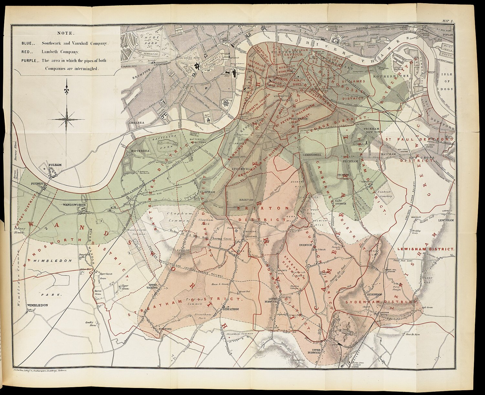{fig-alt="John Snow's 1855 map of south London water supply: areas served by the Southwark and Vauxhall Company, the Lambeth Company, and a large central area where both companies' pipes are intermingled" width="70%"}

Blue (faded to green): **Southwark & Vauxhall** · Red: **Lambeth** · Purple (center): **both companies' pipes intermingled**

::: source
Source: John Snow (1855), *On the Mode of Communication of Cholera*, 2nd ed., Map 2. Wellcome Collection, CC BY 4.0.
:::

::: notes
Show Snow's second map before the logic. It covers the districts south of the Thames. Snow's legend: blue for the Southwark and Vauxhall Company, red for the Lambeth Company, and purple for the area in which the pipes of both companies are intermingled. On this scan the blue has faded to green.

Point to the large purple area in the center, around Kennington, Walworth, and Southwark. There, the two companies' pipes ran down the same streets, and neighboring houses could get water from different companies. Ask: what does that mixing let Snow compare? Houses on the same street, with similar residents, similar air, and similar poverty, that differ mainly in which company pumped their water. That is the as-if random assignment, and the next slide draws it.
:::

## The first natural experiment: John Snow and cholera {#snow}

::: two-column
::: column
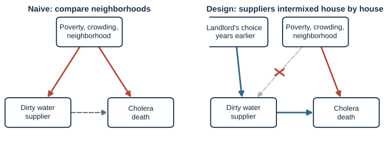{fig-alt="Naive DAG: poverty causes both dirty water supplier and cholera death. Design DAG: landlord's choice years earlier causes the water supplier; the arrow from poverty to supplier is cut"}
:::

::: column
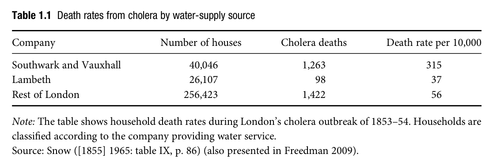{fig-alt="Dunning Table 1.1: cholera death rates by water supplier, London 1853-54"}

Deaths per 10,000 houses: **315** (Southwark & Vauxhall) vs. **37** (Lambeth).
:::
:::

::: source
Source: Dunning (2012), ch. 1, Table 1.1, pp. 12–15.
:::

::: notes
Tell Snow's story as the template. In 1853–54, two water companies supplied London households. Lambeth had moved its intake upstream of the city's sewage in 1852; Southwark and Vauxhall still drew water downstream. Comparing neighborhoods would be confounded, because poor, crowded neighborhoods might have both dirtier water and more cholera for other reasons, including the then-popular “bad air” theory.

Snow's insight was that the two companies' pipes were intermixed house by house, and landlords had chosen suppliers years earlier, before anyone knew about the risk. So neighboring houses with similar residents got different water for reasons unrelated to their residents. The design DAG cuts the arrow from poverty to water supplier.

The result: 315 deaths per 10,000 houses supplied by Southwark and Vauxhall, versus 37 for Lambeth and 56 for the rest of London.
:::

## The natural-experiment toolbox {#toolbox}

::: small-table
| Design | What creates the variation | Example |
|---|---|---|
| **Lottery** | an actual random draw, run by someone else | Swedish lottery prizes; Vietnam draft |
| **As-if random event** | nature, history, or administration | Snow's water companies; Argentine land titles |
| **Regression discontinuity** | a cutoff on a score | merit certificates; grant funding thresholds |
| **Instrumental variables** | a random push toward treatment | judge assignment; draft lottery → service |
| **Before / after an event** | timing of an unexpected shock | attacks during survey fieldwork; TV's arrival |
:::

::: notes
Lay out the toolbox before going through each design. The first two are what Dunning and Grosz call standard natural experiments: treatment is assigned by a real lottery or by an as-if random process. Regression discontinuity uses a rule that assigns treatment above a cutoff. Instrumental variables use something random that pushes people toward treatment without determining it. The last row, comparisons before and after an unexpected event, including difference-in-differences, is not in Grosz's article, but students saw it in Week 10 (the arrival of TV), and Balcells and Torrats-Espinosa use a version of it.

For each design, the next slides show the naive comparison, what the design solves, and what it has to assume.
:::

## 1. Lotteries {#lottery}

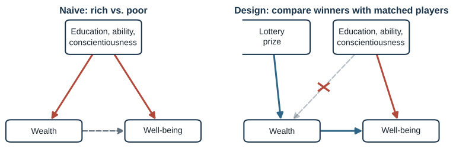{fig-alt="Naive DAG: education and ability cause wealth and well-being. Design DAG: lottery prize causes wealth; the arrow from ability to wealth is cut"}

Swedish lottery players: winners vs. players with the **same number of tickets**. Vietnam draft: eligible white men earned **$358 less** in 1984 (about 2%).

::: source
Sources: Grosz et al. (2024), Box 1 (Lindqvist et al. 2020); Dunning (2012), pp. 8–9 (Angrist 1990).
:::

::: notes
Lotteries are the cleanest natural experiments, because the assignment really is random. Grosz and colleagues' Box 1 uses Lindqvist and colleagues' Swedish lottery study. Wealth and well-being are confounded by education, ability, and conscientiousness. Among lottery players, though, prizes are random within groups of players who bought the same number of tickets, so comparing winners with matched non-winners cuts the arrow from those traits to wealth.

The Vietnam draft is Dunning's running lottery example. Draft eligibility was set by a lottery over birth dates. Among white men in the 1971 lottery, those made eligible earned $15,814 in 1984, versus $16,172 for those not eligible: about $358, or 2 percent, less.

The assumption to state: the lottery was actually random, and the comparison is made within the groups the lottery randomized over. Dunning notes that the 1970 draft lottery was poorly mixed, a reminder to check even real lotteries.
:::

## 2. As-if random events {#as-if-random}

Assignment happened through a process unrelated to people's traits.

- **Argentine land titles:** a 1984 law expropriated land for squatters; some owners **sued**, delaying titles for some plots. Titled families invested more in housing and children's schooling, with **no** gain in credit.
- **Sibling sex:** whether your sibling is a brother or a sister is set at conception (85,887 people, 9 countries).
- **Earthquakes, seating charts, school-entry dates.**

::: {.fragment .key-line}
The burden: show assignment was unrelated to anything that affects the outcome. Check **balance**.
:::

::: source
Sources: Dunning (2012), pp. 9–12 (Galiani and Schargrodsky); Grosz et al. (2024), p. 9 (Dudek et al. 2022).
:::

::: notes
As-if random designs have no actual lottery, so the argument for randomness is harder. In Galiani and Schargrodsky's Argentine study, squatters had occupied land in 1981. A 1984 law expropriated it and gave titles, but some original owners challenged the expropriation in court, which delayed titles for their plots. Whether an owner sued was unrelated to the squatters on the plot, and the titled and untitled groups were similar on measured characteristics. Titled families invested more in their houses, had smaller households, and educated their children more, but got no more credit, contradicting a famous argument that titles unlock loans. Dunning gives no numbers for these effects.

Grosz and colleagues' psychology examples include sibling sex, used by Dudek and colleagues to ask whether having a brother or a sister shapes personality in 85,887 people from 12 samples in 9 countries.

The key assumption: whatever assigned the treatment did not select on traits that affect the outcome. The standard check is balance on characteristics measured before treatment.
:::

## 3. Regression discontinuity {#rd}

::: two-column
::: column
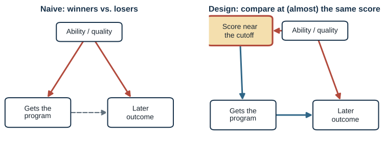{fig-alt="Naive DAG: ability causes both getting the program and the outcome. Design DAG: score near the cutoff is conditioned on; the score determines the program"}
:::

::: column
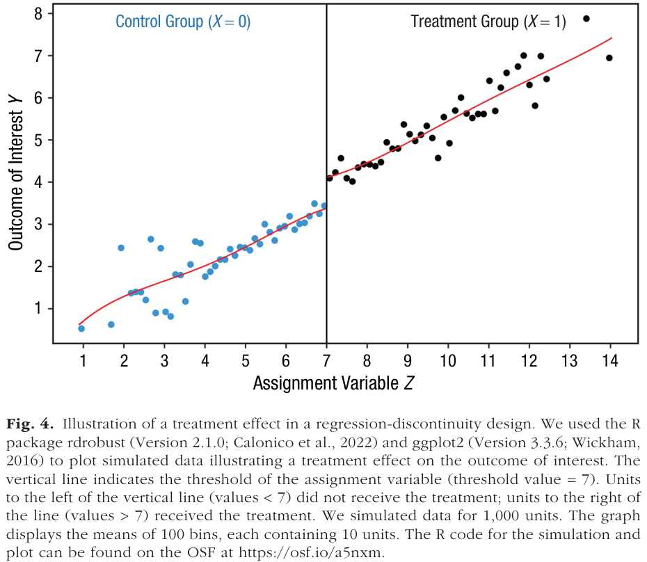{fig-alt="Grosz et al. Figure 4: simulated regression discontinuity plot with a jump at the cutoff"}
:::
:::

People just above and just below a cutoff are nearly identical, except one got the treatment.

::: source
Sources: Grosz et al. (2024), Figure 4 and Box 3 (Thistlethwaite and Campbell 1960).
:::

::: notes
Regression discontinuity uses a rule: treatment goes to everyone above a cutoff on some score. The naive comparison of everyone treated with everyone untreated is confounded, because the score reflects ability, which also affects outcomes. But people with scores just above the cutoff and just below it are nearly identical in ability; only the rule separates them. So the design compares outcomes right at the cutoff, effectively conditioning on the score.

Grosz and colleagues' Box 3 uses the original RD study, Thistlethwaite and Campbell (1960): students just above and just below the score needed for a National Merit Certificate of Merit. The simulated figure shows the logic: the outcome rises smoothly with the score, then jumps at the cutoff. The jump is the effect.

Two assumptions to name now; we will test them on Bol and colleagues. Potential outcomes change smoothly through the cutoff, and people cannot precisely manipulate which side they land on. And the estimate is local: it applies to people near the cutoff.
:::

## 4. Instrumental variables {#iv}

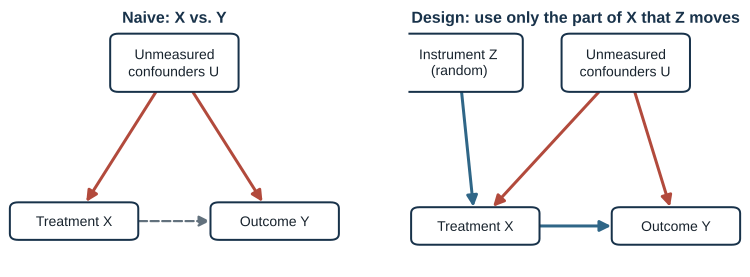{fig-alt="Naive DAG: unmeasured confounders cause treatment and outcome. Design DAG: a random instrument Z causes treatment X; U still causes X and Y, but the analysis uses only the variation in X that Z produces"}

Defendants randomly assigned to harsher vs. more lenient **judicial calendars**: incarcerated **65%** vs. **23%**. Compare their later outcomes, scaled by that difference.

::: source
Sources: Grosz et al. (2024), Figure 3 and Box 2 (Green and Winik 2010); Dunning (2012).
:::

::: notes
Instrumental variables are for treatments people partly choose. Something random pushes some people toward treatment, but does not fully determine it. Grosz and colleagues' Box 2 uses Green and Winik's study of drug defendants in Washington, D.C., who were randomly assigned to one of nine judicial calendars. Calendars differed in harshness: across the harshest and most lenient, 65 versus 23 percent were incarcerated, with average sentences of 11.9 versus 5.1 months. Comparing later recidivism across calendars, scaled by these differences in punishment, estimates the effect of incarceration for defendants whose sentence depended on the calendar.

The draft lottery works the same way for military service: the lottery changed who served, so it can estimate the effect of service, not only of eligibility.

Assumptions: the instrument is random (independence); it actually moves the treatment (relevance, checkable in the first stage); it affects the outcome only through the treatment (exclusion, not checkable, only argued); and it does not push anyone away from treatment (monotonicity). The estimate applies to compliers, people whose treatment the instrument changed.
:::

## 5. Before and after an event {#before-after}

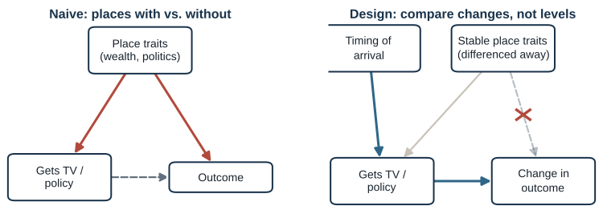{fig-alt="Naive DAG: place traits cause both getting a policy and the outcome. Design DAG: timing of arrival causes treatment; stable place traits are differenced away"}

Compare **changes**, not levels: TV's staggered arrival (Week 10), Fox News entering local cable systems, or respondents interviewed just **before vs. after** an unexpected attack.

::: notes
The last design uses timing. Comparing places that got a treatment with places that did not is confounded by stable differences between places. Comparing changes over time removes stable differences: if treated and untreated places were on parallel paths before, any divergence after the treatment can be attributed to it. Students saw this in Week 10 with the staggered arrival of TV (Gentzkow and Shapiro). DellaVigna and Kaplan's study of Fox News entering local cable systems uses the same logic.

A related design compares people surveyed just before and just after an unexpected event, within the same survey. That is Balcells and Torrats-Espinosa's design, coming up in Part 5.

Assumptions: without the event, outcomes would have followed parallel paths (or, for before/after within a survey, people interviewed later would have answered like people interviewed earlier), and nothing else changed at the same moment. This design is not in Grosz and colleagues' article; flag it as an addition.
:::

## What each design assumes, and how to check {#assumptions-table}

::: small-table
| Design | Key assumption | How to probe it |
|---|---|---|
| Lottery | assignment really random (within strata) | verify the mechanism; balance on pre-treatment traits |
| As-if random | assigner didn't select on outcome-relevant traits | balance tables; knowledge of how assignment happened |
| Regression discontinuity | no precise sorting around the cutoff; outcomes smooth through it | density test; balance **at** the cutoff; placebo cutoffs |
| Instrumental variables | instrument affects Y **only** through X; it moves X | first-stage strength (testable); exclusion (argue) |
| Before / after | no other change at the same time; similar paths before | pre-trends; placebo dates; who was reached when |
:::

::: {.fragment .key-line}
Every design trades one assumption (no confounding) for others. The question is which assumption is more believable.
:::

::: notes
Pull the assumptions together. No natural experiment is assumption-free. Each replaces the ordinary observational assumption, that we measured every confounder, with a different assumption that is often easier to defend and to probe.

Some assumptions are testable in part. Balance on pre-treatment characteristics, the first-stage effect of an instrument, the density of scores around a cutoff, and pre-trends can all be examined in data. Others, such as the exclusion restriction in IV or the absence of any other change exactly at the cutoff, can only be argued from knowledge of the setting.

This table is the checklist for the two cases in Part 5.
:::

## Not every “natural experiment” is one {#not-ne}

::: two-column
::: column
### Connecticut speeding crackdown, 1955

Deaths fell after a crackdown, but the crackdown followed a record **bad** year. Regression to the mean, not as-if random.
:::

::: column
### UN peacekeeping

Missions compared with matched cases on **measured** variables. Matching is not as-if random: unmeasured differences remain.
:::
:::

::: {.fragment .key-line}
Ask: who or what decided treatment, and could it have responded to the outcome?
:::

::: source
Source: Dunning (2012), pp. 19–21; Campbell and Ross (1968).
:::

::: notes
Use Dunning's contrast cases to sharpen the definition. In Campbell and Ross's classic analysis, Connecticut's governor began a crackdown on speeding in late 1955 after a year of unusually high traffic deaths, and deaths fell afterward. But the crackdown was a response to the bad year, so some decline was expected regardless: regression to the mean. Treatment timing depended on the outcome. Dunning describes this as a law; Campbell and Ross describe it as an enforcement crackdown.

Gilligan and Sergenti's study of UN peacekeeping matched countries with and without missions on measured characteristics. That is useful, but it is matching, not a natural experiment: nothing about how missions were assigned guarantees balance on unmeasured traits.

The diagnostic question for any proposed natural experiment: who or what decided who was treated, and could that decision have been influenced by the outcome or its causes?
:::

## Judging a natural experiment {#dunning-cube}

::: two-column
::: column
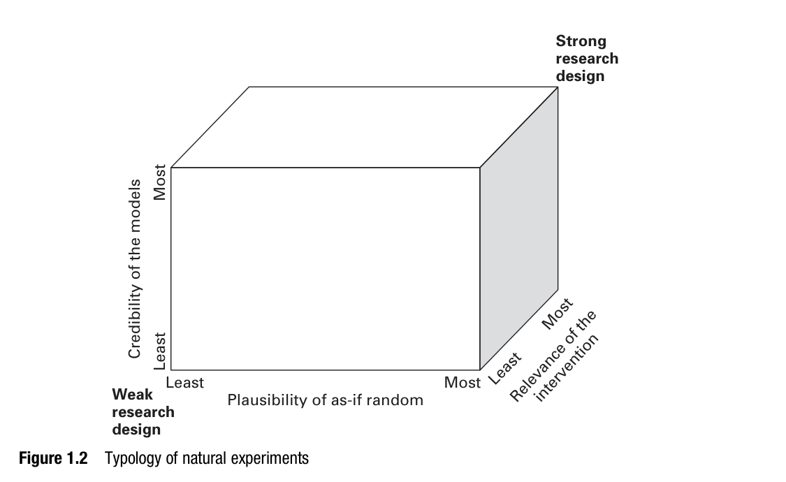{fig-alt="Dunning Figure 1.2: a cube with three dimensions: plausibility of as-if random, credibility of models, substantive relevance"}
:::

::: column
1. **Plausibility of as-if random:** how convincing is the assignment story?
2. **Credibility of the models:** does the analysis rest on simple comparisons or heavy modeling?
3. **Substantive relevance:** does the answer speak to the question we care about?
:::
:::

::: {.fragment .key-line}
Lotteries score high on (1) but often low on (3): lottery winnings are not earned income.
:::

::: source
Source: Dunning (2012), Figure 1.2, p. 31.
:::

::: notes
Present Dunning's three evaluative dimensions. A strong natural experiment has a convincing as-if random story, an analysis close to a simple comparison of means rather than an elaborate model, and an answer that bears on the substantive question.

These can trade off. Dunning's lottery example: lottery winnings are as random as it gets, but players are not representative of voters, and a windfall is not the same thing as earned income, so the result may not answer a question about how income shapes political attitudes. Regression discontinuity answers a question about people near the cutoff, which may or may not be the population of interest.

Students will use these three dimensions to judge Bol and colleagues and Balcells and Torrats-Espinosa.
:::

## Psychology rarely uses them {#grosz-table}

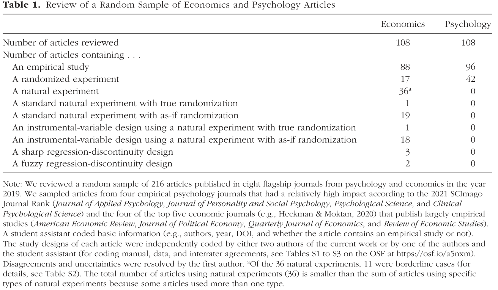{fig-alt="Grosz et al. Table 1: review of 108 psychology and 108 economics articles; 0 psychology vs. 36 economics articles used natural experiments" width="72%"}

::: {.fragment .key-line}
**0 of 108** psychology articles vs. **36 of 108** economics articles used a natural experiment.
:::

::: source
Source: Grosz et al. (2024), Table 1, p. 6.
:::

::: notes
Close Part 4 with Grosz and colleagues' motivation. They reviewed 108 recent articles in leading psychology journals and 108 in leading economics journals. None of the psychology articles used a natural experiment; 36 of the economics articles did. Their argument is that psychology relies on lab experiments and on observational studies with statistical controls, and misses many settings in which nature or policy has already randomized something psychologically important.

Ask communication students where communication falls. Communication research uses some natural experiments, such as TV's arrival, broadband rollout, and newspaper closures, but far fewer than economics.
:::

## Two natural experiments up close {#cases .section-title}

[Part 5 of 5 · Two cases]{.kicker}

> A funding cutoff and a badly timed attack. What did each design solve, and what did it assume?

::: notes
Transition to the two cases. Bol and colleagues use a regression discontinuity around a grant-funding threshold. Balcells and Torrats-Espinosa compare survey respondents interviewed just before and just after terrorist attacks. For each, ask the same four questions: what is the naive comparison, what does the design solve, what does it assume, and how well does it check those assumptions?
:::

## Bol et al.: does winning a grant make you win more grants? {#bol-question}

The **Matthew effect**: “to everyone who has, more will be given.” Do early winners pull ahead because of **merit** or because of the **win itself**?

Since 2000, the Dutch Veni/Vidi/Vici program concentrated **€2.4 billion** in **3,660** applicants.

::: {.fragment}
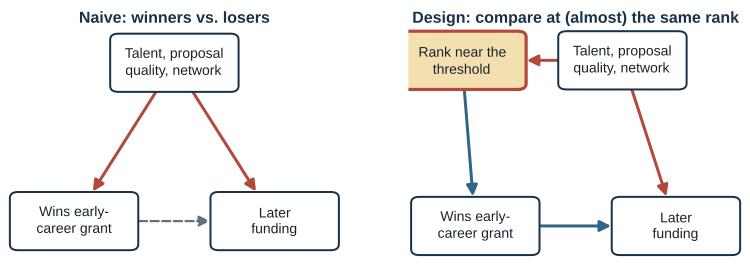{fig-alt="Naive DAG: talent and proposal quality cause both winning an early-career grant and later funding. Design DAG: rank near the threshold is conditioned on and determines winning"}
:::

::: source
Source: Bol, de Vaan, and van de Rijt (2018), *PNAS* 115(19): 4887–4890.
:::

::: notes
Introduce the theory. Robert Merton named the Matthew effect: recognition flows to those already recognized. In science funding, early winners go on to win more. The question is whether that happens because winners are better scientists or because winning itself, through status, money, or confidence, produces later success.

The naive comparison of grant winners and losers cannot separate these, because talent, proposal quality, and networks affect both the early grant and later funding. Bol and colleagues use the Netherlands' main personal-grant program. The early-career Veni grant is worth about 250,000 euros; later Vidi and Vici grants are larger. Since 2000 the program has concentrated about 2.4 billion euros in 3,660 applicants.

The design: reviewers score and rank applicants, and a budget sets the funding threshold. Applicants just above and just below the threshold had nearly identical evaluations, but only those above got the grant. Show the design DAG: conditioning on rank near the threshold cuts the confounding.
:::

## Near-winners and near-losers looked the same before {#bol-balance}

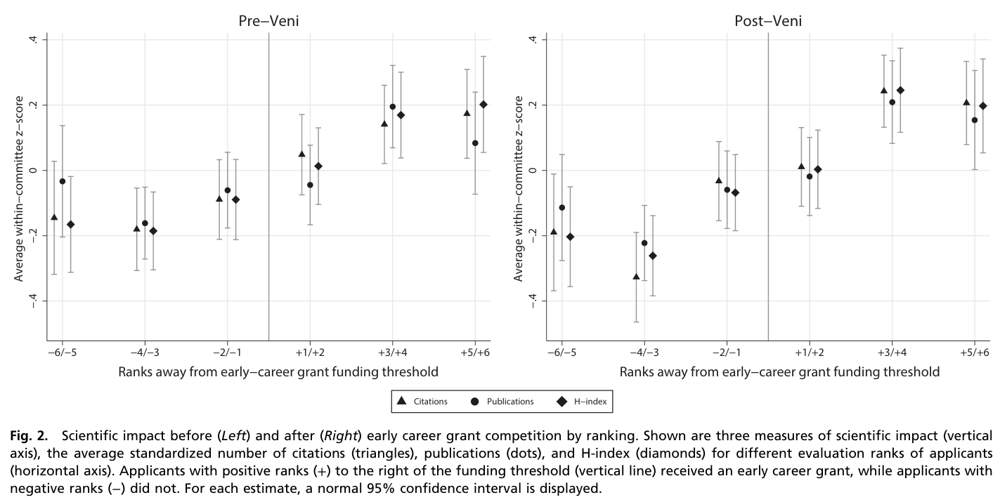{fig-alt="Bol et al. Figure 2: publications, citations, and h-index by rank around the funding threshold, before and after the competition; no jump at the threshold" width="88%"}

::: {.fragment .key-line}
No jump at the threshold in publications, citations, or h-index, **before or after** the grant.
:::

::: source
Source: Bol et al. (2018), Figure 2.
:::

::: notes
Show the balance check first. Bol and colleagues plot scientific productivity, publications, citations, and h-index, by rank relative to the threshold. Before the competition, there is no jump at the threshold: near-winners and near-losers were equally productive scientists. That supports the RD assumption that the threshold separates otherwise similar people.

The same figure shows no jump after the competition either. That matters for the mechanism: if winners went on to get more grants, it was not because they suddenly produced more or better science.
:::

## ...but their careers diverged {#bol-results}

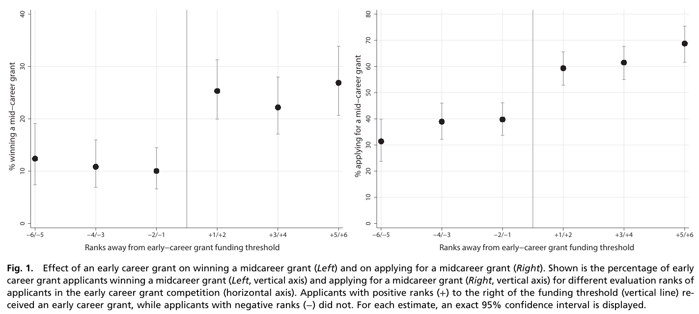{fig-alt="Bol et al. Figure 1: percent winning a mid-career grant (about 10 percent just below versus 26 percent just above) and percent applying (40 versus 59 percent) by rank around the threshold" width="92%"}

Won a mid-career grant: **10%** (near-losers) vs. **26%** (near-winners). Applied for one: **40%** vs. **59%**.

::: source
Source: Bol et al. (2018), Figure 1, pp. 4888–4889.
:::

::: notes
Read Figure 1. The horizontal axis is rank relative to the funding threshold; the vertical line is the threshold. Left panel: about 10 percent of applicants just below the threshold later won a mid-career Vidi grant, versus 26 percent just above it, about two and a half times as many. Right panel: 40 percent of near-losers applied for a Vidi, versus 59 percent of near-winners.

Point out what makes this an RD plot: the outcome is roughly flat on each side and jumps at the threshold. The jump, not the overall upward slope, is the causal effect of winning the early grant for applicants near the threshold.
:::

## The gap kept growing {#bol-cumulative}

::: two-column
::: column
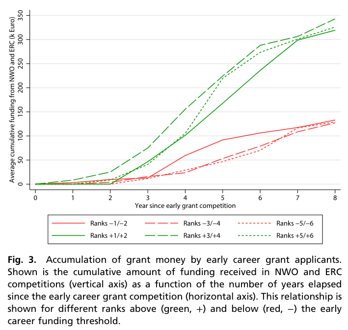{fig-alt="Bol et al. Figure 3: cumulative additional funding for near-winners versus near-losers over eight years"}
:::

::: column
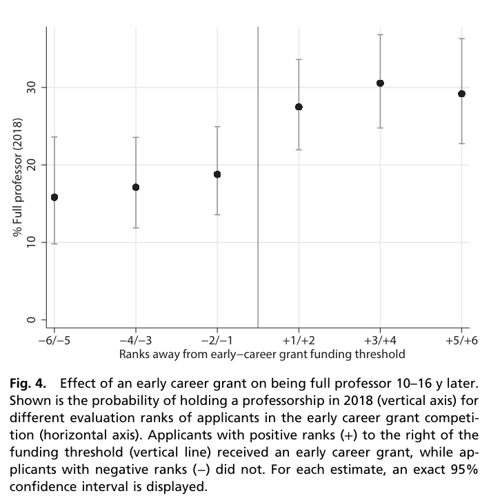{fig-alt="Bol et al. Figure 4: share who became full professors, 19 percent versus 28 percent"}
:::
:::

Extra funding: about **€40,000** after 4 years, about **€180,000** after 8 (beyond the Veni itself). Full professor by 2018: **19%** vs. **28%**.

::: source
Source: Bol et al. (2018), Figures 3 and 4, p. 4889.
:::

::: notes
Show the accumulation. Beyond the Veni grant itself, near-winners received about 40,000 euros more in later funding after four years and about 180,000 euros more after eight years, more than twice as much as near-losers. The authors note that this 180,000 euros is about 40 percent of the funding difference between the best and worst applicants in the competition.

Careers diverged too: 28 percent of near-winners were full professors by 2018, 10 to 16 years after the competition, versus 19 percent of near-losers.

The interpretation: a nearly arbitrary early difference, a rank or two around a budget line, produced lasting inequality in funding and status.
:::

## Why? Participation and status {#bol-mechanism}

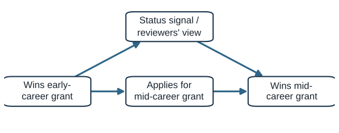{fig-alt="Winning an early-career grant leads to applying for a mid-career grant and to a status signal, both of which lead to winning a mid-career grant" width="62%"}

- Near-losers **applied less** (40% vs. 59%).
- Among those who applied, near-winners still won more (about **44%** vs. **25%**).

::: {.fragment .key-line}
Discouragement explains part of the gap. A status signal may explain the rest.
:::

::: source
Source: Bol et al. (2018); win rates among applicants calculated from Figure 1 (reading summary).
:::

::: notes
Turn to mechanisms. The abstract emphasizes participation: losing discouraged applicants from trying again. Figure 1's right panel shows the participation gap, 40 versus 59 percent.

But participation is not the whole story. Dividing the win rates by the application rates, among people who applied for a Vidi, near-winners won about 44 percent of the time and near-losers about 25 percent. That calculation comes from the reading summary, not the paper. So even among those who tried again, the early win helped, consistent with reviewers treating a past grant as a status signal.

Note the connection to Part 2: these are mediators of the effect of winning, and they are measured, not manipulated. The RD identifies the total effect of the early grant cleanly; the decomposition into participation and status is weaker evidence.
:::

## What the funding RD assumes {#bol-assumptions}

::: small-table
| Assumption | Why it might fail | Evidence |
|---|---|---|
| Similar just above and below | committees might push favored applicants over the line | no jump in prior publications, citations, h-index |
| No sorting around the threshold | applicants can't choose their rank; committee can decide borderline cases | addressed indirectly; no density test reported |
| Losers didn't leave science | near-losers might exit, lowering their later funding mechanically | checked in the supplement (not in our PDF) |
| Local estimand | applies to applicants **near** the threshold | effect for the best or worst applicants unknown |
:::

::: notes
Run the assumptions checklist on Bol and colleagues. The balance figure supports the claim that near-winners and near-losers were similar. The main manipulation worry is not applicants sorting themselves, since they cannot choose their rank, but committees deciding borderline cases in ways related to future success. The paper addresses this only indirectly. A standard density test would say little here, because every rank is filled by construction.

The authors report checks that near-losers did not leave academia or the country, but those are in the supplementary information, which is not in the course PDF. And the estimate is local: it tells us what an early grant does for applicants near the threshold, not for the strongest or weakest applicants.

On Dunning's dimensions: high plausibility of as-if random near the threshold, simple and transparent analysis, and strong substantive relevance for science policy.
:::

## Balcells & Torrats-Espinosa: do terrorist attacks change elections? {#balcells-question}

Two questions: do attacks change whether people **vote**, and **whom** they vote for?

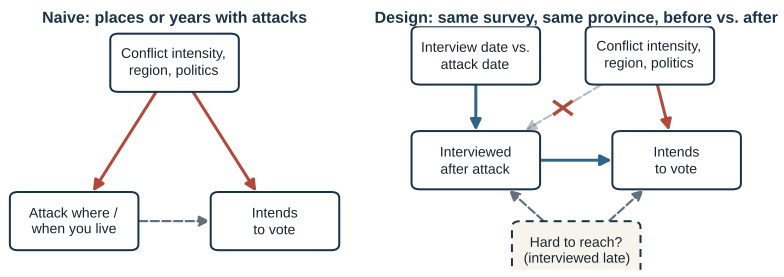{fig-alt="Naive DAG: conflict intensity causes both attacks and voting. Design DAG: interview date relative to attack date determines treatment within the same survey and province; the conflict arrow is cut; hard-to-reach respondents remain a threat" width="92%"}

::: source
Source: Balcells and Torrats-Espinosa (2018), *PNAS* 115(42): 10624–10629.
:::

::: notes
Introduce the question. Do terrorist attacks change democratic participation, and do they punish or reward the incumbent? Naive comparisons, across places or years with and without attacks, are confounded: attacks happen where and when conflict is intense and politics are polarized, which also affects voting.

The design uses timing. Spain's public-opinion institute, the CIS, surveys people over several days. The authors found eight attacks by ETA, the Basque separatist group, between 1989 and 1997 that happened while a CIS survey was in the field. Within the same survey and the same province, people interviewed just after an attack form the treatment group, and people interviewed just before form the control group. That cuts the confounding from conflict intensity and region, since those are the same for both groups.

The design DAG shows the remaining threat: if people interviewed later in the fieldwork period are different, for example harder to reach, then interview timing is not as-if random.
:::

## The design: eight attacks during survey fieldwork {#balcells-design}

- **8** ETA attacks (1989–1997) during **7** CIS surveys
- Compare respondents **within the same survey and province**, interviewed before vs. after
- Windows of **±1, ±3, ±5 days**; respondents interviewed on the attack day dropped
- Outcomes: would you vote “tomorrow”? would you vote for the **incumbent**?

::: {.fragment .key-line}
N = 3,810 (±1 day), 9,135 (±3), 11,848 (±5).
:::

::: source
Source: Balcells and Torrats-Espinosa (2018), pp. 10625, 10628; SI Table S1.
:::

::: notes
Walk through the details. The authors matched CIS fieldwork calendars against ETA attacks and kept the overlaps: eight attacks across seven surveys, five of them nationally representative. Treatment is being interviewed after the attack. Because interview times are not recorded, respondents interviewed on the day of the attack are dropped. The comparison uses windows of one, three, and five days on either side.

The model is a linear probability model with province-by-survey fixed effects, so every comparison is within the same survey and province, with controls for prior vote, gender, age, education, employment, and town size. Standard errors are clustered by the survey's sampling unit.

Outcomes: whether the respondent would vote if a general election were held tomorrow, and whether they would vote for the incumbent party.
:::

## People said they would vote, but not for anyone in particular {#balcells-results}

::: two-column
::: column
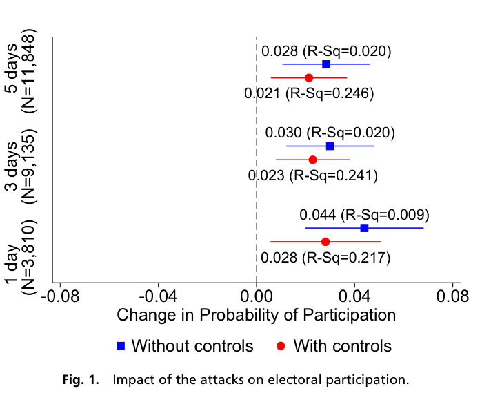{fig-alt="Balcells and Torrats-Espinosa Figure 1: effect of attacks on turnout intention at 1, 3, and 5 days, with and without controls"}

Turnout intention: **+2.8 pts** (±1 day, controls); +4.4 without.
:::

::: column
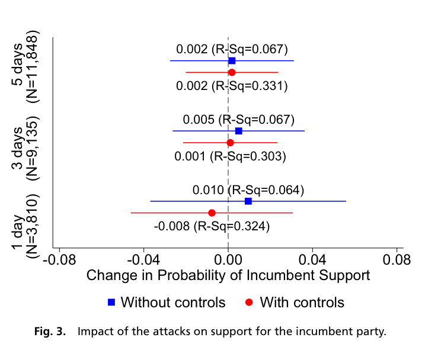{fig-alt="Balcells and Torrats-Espinosa Figure 3: no effect of attacks on incumbent support"}

Incumbent support: between **−0.8 and +1.0 pts**, never significant.
:::
:::

::: source
Source: Balcells and Torrats-Espinosa (2018), Figures 1 and 3.
:::

::: notes
Present the main results. People interviewed after an attack were more likely to say they would vote: 2.8 percentage points within one day with controls, 4.4 without, and about 2 points at three and five days. All six estimates are positive and significant. Before attacks, about 89 percent already said they would vote, so 2.8 points cuts would-be abstention from about 11 to about 8 percent.

There is no change in whom people would vote for: estimates of incumbent support range from minus 0.8 to plus 1.0 points across all six specifications, and vote switching does not change either. The authors interpret this as a rally in democratic participation, not a punishment or reward for the government.
:::

## Who was activated? {#balcells-heterogeneity}

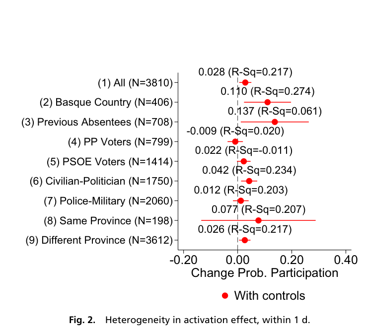{fig-alt="Balcells and Torrats-Espinosa Figure 2: heterogeneity in the turnout effect by subgroup within 1 day" width="70%"}

Prior abstainers **+13.7** (N = 708) · Basque residents **+11** (N = 406) · civilian or politician victims **+4.2** vs. police or military **+1.2**

::: source
Source: Balcells and Torrats-Espinosa (2018), Figure 2; SI Table S6.
:::

::: notes
Show the heterogeneity, and connect it to Part 3: these subgroup differences are moderation. The effect is largest among people who did not vote in the previous election, 13.7 points, and among residents of the Basque Country, 11 points. Attacks on civilians or politicians raised turnout intention by 4.2 points, attacks on police or military by 1.2, though that difference is significant only at p < .10.

Add the caveats from the summary. The Basque estimate comes mostly from one attack in a regional survey with only 41 post-attack respondents in the one-day window. Among people who voted last time, about 80 percent of the sample, the effect is close to zero: the whole effect is among prior abstainers. And the subgroups are not randomized, so these are differences in effects across kinds of people, not effects of being Basque.
:::

## What the timing design assumes {#balcells-assumptions}

::: small-table
| Assumption | Why it might fail | Evidence |
|---|---|---|
| Interview timing as-if random | harder-to-reach people interviewed later | balance table: joint test *p* = .18, but post-attack respondents **2 pts** less likely to be prior abstainers |
| No differential nonresponse | attacks change who agrees to answer | contact attempts and refusals similar (reported in prose only) |
| Controls are pre-treatment | “prior vote” is **recalled after** the attack | the 4.4 → 2.8 drop comes from this control |
| Nothing else changed that day | other news, other events | coverage tables; leave-one-attack-out estimates stay positive |
:::

::: {.fragment .key-line}
Robust to unobservables? Selection on unobservables would need to be **1.5–5.9×** as strong as on observables (Oster test).
:::

::: notes
Run the checklist. The central assumption is that whether someone was interviewed before or after the attack is unrelated to their likelihood of voting. The balance table mostly supports that, joint p = .18, but post-attack respondents were 2 points less likely to report having abstained in the last election, and in the one-day window the gap is larger. Fewer abstainers reached after attacks would inflate the raw estimate.

There is a subtle bad-control problem. The authors control for recalled prior vote, which is reported after the attack. If the attack changed how people remember or report past voting, controlling for it removes part of the true effect. The drop from 4.4 to 2.8 points comes entirely from this one control, so the true effect plausibly lies between them.

Other checks: contact attempts and refusals were similar before and after (described in prose only); leave-one-attack-out estimates all stay positive; and the Oster sensitivity test says unobservable selection would have to be 1.5 to 5.9 times as strong as observable selection to erase the effect. The paper runs no placebo-date test; the reading summary reports a quick placebo with no sign of a rising pre-trend.
:::

## Two designs compared {#cases-compared}

::: small-table
| | Bol et al. | Balcells & Torrats-Espinosa |
|---|---|---|
| Design | regression discontinuity | before vs. after an unexpected event |
| What assigns treatment | a rank relative to a budget line | the attack date relative to the interview date |
| Naive confounder cut | talent, proposal quality | conflict intensity, region, politics |
| Key assumption | applicants near the line are comparable | interview timing unrelated to voting |
| Main threat | committees deciding borderline cases | who is reachable after an attack |
| Estimand | effect for applicants near the threshold | short-run effect on stated intention |
:::

::: notes
Put the two cases side by side using the vocabulary of the day. Both cut an obvious confounder by exploiting how treatment happened to be assigned. Both rest on an assumption that can be partly checked, balance at the threshold or before and after the attack, and partly only argued. Both estimate something narrower than the broad question: the effect of an early grant for applicants near the threshold, and the effect of an attack on stated vote intention within days.

Ask students to score each on Dunning's three dimensions. Bol and colleagues likely score high on all three. Balcells and Torrats-Espinosa score high on plausibility within surveys, but stated intention a few days later is a long way from actual turnout at the next election, which matters for substantive relevance.
:::

## Exit question {#exit-question .section-title}

> Pick a question from your project that you could never randomize.
>
> What **lottery, cutoff, timing, or accident** could stand in for random assignment, and what would you have to assume?

::: notes
Collect exit responses. Good answers name a specific source of variation, such as a policy cutoff, the timing of a platform change or outage, a newspaper closure, or a random assignment of journalists to beats, and state the key assumption that would have to hold. Read several at the start of next week.
:::
